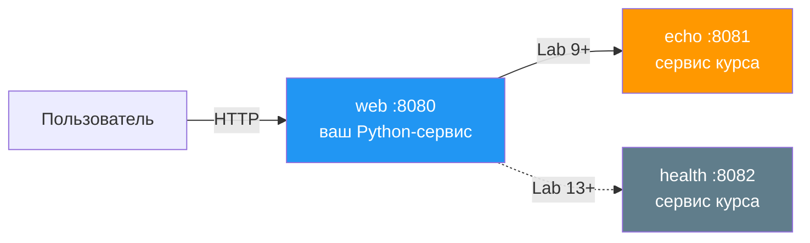
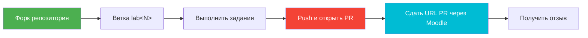

# DevOps Engineering: основные практики


Освойте **production-grade DevOps** руками. Вы берёте один веб-сервис и неделя за неделей упаковываете его в контейнер, подключаете CI/CD, описываете инфраструктуру кодом, делаете наблюдаемым, запускаете в Kubernetes и доводите до GitOps и progressive delivery. На выходе — система из нескольких сервисов, которая сама восстанавливается и полностью наблюдаема, и портфолио, по которому видно: вы умеете эксплуатировать софт в проде.

> *«You build it, you run it»* («собрал — сам и эксплуатируй») — Werner Vogels

---

## Как проходить курс самостоятельно

Репозиторий собран как университетский курс. Квизы, таблицы лидеров, баллы и сдача через Moodle нужны студентам потока. Дома это можно не использовать.

- **Как проверять себя.** Ориентир — критерии приёмки в конце каждой лабораторной, а не оценка в Moodle. Считайте lab закрытым, когда основные задания сделаны и критерии приёмки выполняются у вас локально. Рубрика с баллами полезна как карта сложности: что обязательно, что бонус. Выставлять эти баллы некому.
- **Лекции и квизы.** Лекции 1–16 идут парами с Lab 1–16. Квиз после лекции и таблица лидеров — для университетского потока. Дома достаточно прочитать лекцию и сразу делать лабораторную.
- **Что нужно на своей машине.** Почти весь курс локальный: Docker Engine (в стеке указан 29.x) и, с Lab 9, локальный кластер **k3d** (k3s внутри Docker). Отдельный облачный Kubernetes не нужен. Ещё понадобятся Python 3.13, Git и аккаунт GitHub: форк, GitHub Actions и GHCR.
- **Где нужен облачный аккаунт.** Lab 4 (Terraform и Pulumi) и продолжение в Lab 5–6 рассчитаны на одну небольшую виртуалку. Логику заданий менять не нужно: в Lab 4 уже перечислены AWS, GCP, DigitalOcean и локальная замена — провайдер `kreuzwerker/docker`, тот же цикл `init → plan → apply → destroy` на контейнере. Если хотите настоящее облако и иностранный аккаунт неудобен, берите **Yandex Cloud** — в Lab 4 он уже есть как вариант (`yandex-cloud/yandex`). Это замена провайдера, а не другой lab.
- **Lab 17 (Cloudflare Workers)** — бонусный. Живой deploy просит аккаунт Cloudflare; в части российских сетей Cloudflare режется, и в самой лабораторной уже есть локальный путь `wrangler dev --local`. Yandex Cloud сюда не подставляйте: модель Workers другая, и задание из-за этого не переписывается.
- Остальные лабораторные — контейнеры, CI, логи, метрики, Kubernetes, Helm, секреты, GitOps, Rollouts, StatefulSet, мониторинг кластера, Nix — делаются на своей машине.

---

## Дорожная карта

Дуга курса: **сборка → интеграция → инфраструктура → наблюдаемость → оркестрация → поставка → эксплуатация в масштабе**. Каждый lab опирается на предыдущий: сервис вырастает от одного контейнера до кластера из трёх сервисов.

| Неделя | Lab | Модуль | Ключевые темы и инструменты (май 2026) |
|:---:|:---:|--------|---------------------------------|
| 1 | 1 | Разработка веб-приложения | Python 3.13, Flask/FastAPI, health-эндпоинты |
| 2 | 2 | Контейнеризация | Docker 29, multi-stage, distroless, сканирование Trivy, GHCR |
| 3 | 3 | Непрерывная интеграция | GitHub Actions, пирамида тестирования, безопасность цепочки поставок |
| 4 | 4 | Инфраструктура как код | Terraform 1.15 **+ Pulumi 3.243**, state, OpenTofu |
| 5 | 5 | Управление конфигурацией | ansible-core 2.21, роли, идемпотентность, Vault |
| 6 | 6 | Непрерывный deployment | Продвинутый Ansible, Compose v2, CI/CD с OIDC |
| 7 | 7 | Логирование | Loki 3.7, **Grafana Alloy 1.16** (Promtail снят с поддержки), LogQL |
| 8 | 8 | Мониторинг | Prometheus 3.x, PromQL, RED/USE, Grafana 13 |
| 9 | 9 | Kubernetes | K8s 1.36 «Haru», Deployment, Service — **подключается 2-й сервис** |
| 10 | 10 | Helm | **Helm 4.1**, чарты, шаблоны, hooks, OCI-реестры |
| 11 | 11 | Управление секретами | Kubernetes Secrets, **OpenBao 2.5**, External Secrets Operator |
| 12 | 12 | Конфигурация и хранение | ConfigMap, PV/PVC, StorageClass, hot-reload |
| 13 | 13 | GitOps | **ArgoCD 3.4**, ApplicationSet — **подключается 3-й сервис** |
| 14 | 14 | Progressive delivery | Argo Rollouts 1.8, canary, blue-green, AnalysisTemplate |
| 15 | 15 | StatefulSet | Headless Service, volumeClaimTemplates, операторы |
| 16 | 16 | Мониторинг кластера | kube-prometheus, ServiceMonitor, init-контейнеры |
| — | **Бонусные лабораторные** | | |
| — | 17 | Выкладка на edge | Cloudflare Workers, изоляты V8, глобальный edge |
| — | 18 | Воспроизводимые сборки | Nix flakes, детерминированные сборки |

> 📅 **16 недель.** Если семестр короче, лекции ставят парами (две в неделю), а лабораторные по-прежнему идут по одной в неделю. Лекции 1–16 соответствуют Lab 1–16 один к одному; бонусные Lab 17–18 закрывает Lecture 16.

---

## Проект: сервис, который вырастает в систему

Вы начинаете с **одного** Python-сервиса (Lab 1) и не выбрасываете его: каждый lab добавляет к *тому же* проекту очередную продакшен-возможность. Два служебных сервиса курса подключаются позже, чтобы оркестрация была не на словах.



| Сервис | Роль | Кто делает | Когда появляется |
|---------|------|-------|-----------------|
| **web** | Ваш Python веб-сервис — стержень проекта | **Собираете вы** | Lab 1 |
| **echo** | Go-компаньон: без него `Service` и kube-DNS нечему связывать | Служебный код курса (`plumbing/echo/`) | Lab 9 |
| **health** | Go-компаньон: третья цель для ArgoCD ApplicationSet | Служебный код курса (`plumbing/health/`) | Lab 13 |

Сами эти сервисы вы не пишете — вы их выкатываете и связываете. Они отдают метрики Prometheus, поэтому стек наблюдаемости из Lab 7–8–16 подхватывает их сам.

---

## Что лежит в репозитории и что делаете вы

| В этом репозитории (даёт курс) | В вашем форке (делаете вы) |
|--------------------------------|----------------------------|
| `lectures/` — 16 лекций | `app_python/` — ваш сервис |
| `labs/` — 18 лабораторных | `k8s/` — ваши манифесты (с Lab 9) |
| `plumbing/` — сервисы echo и health | `ansible/`, `terraform/` — ваш IaC (Lab 4–6) |
| `README.md` — этот файл | `.github/workflows/` — ваш CI (с Lab 3) |
| | `monitoring/` — ваша конфигурация Prometheus/Loki (Lab 7–8) |

Каталоги, которые собирает студент, в этом репозитории в `.gitignore`, чтобы upstream оставался чистым. В *свой* форк вы их коммитите.

---

## Как устроена лабораторная

Каждый основной lab (1–16) даёт **10 баллов за основные задания и до 2 бонусных**:

- **Основные задания** в сумме **10 баллов**. Разбивка зависит от lab (например 6+4 или 2+3+3+2). Задание 1 всегда самостоятельное: следующие лабораторные не опираются на то, что вы пропустили.
- **Бонус** в сумме **2 балла**, без нарастания. Это настоящие усложнения, а не возня ради баллов.
- **Бонусные Lab 17 и 18** устроены так же, 10 + 2, и заменяют экзамен.

В конце каждой лабораторной — критерии приёмки и таблица критериев оценивания. Порог зачёта по lab: 6/10.

---

## Оценивание

Пять составляющих. Сырые доли в сумме дают **139%** и обрезаются на **100%**: к оценке A ведёт несколько дорог, и ни одна составляющая не обязательна.

| Составляющая | Сырые баллы | Вес | За что |
|-----------|----:|-------:|---------|
| **Основные Lab 1–16** (основные задания) | 160 | **70%** | Регулярная работа над проектом — это пол |
| **Бонусные задания** (2 балла × 16 lab, без нарастания) | 32 | **14%** | Выход за рамки темы недели |
| **Таблицы лидеров квизов** (5 скользящих окон, топ-10 делит пул) | — | **5%** | Вовлечённость и владение лекцией |
| **Бонусные Lab 17 + 18** (по 10 баллов) | 20 | **20%** | Edge и воспроизводимые сборки; замена экзамена |
| **Итоговый экзамен** | — | **30%** | По желанию — письменный, по всему курсу |
| **Сумма (потолок 100%)** | | **139%** | |

### Как набрать A (≥90%)

- **Практический путь:** все основные lab (70%) + бонусы (14%) + оба бонусных lab (20%) → 104% → A с обрезкой, без экзамена.
- **Путь через экзамен:** все основные lab (70%) + бонусы (14%) + уверенный экзамен (30%) → A, без бонусных lab.
- **Смешанный:** основные lab + часть бонусов + один бонусный lab + приличный экзамен.

<details>
<summary>📊 Шкала оценок</summary>

| Оценка | Процент |
|-------|-----------|
| **A** | 90–100% |
| **B** | 75–89% |
| **C** | 60–74% |
| **D** | ниже 60% |

</details>

---

## Таблицы лидеров квизов

После каждой лекции — квиз из 15 вопросов. Квизы кормят **5 скользящих окон** таблицы лидеров за семестр:

| Окно | Лекции | Недели |
|:---:|----------|:---:|
| 1 | lec 1–3 | 1–3 |
| 2 | lec 4–6 | 4–6 |
| 3 | lec 7–9 | 7–9 |
| 4 | lec 10–12 | 10–12 |
| 5 | lec 13–16 | 13–16 |

Топ-10 в каждом окне делит небольшой пул баллов этого окна (около 1% на окно, ~5% всего). Кто подключился позже, всё ещё может забрать следующие окна.

---

## Стек технологий (зафиксирован в мае 2026)

| Слой | Инструмент | Версия |
|-------|------|---------|
| Рантайм | Python | 3.13 |
| Контейнеры | Docker Engine | 29.5 |
| Реестр | GHCR | — |
| Сканирование | Trivy | v0.69.3+ (безопасен после CVE-2026-33634) |
| CI/CD | GitHub Actions | раннеры ubuntu-24.04 |
| IaC | Terraform / OpenTofu / Pulumi | 1.15 / 1.12 / 3.243 |
| Управление конфигурацией | ansible-core | 2.21 |
| Логи | Loki + Grafana Alloy | 3.7 / 1.16 |
| Метрики | Prometheus + Grafana | 3.x / 13 |
| Оркестрация | Kubernetes | 1.36 «Haru» |
| Локальный кластер | k3d (k3s в Docker) | 5.7 |
| Упаковка | Helm | 4.1 |
| Секреты | OpenBao | 2.5 |
| GitOps | ArgoCD | 3.4 |
| Progressive delivery | Argo Rollouts | 1.8 |

---

## Как сдавать работу



```bash
git checkout -b lab1
# ... complete the lab ...
git add app_python/
git commit -m "Complete lab1"
git push -u origin lab1
# Open a PR from your-fork:lab1 → your-fork:main, submit the PR URL on Moodle
```

<details>
<summary>📝 Чеклист сдачи</summary>

- [ ] Все основные задания сделаны
- [ ] Написана документация (`docs/LABNN.md`)
- [ ] Скриншоты и вывод CLI там, где они требуются
- [ ] Код проверен и работает
- [ ] Markdown проверен
- [ ] PR открыт и его URL сдан

</details>

---

## Книги и материалы

**Основа DevOps**
- *The Phoenix Project* («Проект „Феникс“») — Gene Kim и соавторы (2013)
- *The DevOps Handbook* (2-е изд.) — Kim, Humble, Debois, Willis (2021)
- *Accelerate* — Forsgren, Humble, Kim (2018)

**Инструменты**
- *Docker Deep Dive* — Nigel Poulton
- *Terraform: Up & Running* (4-е изд.) — Yevgeniy Brikman
- *Ansible for DevOps* — Jeff Geerling
- *Kubernetes Up & Running* (3-е изд.) — Burns, Beda, Hightower
- *Learning Helm* (2-е изд.) — Butcher, Farina, Dolitsky

**Наблюдаемость и надёжность**
- *Observability Engineering* — Majors, Fong-Jones, Miranda
- *Site Reliability Engineering* — Beyer и соавторы (бесплатно на sre.google/books) — пара к элективу SRE-Intro

**Онлайн**
- [DORA State of DevOps](https://dora.dev/research/)
- [CNCF Cloud Native Landscape](https://landscape.cncf.io)
- [12 Factor App](https://12factor.net)

---

**Готовы? Начните с [Lab 1](labs/lab01.md).** Если идёте сами — ориентир в разделе «Как проходить курс самостоятельно». Вопросы потока — Moodle или консультации.
