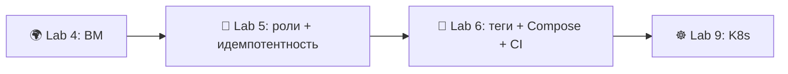

# Lab 5 — Основы Ansible


> **Цель:** настройте ВМ из Lab 4. Напишите три роли Ansible, которые потом пригодятся снова (`common`, `docker`, `app_deploy`), и докажите идемпотентность: второй прогон даёт `changed=0`.
> **Что сдать:** PR из ветки `lab05` с проектом `ansible/` (три роли, два playbook, зашифрованный файл Vault, документация).

---

## Обзор

В этой лабораторной вы потренируетесь:
- писать **идемпотентные** задачи модулями в FQCN (`ansible.builtin.*`, `community.docker.*`)
- раскладывать задачи по **ролям** (`tasks/`, `handlers/`, `defaults/`, `templates/`), а не складывать всё в один гигантский playbook
- пользоваться **handlers** (обработчик, который Ansible вызывает по `notify`), чтобы сервис перезапускался только когда его конфиг реально изменился
- шифровать секреты через **Ansible Vault**, чтобы их можно было хранить в Git
- читать вывод PLAY RECAP: `changed=N` на прогоне 1, `changed=0` на прогоне 2. Для управления конфигурацией это и есть критерий приёмки

> ⚠️ **Границы:** Lab 4 *создала* машину (Terraform/Pulumi дали ей IP). Lab 5 *настраивает* то, что внутри. Lab 6 добавит теги, блоки, Compose и CI-workflow поверх этих ролей и **переименует `app_deploy` → `web_app`** через `git mv`. Имя роли `app_deploy`, которое вы выберете на этой неделе, не останется навсегда. Всё остальное перейдёт дальше без изменений.

> 💡 **Нет облачной ВМ? Можно целиться в localhost.** Поставьте `ansible_connection: local` в inventory и уберите `become:` у задач, которым нужен root в песочнице без sudo. Оценивается *логика* роли. Чистый прогон на localhost с `--check` (где единственная помеха — `become`) принимается как сдача. Оба PLAY RECAP снимите так же: сначала `changed=N`, потом `changed=0`.

> **Заметка про «LTS»:** у `ansible-core` **нет формальной метки LTS**. Открытый движок обещает ~6 месяцев исправлений безопасности на каждый минорный релиз; сейчас поддерживаются **2.18, 2.19, 2.20, 2.21**. Берите **2.21**. Коммерческий *Ansible Automation Platform* от Red Hat даёт расширенную поддержку. Это другой продукт. Слайды в интернете с надписью «2.17 LTS» написаны до того, как политику уточнили.

---

## Состояние проекта

**У вас уже должно быть из прошлых лабораторных:**
- Lab 2: образ Docker вашего Python-сервиса после push в Docker Hub (или любой другой registry)
- Lab 4: доступная ВМ Ubuntu (облако или локальный libvirt) и `sudo` без пароля для вашего пользователя

**Эта лабораторная добавляет:**
- `ansible/` — три роли, два playbook, статический inventory, зашифрованный Vault, документация

К Lab 6 у этих же ролей появятся теги, блоки и CI-workflow; к Lab 9 тот же образ будет работать в Kubernetes. Решения этой недели — насколько дробить роли, как разложить переменные, FQCN — переживут Lab 5.

---

## Подготовка

Управляющий узел (ваш ноутбук или CI-runner):

```bash
python3 --version          # 3.11+
python3 -m venv .venv && source .venv/bin/activate
pip install "ansible-core==2.21.*"
ansible --version          # expect: ansible [core 2.21.x] / python 3.11+
ansible-galaxy collection install community.docker community.general
```

Целевая ВМ (из Lab 4):
- Ubuntu 24.04 LTS (или 22.04)
- доступ по SSH вашим ключом
- **`sudo` без пароля** для пользователя, под которым вы входите (так cloud-init делает по умолчанию; без этого `become:` падает)
- Python 3 уже есть (на Ubuntu он стоит сразу)

Создайте дерево каталогов (файлы заполните сами):

```
ansible/
├── ansible.cfg
├── inventory/
│   └── hosts.ini
├── group_vars/
│   └── all/
│       └── vault.yml             # encrypted; created in Task 3
├── roles/
│   ├── common/
│   │   ├── tasks/main.yml
│   │   └── defaults/main.yml
│   ├── docker/
│   │   ├── tasks/main.yml
│   │   ├── handlers/main.yml
│   │   ├── defaults/main.yml
│   │   └── templates/daemon.json.j2
│   └── app_deploy/
│       ├── tasks/main.yml
│       ├── handlers/main.yml
│       └── defaults/main.yml
├── playbooks/
│   ├── provision.yml             # applies common + docker
│   └── deploy.yml                # applies app_deploy
└── docs/
    └── LAB05.md                  # your submission report
```

> Создавайте только те подкаталоги, которые реально используете. Если у роли нет handlers, каталог `handlers/` не нужен.

---

## Задача 1 — Inventory и каркас ролей (2 балла)

### 1.1 — Зачем FQCN и почему сейчас

После разделения 2021 года на `ansible-core` и `ansible` модули вызывают по **FQCN** (Fully Qualified Collection Name, полное имя коллекции и модуля): `ansible.builtin.apt`, не голое `apt`; `community.docker.docker_container`, не голое `docker_container`. Это важно по двум причинам:

1. **Однозначность.** Две коллекции могут привезти модуль с одним коротким именем. Голое имя молча резолвится в тот, что загрузился первым. На CI-runner с другим набором коллекций это Heisenbug, который только и ждёт.
2. **Запас на будущее.** Сокращение до короткого имени устарело, новые модули выходят только с FQCN. CI-workflow в Lab 6 прогонит lint ролей и поймает голые имена.

Голые имена в 2026 «работают» так же, как `from __future__ import ...` «работал» в Python 2, — до дня, когда перестанут. Используйте FQCN везде.

### 1.2 — Статический inventory

`ВАША ЗАДАЧА`: напишите `inventory/hosts.ini`, который кладёт ВМ из Lab 4 в группу `webservers`. На каждом хосте нужны `ansible_host` (IP), `ansible_user` (`ubuntu`) и блок `[webservers:vars]` с `ansible_ssh_private_key_file` (путь к ключу из Lab 4) и `ansible_python_interpreter=/usr/bin/python3`.

Каркас (заполните пропуски; всё, что в `___`, — ваше):

```ini
[webservers]
lab-vm ansible_host=___ ansible_user=___        # YOUR TASK: VM IP + SSH user (Lab 4: ubuntu)

[webservers:vars]
ansible_ssh_private_key_file=___                 # YOUR TASK: path to your Lab 4 private key (Lab 4 default: ~/.ssh/lab04)
ansible_python_interpreter=___                   # YOUR TASK: usually /usr/bin/python3
```

<details>
<summary>💡 Если целитесь в localhost (песочница без sudo)</summary>

Если ВМ из Lab 4 под рукой нет и вы хотите гонять на самом управляющем узле:

```ini
[webservers]
lab-vm ansible_host=localhost ansible_user=___ ansible_connection=local   # local exec, don't SSH

[webservers:vars]
ansible_python_interpreter=/usr/bin/python3
```

`ansible_connection: local` заставляет Ansible вообще не ходить по SSH и выполнять модули в том же процессе через `exec`. Роли те же. Задачам, которым нужен root (`apt`, `service`), нужен локальный `sudo`. Если в песочнице нет sudo без пароля, смиритесь: эти задачи по-настоящему не применятся, но их *логика* всё равно проверяется в режиме `--check`. Напишите об этом явно в `docs/LAB05.md` и снимите PLAY RECAP с `--check` как доказательство идемпотентности.

</details>

### 1.3 — `ansible.cfg`

`ВАША ЗАДАЧА`: напишите `ansible.cfg` с этими ключами (точные заголовки секций найдите в документации, со Stack Overflow не копируйте: половина ответов ставит `host_key_checking=False` глобально, а это удобство лабораторной, не практика прода):

- `[defaults]`: `inventory` (путь к вашему inventory), `roles_path` (путь к каталогу ролей), `host_key_checking` (для лабораторной False; поймите, почему на проде его ставят в True), `retry_files_enabled` (False)
- `[privilege_escalation]`: `become`, `become_method`, `become_user`

```ini
[defaults]
inventory = ___                                   # YOUR TASK
roles_path = ___                                  # YOUR TASK
host_key_checking = ___                           # YOUR TASK (lab: False; explain why prod is True)
retry_files_enabled = ___                         # YOUR TASK

[privilege_escalation]
become = ___                                      # YOUR TASK
become_method = ___                               # YOUR TASK
become_user = ___                                 # YOUR TASK
```

### 1.4 — Проверьте связь

```bash
cd ansible/
ansible all -m ansible.builtin.ping
ansible webservers -a "uname -a"
```

Ping должен вернуть `pong` (пример: имя хоста у вас будет другим):

```text
lab-vm | SUCCESS => { "changed": false, "ping": "pong" }
```

### 1.5 — Доказательство работы

Вставьте в `docs/LAB05.md`:

- вывод `ansible --version` (должна быть 2.21.x)
- вывод `ansible all -m ansible.builtin.ping` (тот самый `pong`)
- вывод `ansible webservers -a "uname -a"` (доказывает SSH и доступ к shell)
- два предложения, **зачем нужен FQCN** (своими словами)

---

## Задача 2 — Роли подготовки: `common` и `docker` (3 балла)

*Роль* — это дерево каталогов с привычными подпапками. В playbook она подключается одной строкой. Правило простое: если одни и те же задачи вы копируете между двумя playbook, это роль.

### 2.1 — Роль `common`: базовые пакеты и часовой пояс

`ВАША ЗАДАЧА`: напишите `roles/common/defaults/main.yml` и `roles/common/tasks/main.yml`. В defaults лежат *переменные, которые пользователь может захотеть переопределить*. В tasks — сама работа.

`roles/common/defaults/main.yml`:

```yaml
---
common_packages:                                  # YOUR TASK: list at least 4 base packages
  - ___                                           #   (curl/git/vim/htop/ca-certificates — pick a sensible set)
  - ___
  - ___
  - ___
common_timezone: ___                              # YOUR TASK: Etc/UTC or your region
```

`roles/common/tasks/main.yml` — имена модулей даны (это *выбор лекции*); аргументы ваши:

```yaml
---
- name: ___                                       # YOUR TASK: one-line action description
  ansible.builtin.apt:                            # module given
    update_cache: ___                             # YOUR TASK
    cache_valid_time: ___                         # YOUR TASK: why a value > 0? read the apt module's doc
  when: ___                                       # YOUR TASK: limit to Debian-family hosts (hint: ansible_os_family)

- name: ___                                       # YOUR TASK
  ansible.builtin.package:                        # module given — note: NOT `apt:`; see Common Pitfalls
    name: ___                                     # YOUR TASK: reference the variable from defaults
    state: ___                                    # YOUR TASK: present? latest? justify your choice in docs/LAB05.md
  become: ___                                     # YOUR TASK: true or false? why?
  tags: [___]                                     # YOUR TASK: pick a tag — Lab 6 will leverage tag taxonomy

- name: ___                                       # YOUR TASK: set system timezone
  community.general.timezone:                     # module given
    name: ___                                     # YOUR TASK: reference common_timezone
  become: ___                                     # YOUR TASK
  tags: [___]                                     # YOUR TASK
```

Несколько *почему*, на которые нужно ответить в `docs/LAB05.md` (по одному предложению):

- **`become: true` точечно, не на всё подряд.** Зачем задаче с часовым поясом нужен root, а `ping` — нет? Почему `become: true` на уровне *play* дурно пахнет, если привилегии поднимает одна задача? (Подсказка: радиус поражения и читаемость.)
- **`state: present` против `state: latest`.** Оба ставят пакет. Почему `present` даёт повторяемые прогоны, а `latest` тихо ломает идемпотентность в ту секунду, когда апстрим публикует новую версию?
- **Зачем ставить теги уже сейчас?** Lab 6 запустит `ansible-playbook --tags docker`, чтобы выкатить только часть про Docker. Если не разметите теги сейчас, первый шаг Lab 6 — «вернитесь и проставьте теги везде». Привыкайте сразу.

### 2.2 — Роль `docker`: установка Docker Engine

`roles/docker/defaults/main.yml`:

```yaml
---
docker_user: ___                                  # YOUR TASK: the login user to add to the docker group
docker_log_max_size: ___                          # YOUR TASK: a sane value, e.g. "10m"
```

`roles/docker/templates/daemon.json.j2` — шаблон Jinja2, который рендерится в `/etc/docker/daemon.json`:

```jinja
{
  "log-driver": "___",                            # YOUR TASK: choose a driver (json-file or local)
  "log-opts": { "max-size": "{{ ___ }}" }         # YOUR TASK: reference your default
}
```

`roles/docker/handlers/main.yml`:

```yaml
---
- name: ___                                       # YOUR TASK: handler name — keep it short, you'll `notify:` it
  ansible.builtin.service:                        # module given
    name: ___                                     # YOUR TASK
    state: ___                                    # YOUR TASK: restarted? reloaded? why?
```

`roles/docker/tasks/main.yml` — основная работа. Имена модулей даны (как в примере со слайда 20 лекции); аргументы и есть навык:

```yaml
---
- name: ___                                       # YOUR TASK: install prerequisites
  ansible.builtin.apt:                            # module given
    name: ___                                     # YOUR TASK: list — apt-transport-https, ca-certificates, curl, gnupg, lsb-release
    state: ___                                    # YOUR TASK
    update_cache: ___                             # YOUR TASK

- name: ___                                       # YOUR TASK: add Docker's official APT key
  ansible.builtin.get_url:                        # module given (deb822_repository is also valid — pick one and justify)
    url: ___                                      # YOUR TASK: the Docker download URL for the gpg key
    dest: ___                                     # YOUR TASK: a path under /etc/apt/keyrings/
    mode: ___                                     # YOUR TASK: file mode (string, e.g. "0644")

- name: ___                                       # YOUR TASK: add the Docker APT repository
  ansible.builtin.apt_repository:                 # module given
    repo: ___                                     # YOUR TASK — use {{ ansible_distribution_release }} so it works on jammy + noble
    state: ___                                    # YOUR TASK
    filename: ___                                 # YOUR TASK: a stable filename in /etc/apt/sources.list.d/

- name: ___                                       # YOUR TASK: install docker-ce + cli + containerd.io
  ansible.builtin.apt:                            # module given
    name: ___                                     # YOUR TASK: list of three packages
    state: ___                                    # YOUR TASK
    update_cache: ___                             # YOUR TASK
  notify: ___                                     # YOUR TASK: name your handler from above

- name: ___                                       # YOUR TASK: render daemon.json
  ansible.builtin.template:                       # module given
    src: ___                                      # YOUR TASK: filename in templates/
    dest: ___                                     # YOUR TASK: /etc/docker/daemon.json
    mode: ___                                     # YOUR TASK
  notify: ___                                     # YOUR TASK: fires ONLY if the rendered file differs

- name: ___                                       # YOUR TASK: ensure docker service is started + enabled
  ansible.builtin.service:                        # module given
    name: ___                                     # YOUR TASK
    state: ___                                    # YOUR TASK
    enabled: ___                                  # YOUR TASK

- name: ___                                       # YOUR TASK: add the user to the docker group
  ansible.builtin.user:                           # module given
    name: ___                                     # YOUR TASK: {{ docker_user }}
    groups: ___                                   # YOUR TASK
    append: ___                                   # YOUR TASK: true — why is `append` critical here? what does the default do?

- name: ___                                       # YOUR TASK: install the Docker SDK for Python
  ansible.builtin.pip:                            # module given — without this, community.docker.* modules fail
    name: ___                                     # YOUR TASK: package name (it's not "docker-py" anymore)
    state: ___                                    # YOUR TASK
```

*Почему*, на которые нужно ответить:

- **Зачем `{{ ansible_distribution_release }}`?** На Ubuntu 24.04 это `noble`, на 22.04 — `jammy`. Одна роль, оба дистрибутива. (Значение берётся из `gather_facts: true`. Оставьте его включённым.)
- **Почему `notify:` стоит на задаче с шаблоном, а не на задаче apt?** Установка пакета — разовая. Смена конфига должна перезапускать Docker только когда файл *реально изменился*. Для этого и нужен handler: первый прогон перезапускает Docker один раз, второй видит, что файл тот же, и handler пропускает. Нет `changed` — нет рестарта и нет простоя.
- **Зачем `append: true` в задаче пользователя?** Без него Ansible *подменяет* список групп и выкидывает пользователя из `sudo`, `adm` и всех групп, где он уже был. На общих машинах это самая частая ловушка Ansible.

### 2.3 — Playbook подготовки

`playbooks/provision.yml` — тонкий нарочно: вся логика живёт в ролях:

```yaml
---
- name: Provision web servers
  hosts: ___                                      # YOUR TASK: target group
  become: ___                                     # YOUR TASK: true at play level, OR false + per-task become — argue your choice
  gather_facts: ___                               # YOUR TASK: needed for ansible_distribution_release
  roles:
    - ___                                         # YOUR TASK
    - ___                                         # YOUR TASK
```

### 2.4 — Запустите и проверьте

```bash
ansible-playbook playbooks/provision.yml          # first real run
```

Первый прогон в основном жёлтый (пример; число `changed` у вас будет другим):

```text
PLAY RECAP **********************************************************
lab-vm : ok=11  changed=8  unreachable=0  failed=0
```

### 2.5 — Доказательство работы

Вставьте в `docs/LAB05.md`:

- содержимое обоих файлов (`common/tasks/main.yml`, `docker/tasks/main.yml`), в блоке YAML
- **полную строку PLAY RECAP** из `ansible-playbook playbooks/provision.yml`
- вывод `ansible webservers -a "docker --version"`: Docker стоит на машине
- ответ одним абзацем на каждое *почему* из 2.1 и 2.2

---

## Задача 3 — Роль выкладки приложения и Vault (3 балла)

### 3.1 — Зашифруйте учётные данные через Ansible Vault

```bash
ansible-vault create group_vars/all/vault.yml
```

Вас спросят пароль Vault. **Сохраните его сразу** в файл, который git игнорирует, чтобы четыре повторных прогона в задаче 4 не заставляли набирать его заново:

```bash
echo 'your-vault-password' > .vault_pass
chmod 600 .vault_pass
# .vault_pass is already in your .gitignore (see "How to Submit")
```

Скажите Ansible, откуда брать пароль (два способа, выберите один):

- В команде: `ansible-playbook playbooks/deploy.yml --vault-password-file .vault_pass`
- В `ansible.cfg`: добавьте `vault_password_file = .vault_pass` в секцию `[defaults]`

(Форма `--ask-vault-pass` в §3.4 ниже спрашивает пароль каждый раз. Берите тот вариант, который удобнее.)

`ВАША ЗАДАЧА`: положите внутрь учётные данные Docker Hub и конфиг приложения (на диске файл зашифрован AES-256, его можно коммитить; пароль нельзя).

```yaml
---
dockerhub_username: ___                           # YOUR TASK: your Docker Hub username
dockerhub_password: ___                           # YOUR TASK: an ACCESS TOKEN (dckr_pat_…), not your login password
docker_image: ___                                 # YOUR TASK: e.g. "{{ dockerhub_username }}/devops-info-service"
docker_image_tag: ___                             # YOUR TASK: prefer an immutable tag (a SHA) over "latest"
app_port: ___                                     # YOUR TASK
app_container_name: ___                           # YOUR TASK
```

Проверьте, что он расшифровывается:

```bash
ansible-vault view group_vars/all/vault.yml
```

> Почему *access token* Docker Hub, а не пароль аккаунта? Токен ограничен по правам (read-only / read-write / admin), отзывается по одному и виден в аудит-логе DH. Утечка пароля открывает весь аккаунт.

### 3.2 — Роль `app_deploy`

`roles/app_deploy/defaults/main.yml`:

```yaml
---
app_restart_policy: ___                           # YOUR TASK: unless-stopped or on-failure — why?
app_health_path: ___                              # YOUR TASK: /health (matches your Lab 1 service)
```

`roles/app_deploy/handlers/main.yml`:

```yaml
---
- name: ___                                       # YOUR TASK: handler name (`restart app` is fine)
  community.docker.docker_container:              # module given
    name: ___                                     # YOUR TASK: {{ app_container_name }}
    state: ___                                    # YOUR TASK
    restart: ___                                  # YOUR TASK
```

`roles/app_deploy/tasks/main.yml` — имена модулей даны (это выбор лекции: `community.docker.*`); аргументы и есть навык:

```yaml
---
- name: ___                                       # YOUR TASK: log in to Docker Hub
  community.docker.docker_login:                  # module given
    username: ___                                 # YOUR TASK
    password: ___                                 # YOUR TASK
  no_log: ___                                     # YOUR TASK: true — why?

- name: ___                                       # YOUR TASK: pull the image
  community.docker.docker_image:                  # module given
    name: ___                                     # YOUR TASK: {{ docker_image }}
    tag: ___                                      # YOUR TASK
    source: ___                                   # YOUR TASK: pull
    force_source: ___                             # YOUR TASK: false — defend your answer (idempotency)

- name: ___                                       # YOUR TASK: run the container
  community.docker.docker_container:              # module given
    name: ___                                     # YOUR TASK
    image: ___                                    # YOUR TASK: "{{ docker_image }}:{{ docker_image_tag }}"
    state: ___                                    # YOUR TASK
    restart_policy: ___                           # YOUR TASK
    ports:
      - ___                                       # YOUR TASK: "host:container" — e.g. "{{ app_port }}:5000"
    pull: ___                                     # YOUR TASK: never/always/missing — why never on rerun?

- name: ___                                       # YOUR TASK: wait for the port to accept connections
  ansible.builtin.wait_for:                       # module given
    host: ___                                     # YOUR TASK
    port: ___                                     # YOUR TASK
    timeout: ___                                  # YOUR TASK

- name: ___                                       # YOUR TASK: verify /health returns HTTP 200
  ansible.builtin.uri:                            # module given
    url: ___                                      # YOUR TASK: full URL ending in {{ app_health_path }}
    status_code: ___                              # YOUR TASK
    return_content: ___                           # YOUR TASK
  register: ___                                   # YOUR TASK: capture the response so docs can show it
```

*Почему* (по одному предложению в `docs/LAB05.md`):

- **`no_log: true` на задаче логина.** Без него токен Docker Hub попадёт открытым текстом в лог сборки CI. Логи CI в публичных репозиториях читает кто угодно. Кнопки «удалить» нет.
- **`pull: never` на задаче запуска.** Предыдущий шаг pull уже скачал нужный образ. `pull: always` у `docker_container` тянет образ на каждом прогоне: (a) портит картину идемпотентности и (b) зря ходит в registry.
- **Почему коллекция `community.docker`, а не `community.general`?** Модули Docker в 2020 вынесли в отдельную коллекцию, чтобы выпускать их чаще. `community.general.docker_*` больше нет. Голые ответы со Stack Overflow ещё могут на него ссылаться. Они устарели.

### 3.3 — Playbook выкладки

`playbooks/deploy.yml`:

```yaml
---
- name: Deploy application
  hosts: ___                                      # YOUR TASK
  become: ___                                     # YOUR TASK: why true? what does the docker_container module need root for?
  gather_facts: ___                               # YOUR TASK
  roles:
    - ___                                         # YOUR TASK
```

### 3.4 — Запустите и проверьте

```bash
ansible-playbook playbooks/deploy.yml --ask-vault-pass    # or --vault-password-file .vault_pass
curl -fsS http://<VM-IP>:<app_port>/health | jq .         # expect HTTP 200 + JSON
```

### 3.5 — Доказательство работы

Вставьте в `docs/LAB05.md`:

- содержимое `app_deploy/tasks/main.yml` (YAML в блоке)
- PLAY RECAP из `ansible-playbook playbooks/deploy.yml` (прогон №1)
- вывод `ansible webservers -a "docker ps --format '{{.Names}}\t{{.Status}}'"` (ваш контейнер запущен)
- `curl -s http://<VM-IP>:<port>/health | jq .` на ВМ (HTTP 200 и тот JSON, который отдаёт сервис из Lab 1)
- доказательство, что файл Vault зашифрован: `head -1 group_vars/all/vault.yml` показывает `$ANSIBLE_VAULT;1.1;AES256`

---

## Задача 4 — Доказательство идемпотентности (1 балл)

Это главный критерий приёмки. Вся сила управления конфигурацией в том, что второй прогон того же playbook делает то же, что и один.

```bash
# Vault password file in place (see Task 3.1) OR add --ask-vault-pass to each line
ansible-playbook playbooks/provision.yml          # run #1
ansible-playbook playbooks/provision.yml          # run #2
ansible-playbook playbooks/deploy.yml             # run #1 (already done in Task 3)
ansible-playbook playbooks/deploy.yml             # run #2
```

> 💡 Как только появился `group_vars/all/vault.yml`, **каждый** playbook (включая `provision.yml`) грузит его на старте и просит пароль Vault, хотя `provision.yml` секреты *не использует*. Либо один раз пропишите `vault_password_file` в `ansible.cfg`, либо допишите `--ask-vault-pass` ко всем четырём командам выше.

**Второй прогон каждого обязан показать `changed=0`**. (Пример.)

```text
# provision.yml, run #1
lab-vm : ok=11  changed=8  unreachable=0  failed=0
# provision.yml, run #2
lab-vm : ok=11  changed=0  unreachable=0  failed=0       # ← changed=0 = idempotent ✓

# deploy.yml, run #1
lab-vm : ok=6   changed=4  unreachable=0  failed=0
# deploy.yml, run #2
lab-vm : ok=6   changed=0  unreachable=0  failed=0       # ← changed=0 = idempotent ✓
```

Если на прогоне №2 что-то всё ещё меняется, **задача не идемпотентна. Чините.** Обычные виновники:

- Залётный `ansible.builtin.shell` или `command` (у них нет модели состояния). Оберните через `creates:`/`removes:` или замените нужным модулем.
- Шаблон, который подставляет время или случайное значение.
- `state: latest` у пакета. Как только в репозитории апстрима появится новая версия, `changed=1` будет на каждом прогоне.
- `force_source: true` у `docker_image`. Образ тянется каждый раз.

Сухим прогоном проверьте, что drift (расхождение с описанным состоянием) не вылез:

```bash
ansible-playbook playbooks/provision.yml --check --diff
```

### 4.1 — Доказательство работы

Вставьте в `docs/LAB05.md`:

- оба PLAY RECAP из `provision.yml` (прогон №1: changed=N, прогон №2: changed=0)
- оба PLAY RECAP из `deploy.yml` (та же форма)
- вывод сухого прогона `--check --diff` (нет изменений, нет diff)
- разбор одним абзацем: какие задачи поменялись на прогоне №1, почему на прогоне №2 они показали `ok`, и если что-то осталось `changed=1` — что вы исправили

---

## Задача 5 — Документация (1 балл)

`ansible/docs/LAB05.md`. Нужные разделы, по порядку:

1. **Архитектура** — версия `ansible-core`, ОС цели, зачем три роли, а не один монолитный playbook
2. **Роли** — для каждой из `common`, `docker`, `app_deploy`: зачем она, ключевые переменные, как ведёт себя handler
3. **Ответы на *почему*** из задач 2 и 3 (FQCN, точечный `become`, `state: present` против `latest`, `append: true`, handler на шаблоне, а не на apt, `no_log`, `pull: never`)
4. **Доказательство идемпотентности** — оба PLAY RECAP (задача 4) и разбор абзацем
5. **Vault** — как лежат учётные данные, как вы обращаетесь с паролем, доказательство зашифрованного заголовка
6. **Проверка выкладки** — `docker ps` и вывод `curl` на `/health`

---

## Бонусная задача — Динамический inventory (2 балла)

Находите ВМ из Lab 4 сами, через облачный плагин inventory, без зашитого IP. Статический список протухает, как только ВМ пересоздали и у неё новый адрес. Inventory должен узнать это *раньше*, чем Ansible начнёт что-то настраивать.

`ВАША ЗАДАЧА`:

1. Поставьте коллекцию под облако из Lab 4:
   ```bash
   ansible-galaxy collection install ___        # YOUR TASK: amazon.aws / google.cloud / azure.azcollection / yandex.cloud
   ```
2. Напишите `inventory/<cloud>.yml`, который:
   - ставит `plugin:` в FQCN плагина inventory (например `amazon.aws.aws_ec2`)
   - оставляет только **running** инстансы с тегом этого курса (через `filters:`)
   - через `compose:` пишет в `ansible_host` публичный IP (имя поля разное, подсказки ниже)
   - через `keyed_groups:` собирает группу сам (например `webservers` из тега `Role`)
3. Направьте на него Ansible (`-i inventory/<cloud>.yml` или поправьте `ansible.cfg`)
4. Запустите:
   ```bash
   ansible-inventory -i inventory/<cloud>.yml --graph
   ansible all -i inventory/<cloud>.yml -m ansible.builtin.ping
   ansible-playbook -i inventory/<cloud>.yml playbooks/provision.yml --check --diff
   ```

Каркас (AWS — имена полей подставьте под своё облако):

```yaml
# inventory/aws.yml
plugin: ___                                       # YOUR TASK: amazon.aws.aws_ec2
regions:
  - ___                                           # YOUR TASK
filters:
  ___: ___                                        # YOUR TASK: tag:Project=devops-core
  instance-state-name: ___                        # YOUR TASK: running
keyed_groups:
  - key: ___                                      # YOUR TASK: tags.Role
    prefix: ___                                   # YOUR TASK
compose:
  ansible_host: ___                               # YOUR TASK: public_ip_address (for AWS)
```

<details>
<summary>💡 Подсказки по полям облаков</summary>

| Облако | Коллекция | Плагин | Поле публичного IP |
|---|---|---|---|
| AWS | `amazon.aws` | `aws_ec2` | `public_ip_address` |
| GCP | `google.cloud` | `gcp_compute` | `networkInterfaces[0].accessConfigs[0].natIP` |
| Azure | `azure.azcollection` | `azure_rm` | `public_ipv4_addresses[0]` |
| Yandex | `yandex.cloud` | `yandex_compute` | вложено в `network_interfaces[0]` |

Документация: [Плагины inventory](https://docs.ansible.com/ansible-core/2.21/plugins/inventory.html) · [aws_ec2](https://docs.ansible.com/ansible/latest/collections/amazon/aws/aws_ec2_inventory.html)

</details>

### Доказательство по бонусу

Вставьте в `docs/LAB05.md`:

- полный `inventory/<cloud>.yml` (без секретов: вход через переменные окружения или IAM-роль)
- вывод `ansible-inventory --graph`, где видны хосты, найденные сами
- PLAY RECAP команды `ansible all -i inventory/<cloud>.yml -m ansible.builtin.ping`
- один абзац: какой плагин взяли и почему, как входили (переменные окружения? IAM instance profile? конфиг cloud SDK?) и что будет, когда IP ВМ сменится (ничего: руками править не нужно)

---

## Как сдавать

```bash
git switch -c lab05

# Keep secrets out of Git
cat >> .gitignore <<'EOF'
# Ansible
*.retry
.vault_pass
__pycache__/
EOF

git add ansible/ .gitignore
git commit -m "feat(lab05): ansible roles — common, docker, app_deploy + idempotency proof"
git push -u origin lab05
```

**Перед push проверьте:** нет `.vault_pass`, нет приватных SSH-ключей, в коммите только *зашифрованный* `vault.yml`.

Откройте **два** PR:

- `your-fork:lab05` → `course-repo:master` *(на ревью)*
- `your-fork:lab05` → `your-fork:master` *(сольётся в ваш main, когда закончите)*

Чеклист PR:

```text
- [ ] Task 1 done — inventory + ansible.cfg + ping succeeds
- [ ] Task 2 done — common + docker roles applied; PLAY RECAP captured
- [ ] Task 3 done — app_deploy role + encrypted Vault; /health curl is HTTP 200
- [ ] Task 4 done — idempotency: both run #2 PLAY RECAPs show changed=0
- [ ] Task 5 done — docs/LAB05.md covers all six sections with the *why* answers
- [ ] Bonus — dynamic inventory: ansible-inventory --graph + ping against it
```

---

## Критерии приёмки

### Задача 1 (2 балла)
- ✅ `ansible-core` 2.21 установлен (`ansible --version`)
- ✅ Три роли разложены (`common`, `docker`, `app_deploy`) по обычным подкаталогам
- ✅ Статический inventory и `ansible.cfg` настроены
- ✅ `ansible all -m ansible.builtin.ping` возвращает `pong`

### Задача 2 (3 балла)
- ✅ Роль `common` ставит базовые пакеты и часовой пояс. `become: true` стоит только там, где нужен root
- ✅ Роль `docker` ставит Docker Engine, рендерит `daemon.json`, управляет сервисом и добавляет пользователя в группу `docker` с `append: true`
- ✅ Все задачи вызывают модули по FQCN
- ✅ Handler перезапускает Docker **только** когда меняется шаблон (`notify:` на задаче с шаблоном)
- ✅ `provision.yml` применяет обе роли без сбоев

### Задача 3 (3 балла)
- ✅ Учётные данные лежат в зашифрованном файле Vault (`head -1` показывает `$ANSIBLE_VAULT;1.1;AES256`)
- ✅ Роль `app_deploy` скачивает образ из Lab 2 и запускает его контейнером
- ✅ На задаче логина стоит `no_log: true`
- ✅ `/health` отвечает HTTP 200; вывод `curl` сохранён

### Задача 4 (1 балл)
- ✅ PLAY RECAP прогона №1 показывает `changed > 0`
- ✅ PLAY RECAP прогона №2 показывает `changed=0` — и у `provision.yml`, и у `deploy.yml`
- ✅ `--check --diff` не показывает drift

### Задача 5 (1 балл)
- ✅ `docs/LAB05.md` закрывает все шесть разделов

### Бонусная задача (2 балла)
- ✅ Облачный плагин inventory настроен на провайдера из Lab 4
- ✅ `ansible-inventory --graph` показывает хосты, найденные сами
- ✅ Playbook успешно проходит по динамическому inventory

---

## Критерии оценивания

| Задача | Баллы | Критерии |
|------|-------:|----------|
| **Задача 1** — Inventory и каркас | **2** | ping по FQCN, cfg, раскладка из трёх ролей |
| **Задача 2** — роли `common` и `docker` | **3** | идемпотентные задачи, handler на шаблоне, FQCN, `append: true`, *почему* записаны |
| **Задача 3** — `app_deploy` и Vault | **3** | образ из Lab 2 запущен, `/health` 200, зашифрованный Vault, `no_log` |
| **Задача 4** — Идемпотентность | **1** | прогон №2: `changed=0` на обоих playbook |
| **Задача 5** — Документация | **1** | все шесть разделов на месте |
| **Бонус** — Динамический inventory | **2** | облачный плагин сам находит хосты |
| **Итого** | **12** | 10 основных + 2 бонус |

**Жёсткие требования:**
- Структура на ролях обязательна (монолитный playbook не подходит)
- Модули по FQCN обязательны везде
- Идемпотентность обязательна (прогон №2: changed=0 на обоих playbook — это главное в лабораторной)
- Ansible Vault обязателен; `.vault_pass` и секреты открытым текстом коммитить нельзя

---

## Материалы

<details>
<summary>📚 Ansible Core 2.21</summary>

- [Документация ansible-core 2.21](https://docs.ansible.com/ansible-core/2.21/)
- [Роли](https://docs.ansible.com/ansible-core/2.21/playbook_guide/playbooks_reuse_roles.html)
- [Handlers](https://docs.ansible.com/ansible-core/2.21/playbook_guide/playbooks_handlers.html)
- [Inventory](https://docs.ansible.com/ansible-core/2.21/inventory_guide/intro_inventory.html)
- [FQCN](https://docs.ansible.com/ansible-core/2.21/reference_appendices/glossary.html#term-FQCN)
- *Ansible for DevOps* — Jeff Geerling (изд. 2024)

</details>

<details>
<summary>🔒 Vault и секреты</summary>

- [Ansible Vault](https://docs.ansible.com/ansible-core/2.21/vault_guide/index.html)
- [no_log](https://docs.ansible.com/ansible-core/2.21/reference_appendices/logging.html)

</details>

<details>
<summary>🐳 Модули Docker и динамический inventory</summary>

- [Коллекция community.docker](https://docs.ansible.com/ansible/latest/collections/community/docker/index.html)
- [docker_login](https://docs.ansible.com/ansible/latest/collections/community/docker/docker_login_module.html) · [docker_image](https://docs.ansible.com/ansible/latest/collections/community/docker/docker_image_module.html) · [docker_container](https://docs.ansible.com/ansible/latest/collections/community/docker/docker_container_module.html)
- [Установка Docker на Ubuntu](https://docs.docker.com/engine/install/ubuntu/)
- [Плагины inventory](https://docs.ansible.com/ansible-core/2.21/plugins/inventory.html)

</details>

<details>
<summary>⚠️ Типичные ловушки (с реальных сухих прогонов)</summary>

- **`become: true` без sudo без пароля.** Play падает с `sudo: a password is required`. Чините на ВМ (cloud-init обычно создаёт пользователя входа с `NOPASSWD: ALL` в `/etc/sudoers.d/`). На хостах, собранных руками, добавьте пользователя сами. У совсем голых контейнеров этого нет.
- **`ansible.builtin.apt` на хосте не из Debian.** Сразу падает на RHEL, Fedora и Alpine. Если роль `common` хоть раз пойдёт на такую машину, берите `ansible.builtin.package` (сам выбирает apt, dnf, yum или zypper). Для вещей, которые есть только в Debian (PPA, файлы репозиториев), оставьте `apt:`, но поставьте условие `when: ansible_os_family == "Debian"`.
- **`community.docker.docker_container` падает с `Failed to import the required Python library (Docker SDK for Python)`.** На *цели* нужен `pip install docker`. Поэтому последняя задача роли `docker` ставит его через `ansible.builtin.pip`. Без пакета `docker_container` падает сразу и ничего не делает.
- **Динамический inventory пишет `No inventory was parsed`.** Облачная коллекция не стоит (`ansible-galaxy collection install amazon.aws`), имя файла не `*.aws_ec2.yml` / `*.yml` под `plugin:`, или не заданы переменные входа (`AWS_ACCESS_KEY_ID` / `GOOGLE_APPLICATION_CREDENTIALS` / `AZURE_*`). Запустите `ansible-inventory -i inventory/<cloud>.yml --list -vvv`, чтобы увидеть настоящую ошибку. `--graph` её прячет.
- **Забыли `append: true` в задаче пользователя.** Ansible *подменяет* список групп и выкидывает из `sudo`/`adm`. Если вы зашли по SSH как `ubuntu` и прогнали это, следующий вход не пройдёт. Когда добавляете в группу, всегда ставьте `append: true`.
- **`state: latest` у пакета.** Каждый новый релиз апстрима превращает прогон №2 из `changed=0` в `changed=1`. Для повторяемых прогонов берите `state: present`.
- **Файл Vault закоммитили без `--encrypt`.** В `git diff` токены открытым текстом. Как вытащить: `git reset --hard HEAD~1`, ротируйте токен (он сгорел), зашифруйте заново. Всегда создавайте файл через `ansible-vault create`, не через `vi`.
- **`provision.yml` вдруг спрашивает пароль Vault.** Как только есть `group_vars/all/vault.yml`, Ansible грузит его на каждом play, в том числе в `provision.yml`, где секреты не упоминаются. Либо один раз пропишите `vault_password_file = .vault_pass` в `ansible.cfg`, либо передавайте `--ask-vault-pass` / `--vault-password-file` на *все четыре* прогона в задаче 4. Пропуск этого — причина номер один, почему на доказательстве идемпотентности пароль набирают восемь раз.

</details>

<details>
<summary>🛠️ Инструменты, которые стоит знать</summary>

- [ansible-lint](https://ansible.readthedocs.io/projects/lint/) — ловит голые имена вместо FQCN, пропущенный `name:` и запах `state: latest`. CI в Lab 6 гоняет именно его.
- [Molecule](https://ansible.readthedocs.io/projects/molecule/) — поднимает каждую роль в контейнере и гоняет её отдельно.
- `ansible-playbook -vvv` — три `v` печатают команду SSH и JSON модуля. Без этого не понять, почему задача сказала `changed`.

</details>

---

## Что дальше

| Lab | Что добавляет к этим ролям |
|---:|---|
| 6 | Теги (`--tags docker`), блоки и `rescue:`/`always:`, шаблоны Compose, CI-workflow |
| 9 / 10 | Тот же образ выкатывается в k3d через Helm. Ansible готовит хост, выкладку забирает Helm |
| 11 | Ansible Vault меняется на OpenBao: секреты в рантайме живут там |



---

**Удачи.** 🚀

> **Помните:** скажите серверу, *в каком состоянии остановиться*, а не какими шагами туда идти. Критерий приёмки — `changed=0` на прогоне №2. Секреты держите в Vault, роли делайте маленькими, *почему* записывайте.
