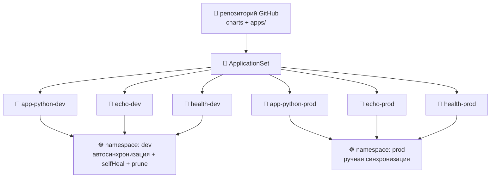

# Lab 13 — GitOps с ArgoCD


> **Цель:** сделайте Git единственным источником правды для кластера. Установите **ArgoCD 3.4**, руками опишите манифесты `Application` для **трёх** сервисов в **двух** окружениях, затем сверните все шесть в один **ApplicationSet**, который кластер непрерывно сверяет с Git.
> **Что сдать:** PR из `lab13` с `k8s/argocd/` (apps + ApplicationSet + values) и `docs/LAB13.md`. С ноутбука больше не запускайте `helm upgrade`.

---

## Обзор

До Lab 12 вы выкатывали сервис командой `helm upgrade` с ноутбука (или с CI-runner). Это модель **push**: человек или pipeline (цепочка автоматической сборки и выкладки) заходит *внутрь* кластера с правами cluster-admin. **GitOps** переворачивает схему — агент *внутри* кластера следит за Git, забирает желаемое состояние и непрерывно приводит кластер к нему. К Git тянется кластер; внутрь никто не заходит.

В этой лабораторной вы:

- Выберете и **зафиксируете версию чарта ArgoCD, у которой `appVersion` в линейке 3.4.x** (не копируйте туториал — прочитайте индекс чартов)
- Напишете CRD `Application` с нуля — `source` / `destination` / `syncPolicy` своими руками
- Разберёте две дисциплины sync: dev с `automated{prune,selfHeal}`, prod с ручным sync — и запишете, *почему*
- Соберёте **шесть** Application из одного шаблона **ApplicationSet** Matrix(List, List) — паттерн, который окупается только при ≥ 3 приложениях
- Докажете цикл GitOps: удалите workload, ArgoCD создаст его снова; сделайте `kubectl edit` у Service, ArgoCD откатит правку за 3 минуты

> ⚠️ **Границы:** без Argo Rollouts (это Lab 14), без multi-cluster, без SSO/OIDC. Один ArgoCD внутри кластера управляет одним кластером. В бонусе возьмите *другое*, а не ставьте ещё контроллеры.

> ⚠️ **Про версии:** ArgoCD **2.x — EOL** (релиз 3.2 в ноябре 2025 закрыл поддержку 2.x). Здесь **3.4**. Если в туториале манифесты 2.x, CRD `Application`/`ApplicationSet` совместимы, но сверьтесь с документацией 3.x по ссылкам в конце.

---

## Состояние проекта

**К этой лабораторной у вас уже должно быть:**

- Кластер k3d на Kubernetes **1.36** (Lab 9)
- Helm-чарт `app-python` в `k8s/lab10-app/` с `values-dev.yaml` / `values-prod.yaml` (Lab 10) — в Lab 13 этот чарт выкатывает ArgoCD, а не `helm upgrade`
- Служебный сервис **`echo`** из Lab 9 (`ghcr.io/inno-devops-labs/echo:v1`, порт 8081)

**Эта лабораторная добавляет:**

- ArgoCD 3.4 через Helm-чарт `argo/argo-cd` (namespace `argocd`)
- Служебный сервис **`health`** — **третий** в топологии, лежит в `plumbing/health/` (`ghcr.io/inno-devops-labs/health:v1`, порт 8082)
- `k8s/argocd/apps/` — шесть написанных руками манифестов `Application` (задания 2–3), потом их заменит один `ApplicationSet` (задание 4)
- `docs/LAB13.md` — отчёт к сдаче

К Lab 14 перед теми же шестью Application встанут CRD `Rollout` для progressive delivery. Цикл GitOps, который вы собираете здесь, — подложка для всего остального.

---

## Три сервиса

| Сервис | Откуда | Образ | Порт | Пишете сами? |
|---|---|---|---|---|
| 🐍 **app-python** | Ваш сервис из Lab 1 → Lab 12 | из вашего CI | 8080 | ✅ Да — ваш код |
| 🦫 **echo** | Служебный код курса (Lab 9+) | `ghcr.io/inno-devops-labs/echo:v1` | 8081 | ❌ Нет — готовый образ |
| 💚 **health** | Служебный код курса — **новый в этой лабораторной** | `ghcr.io/inno-devops-labs/health:v1` | 8082 | ❌ Нет — готовый образ |

`health` лежит в `plumbing/health/` (см. `plumbing/health/README.md`). Ссылайтесь на опубликованный образ напрямую — **не** собирайте его через `docker build`. Он отдаёт `GET /`, `GET /healthz` и `GET /metrics`. В этой лабораторной он нужен только как третья цель выкладки, чтобы `ApplicationSet` перестал быть игрушечным паттерном.



---

## Подготовка

Проверьте, что предпосылки с прошлых лабораторных живы: `kubectl get nodes` (3 узла Ready на v1.36.x из Lab 9) и `helm version` (4.1.x из Lab 10). Затем добавьте репозиторий чартов Argo — `helm repo add argo https://argoproj.github.io/argo-helm && helm repo update`. Искать в нём будете в задании 1.

Каталог, который вы соберёте: `k8s/argocd/install/argocd-values.yaml` (задание 1), шесть манифестов Application в `k8s/argocd/apps/` (задания 2 и 3 — `{app-python,echo,health}-{dev,prod}.yaml`) и `k8s/argocd/applicationset.yaml` (задание 4, оно удаляет эти шесть). Отчёт — в `docs/LAB13.md`. Файлы служебного кода (`plumbing/health/Dockerfile`, `main.go`, …) **не** правьте — они даны готовыми.

---

## Задание 1 — Установка ArgoCD 3.4 (2 балла)

### 1.1 — Найдите версию чарта с `appVersion` в 3.4.x

`ВАША ЗАДАЧА`: Helm-чарт `argo/argo-cd` и само приложение ArgoCD версионируются независимо. Выберите версию **чарта**, у которой **`appVersion`** попадает в **3.4.x** (2.x — EOL: этот балл сгорит, если сервер ответит 2.x или превью 3.3.x).

Подсказка: `helm search repo argo/argo-cd --versions` показывает `CHART VERSION` и `APP VERSION` рядом. Прочитайте таблицу и возьмите самую свежую стабильную строку, где `APP VERSION` начинается с `3.4.`.

В `docs/LAB13.md` запишите **два** выбранных номера версий и одно предложение, чем chart-version отличается от appVersion.

### 1.2 — Поставьте через Helm, с зафиксированным файлом values

`ВАША ЗАДАЧА`: создайте **`k8s/argocd/install/argocd-values.yaml`** с *минимальными* переопределениями под k3d. Не берите upstream-дефолты вслепую. Как минимум решите и пропишите:

- `server.service.type` — `ClusterIP` (дальше `kubectl port-forward`) или `LoadBalancer` (klipper в k3d его опубликует) — выберите одно и обоснуйте в отчёте
- `configs.params."server.insecure"` — для лабораторной `true` нормально (TLS оборвёте на port-forward); запишите, чем платите
- блок `resources:` хотя бы для `controller` и `repoServer`, который влезает в бюджет двух agent-нод k3d

Дальше ставьте — подставьте выбранную версию чарта:

```bash
# YOUR TASK below:
#   --version: the chart version you picked in 1.1
#   --values:  path to your overrides file (e.g. k8s/argocd/install/argocd-values.yaml)
kubectl create namespace argocd
helm install argocd argo/argo-cd \
  --namespace argocd \
  --version YOUR-TASK \
  --values YOUR-TASK
# wait for the server with `kubectl rollout status deploy/argocd-server -n argocd --timeout=180s`
```

Каркас `k8s/argocd/install/argocd-values.yaml` — внутренности напишите сами:

```yaml
# k8s/argocd/install/argocd-values.yaml
# Overrides for the argo/argo-cd chart on a k3d cluster.
# Leave defaults for anything you don't have a reason to change.

server:
  service:
    type: YOUR-TASK            # ClusterIP or LoadBalancer — your call, document why
  # YOUR-TASK: any other server overrides (e.g. resource requests/limits)

configs:
  params:
    server.insecure: "YOUR-TASK"   # "true" if you want plain HTTP over port-forward

controller:
  resources:
    requests:
      cpu: YOUR-TASK
      memory: YOUR-TASK
    limits:
      cpu: YOUR-TASK
      memory: YOUR-TASK

repoServer:
  resources:
    requests:
      cpu: YOUR-TASK
      memory: YOUR-TASK
```

### 1.3 — Зайдите в UI и поставьте CLI той же версии

`ВАША ЗАДАЧА`: сделайте port-forward `svc/argocd-server` на ноутбук, достаньте начальный пароль admin из Secret `argocd-initial-admin-secret` в namespace `argocd` (он в base64 в `.data.password`), поставьте бинарник CLI **3.4.x** той же линии и залогиньтесь. `argocd version` должен показать **и** `argocd: v3.4.x` (клиент), **и** `argocd-server: v3.4.x` (сервер).

Подсказка: пароль лежит в Secret — `kubectl get secret -n argocd` покажет, что там есть. Base64 не копируйте, декодируйте.

### 1.4 — Доказательства

**Вставьте в `docs/LAB13.md`:**

- `helm search repo argo/argo-cd --versions | head -5` — выбранная строка выделена
- `kubectl get pods -n argocd -o wide` — все основные Pod в Running (ждите ≥ 6: `argocd-server`, `argocd-application-controller`, `argocd-applicationset-controller`, `argocd-repo-server`, `argocd-redis`, `argocd-notifications-controller`; `dex-server` только если вы его включили)
- `argocd version` — клиент и сервер оба **3.4.x**
- полное содержимое `k8s/argocd/install/argocd-values.yaml`
- одно предложение про выбор `server.service.type` и одно про `server.insecure`

---

## Задание 2 — CRD Application для трёх сервисов (3 балла)

### 2.1 — Разложите путь GitOps-репозитория

`ВАША ЗАДАЧА`: в `k8s/argocd/apps/` вы напишете **шесть** манифестов `Application` в заданиях 2 и 3 (3 сервиса × 2 окружения). Сейчас начните с трёх Application для **dev**. В `docs/LAB13.md` — абзац: на какой **чарт** ссылается каждый Application (чарт из Lab 10 для `app-python`; маленькие чарты, которые вы напишете для `echo` и `health`, только выкатывают готовые образы и Service).

> Совет: самый простой чарт `echo`/`health` — это `Chart.yaml` + `templates/deployment.yaml` + `templates/service.yaml`, по три файла. Образ обязан быть `ghcr.io/inno-devops-labs/echo:v1` и `ghcr.io/inno-devops-labs/health:v1`. **Не** пересобирайте их.

### 2.2 — Напишите три CRD `Application` руками (окружение dev)

`ВАША ЗАДАЧА`: напишите `app-python-dev.yaml`, `echo-dev.yaml`, `health-dev.yaml` в `k8s/argocd/apps/`. Форма показана; **каждое** значение выбираете вы. Пока **ручной sync** (без блока `automated:`) — включите его в задании 3.

```yaml
# k8s/argocd/apps/app-python-dev.yaml   (echo-dev.yaml and health-dev.yaml are analogous)
apiVersion: argoproj.io/v1alpha1
kind: Application
metadata:
  name: YOUR-TASK                # e.g. app-python-dev — the controller indexes by this
  namespace: argocd              # ArgoCD watches Applications in its OWN namespace
  finalizers:
    - YOUR-TASK                  # the resources-finalizer that cascade-deletes K8s
                                 # resources on `kubectl delete app`. Look it up.
spec:
  project: default
  source:
    repoURL: YOUR-TASK           # https://github.com/<you>/<your-fork>.git
    targetRevision: YOUR-TASK    # branch (dev) or tag/SHA (prod) — pick one, explain in report
    path: YOUR-TASK              # e.g. k8s/lab10-app for app-python; k8s/charts/echo for echo
    helm:                        # if your chart takes values, declare them here
      valueFiles:
        - YOUR-TASK               # e.g. values-dev.yaml
  destination:
    server: https://kubernetes.default.svc       # in-cluster API server
    namespace: YOUR-TASK         # the K8s namespace the WORKLOAD lands in (e.g. dev)
  syncPolicy:
    # NO `automated:` block YET — Task 3 turns it on for dev only.
    syncOptions:
      - YOUR-TASK                # the option that auto-creates the destination namespace
```

По ходу разберитесь вот с чем:

- `metadata.name` живёт в namespace `argocd`, а `spec.destination.namespace` — куда садится **workload**. Это два разных namespace. Не смешивайте.
- `repoURL` — это **GitOps-репозиторий** (ваш форк), доступный из кластера. Для публичного HTTPS креды не нужны; для приватного вы бы зарегистрировали Secret `argocd-repo-creds` (вне этой лабораторной, но в отчёте стоит одна фраза).
- Блок `finalizers:` **держит каскад**. Без него `kubectl delete app` оставляет Deployment и Service в namespace workload. Попробуйте оба варианта, если хотите увидеть разницу.

### 2.3 — Примените и сделайте первый sync вручную

Примените три CR Application (`kubectl apply -f k8s/argocd/apps/`) и убедитесь, что в `argocd app list` они **OutOfSync** (блока `automated:` ещё нет: CR есть, сверки не было). Затем каждый запустите через `argocd app sync <name>` — это ручной sync, то же, что кнопка в UI. Проверьте, что каждый дошёл до **`Synced / Healthy`**, командой `kubectl get app -n argocd -o wide`.

### 2.4 — Докажите цикл GitOps

`ВАША ЗАДАЧА`: поменяйте в Git что-нибудь дешёвое (например `replicaCount: 1` → `2` в `values.yaml` чарта `app-python`), закоммитьте, сделайте push. Затем **без единого `kubectl apply` и `helm upgrade`** смотрите на ArgoCD:

1. За ~3 мин Application станет **OutOfSync** (интервал сверки по умолчанию) или раньше, если нажмёте **REFRESH** в UI
2. Примените изменение (ручной sync) и вернитесь в **Synced / Healthy**

В этом вся суть GitOps: изменился Git — кластер пошёл следом. В кластер руками никто не заходил.

### 2.5 — Доказательства

**Вставьте в `docs/LAB13.md`:**

- содержимое трёх манифестов Application
- `kubectl get app -n argocd -o wide` — три строки, **Synced / Healthy**
- `kubectl get deploy,svc -n dev` — шесть ресурсов (Deployment и Service на каждый сервис), которые вы **ни разу** не применяли руками через `kubectl apply`
- SHA коммита изменения «цикл GitOps» и скриншот или вывод `argocd app history app-python-dev`, где виден sync после этого коммита

---

## Задание 3 — Два окружения: dev (авто) и prod (вручную) (3 балла)

### 3.1 — Два namespace, два набора values

`ВАША ЗАДАЧА`: сделайте `values-dev.yaml` и `values-prod.yaml` для **каждого** чарта (у `app-python` они уже есть с Lab 10; для мини-чартов `echo` и `health` из задания 2 добавьте такие же). Отличия должны быть **по делу** — минимум два пункта из списка: число реплик, requests/limits, пин тега образа, тип Service. Таблицу положите в `docs/LAB13.md`.

### 3.2 — Переведите dev на автосинхронизацию и добавьте три Application для prod

`ВАША ЗАДАЧА`: в трёх dev Application добавьте блок `automated:` и **напишите три новых** Application для prod (`app-python-prod.yaml`, `echo-prod.yaml`, `health-prod.yaml`). Они смотрят в namespace `prod` **без** блока `automated:`.

**Политика sync для dev — заполните `YOUR-TASK`:**

```yaml
syncPolicy:
  automated:
    prune: YOUR-TASK              # delete cluster resources removed from Git?
    selfHeal: YOUR-TASK           # revert manual cluster edits back to Git state?
    allowEmpty: YOUR-TASK         # apply when render produces zero manifests? (read the docs)
  syncOptions:
    - CreateNamespace=true
    - YOUR-TASK                    # the option that uses K8s server-side apply
                                   # — required for clean HPA/VPA coexistence
```

**Политика sync для prod — заполните `YOUR-TASK`:**

```yaml
spec:
  source:
    repoURL: YOUR-TASK
    targetRevision: YOUR-TASK     # a TAG or release/* branch — NOT `main`. Why? See 3.3.
    path: YOUR-TASK
    helm:
      valueFiles:
        - YOUR-TASK                # e.g. values-prod.yaml
  destination:
    namespace: YOUR-TASK           # prod
  syncPolicy:
    # NO `automated:` block — prod is manual. A human clicks SYNC or runs `argocd app sync`.
    syncOptions:
      - YOUR-TASK
```

### 3.3 — Объясните операционный компромисс

В `docs/LAB13.md` напишите 4–6 предложений:

- Почему `prune: true` + `selfHeal: true` нормально для **dev** и опасно для **prod**?
- Почему `targetRevision: main` у prod Application ломает смысл процесса релиза?
- Какой отказ будет, если включить `prune: true` с неверным `path:`, и как вы это смягчите?

Вот чему здесь учатся: YAML механический, а *выбор политики* — навык.

### 3.4 — Проверьте оба окружения и запустите prod вручную

Примените шесть Application. Dev должен синхронизироваться сам за ~3 мин (или сразу, если нажмёте REFRESH); prod останется **OutOfSync**, пока вы руками не выполните `argocd app sync app-python-prod` / `echo-prod` / `health-prod`. Проверьте `kubectl get app -n argocd -o wide`, затем сравните `kubectl get pods -n dev` и `kubectl get pods -n prod` — число реплик (и любые другие отличия из файлов values) должно различаться.

### 3.5 — Доказательства

**Вставьте в `docs/LAB13.md`:**

- таблица dev и prod (реплики, ресурсы, пин тега образа и всё остальное)
- все шесть манифестов Application
- `kubectl get app -n argocd -o wide` — шесть строк, каждая **Synced / Healthy**
- текст на 4–6 предложений про операционный компромисс

---

## Задание 4 — ApplicationSet (главное, ради чего появился третий сервис) (2 балла)

### 4.1 — Зачем один шаблон на шесть приложений

При **трёх** сервисах × **двух** окружениях шесть написанных руками Application совпадают примерно на 95% YAML — меняются только `name`, `path` и `namespace`. Четвёртый сервис сегодня — это два новых файла и память, чтобы они не разъехались с шестью старыми. Эту боль закрывает `ApplicationSet`: один шаблон и **генератор**, который перечисляет комбинации.

Один генератор List на шесть элементов сработает, но потеряет структуру (сервисы и окружения независимы по смыслу). Правильная форма — **Matrix(List сервисов, List окружений)**: cross-join двух коротких списков. Четвёртый сервис? Одна строка в списке сервисов. Третье окружение (staging)? Одна строка в списке окружений.

> 💡 Именно **поэтому** лабораторная вводит третий сервис. На одном-двух сервисах ApplicationSet — это `kubectl apply` с лишними шагами. На шести сгенерированных Application польза очевидна. Меньше 3 — игрушка; 3 — уже по-настоящему.

### 4.2 — Напишите ApplicationSet

`ВАША ЗАДАЧА`: напишите `k8s/argocd/applicationset.yaml`, который порождает все шесть Application. Kind, внешняя форма `spec.generators` и сервер назначения показаны; **тело matrix, элементы списков и каждая ссылка `{{...}}` внутри шаблона — ваши**.

```yaml
# k8s/argocd/applicationset.yaml
apiVersion: argoproj.io/v1alpha1
kind: ApplicationSet
metadata:
  name: all-apps
  namespace: argocd
spec:
  # goTemplate: true enables {{- if eq ... }} / | default — needed if you want
  # per-env sync policy in ONE ApplicationSet. Default is fasttemplate (no logic).
  goTemplate: YOUR-TASK                # true or false — your call, document it
  generators:
    - matrix:
        generators:
          - list:
              elements:
                # YOUR-TASK: three rows, one per service. Each row needs at least:
                #   svc:  short name  (e.g. app-python)
                #   path: chart path in the repo (e.g. k8s/lab10-app)
                - YOUR-TASK
                - YOUR-TASK
                - YOUR-TASK
          - list:
              elements:
                # YOUR-TASK: two rows, one per env. Each row needs at least:
                #   env:      dev or prod
                #   autoSync: "true" / "false"  (you'll branch on this in the template)
                - YOUR-TASK
                - YOUR-TASK
  template:
    metadata:
      name: YOUR-TASK                  # use both generator values, e.g. {{.svc}}-{{.env}}
      finalizers:
        - resources-finalizer.argocd.argoproj.io
    spec:
      project: default
      source:
        repoURL: YOUR-TASK             # your fork URL
        targetRevision: YOUR-TASK      # branch for dev, tag for prod — see hint below
        path: YOUR-TASK                # reference the path from the services list
        helm:
          valueFiles:
            - YOUR-TASK                # e.g. values-{{.env}}.yaml
      destination:
        server: https://kubernetes.default.svc
        namespace: YOUR-TASK           # reference the env value
      syncPolicy:
        # YOUR-TASK: ApplicationSet has no `if` in fasttemplate mode. Pick ONE:
        #   (a) goTemplate: true above, then {{- if eq .autoSync "true" }}automated: {...}{{- end }}
        #   (b) leave fasttemplate, write TWO ApplicationSets (one with `automated:`, one without)
        #       and put the env list in each — three services per ApplicationSet.
        # Whichever you pick, EXPLAIN it in docs/LAB13.md.
        syncOptions:
          - CreateNamespace=true
          - ServerSideApply=true
```

Грабли, которые надо обойти, пока пишете (это настоящие ловушки — см. «Типичные ловушки» внизу):

- **fasttemplate и goTemplate.** Движок по умолчанию (fasttemplate) — тупая подстановка строк: `{{ values.foo | default "bar" }}` сломается. Ставьте `goTemplate: true`, если нужны пайпы, `if` и `default`. Синтаксис плейсхолдера тоже переворачивается: `{{svc}}` → `{{.svc}}`.
- **Политика sync на окружение.** У ArgoCD нет встроенного `if` в режиме fasttemplate. Либо включаете `goTemplate: true` (`if` из Go-шаблонов), либо пишете **два** ApplicationSet. Оба пути в подсказке выше — выберите один.
- **`targetRevision` на окружение.** Если окружения заданы через Matrix List, у каждого Application будет **один и тот же** `targetRevision`, пока вы не положите его в сам элемент списка окружений. Чистый фикс: в строки списка окружений добавьте `targetRevision: main` для dev и `targetRevision: v1.0.0` для prod.

### 4.3 — Замените шесть рукописных манифестов

Когда ApplicationSet породит Application с теми же именами, что в заданиях 2/3 (`app-python-dev`, `echo-dev`, `health-dev`, `app-python-prod`, `echo-prod`, `health-prod`), выполните `kubectl apply -f k8s/argocd/applicationset.yaml`, убедитесь через `kubectl get applications -n argocd`, что их ровно шесть, и в том же PR сделайте **`git rm`** шести отдельных файлов из `k8s/argocd/apps/`.

Если отдельный Application называется так же, как сгенерированный, ArgoCD откажется забирать его себе — сначала `kubectl delete app <name> -n argocd`, потом снова примените ApplicationSet.

### 4.4 — Докажите цикл сверки GitOps (selfHeal)

`ВАША ЗАДАЧА`: запустите self-healing ArgoCD в **dev** и снимите доказательства. Два сценария:

1. **Удалите workload** — выбирайте по лейблу, не по имени (имя отрендеренного Deployment зависит от helper: у `app-python` с release `app-python-dev` и чартом `lab10-app` канонический helper даёт `app-python-dev-lab10-app-web`, а не `app-python-dev`):
   ```bash
   kubectl delete deploy -l app.kubernetes.io/instance=app-python-dev -n dev
   ```
   При `selfHeal: true` ArgoCD пересоздаст Deployment на следующем цикле сверки (по умолчанию 3 мин; в UI нажмите REFRESH, чтобы быстрее). Это **self-healing ArgoCD**: drift (расхождение с Git) откатывается назад. Self-healing Kubernetes работает на другом слое: удалённый Pod поднимает его ReplicaSet.
2. **Сдвиньте лейбл** — `kubectl label deploy -l app.kubernetes.io/instance=echo-dev -n dev owner=me --overwrite`. Смотрите diff в UI и откат.

В `docs/LAB13.md` объясните разницу между self-healing Kubernetes (ReplicaSet → Pod) и self-healing ArgoCD (Git → состояние кластера). Это разные слои; selfHeal не спасёт от CrashLoopBackOff.

### 4.5 — Доказательства

**Вставьте в `docs/LAB13.md`:**

- полный текст `applicationset.yaml`
- заметка, какой путь выбрали (goTemplate или два ApplicationSet) и почему
- `kubectl get app -n argocd -o wide` — **шесть** строк от `all-apps`, каждая **Synced / Healthy**; все шесть приехали из Git без ручного `kubectl apply` workload
- два снимка self-heal (удаление и drift лейбла) с временем, где виден откат
- одно предложение, чем self-healing Kubernetes отличается от self-healing ArgoCD

---

## Бонус — выберите ОДНУ day-2 возможность (2 балла)

`ВАША ЗАДАЧА`: возьмите **одну** из трёх постановок ниже и доведите до рабочего вида. Здесь вас меньше ведут за руку, чем в основных заданиях — дизайн выбираете вы.

### Вариант A — ArgoCD Notifications при падении sync

Подключите **argocd-notifications-controller** (он уже стоит с задания 1): webhook, когда sync Application падает или health деградирует. Минимум: trigger, template и сервис доставки webhook (request-bin работает офлайн) в `argocd-notifications-cm`, подписка одного Application через аннотацию, принудительный сбой (запушьте манифест с кривым тегом образа) и снятый payload алерта.

### Вариант B — Sync waves и хук PreSync

Упорядочьте ресурсы внутри одного Application: `Namespace` и `ConfigMap` на волне `-1`, `Deployment` на волне `0`, `Service` на волне `1`. Добавьте хук **PreSync** — `Job` (например фейковая «миграция БД», которая делает `sleep 5; echo done`) с `hook-delete-policy: HookSucceeded`, чтобы Job сам убрался. Снимите `kubectl get jobs -n dev`: хук отработал и удалился.

### Вариант C — Multi-cluster: выкатите `health` во второй кластер k3d

Поднимите второй кластер k3d (`k3d cluster create devops-edge`), зарегистрируйте его в ArgoCD (`argocd cluster add <context>` — это создаст `Secret` в namespace `argocd` с kubeconfig), затем напишите ApplicationSet с генератором **Cluster**, который выкатывает **только** `health` на кластеры с нужным лейблом. Два кластера × один сервис = два новых Application.

Что бы вы ни выбрали, опишите дизайн в `docs/LAB13.md` (абзац), что изменили, и одно доказательство из CLI, что это работает.

---

## Как сдавать

```bash
git switch -c lab13
git add k8s/argocd/ docs/LAB13.md
git commit -m "feat(lab13): gitops with argocd 3.4 — applicationset for 3 services × 2 envs"
git push -u origin lab13
```

Откройте **два** PR:

- `your-fork:lab13` → `course-repo:master` *(ревью)*
- `your-fork:lab13` → `your-fork:master` *(сольётся в ваш main, когда закончите)*

Чеклист PR:

```text
- [ ] Task 1 — ArgoCD 3.4 installed; chart version + server/CLI versions documented
- [ ] Task 2 — three dev Applications, manual first sync, GitOps loop proven
- [ ] Task 3 — six Applications across dev (auto) + prod (manual), tradeoff written up
- [ ] Task 4 — ApplicationSet Matrix(List, List) replaces the six manifests; selfHeal proven
- [ ] Bonus — Notifications / sync waves / multi-cluster (one of three)
```

---

## Критерии приёмки

### Задание 1 (2 балла)
- ✅ У выбранной версии чарта `appVersion` в **3.4.x** (видно в `helm search`)
- ✅ `k8s/argocd/install/argocd-values.yaml` написан вами, не скопирован из туториала
- ✅ `argocd version` показывает **клиент и сервер, оба 3.4.x**
- ✅ Все основные Pod в namespace `argocd` в Running

### Задание 2 (3 балла)
- ✅ Три dev Application написаны руками в `k8s/argocd/apps/`
- ✅ У каждого есть `finalizers` и настоящий `repoURL` (ваш форк)
- ✅ Все три доходят до **Synced / Healthy** после ручного `argocd app sync`
- ✅ Цикл GitOps доказан: коммит в Git вызвал sync (это видно в history)

### Задание 3 (3 балла)
- ✅ На каждый чарт есть `values-dev.yaml` и `values-prod.yaml`, отличия **по делу**
- ✅ Шесть Application: dev с `automated:{prune,selfHeal}`, prod **без** `automated:`
- ✅ `targetRevision` у prod — тег или ветка `release/*` (не `main`)
- ✅ В `docs/LAB13.md` есть 4–6 предложений про операционный компромисс

### Задание 4 (2 балла)
- ✅ Один `ApplicationSet` с генератором Matrix(List × List) в `k8s/argocd/`
- ✅ Порождает **шесть** Application с именами из задания 3
- ✅ Отдельные манифесты из задания 3 удалены в том же PR
- ✅ Политика sync по окружениям сделана (`if` в goTemplate ИЛИ два ApplicationSet) и объяснена
- ✅ selfHeal доказан снимками удаления и drift лейбла

### Бонус (2 балла)
- ✅ Один вариант доведён до конца (Notifications, sync waves или multi-cluster)
- ✅ Живое доказательство — payload алерта, логи hook Job или список Pod второго кластера

---

## Критерии оценивания

| Задание | Баллы | Критерии |
|------|-------:|----------|
| **Задание 1** — Установка ArgoCD 3.4 | **2** | Зафиксированный чарт с appVersion 3.4.x, values написаны руками, UI и CLI проверены |
| **Задание 2** — Три CRD Application | **3** | Руками написанные dev Application для app-python/echo/health; ручной sync; цикл GitOps |
| **Задание 3** — Несколько окружений (dev авто / prod вручную) | **3** | Шесть Application, разные values, prod зафиксирован, компромисс записан |
| **Задание 4** — ApplicationSet Matrix(List, List) | **2** | Один шаблон порождает 6 приложений; selfHeal доказан; отдельные манифесты удалены |
| **Бонус** — day-2 возможность | **2** | Notifications ИЛИ sync waves ИЛИ multi-cluster — одно, и с доказательством |
| **Итого** | **12** | 10 основных + 2 бонус |

---

## Материалы

<details>
<summary>📚 Документация (ArgoCD 3.x)</summary>

- [Документация ArgoCD](https://argo-cd.readthedocs.io/en/stable/) (3.x)
- [Чарт argo-helm — соответствие version и appVersion](https://github.com/argoproj/argo-helm/tree/main/charts/argo-cd)
- [Декларативная установка (Application CRD)](https://argo-cd.readthedocs.io/en/stable/operator-manual/declarative-setup/)
- [Автосинхронизация, selfHeal, prune](https://argo-cd.readthedocs.io/en/stable/user-guide/auto_sync/)
- [ApplicationSet — генераторы](https://argo-cd.readthedocs.io/en/stable/operator-manual/applicationset/Generators/)
- [Sync waves и resource hooks](https://argo-cd.readthedocs.io/en/stable/user-guide/sync-waves/)
- [Notifications](https://argo-cd.readthedocs.io/en/stable/operator-manual/notifications/)
- [OpenGitOps — четыре принципа](https://opengitops.dev/)

</details>

<details>
<summary>📦 Служебный код курса</summary>

- `plumbing/health/README.md` — **третий** сервис (порт 8082, `ghcr.io/inno-devops-labs/health:v1`)
- `plumbing/echo/README.md` — второй сервис (порт 8081, `ghcr.io/inno-devops-labs/echo:v1`)

</details>

<details>
<summary>⚠️ Типичные ловушки (с реальных прогонов)</summary>

- **`kubectl apply -f install.yaml` на первом проходе возвращает ненулевой код.** ArgoCD кладёт CRD `Application`/`AppProject` рядом с CR, которые их *используют*; CR применяются раньше, чем CRD становятся Established. Обход: **примените дважды** или `kubectl apply --server-side`. Это не баг ArgoCD — так `kubectl apply -f` сортирует ресурсы по алфавиту. Установка Helm в задании 1 это обходит: Helm упорядочивает ресурсы по kind.
- **`prune: true` удаляет Secret, который вы применили руками.** Классическая ловушка «куда делся мой Secret»: вы делаете `kubectl apply -f my-secret.yaml` в `dev`, ArgoCD сверяет состояние, видит Secret в кластере, но не в Git, помечает его на prune и удаляет на следующем sync. Либо закоммитьте Secret в Git (зашифрованным — паттерн OpenBao из Lab 11), либо перенесите его в namespace, которым ArgoCD не управляет. Не выключайте `prune`, чтобы это «починить»: так вы прячете drift.
- **`selfHeal: true` маскирует настоящие баги.** Pod падает из-за неверной переменной окружения, вы чините её через `kubectl set env` посреди инцидента; через 3 минуты selfHeal откатывает правку, и падение возвращается. selfHeal *откатывает* drift к Git — исправление должно попасть *в* Git. Симптом: «каждые 3 минуты Pod оживает и снова ломается» — это selfHeal делает свою работу, а не баг.
- **Права на репозиторий.** Публичный HTTPS-репозиторий работает без кредов. Приватному нужно одно из двух: (a) HTTPS и GitHub PAT, зарегистрированный как Secret `argocd-repo-creds`, или (b) SSH и deploy key. Без кредов у Application статус sync `Unknown`, а в логах `repo-server` написано `authentication required`. Панель «Repository Connection Status» в Settings → Repositories — самый быстрый способ это отладить.
- **ApplicationSet: `goTemplate: true` и fasttemplate по умолчанию.** Fasttemplate — тупая подстановка строк: `{{ values.foo | default "bar" }}` **не** разбирается, и в манифесте окажется буквальная строка `default`. Ставьте `goTemplate: true`, чтобы работали пайпы в стиле Sprig, `if` и `default`. Синтаксис плейсхолдера тоже другой: у fasttemplate `{{svc}}`, у goTemplate `{{.svc}}`. Если баг в этом, логи `controller` пишут `template: ...`.
- **Забыли блок `finalizers:`.** `kubectl delete app health-dev -n argocd` удаляет CR Application, но **оставляет** Deployment и Service в namespace `dev`. Без finalizer ArgoCD не успевает каскадно удалить workload. Ставьте его с первого дня.
- **`targetRevision: main` на prod.** Каждый merge в main молча выкатывается в prod. Фиксируйте тег или ветку `release/*` — ради этого prod и существует отдельно.

</details>

<details>
<summary>🛠️ Инструменты, которые стоит знать</summary>

- [`argocd` CLI](https://argo-cd.readthedocs.io/en/stable/cli_installation/) — ставьте тот же патч, что и на сервере
- [`argocd app diff`](https://argo-cd.readthedocs.io/en/stable/user-guide/commands/argocd_app_diff/) — смотрите drift до sync
- [`argocd app history` / `rollback`](https://argo-cd.readthedocs.io/en/stable/user-guide/commands/argocd_app_history/) — история ревизий по каждому Application
- [Sealed Secrets](https://github.com/bitnami-labs/sealed-secrets) — шифрование Secret перед коммитом в Git
- [External Secrets Operator](https://external-secrets.io/) — тянет значения Secret из OpenBao/Vault/AWS SM (путь из Lab 11)

</details>

---

## Что дальше

| Lab | Что добавляет к этому сервису |
|---:|---|
| 14 | Замените `Deployment` в каждом чарте на Argo `Rollout` — canary `25→50→75→100` и blue-green |
| 15 | StatefulSet для stateful-нагрузки (стабильное имя, headless Service, PVC на каждый Pod) |
| 16 | kube-prometheus-stack — scrape `/metrics` у `health` и `echo` через `ServiceMonitor` |

Кластер теперь сам тянется к Git; внутрь никто не заходит. Дальше каждое изменение, которое вы выкатываете, — это pull request: ArgoCD его находит и сверяет. От «это задеплоил я» к «это задеплоил Git» — по одному merge. 🔄
