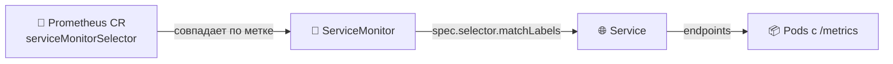

# Lab 16 — Мониторинг Kubernetes и init-контейнеры


> **Цель:** Замените `prometheus.yml` из Lab 8, который правили руками, на **kube-prometheus-stack** под управлением оператора. Затем научите `kubectl` стартовать Pod *в нужном порядке* с помощью **init-контейнеров** и посмотрите, как `restartPolicy: Always` превращает тот же примитив в sidecar.
> **Что сдать:** PR из `lab16` с файлами `monitoring-values.yaml`, `k8s/servicemonitor-app-python.yaml` (бонус), `k8s/init-demo.yaml` и `k8s/MONITORING.md`.

---

## Обзор

В Lab 8 вы запускали один контейнер `prom/prometheus` в Docker Compose и сами писали блок `scrape_configs`. В Kubernetes Pod приходят и уходят, IP меняются, и править `prometheus.yml` при каждом переселении планировщиком нельзя. **Prometheus Operator** следит за CRD **`ServiceMonitor`** и **`PodMonitor`** и заново собирает конфигурацию Prometheus, когда они меняются. Та же идея GitOps, которую вы применили к приложениям в Lab 13–14, теперь для **конфигурации сбора**.

Вы:

- Поставите Helm-чарт **kube-prometheus-stack** (оператор + Prometheus + Alertmanager + Grafana + kube-state-metrics + node-exporter — сколько оставить, решаете вы).
- Напишете **ServiceMonitor с нуля** для сервиса `app-python`. Селекторы чарта по умолчанию требуют метку `release:`. В этом весь **двухуровневый паттерн селекторов**, вокруг которого построен оператор.
- **Init-контейнерами** сделаете работу *до* запуска основного контейнера: положите файл в общий `emptyDir` и докажете, что основной контейнер его читает.
- Увидите, как тот же примитив становится **sidecar**, если переключить одно поле: `restartPolicy: Always` на init-контейнере. В Kubernetes 1.33 это GA.

> ⚠️ **Границы:** не пишем CRD AlertmanagerConfig, не описываем recording rules кодом, не собираем полный SLO-стек. Это в элективе SRE-Intro. Сегодняшний урок — *обнаружение целей сбора через оператор* и *примитивы порядка старта Pod*.

**Что отработаете:**

- CRD Prometheus Operator (`Prometheus`, `ServiceMonitor`, `PodMonitor`, `PrometheusRule`) и как оператор сверяет их в конфиг сбора
- **Двухуровневый паттерн селекторов** (Prometheus выбирает ServiceMonitor по метке → ServiceMonitor выбирает Service по метке → Service выбирает Pod)
- Переопределение values в Helm 4 для чарта с жёстким мнением: профиль lean (урезанный) и full (полный)
- Init-контейнеры как нативное для Kubernetes решение задач «подождать зависимость», «забрать конфиг», «прогнать миграцию»
- Sidecar — init-контейнеры с `restartPolicy: Always`, GA с 1.33

> 📚 В паре с **Lecture 8 — Метрики и мониторинг с Prometheus** (модель сбора и PromQL) и **Lecture 15 — StatefulSet** (паттерн sidecar ввели на границе GA). Перед стартом перечитайте слайд Lec 8 с превью Lab 16 и слайд Lec 15 про sidecar-контейнеры.

---

## Состояние проекта

**Из прошлых лабораторных у вас уже должно быть:**

- Кластер k3d на Kubernetes 1.36 (Lab 9).
- Helm-чарт `lab10-app` из Lab 10–13. Он выкатывает `app-python` (ваш код, порт **8080**, `/metrics` из Lab 8) и служебные сервисы курса: `echo` (`ghcr.io/inno-devops-labs/echo:v1`, порт 8081) и `health` (`ghcr.io/inno-devops-labs/health:v1`, порт 8082). У всех трёх есть `GET /metrics` в текстовом формате Prometheus. В этой лабораторной «app-python» — концептуальный *сервис* (Python-приложение, которое вы написали). Реальное имя Service в Kubernetes из вашего чарта — `lab10-app-web` (fullname чарта `lab10-app` плюс суффикс компонента `-web` по Lab 10). ServiceMonitor выбирает по **метке** `app.kubernetes.io/name=lab10-app`. От имени Service это не зависит: метку ставят хелперы чарта.
- `kubectl`, `helm` v4.1.x, рабочий `port-forward`.

**Эта лабораторная добавляет:**

- `monitoring-values.yaml` — переопределение Helm values для чарта (версия чарта зафиксирована, какие компоненты оставляете, resources и retention)
- `k8s/servicemonitor-app-python.yaml` — ваш ServiceMonitor (это бонус, но скорее всего напишете его ещё в задании 2)
- `k8s/init-demo.yaml` — один Pod, где видны и паттерн init, и вариант sidecar
- `k8s/MONITORING.md` — отчёт для сдачи

> 📦 **Напоминание про служебные сервисы курса.** `app-python` — **ваше** приложение. `echo` и `health` собраны заранее, вы их не собираете, и у всех трёх есть `/metrics`. Весь смысл задания 2 и бонуса: вы *пишете ServiceMonitor*. Файлы конфигурации Prometheus не правите.

---

## Подготовка

```bash
helm version              # v4.1.x — same as Lab 10
helm repo add prometheus-community https://prometheus-community.github.io/helm-charts
helm repo update
kubectl get nodes         # your k3d cluster from Lab 9 must be up
kubectl create namespace monitoring
```

Найдите актуальную версию чарта. Не плывите на `latest` — зафиксируйте её:

```bash
helm search repo prometheus-community/kube-prometheus-stack --versions | head
# As of May 2026 the chart is in the ~85.x line. Pin whatever is current when you do the lab.
```

Дальше напишете `monitoring-values.yaml`. **Не** ставьте чарт с дефолтами. Дефолты поднимают полный стек (alertmanager + node-exporter + kube-state-metrics + push gateway), и на кластер ноутбука он может не влезть.

---

## Задание 1 — Поставьте kube-prometheus-stack (2 балла)

**Цель:** поставить стек мониторинга на операторе. Оценивается навык **выбрать версию чарта, выбрать, какие компоненты оставить, и написать values так, чтобы ServiceMonitor находились шире**, — *а не* скопировать нашу команду установки.

### 1.1 — Опишите, что делает каждый компонент

`ВАША ЗАДАЧА`: в `MONITORING.md` своими словами заполните роль каждого компонента (**одно предложение на каждый**, не копируйте из README чарта):

| Компонент | Что делает в стеке |
|---|---|
| Prometheus Operator | ___ |
| Prometheus (server) | ___ |
| Alertmanager | ___ |
| Grafana | ___ |
| kube-state-metrics | ___ |
| node-exporter | ___ |

Часть из них можно **выключить** (задание 1.2). Все шесть всё равно опишите.

### 1.2 — Напишите `monitoring-values.yaml`

В чарте порядка 85 разных YAML-ручек. Нужна горстка, и именно она — урок.

`ВАША ЗАДАЧА`: напишите values-файл, в котором заданы **как минимум** четыре блока ниже.

```yaml
# monitoring-values.yaml — your overrides for kube-prometheus-stack

prometheus:
  prometheusSpec:
    # YOUR TASK: widen ServiceMonitor discovery so your custom monitor (Task 2 / Bonus)
    # is found regardless of which namespace + which labels it carries.
    # Hint: there are TWO sibling fields here, both starting with
    # serviceMonitorSelector...  and  podMonitorSelector... — read the
    # chart README's "Selector Defaults" section. Why two? Because the operator
    # has DIFFERENT defaults when the field is nil vs {} — that's the trap.
    ___: ___
    ___: ___

    # YOUR TASK: set resource requests + limits AND data retention.
    # Hints: defaults ask for ~1Gi memory which a laptop k3d may not have spare.
    # Retention is a string ('10d' / '24h') under prometheusSpec, NOT under storage.
    resources: { ___ }
    retention: ___

grafana:
  # YOUR TASK: set the admin password ONLY (lab — never hardcode a prod password).
  # Default is 'prom-operator'; pick anything but document it in MONITORING.md.
  adminPassword: ___

# YOUR TASK: pick a profile and disable the components you don't keep.
# Two profiles are acceptable; pick ONE and justify it in MONITORING.md:
#   - LEAN  — operator + Prometheus + Grafana only (laptop k3d, no node metrics)
#   - FULL  — operator + Prometheus + Grafana + KSM + node-exporter + alertmanager
# To disable a component, set its top-level block to { enabled: false }.
# (kube-state-metrics + node-exporter live under their OWN top-level keys at the
#  chart root, not under prometheus.* — look at `helm show values` output.)
```

> 🧠 **Зачем два поля селектора.** Чарт запекает в CR `Prometheus` селектор по умолчанию `release: <release-name>`. Если оставить `serviceMonitorSelector` равным *nil*, оператор ведёт себя так, будто совпадение по этой метке задано. Значит, чтобы ваш ServiceMonitor подобрали, ему нужна метка `labels: { release: monitoring }`. `serviceMonitorSelectorNilUsesHelmValues: false` говорит оператору: *«передал nil — считай селектор пустым и совпадай со всем»*. Тот же приём для PodMonitor. Имя путаное, но это штатная ручка.

### 1.3 — Установите с зафиксированной версией

`ВАША ЗАДАЧА`: напишите команду `helm install` со **своей зафиксированной** версией чарта, namespace `monitoring` и файлом `monitoring-values.yaml`:

```bash
helm install ___ prometheus-community/kube-prometheus-stack \
  --namespace ___ --create-namespace \
  --version ___ \
  -f ___
```

После установки проверьте, что *каждый* Pod в `monitoring` дошёл до `Running`/`Ready` и CRD оператора на месте. **ВАША ЗАДАЧА** — напишите две команды `kubectl` (одна перечисляет Pod в namespace monitoring, вторая — только CRD группы `monitoring.coreos.com`):

```bash
kubectl ___
kubectl ___
# Expect (at minimum, in the CRD output): servicemonitors, podmonitors,
# prometheuses, alertmanagers, prometheusrules, probes, scrapeconfigs.
```

Если Pod в `Pending`, почти всегда не хватает ресурсов. Подкрутите блок `resources:` или выключите тяжёлые компоненты.

### 1.4 — Подтверждение

Вставьте в `MONITORING.md`:

- Зафиксированную версию чарта (например `85.10.1`) и какой профиль выбрали (lean / full), с обоснованием в одно предложение
- Таблицу из шести компонентов из 1.1
- `kubectl get pods -n monitoring`: каждый выбранный Pod в `Running`/`Ready`
- `kubectl get crd | grep monitoring.coreos.com`: CRD оператора
- `kubectl get prometheus -n monitoring -o jsonpath='{.items[0].spec.serviceMonitorSelector}'` — селектор равен `{}` (совпадает со всем), а не с дефолтным совпадением `release: <release-name>`

---

## Задание 2 — Grafana и проверка целей сбора (3 балла)

**Цель:** по встроенным дашбордам и UI Prometheus прочитать здоровье *вашего* кластера и написать ServiceMonitor, который подключает приложение к конфигу сбора под оператором. **Здесь паттерн оператора отрабатывает свою роль.**

### 2.1 — Откройте UI

`ВАША ЗАДАЧА`: найдите имена Service (`kubectl get svc -n monitoring`) и напишите три команды `port-forward`. Grafana на `3000:80`, Prometheus на `9090:9090`, Alertmanager на `9093:9093` (только если оставили его). Чарт добавляет к каждому Service префикс — имя релиза. Если релиз был `kps`, сервис Grafana — `kps-grafana`, и так далее.

```bash
kubectl port-forward svc/___ -n monitoring 3000:___
kubectl port-forward svc/___ -n monitoring 9090:___
# (Alertmanager only if you kept it enabled in Task 1.2)
kubectl port-forward svc/___ -n monitoring 9093:___
```

### 2.2 — Прочитайте кластер по встроенным дашбордам

На каждый вопрос ниже — скриншот и **чтение в одну строку**. Числа на вашем кластере будут другими. Вопрос в том, что график *значит*, а не какое там число.

1. **Ресурсы узла (метод USE):** утилизация CPU узла и занятая память. *Дашборд: "Node Exporter / Nodes".* Если взяли lean и выключили node-exporter, подставьте *"Kubernetes / Compute Resources / Cluster"* и объясните замену.
2. **Вычисления по namespace:** какие Pod в `<your-app-ns>` едят больше всего и меньше всего CPU и памяти? *Дашборд: "Kubernetes / Compute Resources / Namespace (Pods)".*
3. **Детали по Pod:** троттлинг CPU и working set памяти у одного Pod `app-python`. *Дашборд: "Kubernetes / Compute Resources / Pod".*
4. **Состояние кластера (kube-state-metrics):** число Pod по фазе. Напишите `sum by (phase) (kube_pod_status_phase)`, если оставили KSM. Если нет, объясните, почему на установке lean у запроса нет результата.
5. **Алерты:** сколько алертов горит? На свежем кластере kube-prometheus-stack всегда горит алерт `Watchdog`. Одним предложением объясните, *зачем* он нужен.

### 2.3 — Напишите ServiceMonitor для `app-python` (это и есть урок)

Весь смысл оператора: **файл конфигурации Prometheus вы больше не правите**. Вы пишете `ServiceMonitor`, блок сбора пишет оператор. Двухуровневый паттерн селекторов:



Три метки, три совпадения, в этом порядке. Сломаете любое — цель тихо не появится.

`ВАША ЗАДАЧА`: напишите `k8s/servicemonitor-app-python.yaml` с нуля. Форма задана. **Поля, которые и есть навык**, пустые.

```yaml
apiVersion: monitoring.coreos.com/v1
kind: ServiceMonitor
metadata:
  name: app-python
  # YOUR TASK: which namespace?  Two valid answers:
  #   - your app's namespace (then your monitoring-values.yaml MUST have
  #     serviceMonitorSelectorNilUsesHelmValues: false from Task 1)
  #   - the monitoring namespace (then add a sibling 'namespaceSelector' below
  #     that points at the app's namespace — the Service is across namespaces)
  # Pick one, document the choice in MONITORING.md.
  namespace: ___
  labels:
    # YOUR TASK: at minimum the chart's release-discriminator label so the
    # operator's DEFAULT selector would also pick it up. (Belt-and-braces:
    # works even if Task 1's serviceMonitorSelectorNilUsesHelmValues regresses.)
    # If your release was `monitoring`, the label key/value pair is...
    ___: ___
spec:
  # Level 2: ServiceMonitor → Service. Match the Service by its labels.
  selector:
    matchLabels:
      # YOUR TASK: a label that uniquely identifies your app-python Service.
      # Hint: your Lab 10 helpers emit  app.kubernetes.io/name=<chart-name>
      ___: ___
  # OPTIONAL — only needed if this ServiceMonitor lives in a DIFFERENT namespace
  # from the Service it selects. Default behaviour is "same namespace only".
  # namespaceSelector:
  #   matchNames: [<your-app-ns>]
  endpoints:
    # YOUR TASK: which port of the Service to scrape, which path, how often.
    # CRITICAL: 'port' is the Service port's NAME (a string), not a number.
    # Your app-python Service MUST already have a named port — check Lab 10's
    # service.yaml. If not, add one and `helm upgrade` first.
    - port: ___
      path: ___
      interval: ___
```

После apply проверьте из CLI (сначала port-forward на Prometheus). Скелет:

```bash
kubectl apply -f k8s/servicemonitor-app-python.yaml
# Wait ~30s for the operator to reconcile, then:
kubectl get servicemonitor -A          # yours should appear

# YOUR TASK: pipe Prometheus's /api/v1/targets through jq to extract ONLY your
# app-python target, showing its health + last scrape time + URL. The filter is:
#   .data.activeTargets[] | select(.labels.job == "<your-job-name>") | {health, lastScrape, scrapeUrl}
curl -s localhost:9090/api/v1/targets | jq '___'
```

> ⚠️ **Если цель не появилась**, идите по порядку. (1) `kubectl describe prometheus -n monitoring <release>-kube-prometheus-prometheus` и grep вашего ServiceMonitor в Status: оператор пишет, почему пропустил. (2) `kubectl get svc <app-python> -o yaml | grep -A3 ports:` — порт **именованный**? (3) `spec.selector.matchLabels` вашего ServiceMonitor точно совпадает с меткой на Service? (4) в metadata.labels ServiceMonitor есть `release: <release>` *или* вы отключили этот селектор в задании 1? Шаг 4 пропускаете, только если в задании 1 поставили `nilUsesHelmValues: false`.

### 2.4 — PromQL на живом кластере

Когда все три сервиса уже собираются (`app-python` через ваш ServiceMonitor, `echo` и `health` через отдельные мониторы, которые напишете так же, *или* через service discovery оператора по умолчанию, если на них нужные метки), те же запросы RED и USE из Lab 8 работают, но данные интереснее.

`ВАША ЗАДАЧА`: запишите в `MONITORING.md` **три** запроса PromQL. К каждому — чтение в одну строку. Форма каждого задана, заполните тело. Не копируйте Lab 8 дословно: форма данных изменилась (больше меток, нативные для Kubernetes метки `job=`, селекторы namespace и pod).

```promql
# 1) "Are all three of my services being scraped right now?"
#    YOUR TASK: one query returning 1 per UP target, filtered to your three jobs.
#    Hint: the metric is `up`; filter with {job=~"<regex>"} to match a|b|c.
___

# 2) RED — per-service request rate over a 5-minute window.
#    YOUR TASK: aggregate the per-pod counter into a per-service rate.
#    Hint: rate() of a Counter, summed by `job` (k8s ServiceMonitor sets job=<SM-name>).
sum by (___) (rate(___[5m]))

# 3) USE — pick ONE: node-level if you kept node-exporter,
#    OR cluster-level CPU saturation if you went lean (use kube-state-metrics).
#    YOUR TASK: write the query you'd graph on a SRE on-call dashboard.
___
```

### 2.5 — Подтверждение

Вставьте в `MONITORING.md`:

- Ваш `servicemonitor-app-python.yaml` целиком
- Скриншот Prometheus → Status → Targets, где `app-python` в статусе `UP`
- Вывод `kubectl get servicemonitor -A` (ваш есть в списке)
- Три запроса PromQL и чтения в одну строку
- Пять ответов по дашбордам из 2.2 со скриншотами
- Объяснение алерта `Watchdog` в одну строку

---

## Задание 3 — Init-контейнеры и sidecar (3 балла)

**Цель:** init-контейнерами сделать подготовку *до* старта основного контейнера, затем тем же примитивом получить sidecar. Для этого переключите одно поле.

> 📚 **Init-контейнеры** идут по очереди. Каждый должен выйти с кодом `0`, прежде чем стартует следующий, и **все** init-контейнеры должны успешно закончиться, прежде чем стартует контейнер приложения. Так ждут зависимость, забирают конфиг или гоняют миграцию, *не* запекая эту логику в образ. **Sidecar** — это `restartPolicy: Always` на init-контейнере, GA с Kubernetes 1.33. Тот же список, другая семантика: init-контейнер *дошёл до конца*, sidecar *продолжает работать* рядом с основным контейнером и гасится вместе с ним.

### 3.1 — Init-контейнер: скачать, потом отдать

`ВАША ЗАДАЧА`: в `k8s/init-demo.yaml` напишите один `kind: Pod`. Он доказывает, что init-контейнер дошёл до конца *до* старта основного, и основной контейнер *потребляет* то, что записал init.

Поток данных:

```
init container → writes /work/index.html → emptyDir volume → main container reads /usr/share/nginx/html/index.html
```

Форма задана. Строки, которые *и есть навык*, пустые.

```yaml
apiVersion: v1
kind: Pod
metadata:
  name: initdemo
  labels: { app: initdemo }
spec:
  initContainers:
    - name: fetch-content
      # YOUR TASK: pick a tiny image with a shell + an echo or wget.
      # Hints: busybox:1.37, alpine:3.21. The image MUST be able to run `sh -c`.
      image: ___
      # YOUR TASK: a shell one-liner that ends with exit 0.
      # Requirements:
      #   - writes a NON-EMPTY file to /work/index.html
      #   - the file content must contain a string ('ready', a date, anything)
      #     that you can later assert from the main container
      # Hint: `sh -c 'echo "ready @ $(date -u +%FT%TZ)" > /work/index.html'`
      command: ['sh', '-c']
      args: ['___']
      volumeMounts:
        # YOUR TASK: mount the shared emptyDir at /work
        - { name: ___, mountPath: ___ }

  containers:
    - name: app
      # YOUR TASK: a webserver image that serves files from a docroot.
      # Hint: nginx:1.27-alpine reads /usr/share/nginx/html by default.
      image: ___
      ports: [{ containerPort: 80 }]
      volumeMounts:
        # YOUR TASK: mount the SAME emptyDir at the webserver's docroot.
        # The init wrote /work/index.html — what's nginx's docroot path?
        - { name: ___, mountPath: ___ }

  volumes:
    - name: workdir
      emptyDir: {}
```

Проверка. `ВАША ЗАДАЧА`: допишите две команды `kubectl` и один `curl`.

```bash
kubectl apply -f k8s/init-demo.yaml
kubectl get pod initdemo -w        # watch: Init:0/1 → PodInitializing → Running

# YOUR TASK: print ONLY the terminated reason of the first init container
# (must be the string 'Completed'). Hint: jsonpath against .status.initContainerStatuses[0].
kubectl get pod initdemo -o jsonpath='___'

# YOUR TASK: prove the main container is serving the file the init wrote.
# Hint: port-forward, then curl localhost:8080/index.html (or whichever filename
# you wrote in 3.1) — the response body must contain the string init wrote.
kubectl port-forward pod/initdemo ___
curl -s localhost:___/___
```

### 3.2 — Sidecar: тот же примитив, другая политика рестарта

`ВАША ЗАДАЧА`: добавьте **вторую** запись в `initContainers:` того же Pod. Сделайте её *sidecar* (долго живёт, рядом с основным контейнером): поставьте `restartPolicy: Always` только на этом init-контейнере.

```yaml
spec:
  initContainers:
    - name: fetch-content     # from 3.1 — unchanged, run-to-completion
      # ...

    # NEW: a sidecar — long-running, NOT run-to-completion.
    - name: log-tail
      image: busybox:1.37
      # YOUR TASK: pick the field that flips this from init → sidecar.
      # Hint: lives on the container, valid values are 'Always' / 'OnFailure' / 'Never'.
      # GA in K8s 1.33 — your k3d 1.36 supports it natively. NO feature gate flip needed.
      ___: ___
      command: ['sh', '-c']
      # YOUR TASK: a command that runs FOREVER (never exits 0).
      # Suggested: tail -F /work/index.html  — prints any new writes for the lifetime of the pod.
      args: ['___']
      volumeMounts:
        - { name: workdir, mountPath: /work }
```

Запись sidecar **остаётся в `initContainers:`**. Это не опечатка. Фичу ввели в Kubernetes 1.29, в 1.33 она стала GA. *Sidecar* — это init-контейнер с `restartPolicy: Always`. API не переехал, переехала *семантика*. Проверьте, что оба поведения живут вместе. `ВАША ЗАДАЧА`: напишите три команды.

```bash
kubectl apply -f k8s/init-demo.yaml

# YOUR TASK: show the pod with its READY count. Once the sidecar is up alongside
# the main container, READY must be 2/2 — that's the headline of the 1.33 GA.
kubectl ___

# YOUR TASK: tail the sidecar's logs (it should stream forever).
kubectl logs initdemo -c ___

# YOUR TASK: prove the OTHER init container (fetch-content) STILL ran-to-completion.
# Hint: a jsonpath over .status.initContainerStatuses[*] showing each entry's name and state.
kubectl get pod initdemo -o jsonpath='___'
```

### 3.3 — Выберите нужный примитив

В `MONITORING.md` ответьте (не больше 2 предложений на пункт): **init / sidecar / ни то ни другое**.

1. Подождать, пока Service Postgres начнёт принимать соединения, и только потом стартовать API.
2. Стримить `/var/log/app.log` приложения в stdout, чтобы его забрал kubelet.
3. Прогнать разовую миграцию БД при каждом обновлении чарта.
4. Обновлять ключ подписи JWT каждые 10 минут, пока живёт Pod.

> 💡 Первый пункт — классическая ловушка. Неверный ответ: «init-контейнер с `sleep`, пока порт не откроется». Это хрупко и прячет настоящее исправление. Один из четырёх — **вообще не** init и **не** sidecar. Это примитив, который вы писали в Lab 10. Напишите, какой и почему.

### 3.4 — Подтверждение

Вставьте в `MONITORING.md`:

- `k8s/init-demo.yaml` целиком
- `kubectl get pod initdemo -o jsonpath='{.status.initContainerStatuses[0].state.terminated.reason}'` со значением `Completed`
- `curl` к `localhost:8080/index.html`: в ответе строка, которую записал init
- Захват `kubectl logs initdemo -c log-tail` (хватит нескольких строк)
- Четыре ответа «выберите примитив»

---

## Задание 4 — Документация (2 балла)

`ВАША ЗАДАЧА`: напишите `k8s/MONITORING.md`. По порядку:

1. **Выбор чарта** — зафиксированная версия, профиль lean или full, таблица из шести компонентов
2. **Обнаружение** — ваш `monitoring-values.yaml` (расширение селектора, resources, retention), `kubectl get prometheus -o jsonpath`, который показывает, что селектор широкий, и абзац своими словами про **двухуровневый паттерн селекторов**
3. **ServiceMonitor** — ваш `servicemonitor-app-python.yaml`, скриншот UI Prometheus, запрос `up{...}`
4. **Дашборды** — пять чтений из задания 2 со скриншотами и объяснение `Watchdog`
5. **Init и sidecar** — манифест, доказательство `Completed`, curl, логи sidecar, четыре ответа «выберите примитив»
6. **Сложности и выводы** — хотя бы одна настоящая (селектор не совпал, нет именованного порта, размер профиля lean и т.д.)

> 📸 Скриншоты считаются. «У меня работает» без доказательств по этому пункту даёт ноль.

---

## Бонус — Своя метрика через второй ServiceMonitor (2 балла)

**Цель:** отдать из `app-python` *свою бизнес-метрику* и доказать, что оператор её собирает без дальнейших правок конфига. Это замена руками написанного `scrape_config` из Lab 8, уже нативная для оператора.

Здесь вас меньше ведут за руку.

`ВАША ЗАДАЧА`:

1. **Добавьте в `app-python` бизнес-метрику с ограниченной кардинальностью** через `prometheus_client`. **Тип** метрики и **метки** выберите сами, но **метки только с ограниченным набором значений**. Пройдите ревью кардинальности: `Counter` по короткому перечислению (один из `/`, `/health`, `/info`) или `Gauge` на одно глобальное число. Провал: всё, где есть `user_id`, `request_id` или куски пути без верхней границы. **ВАША ЗАДАЧА** — напишите не больше 10 строк Python и вставьте diff в `MONITORING.md`.
2. **Убедитесь, что у Service `app-python` есть ИМЕНОВАННЫЙ порт** для `/metrics`. Если Lab 10 открывает только безымянный `port:`, добавьте второй порт. SM совпадает по имени:

   ```yaml
   # Edit your chart's templates/service.yaml ports: block.
   ports:
     - { name: http, port: ___, targetPort: ___ }      # YOUR TASK: existing app port
     - { name: ___, port: ___, targetPort: ___ }       # YOUR TASK: NAMED metrics port for the SM
                                                      # (only needed if you separate /metrics onto a
                                                      # different port; the simpler path is reusing the
                                                      # existing `http` port since the app serves /metrics
                                                      # on the same listener as the app endpoints)
   ```

3. **Напишите второй ServiceMonitor (или поправьте тот из задания 2)**, чтобы он собирал новый именованный порт. Добавьте блок `relabelings:`, который ставит метке `job` читаемое значение. Форма:

   ```yaml
   spec:
     endpoints:
       - port: ___                       # YOUR TASK: the name from the Service port above
         path: ___                       # YOUR TASK: where prometheus_client serves metrics
         interval: ___
         relabelings:
           # YOUR TASK: one rewrite that sets the `job` label to a custom value.
           # Hint: action: replace, targetLabel: job, replacement: <your-value>
           - ___
   ```

4. **Проверьте** в UI Prometheus (Status → Targets), что новый эндпоинт в `UP` и метрика запрашивается. **ВАША ЗАДАЧА** — вставьте точный запрос PromQL, которым строили график своей метрики во времени (подсказка: `rate(<your-counter>[5m])` с нужной агрегацией по меткам).

Вставьте в `MONITORING.md`:

- Diff на Python, который добавляет метрику (не больше 10 строк)
- Блок именованного порта вашего Service
- Новый или поправленный ServiceMonitor
- Скриншот Prometheus → Targets, где новый эндпоинт в `UP`
- Скриншот панели Grafana с графиком вашей метрики

> 🧠 **Оператор и Lab 8 (главное).** В Lab 8 вы дописали `- job_name: app` в `prometheus.yml`, перезапустили контейнер и надеялись. Здесь вы добавляете объект `ServiceMonitor`, и оператор сам пересобирает конфиг сбора: декларативно, со сверкой. Это переживает текучку Pod и обновления оператора. Результат тот же, обвязка нативная для Kubernetes.

---

## Как сдать

```bash
git switch -c lab16
git add monitoring-values.yaml k8s/
git commit -m "feat(lab16): kube-prometheus-stack + ServiceMonitor + init/sidecar demo"
git push -u origin lab16
```

Откройте **два** PR:

- `your-fork:lab16` → `course-repo:master` *(на ревью)*
- `your-fork:lab16` → `your-fork:master` *(вливается в ваш main, когда закончите)*

Чеклист PR:

```text
- [ ] Task 1 — chart version pinned, profile + components documented, all pods Running, CRDs present
- [ ] Task 2 — ServiceMonitor written from scratch, app-python visible in Targets as UP, three PromQL queries documented, five dashboard answers with screenshots
- [ ] Task 3 — initdemo Pod with both an init container (Completed) and a sidecar (Running), four pick-the-primitive answers
- [ ] Task 4 — MONITORING.md with all six sections + evidence
- [ ] Bonus — custom bounded metric + named port + second ServiceMonitor scraped and graphed
```

---

## Критерии приёмки

### Задание 1 — Поставьте стек (2 балла)
- ✅ **Версия чарта зафиксирована** (не `latest`); установка в namespace `monitoring`
- ✅ Все выбранные Pod доходят до `Running`/`Ready`; CRD оператора на месте (`servicemonitors`, `podmonitors`, `prometheuses`, …)
- ✅ Стоит `serviceMonitorSelectorNilUsesHelmValues: false` (или эквивалент), чтобы мониторы находились по всему кластеру
- ✅ `kubectl get prometheus -o jsonpath='{...serviceMonitorSelector}'` возвращает `{}`
- ✅ Таблица из шести компонентов заполнена своими словами

### Задание 2 — Grafana и ServiceMonitor (3 балла)
- ✅ Grafana и Prometheus доступны через port-forward (Alertmanager — только если оставили)
- ✅ Пять ответов по дашбордам со скриншотами
- ✅ **Свой** `ServiceMonitor` для `app-python` написан с нуля (не копия из README чарта)
- ✅ В Prometheus → Targets у `app-python` статус `UP`
- ✅ Три запроса PromQL с чтением в одну строку; `up{job=~"app-python|echo|health"}` = 1 для всех
- ✅ Алерт `Watchdog` объяснён

### Задание 3 — Init и sidecar (3 балла)
- ✅ Init-контейнер пишет непустой файл в общий `emptyDir`; основной контейнер его отдаёт
- ✅ `initContainerStatuses[0].state.terminated.reason` = `Completed`
- ✅ `curl` к основному контейнеру возвращает строку, которую записал init
- ✅ Sidecar (`restartPolicy: Always` на второй записи init) в `Running` рядом с основным контейнером
- ✅ Четыре ответа «выберите примитив» верные

### Задание 4 — Документация (2 балла)
- ✅ `MONITORING.md` покрывает все шесть обязательных разделов, с доказательствами
- ✅ Записаны версия чарта и `monitoring-values.yaml`
- ✅ Все скриншоты на месте и читаются

### Бонус — Своя метрика (2 балла)
- ✅ В `app-python` новая бизнес-метрика с ограниченной кардинальностью
- ✅ Service открывает **именованный** порт для `/metrics`
- ✅ Новый или поправленный ServiceMonitor её собирает; в Targets она `UP`
- ✅ Метрика на графике в Grafana

---

## Критерии оценивания

| Задание | Баллы | Критерии |
|------|-------:|----------|
| **Задание 1** — Поставить стек | **2** | Версия чарта зафиксирована, компоненты описаны, все Pod здоровы, селектор расширен |
| **Задание 2** — ServiceMonitor и дашборды | **3** | SM написан с нуля, цель UP, по дашбордам есть ответы |
| **Задание 3** — Init и sidecar | **3** | Оба паттерна доказаны в одном Pod, примитивы выбраны верно |
| **Задание 4** — Документация | **2** | `MONITORING.md` полный, со скриншотами |
| **Бонус** — Своя метрика | **2** | Своя метрика, именованный порт, SM собирает, график есть |
| **Итого** | **12** | 10 основных + 2 бонус |

**Оценивание:**
- **10/10:** стек здоров, ServiceMonitor написан чисто, init и sidecar оба доказаны, документация подробная
- **8–9/10:** мониторинг работает от начала до конца; мелкие пробелы в ответах по дашбордам или в доказательствах init
- **6–7/10:** стек ставится, но ServiceMonitor опирается на дефолты чарта, или нет варианта sidecar
- **<6/10:** стек нездоров, сбор не проверен или в репозитории нет `init-demo.yaml`

---

## Материалы

<details>
<summary>📚 Документация</summary>

- [Чарт kube-prometheus-stack](https://github.com/prometheus-community/helm-charts/tree/main/charts/kube-prometheus-stack)
- [Prometheus Operator — дизайн](https://prometheus-operator.dev/docs/getting-started/design/)
- [ServiceMonitor и PodMonitor](https://prometheus-operator.dev/docs/developer/getting-started/)
- [Селекторы по умолчанию в чарте](https://github.com/prometheus-community/helm-charts/tree/main/charts/kube-prometheus-stack#prometheusspec)
- [Документация Prometheus 3.x](https://prometheus.io/docs/)
- [Документация Grafana](https://grafana.com/docs/)
- [Init-контейнеры](https://kubernetes.io/docs/concepts/workloads/pods/init-containers/)
- [Sidecar-контейнеры (GA 1.33)](https://kubernetes.io/docs/concepts/workloads/pods/sidecar-containers/)
- [Метод USE (Brendan Gregg)](https://www.brendangregg.com/usemethod.html) · [Метод RED (Tom Wilkie)](https://grafana.com/blog/the-red-method-how-to-instrument-your-services/)

</details>

<details>
<summary>⚠️ Типичные ловушки (с реальных пробных прогонов)</summary>

- **ServiceMonitor не в том namespace.** По умолчанию ServiceMonitor выбирает Service только в **своём** namespace. Положите SM в `monitoring/`, а Service живёт в namespace приложения — совпадений не будет. Как починить: либо положите SM в namespace приложения, либо добавьте в SM в `monitoring/` поле `spec.namespaceSelector.matchNames: [<app-ns>]`.
- **На ServiceMonitor нет метки `release:`.** Дефолтный `serviceMonitorSelector` чарта требует `release: <release-name>` на каждом мониторе. Если вы не поставили `serviceMonitorSelectorNilUsesHelmValues: false` и не добавили метку `release:`, оператор молча игнорирует ваш SM. `kubectl describe prometheus -n monitoring <release>` показывает, какие мониторы пропущены и почему.
- **Порт Service без имени.** `endpoints.port` в ServiceMonitor — это **имя** порта Service (строка), а не число. `port: 5000` выглядит валидно, и линтер молчит, но оператор не может его разрешить, и цель так и не появляется. Всегда так: `ports: [{ name: http, port: 80, targetPort: 5000 }]` и `endpoints: [{ port: http, ... }]`.
- **Конфликт с уже существующими CRD Prometheus.** kube-prometheus-stack везёт свои CRD со своим мнением. Если вы уже ставили upstream Prometheus Operator отдельно или другой Helm-релиз того же чарта, CRD сталкиваются. Helm 4 откажется ставить и напишет «resource already exists». Чистая зачистка: `helm uninstall <other-release> -n <ns>` и `kubectl delete crd $(kubectl get crd -o name | grep monitoring.coreos.com)`, и только потом ставьте снова.
- **Init-контейнер, который ждёт Service через `sleep N`, — дурной запах.** «Подождать базу» опросом — хрупко (`sleep 5; nc -z db 5432; if [ $? -ne 0 ]; then sleep 10; fi`: работает, пока не перестанет). Нативное для Kubernetes исправление: **readiness gate** и sidecar, который этот gate переключает, или научите приложение само повторять коннект к БД на старте. Init-контейнер должен дойти *до конца*, а не крутиться, *пока* что-то не станет истинным.
- **Sidecar нужны Kubernetes ≥ 1.29 (beta) / 1.33 (GA).** `restartPolicy: Always` на записи `initContainers[]` на старых кластерах ничего не меняет: контейнер становится обычным init и выходит, когда завершается команда. На вашем k3d 1.36 поддержка GA есть. Если целитесь в управляемый кластер старше 1.33, проверьте `kubectl version`.
- **Профиль lean и дашборды, завязанные на `node-exporter`.** Выключите `nodeExporter` и `kube-state-metrics`, чтобы влезло на ноутбук, — дашборды "Node Exporter / Nodes" и "Kubernetes / Cluster" опустеют. Так и задумано, это не баг. Подставьте "Kubernetes / Compute Resources / Cluster" (только KSM) или поднимите полный профиль.
- **Watchdog — не ошибка.** kube-prometheus-stack везёт `PrometheusRule` `Watchdog`, который *всегда горит*. Его задача — *доказать, что цепочка доставки алертов жива*. Если `Watchdog` когда-нибудь перестанет гореть, мониторинг сломан. Многие проверяющие в день 0 видят «1 alert firing» и пугаются. Не надо.

</details>

<details>
<summary>📖 Материалы для чтения</summary>

- [Документация Prometheus Operator — заметки о дизайне селекторов](https://prometheus-operator.dev/docs/getting-started/design/)
- [Sidecar-контейнеры Kubernetes — блог про GA (1.33)](https://kubernetes.io/blog/2025/04/01/kubernetes-v1-33-sidecar-containers-ga/)
- *Cloud Native Observability with Prometheus* (2023) — Wakeling & Hartmann, Manning — глава про паттерн оператора

</details>

---

## Что дальше

Вы собрали полный жизненный цикл DevOps на Kubernetes: приложение (Lab 1–3), контейнеры (Lab 2), CI/CD (Lab 3–5), конфиг, логи и метрики (Lab 6–8), кластер (Lab 9–12), GitOps и прогрессивную доставку (Lab 13–14), stateful-нагрузки (Lab 15) и мониторинг кластера через оператор (эта лабораторная). Стек наблюдаемости, который вы гоняли локально в Compose в Lab 7–8, теперь под оператором и нативен для Kubernetes. Те же метрики, тот же PromQL. Цели находятся сами через CRD, а не через файл конфига, правленый руками.

**Необязательные элективы (вместо экзамена):**

- **Lab 17:** выкатите сервис из Lab 1 на **Cloudflare Workers** (изоляты V8 на edge)
- **Lab 18:** упакуйте его воспроизводимо через **Nix** flakes

---

**Удачи!** 📊

> **Запомните:** с оператором вы объявляете, *что* собирать. *Как* — дело платформы. Если вы написали ServiceMonitor руками и ни разу не тронули `prometheus.yml`, урок усвоен.
