# 📌 Lecture 1 — Введение в DevOps: от хаоса к потоку

## 📍 Слайд 1 – 🚀 Добро пожаловать в DevOps

* 🌍 **Software is eating the world** (софт пожирает мир) — но надёжно выкатывать его трудно
* 😰 Команды буксуют: медленные релизы, сломанные деплои, поиск виноватых
* 🌉 **DevOps закрывает разрыв** между **разработкой** и **эксплуатацией** софта
* 🎯 Этот курс: практические навыки выкатывать софт так, как это делают современные команды

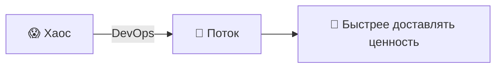

> 📚 **Рамка семестра:** каждая лаба курса про проблему, которую закрывает DevOps. Сегодня называем проблемы; следующие 16 недель вы собираете решения сами.

---

## 📍 Слайд 2 – 🎯 Чему научитесь

* ✅ Сформулировать DevOps и базовые принципы (CAMS, Three Ways)
* ✅ Узнавать антипаттерны до DevOps в живых командах
* ✅ Сопоставить практики DevOps (CI/CD, IaC, наблюдаемость) с проблемами, которые они закрывают
* ✅ Читать метрики DORA и отличать elite от low performers
* ✅ Пройти по циклу DevOps и найти на нём лабы курса

**🎓 К концу лекции:**

| # | Результат |
|---|---------|
| 1 | 🧠 Сформулировать DevOps своими словами |
| 2 | 🔍 Узнать силосы, страх и toil (ручная работа, которая не заканчивается) — то, с чем DevOps и борется |
| 3 | 🛠️ Сопоставить каждую практику DevOps со сбоем, который она закрывает |
| 4 | 🗺️ Разложить каждую лабу курса по циклу DevOps |

---

## 📍 Слайд 3 – 📜 Короткая история

* 📅 **2009** — Patrick Debois собирает **DevOpsDays** в Генте, Бельгия. Так появляется слово *"DevOps"*.
* 📅 **2009** — John Allspaw и Paul Hammond показывают *"10+ Deploys per Day"* на Velocity. Это культурный манифест.
* 📅 **2011** — Werner Vogels (CTO Amazon): на пике Amazon выкатывает в прод **каждые 11.7 секунды**.
* 📅 **2013** — **Docker** открывает исходники. Контейнеры становятся мейнстримом.
* 📅 **2014** — Google анонсирует **Kubernetes**. Оркестрация контейнеров взлетает.
* 📅 **2016** — выходит **The DevOps Handbook** (Kim, Humble, Debois, Willis).
* 📅 **2018** — в *Accelerate* Nicole Forsgren публикует четыре метрики DORA.
* 📅 **2024** — отчёт DORA *State of DevOps*: **19% elite + 22% high performers** (вместе 41%; последний отчёт с этой классификацией).
* 📅 **2025** — DORA убирает лестницу Elite/High/Medium/Low. Вместо неё **семь архетипов команд**: скорость поставки плюс люди (выгорание, трение, ощущаемая ценность).

> 🤔 **Заметьте:** DevOps начался как движение про культуру, не как анонс инструмента.

---

## 📍 Слайд 4 – ❓ Главный вопрос

* 📊 **70%+** крупных IT-проектов сильно выбиваются из бюджета или сроков (McKinsey)
* ⏱️ Lead time от коммита до прода до DevOps: **недели или месяцы**
* 💥 Главный источник аварий — **изменения**: деплои, правки конфига, обновления зависимостей

> 💬 *«У меня на машине работало.»* — каждый разработчик, всегда

**🤔 Обсуждение:**
* Почему поставка софта так трудна?
* Почему команды боятся деплоев?
* Как для вашей команды выглядит «хорошо»?

---

## 📍 Слайд 5 – 🔥 Раздел 1: проблема до DevOps

* 👨‍💻 **Разработка** и ⚙️ **эксплуатация** были разными командами с противоположными целями
* 🚀 Dev хотели: **быстро выкатывать фичи** (мерили скоростью)
* 🛡️ Ops хотели: **держать системы стабильными** (мерили аптаймом)
* 💥 Итог: **конфликт ролей, обвинения и медленная поставка**

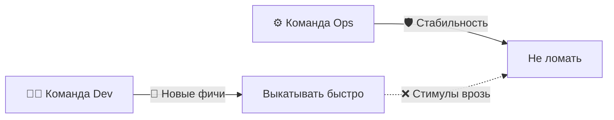

> 📖 *The Phoenix Project* (Kim, Behr, Spafford, 2013; рус. «Проект „Феникс“») показывает ровно этот конфликт. На курсе это обязательное чтение.

---

## 📍 Слайд 6 – 🧱 Стена непонимания

* 🧱 **Стена** = невидимый барьер между Dev и Ops
* 📦 Dev «перебрасывает код через стену»; когда всё ломается, виноваты Ops
* 🔄 Ops отклоняет изменения, чтобы не рисковать; Dev обходит Ops стороной

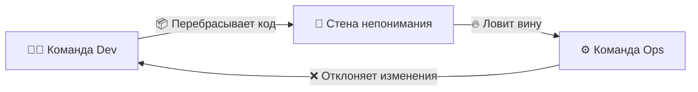

> 🤔 **Подумайте:** в вашем последнем учебном проекте кто был бы «Dev», а кто «Ops»?

---

## 📍 Слайд 7 – 😱 Ад ручных релизов

* 📅 Деплои — редкие события (раз в месяц или квартал)
* 🎰 Каждый релиз = **высокий риск, общий аврал**
* 📋 Ручные чеклисты, работа в выходные, нет плана отката
* 💀 Одна ошибка = часы восстановления и злые пользователи

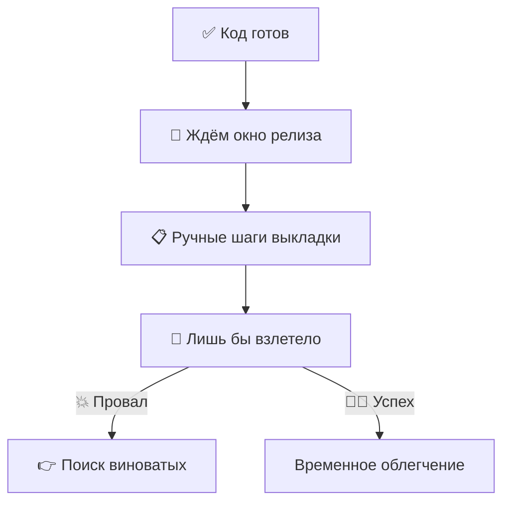

**📊 Цифры до DevOps (Accelerate, 2018):**
* 🐢 Lead time изменений: **месяцы** (low performers)
* 📉 Доля неудачных изменений: **40–60%** у low performers
* ⏱️ Восстановление после инцидента: **неделя и больше**

---

## 📍 Слайд 8 – 😨 Культура страха и обвинений

* 🌙 Инцидент в 2 часа ночи — первый вопрос: *«Кто это сделал?»*
* 🙈 Инженеры прячут ошибки; в пятницу никто не деплоит
* 💀 Инновации замирают; самый безопасный ход — ничего не делать

> ⚠️ **Страх убивает скорость.**

**Симптомы культуры обвинений:**
* 🔇 На постмортемах люди боятся говорить
* 📝 Документацию пишут, чтобы прикрыться
* 🐌 Решения принимают медленно, всё эскалируют
* 🚪 Сильные инженеры уходят

> 📖 *«Без постмортемов, где не ищут виноватых, организации не учатся на инцидентах.»* — Google SRE Book (Beyer et al.)

---

## 📍 Слайд 9 – 💸 Цена хаоса

| 🔥 Проблема | 💥 Цена |
|------------|-----------|
| 🐢 Медленные релизы | Упущенный рынок, конкуренты выкатывают первыми |
| 📋 Ручные процессы | Ошибки людей, выгорание, усталость от дежурств |
| 👉 Культура обвинений | Сильные уходят, знание утекает |
| 🙈 Нет наблюдаемости | Режим пожаротушения, MTTR в часах, не в минутах |

**📈 Конкретные примеры:**
* 🏢 **Amazon до DevOps (начало 2000-х):** монолитные деплои занимали **недели**
* 🚀 **Amazon сегодня:** ~50 миллионов деплоев в год по сервисам (Werner Vogels, re:Invent)
* 💰 **IBM Cost of a Data Breach:** пик **$4.88M (2024)**, затем **падение до $4.44M в 2025**: детекция с ИИ сократила время локализации; **средний ущерб в США поставил рекорд $10.22M** в 2025

> 🔥 **Жёстко:** каждый час простоя кто-то оплачивает. Вопрос в том, платите *вы* или *ваши пользователи*.

---

## 📍 Слайд 10 – 💡 Раздел 2: что такое DevOps на самом деле

* 🤝 **DevOps** = разработка + эксплуатация как **одна команда**
* 🌱 **Культура** сотрудничества и общей ответственности
* 🔧 Набор **практик** быстрой и надёжной поставки
* 🚫 Это НЕ просто инструменты, НЕ должность и НЕ отдельная команда

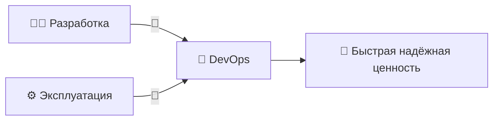

**📖 Рабочее определение (Humble & Farley, *Continuous Delivery*, 2010):**
> DevOps — набор практик, который соединяет разработку и IT-эксплуатацию, чтобы укоротить цикл разработки и часто выкатывать фичи, фиксы и обновления в ногу с целями бизнеса.

---

## 📍 Слайд 11 – 🚫 Что DevOps — это НЕ

| ❌ Миф | ✅ Как на самом деле |
|---------|-----------|
| «Наняли DevOps-инженера — и готово» | 👥 Участвуют все |
| «DevOps — это поставить Kubernetes» | 🛠️ Инструменты служат культуре, не наоборот |
| «DevOps заменяет разработчиков или ops» | 🤝 Он их соединяет |
| «DevOps = просто автоматизация» | 🧩 Автоматизация + культура + измерения + обмен |
| «DevOps — это команда» | 🌍 Это способ работать |

> 🔥 **Жёстко:** DevOps не купить. Его строят.

---

## 📍 Слайд 12 – 🔄 Три пути

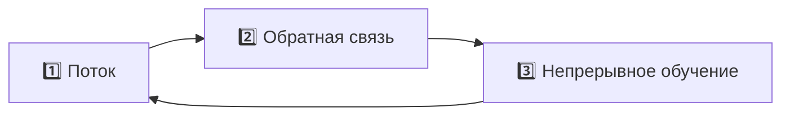

| 🛤️ Путь | 🎯 Фокус | 💡 Пример из практики |
|--------|---------|-----------|
| 1️⃣ **Поток** | Быстро Dev → прод | 🚀 CI/CD pipeline (цепочка автоматической сборки и выкладки), trunk-based development |
| 2️⃣ **Обратная связь** | Быстро прод → Dev | 📊 Мониторинг, алерты, error budget (бюджет ошибок) |
| 3️⃣ **Непрерывное обучение** | Безопасные эксперименты | 📝 Постмортемы без поиска виноватых, chaos engineering |

> 📚 **Источник:** *The Phoenix Project* и *The DevOps Handbook* (Kim et al.)

---

## 📍 Слайд 13 – 🧩 Модель CAMS

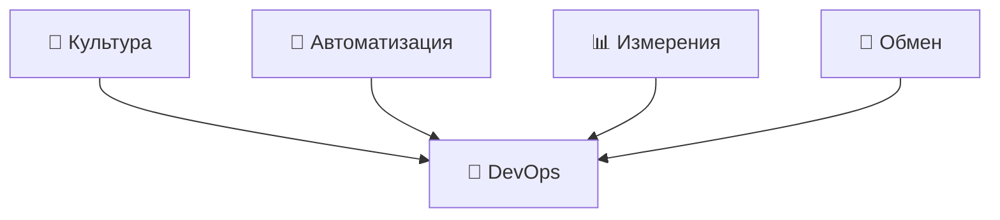

* 🌱 **Культура** — доверие, сотрудничество, общее владение
* 🤖 **Автоматизация** — убрать ручной toil, на котором легко ошибиться
* 📊 **Измерения** — смотреть метрики, решать по данным
* 🔗 **Обмен** — знание течёт свободно, постмортемы без поиска виноватых

> 📖 Термин придумали Damon Edwards и John Willis (2010). Позже Jez Humble добавил **L** от *Lean* — получилось **CALMS**.

---

## 📍 Слайд 14 – ⚡ До и после DevOps

| 😰 До | 🚀 После |
|----------|---------|
| 📅 Релизы раз в несколько месяцев | 📆 Релизы каждый день или каждый час |
| 📋 Ручные деплои | 🤖 Автоматические pipeline под контролем версий |
| 👉 Обвинения, когда всё ломается | 📝 Постмортемы без поиска виноватых |
| 🙅 «Не моя проблема» | 🤝 Общая ответственность («you build it, you run it» — построил, сам и эксплуатируешь) |
| 😨 Страх изменений | 💪 Маленькие обратимые изменения — это норма |
| 🐌 Часы ручного деплоя | ⚡ Минуты на выкатку, секунды на откат |

> 🤔 Какой столбец про команду, где вы уже работали?

---

## 📍 Слайд 15 – 🎮 Раздел 3: DevOps как игра

## 🕹️ Симуляция — вы CTO

* 🏢 **FlowStart Inc.** — растущий стартап
* 👥 5 разработчиков, 2 инженера эксплуатации, 10K пользователей
* 📈 Давление сверху: выкатывать быстрее, но перестать всё ломать
* ❓ **Что может пойти не так?**

> 💀 *Всё.*

Разберём четыре реальных режима отказа и практику DevOps, которая закрывает каждый. Каждый сценарий ложится на лабу этого семестра.

---

## 📍 Слайд 16 – 💥 Сценарий 1: сломанный релиз → CI/CD

**Сбой:**
* 📤 Пятница, 17:00, push без тестов и без ревью, сразу в прод
* 💥 Логин сломан, 10K пользователей не могут войти, 4 часа простоя
* 🤷 Никто не знает, что изменилось: деплой нельзя воспроизвести

**Починка — непрерывная интеграция и непрерывная поставка:**

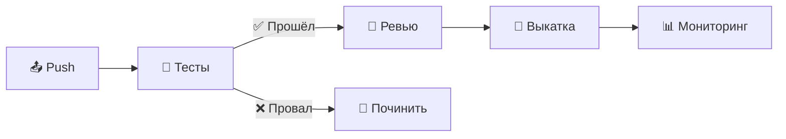

* ✅ Каждое изменение гоняет автотесты до мержа
* ✅ Ревью кода обязательно
* ✅ Деплой — одна команда (или один git push)
* ✅ Откат — один клик

> 🔗 **Связка с курсом:** Lab 3 собирает ровно этот pipeline в GitHub Actions.

---

## 📍 Слайд 17 – 🐾 Сценарий 2: серверы-снежинки → инфраструктура как код

**Сбой:**
* 🖥️ Прод два года руками настраивал инженер эксплуатации, который только что уволился
* 📈 Нужно выйти на 3 сервера — а конфиг никто не повторит
* 😱 «Документация» живёт в чьей-то голове и в личках Slack

> 🐶 **«Питомцы против стада»** (pets vs. cattle) — Bill Baker, Microsoft (2012). Питомцев выхаживают, стадо меняют.

**Починка — инфраструктура как код:**

```hcl
# 🌍 Terraform (1.10+) — declarative infra
resource "aws_instance" "web" {
  ami           = "ami-0c55b159cbfafe1f0"
  instance_type = "t3.micro"
  count         = 3  # three identical, replaceable servers
}
```

* 📝 Инфраструктура живёт в файлах под контролем версий
* 🔄 Серверы воспроизводимы, а не уникальны
* ⚡ Одинаковые окружения поднимаются за минуты

> 🔗 **Связка с курсом:** Labs 4 (Terraform + Pulumi) и 5–6 (Ansible) как раз про этот навык.

---

## 📍 Слайд 18 – 🔓 Сценарий 3: утечка секрета → управление секретами

**Сбой:**
* 👨‍💻 Разработчик коммитит `database.password = "hunter2"` в публичный репозиторий
* 🤖 Боты-сканеры находят это **меньше чем за 5 минут** (это подтверждают отчёты GitGuardian)
* 💥 Атакующие выгружают базу

**Починка — управление секретами:**

```yaml
# ❌ Bad — secret in source
DATABASE_PASSWORD: "super_secret_123"

# ✅ Good — reference, not value
DATABASE_PASSWORD: ${vault:secret/db/password}
```

* 🚫 Никогда не храните секреты в коде и в открытом конфиге
* 🔐 Берите менеджер секретов: HashiCorp Vault, OpenBao, AWS Secrets Manager, GCP Secret Manager
* 🔍 Pre-commit хуки ищут секреты (gitleaks, trufflehog)
* 🔄 Ротируйте учётные данные автоматически

> 🔗 **Связка с курсом:** Lab 11 связывает Kubernetes Secrets с **OpenBao** (open source-форк Vault; у самого Vault лицензия BSL).

---

## 📍 Слайд 19 – 🙈 Сценарий 4: слепая эксплуатация → наблюдаемость

**Сбой:**
* 👥 Пользователи в Twitter: *«Приложение тормозит.»*
* 🤷 У команды нет метрик, логов и трейсов
* ⏱️ Часы уходят на догадки; в конце от бессилия перезапускают сервер

**Починка — наблюдаемость (три столпа):**

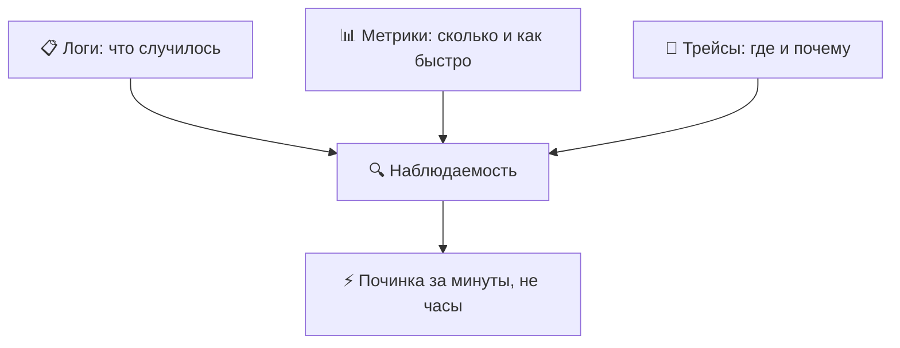

| 📊 Столп | 🛠️ Инструменты этого курса |
|-----------|---------------------------------|
| 📋 Логи | Loki + Promtail (Lab 7) |
| 📊 Метрики | Prometheus + Grafana (Lab 8, Lab 16) |
| 🔗 Трейсы | Не в Core — это в SRE-Intro |

> 🔗 **Связка с курсом:** Labs 7, 8 и 16 собирают полный стек наблюдаемости с нуля.

---

## 📍 Слайд 20 – ♾️ Раздел 4: жизненный цикл DevOps

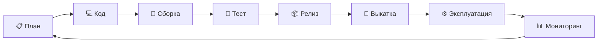

* ♾️ DevOps **непрерывен** — «готово» не бывает
* 🔄 Каждый этап кормит следующий; мониторинг подсказывает следующий план
* 🔁 Улучшаем бесконечно — смысл в самом цикле

---

## 📍 Слайд 21 – 🔁 Фазы цикла → инструменты (ориентир на май 2026)

| 📍 Фаза | 🎯 Действие | 🛠️ Типичные инструменты |
|----------|------------|-------------------------|
| 📋 План | Требования, дизайн | Jira, Linear, GitHub Issues |
| 💻 Код | Писать и ревьюить | Git, GitHub, VS Code, JetBrains |
| 🔨 Сборка | Компиляция, упаковка | Docker **29.x**, Buildah, Maven, npm |
| 🧪 Тест | Автотесты | pytest 8.3, Jest 30, Playwright, k6 |
| 📦 Релиз | Версия, согласование | GitHub Releases, Conventional Commits |
| 🚀 Выкатка | Выкатить в окружение | **ArgoCD 3.4**, **Argo Rollouts 1.8**, **Helm 4.1** |
| ⚙️ Эксплуатация | Запуск, масштаб | **Kubernetes 1.36** «Haru», **Terraform 1.15**, **ansible-core 2.21** |
| 📊 Мониторинг | Смотреть и алертить | **Prometheus 3.11+**, Grafana 11, Loki 3.7, **Alloy 1.16** (Promtail: EOL в марте 2026) |

> 🔧 **Про версии:** каждый инструмент выше прибит к стабильному релизу на май 2026. Лабы совпадают. *Helm 4 — мажор: большинство туториалов в сети всё ещё на синтаксисе Helm 3; мы сознательно берём 4.*

---

## 📍 Слайд 22 – 🗺️ Карта курса

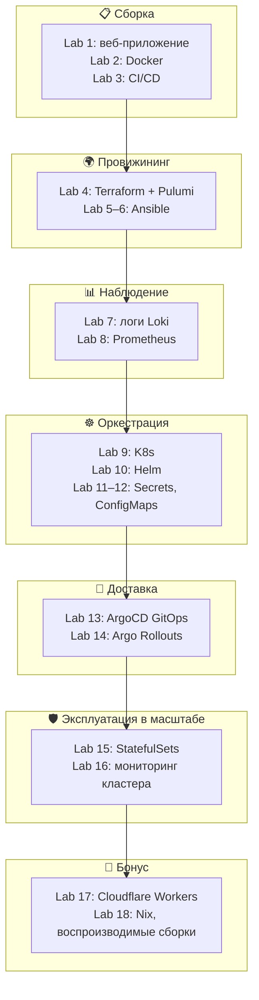

✅ **16 основных лаб + 2 бонусные. Каждая ложится на реальный навык DevOps.**

---

## 📍 Слайд 23 – 📊 Метрики DORA — как мерить DevOps

Команда DORA (Nicole Forsgren и др.) выделила четыре метрики, которые предсказывают, как команда поставляет софт. Отчёт DORA *State of DevOps* следит за ними каждый год с 2014.

| 📊 Метрика | 📏 Что измеряет | 🏆 Elite (2024) | 🐢 Low (2024) |
|-----------|--------------------|--------------|--------------|
| ⏱️ **Lead Time for Changes** | Коммит → прод | < 1 часа | > 1 месяца |
| 📦 **Deployment Frequency** | Как часто выкатываете | По запросу (несколько раз в день) | < 1/месяц |
| ❌ **Change Failure Rate** | % деплоев, которые вызывают инциденты | 0–5% | 46–60% |
| 🔧 **Failed Deployment Recovery Time** | MTTR после плохого деплоя | < 1 часа | > 1 месяца |

> 📚 **Источник:** DORA *State of DevOps Report 2024* — последний отчёт с лестницей из четырёх ступеней. Пятую метрику (надёжность) добавили в 2021. Отчёт 2025 убрал лестницу и поставил семь архетипов команд: поставка плюс человеческие факторы. Сами четыре метрики так и остаются стандартом, по которому меряют в индустрии.

**🤔 Вопрос:** какую метрику труднее всего сдвинуть и почему?

---

## 📍 Слайд 24 – 🌊 От хаоса к потоку

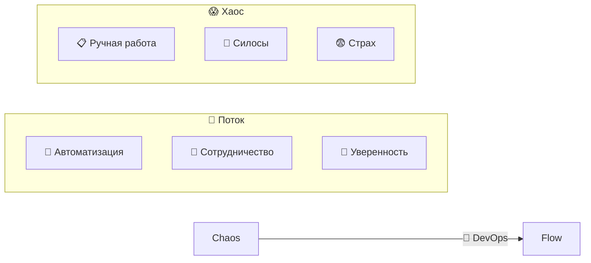

**🎯 Состояние потока (определение Gene Kim):**
* ⚡ Изменения спокойно идут от идеи до прода
* 🔄 Петли обратной связи быстрые, им можно верить
* 📈 Команды постоянно экспериментируют и улучшаются

---

## 📍 Слайд 25 – 🏢 Раздел 5: DevOps вживую

**🎬 Netflix** — канонический кейс DevOps
* 🚀 1000+ деплоев в прод в день по сервисам
* 🐒 *Chaos Monkey* (исходники открыли в 2012) — специально убивает инстансы в проде, чтобы проверить устойчивость
* 🔄 Инфраструктура лечит себя сама; дежурных почти не дёргают

**📦 Amazon**
* ⚡ В среднем каждые 11.7 секунды (Werner Vogels, 2011) — до сих пор ставят в пример
* 🔧 *«You build it, you run it»* (построил — сам и эксплуатируешь) — правило Werner про команду на две пиццы
* 🛠️ Сам AWS построили, чтобы Amazon обкатывал свою платформу на себе (dogfood)

**🔍 Google**
* 🛡️ Придумали **Site Reliability Engineering (SRE)** в 2003 — Ben Treynor Sloss
* 📊 *Error budget* балансирует скорость и надёжность
* 📝 Постмортемы без поиска виноватых проверяют ещё на найме

> 🔗 **Хотите глубже?** SRE-Intro (по выбору) подробно разбирает playbook Google.

---

## 📍 Слайд 26 – 👥 Роли в DevOps (2025/26)

| 👤 Роль | 🎯 Фокус |
|---------|---------|
| 🔧 **DevOps Engineer** | Pipeline, автоматизация, инфраструктура как код |
| 🛡️ **SRE** | Надёжность, SLO, реакция на инциденты |
| 🏗️ **Platform Engineer** | Внутренняя платформа разработчика, golden path (проторенный путь) |
| ☁️ **Cloud Engineer** | Облачная инфраструктура, оптимизация затрат, FinOps |

**🔗 Общее:** сотрудничество, автоматизация, владение продом.

> 💼 Platform Engineering растёт быстрее трёх остальных (Gartner 2024). Внутреннюю платформу разработчика многие уже ведут как продукт.

---

## 📍 Слайд 27 – 🤝 Как команды работают вместе

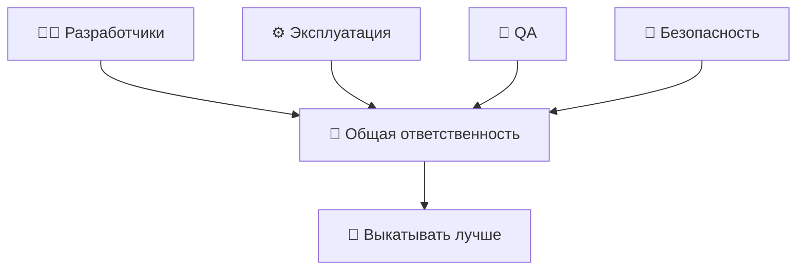

**🤝 Что видно в здоровых командах:**
* 📟 Общие дежурства Dev и Ops
* 📝 Разборы инцидентов без поиска виноватых, с конкретными действиями
* 👥 Кросс-функциональные сквады: фичевые команды владеют путём от идеи до эксплуатации
* 🔓 Деплой самообслуживанием: выкатить может каждый инженер, но есть предохранители

---

## 📍 Слайд 28 – 🎯 Главное

1. 🧩 **DevOps = культура + практики + инструменты** — именно в этом порядке
2. 🧱 **Ломайте силосы** между Dev и Ops
3. 🤖 **Автоматизируйте всё** повторяемое
4. 📊 **Мерьте по DORA** — lead time, частота деплоев, доля неудачных изменений, MTTR
5. 📝 **Учитесь на сбоях**, не ищите виноватых
6. 🔄 **Маленькие изменения, быстрая обратная связь** — самый безопасный путь в прод

> 💡 DevOps — не пункт назначения. Это направление.

---

## 📍 Слайд 29 – 🧠 Смена взгляда

| 😰 Старый взгляд | 🚀 Взгляд DevOps |
|---------------|------------------|
| 🙅 «Не моя работа» | 🤝 «Наша ответственность» |
| 🚫 «Прод не трогать» | 💪 «Выкатывай уверенно, откатывай быстро» |
| 👉 «Кто сломал?» | 🔍 «Как не допустить этот класс сбоев?» |
| 😨 «Изменения — это риск» | ✅ «Частые маленькие изменения безопаснее редких больших» |
| 💻 «У меня работает» | 🌍 «Работает в любом окружении — это доказал pipeline» |

> ❓ Какой взгляд про команду, в которой вы хотите работать?

---

## 📍 Слайд 30 – 🚀 Что дальше

**📚 Следующая лекция: *Контейнеризация с Docker*** — упаковка приложения, чтобы «работает у меня» наконец значило «работает везде».

* 🐳 Почему победили контейнеры (и где нет)
* 🔧 Пишем production-ready Dockerfile
* 🛡️ Rootless, distroless, multi-stage сборки
* 🌐 Workflow с Docker Hub

**🔬 Ваша работа в Lab 1:** соберите Python-веб-сервис с `/` и `/health`. Этот сервис — ваш проект до конца семестра. К Lab 16 он крутится в Kubernetes с GitOps, мониторингом, секретами и хранилищем на StatefulSet.

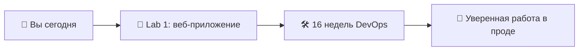

**👋 Увидимся в Lecture 2.**

> 🌊 От хаоса к потоку — один коммит за раз.

---

## 📚 Материалы

**📕 Книги — прочитайте хотя бы одну за семестр:**
* *The Phoenix Project* — Gene Kim, Kevin Behr, George Spafford (2013). Роман, который вывел DevOps в обычный IT.
* *The DevOps Handbook* (2-е изд.) — Kim, Humble, Debois, Willis (2021). Справочник.
* *Accelerate* — Forsgren, Humble, Kim (2018). Наука за метриками DORA.
* *Site Reliability Engineering* — Beyer, Jones, Petoff, Murphy (2016). Бесплатно: sre.google/books.

**🔗 Ссылки:**
* 🌐 [Отчёты DORA State of DevOps](https://dora.dev/research/) — ежегодные исследования, бесплатно
* 🌐 [12 Factor App](https://12factor.net) — базовые принципы от Heroku
* 🌐 [CNCF Cloud Native Landscape](https://landscape.cncf.io) — вселенная инструментов

**🎓 Квиз:** после лекции он кормит таблицу лидеров недель 1–3 (см. `README.md` → Grading).
