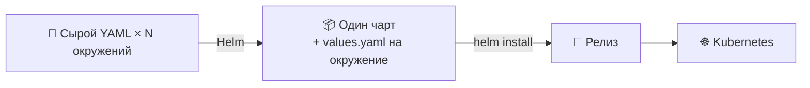
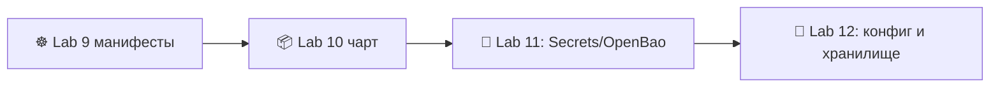

# 📌 Lecture 10 — Управление пакетами Helm: шаблоны для Kubernetes

## 📍 Слайд 1 – 📦 Добро пожаловать в Helm

* 🌍 **Lecture 9 оставила сырой YAML** — Deployment и Service на каждое окружение, копируете и правите руками. Тянет от силы два окружения, потом кусается.
* 📦 **Helm** = пакетный менеджер Kubernetes. Собирает манифесты в **чарт** (Helm-чарт), параметризует их через **values** и помнит установки как **релизы**.
* 🎯 Эта лекция: написать чарт, аккуратно шаблонизировать его и провести один и тот же чарт через dev/stage/prod. На окружение — один файл values.
* 🔗 **Связка с Lab 10:** переведите манифесты Lab 9 в чарт, поддержите 3 окружения через values, добавьте хуки pre/post-install, запушьте чарт в GHCR как OCI-артефакт.



---

## 📍 Слайд 2 – 🎯 Результаты

| # | Результат |
|---|---------|
| 1 | 🧱 Читать и писать структуру чарта Helm 4: `Chart.yaml`, `values.yaml`, `templates/`, `_helpers.tpl`, `charts/` |
| 2 | 🎨 Пользоваться шаблонами Go и функциями Sprig, именованными шаблонами, `tpl`, `include` |
| 3 | 🚦 Вести релизы командами `install / upgrade / rollback / uninstall / template / lint / test` |
| 4 | 🌳 Собирать чарты из зависимостей и library-чартов |
| 5 | 🪝 Ставить хуки на логику pre-install / post-upgrade / pre-delete |
| 6 | 🌐 Пушить и пуллить чарты через OCI-реестр (GHCR) |

**Стек зафиксирован на май 2026:** **Helm 4.1.4** (вышел 8 апреля 2026). Helm 3 в поддержке до 8 июля 2026 (багфиксы) / 11 ноября 2026 (только безопасность). Новое пишем на Helm 4.

---

## 📍 Слайд 3 – ❓ Зачем нужен Helm

В Lab 9 вы написали три манифеста (Deployment, Service, ConfigMap). Теперь представьте:
* 🌳 Три окружения — dev, staging, prod. У каждого свои реплики, теги образов, лимиты ресурсов.
* 🔁 Двенадцать сервисов. Форма одна, имена разные.

**Без Helm:** копипаста YAML, diff глазами, надежда, что окружения не разъедутся (drift). Ломается к 4-му сервису.

**С Helm:** *один* набор шаблонов, *один* `values.yaml` на окружение, одна команда на установку. Шаблоны становятся YAML, Helm прогоняет их через `kubectl apply`.

> 🔥 **Резкий тезис:** Helm — не единственный шаблонизатор K8s (Kustomize, Jsonnet, cdk8s, Carvel ytt). Он популярнее примерно в 5 раз, потому что чарты — *артефакты, которыми делятся*: `helm pull oci://…` — и у вас чужой рабочий стек.

---

## 📍 Слайд 4 – 📜 Эволюция Helm: 1 → 2 → 3 → 4

* 📅 **2015** — Deis выпускает Helm 1 (Microsoft купила Deis в 2017). Шаблоны только на клиенте.
* 📅 **2016** — Helm 2 вводит **Tiller**, серверный компонент внутри кластера. Любили за мощь, ненавидели за RBAC на весь кластер.
* 📅 **2019** — Helm 3 **выбрасывает Tiller** и хранит состояние релиза в Secret и ConfigMap Kubernetes. Сейчас все сидят на этом.
* 📅 **2022** — OCI-реестры становятся штатным способом раздавать чарты (их пушат и пуллят как образы Docker).
* 📅 **2026 (8 апреля)** — вышел Helm **4.1.4**. Формат чарта для `apiVersion: v2` обратно совместим. Движок переписан, зависимости резолвятся лучше, есть поддержка плагинов на WASM.

> 📝 **Про миграцию:** почти все чарты Helm 3 работают на Helm 4 без правок. CLI Helm 3 ещё жив. До середины 2026 в компаниях будут оба. Лабы этого курса — на Helm 4.

---

## 📍 Слайд 5 – 🧱 Анатомия чарта

Чарт — каталог вот такой формы:

```
mychart/
├── Chart.yaml          # 📇 Metadata: name, version, appVersion, dependencies
├── values.yaml         # 🎚️ Default values (overridable per install)
├── values.schema.json  # 📐 (Optional) JSON schema for values validation
├── templates/
│   ├── deployment.yaml
│   ├── service.yaml
│   ├── ingress.yaml
│   ├── configmap.yaml
│   ├── _helpers.tpl    # 🛠️ Named template definitions (no underscore = file is rendered)
│   ├── NOTES.txt       # 📋 Printed after install/upgrade
│   └── tests/
│       └── test-connection.yaml
├── charts/             # 📦 Subcharts (dependencies)
└── README.md
```

Правила:
* 📁 Файлы, которые начинаются с `_`, — это **partials** (куски шаблона). Их подключают через `{{ include ... }}`, в самостоятельный YAML их не рендерят.
* 🧪 Файлы в `templates/tests/` запускаются только на `helm test <release>`.
* 🔒 Всё в `charts/` — вендоренный субчарт. Его ведёт `helm dependency update`.

---

## 📍 Слайд 6 – 📇 Chart.yaml

```yaml
apiVersion: v2                # ⚠️ Helm 3+; Helm 4 reads v2; v1 is Helm 2 (deprecated)
name: lab10-app
description: DevOps Core lab 10 — Python service + Go echo
type: application             # 'application' (default) or 'library'
version: 1.3.0                # 📌 Chart version (SemVer) — bumped on chart changes
appVersion: "1.0.0"           # 📌 App version (string) — bumped on image changes
kubeVersion: ">=1.33.0"       # 🚦 Refuse install on older clusters

dependencies:
  - name: postgresql
    version: 16.x
    repository: oci://registry-1.docker.io/bitnamicharts
    condition: postgresql.enabled
```

* 🎯 Важны **две версии**: `version` (чарт, который публикуете ВЫ) и `appVersion` (образ, который он выкатывает). Меняются они независимо.
* 🔧 Чарт с `type: library` отдаёт только шаблоны `_helpers.tpl`. Сам он ничего не ставит.

---

## 📍 Слайд 7 – 🎨 Шаблоны Go и Sprig

Helm берёт пакет Go `text/template` и библиотеку **Sprig** (ещё ~200 хелперов).

```yaml
apiVersion: apps/v1
kind: Deployment
metadata:
  name: {{ include "lab10-app.fullname" . }}
  labels:
    {{- include "lab10-app.labels" . | nindent 4 }}
spec:
  replicas: {{ .Values.replicaCount | default 2 }}
  template:
    spec:
      containers:
        - name: web
          image: "{{ .Values.image.repository }}:{{ .Values.image.tag | default .Chart.AppVersion }}"
          env:
            - name: ECHO_URL
              value: "http://{{ include "lab10-app.fullname" . }}-echo:80"
          {{- with .Values.resources }}
          resources:
            {{- toYaml . | nindent 12 }}
          {{- end }}
```

Частые обороты:
* `{{ include "name" . }}` — вызвать именованный шаблон. Лучше, чем `template`: вернёт строку, её можно отдать в пайп.
* `| nindent N` — сдвинуть блок на N пробелов *после* перевода строки. Так чаще всего чинят кривые отступы.
* `| default X` — запас, если значения нет.
* `{{- ... -}}` — срезать пробелы слева и справа от действия.
* `{{ toYaml . | nindent N }}` — вывести структуру как YAML.

> 🔥 **Баг Helm №1 — отступы.** `nindent` (перевод строки и отступ) нужен в 90% случаев. `indent` ломает YAML, если действие стоит на своей строке.

---

## 📍 Слайд 8 – 🛠️ `_helpers.tpl` — именованные шаблоны без копипасты

Не копируйте блоки меток. Один раз описали — подключаете везде.

```handlebars
{{/*
Standard labels — matches the K8s recommended labels namespace.
*/}}
{{- define "lab10-app.labels" -}}
helm.sh/chart: {{ printf "%s-%s" .Chart.Name .Chart.Version | replace "+" "_" | trunc 63 | trimSuffix "-" }}
app.kubernetes.io/name: {{ .Chart.Name }}
app.kubernetes.io/instance: {{ .Release.Name }}
app.kubernetes.io/version: {{ .Chart.AppVersion | quote }}
app.kubernetes.io/managed-by: {{ .Release.Service }}
{{- end }}

{{/*
Selector labels — subset that should never change after install.
*/}}
{{- define "lab10-app.selectorLabels" -}}
app.kubernetes.io/name: {{ .Chart.Name }}
app.kubernetes.io/instance: {{ .Release.Name }}
{{- end }}
```

Селекторные метки — строгое подмножество `.labels`: **селекторы Service и Deployment после создания не меняются**. Положите `version` в селектор — сломаете rolling update.

---

## 📍 Слайд 9 – 🚦 Жизненный цикл релиза

```bash
helm install web ./mychart -n dev \
  -f values-dev.yaml \
  --create-namespace

helm upgrade web ./mychart -n dev \
  -f values-dev.yaml \
  --set image.tag=v1.0.5

helm rollback web 3 -n dev          # ⏪ to revision 3
helm history web -n dev             # 📜 every revision is in K8s Secrets
helm uninstall web -n dev           # 🗑️ removes everything Helm tracked

helm template ./mychart -f values-prod.yaml  # 🔍 render to stdout (CI / GitOps friendly)
helm lint ./mychart                          # 🔍 syntax + schema check
helm test web -n dev                         # 🧪 run templates/tests/ pods
```

* 📜 Каждый `install` и `upgrade` пишет **ревизию**: Secret `helm.sh/release.v1` в namespace релиза. `helm rollback` — это «накатить манифесты ревизии N».
* 🔍 `helm template` — вход в GitOps. Отрендерили один раз, закоммитили YAML, применяет ArgoCD.

---

## 📍 Слайд 10 – 🌳 Несколько окружений через иерархию values

Гибкая схема: базовый `values.yaml` и файл-override на каждое окружение.

```yaml
# values.yaml (defaults)
replicaCount: 2
image:
  repository: ghcr.io/innodevops/lab2-app
  tag: ""                            # falls back to .Chart.AppVersion
resources:
  requests: {cpu: 100m, memory: 64Mi}
  limits:   {cpu: 500m, memory: 256Mi}
ingress:
  enabled: false
```

```yaml
# values-prod.yaml (overrides)
replicaCount: 5
image:
  tag: v1.2.0
resources:
  requests: {cpu: 500m, memory: 256Mi}
  limits:   {cpu: 2000m, memory: 1Gi}
ingress:
  enabled: true
  host: app.prod.example.com
```

```bash
helm upgrade --install web ./mychart -n prod -f values.yaml -f values-prod.yaml
```

Порядок (слабый → сильный):
1. `values.yaml` (умолчания чарта)
2. `-f file.yaml` (поздний файл бьёт ранний)
3. `--set key=value` (явно в CLI)

---

## 📍 Слайд 11 – 🪝 Хуки: pre-install, post-upgrade, …

Хук запускает Job, Pod или любой ресурс в нужной точке жизненного цикла релиза.

```yaml
apiVersion: batch/v1
kind: Job
metadata:
  name: {{ include "lab10-app.fullname" . }}-db-migrate
  annotations:
    "helm.sh/hook": pre-upgrade,pre-install
    "helm.sh/hook-weight": "-5"
    "helm.sh/hook-delete-policy": before-hook-creation,hook-succeeded
spec:
  template:
    spec:
      restartPolicy: Never
      containers:
        - name: migrate
          image: "{{ .Values.image.repository }}:{{ .Values.image.tag }}"
          command: ["python", "manage.py", "migrate"]
```

Обычные точки: `pre-install`, `post-install`, `pre-upgrade`, `post-upgrade`, `pre-delete`, `post-delete`, `test`.

`hook-weight` ставит порядок нескольких хуков (меньше — раньше; ничья режется по алфавиту).
`hook-delete-policy` решает, когда убирать: `before-hook-creation` (по умолчанию), `hook-succeeded`, `hook-failed`.

> ⚠️ **Ловушка хуков:** ресурсы хука в релиз *не* входят. `helm uninstall` Job хука не удалит. Для уборки ставьте `hook-delete-policy: hook-succeeded`.

---

## 📍 Слайд 12 – 📦 Зависимости и субчарты

Чарты могут зависеть от других чартов. `helm dependency update` скачивает их в `charts/`.

```yaml
# Chart.yaml
dependencies:
  - name: postgresql
    version: 16.x
    repository: oci://registry-1.docker.io/bitnamicharts
    condition: postgresql.enabled
    alias: db                        # 🏷️ rename in values
```

```yaml
# values.yaml
postgresql:                          # 🎚️ subchart values nest under its alias
  enabled: true
  auth:
    username: app
    database: lab10
```

В Helm 4 зависимости резолвятся лучше: несколько чартов тянут одну транзитивную зависимость без конфликтов.

---

## 📍 Слайд 13 – 📚 Library-чарты

Чарт с `type: library` отдаёт только шаблоны `_helpers.tpl`. Берите его, когда 10 чартов приложений делят одну болванку: метки, security context, секреты на pull образа.

```yaml
# common-lib/Chart.yaml
apiVersion: v2
name: common-lib
type: library                        # 🚫 no templates rendered, only helpers contributed
version: 1.0.0
```

```yaml
# mychart/Chart.yaml
dependencies:
  - name: common-lib
    version: 1.x
    repository: oci://ghcr.io/innodevops/charts
```

```handlebars
# mychart/templates/deployment.yaml
{{ include "common-lib.labels" . | nindent 4 }}    # 🔁 reused from the library
```

> 🔗 **Бонус Lab 10** просит вынести `_helpers.tpl` в library-чарт и подключить его из чарта приложения.

---

## 📍 Слайд 14 – 🌐 OCI-реестры — чарты как OCI-артефакты

С 2022 Helm пушит чарты в OCI-реестры (тот же протокол, что у образов Docker). GHCR, Docker Hub, Harbor и ECR умеют OCI-артефакты.

```bash
# 📦 Package
helm package ./mychart                       # produces mychart-1.3.0.tgz

# 🔑 Auth (GHCR uses GitHub PAT or GITHUB_TOKEN in CI)
echo $GITHUB_TOKEN | helm registry login ghcr.io -u $GITHUB_ACTOR --password-stdin

# 📤 Push
helm push mychart-1.3.0.tgz oci://ghcr.io/innodevops/charts

# 📥 Pull (in another repo / cluster)
helm install web oci://ghcr.io/innodevops/charts/mychart --version 1.3.0
```

> 🔥 **Зачем OCI:** одна модель входа, один реестр, одни и те же права на образы *и* чарты. Старый HTTP-индекс через `helm repo add` больше не нужен.

---

## 📍 Слайд 15 – 🧪 Тесты чартов

* 🔍 `helm lint ./mychart` — схема и разбор YAML
* 📐 `values.schema.json` — JSON Schema проверяет `values.yaml`. Кривые values — Helm падает до установки.
* 🧪 `helm template ./mychart | kubectl apply --dry-run=server -f -` — проверка на стороне сервера
* ✅ `helm test <release>` — гоняет Pod из `templates/tests/` по живому релизу

Типичный `templates/tests/test-connection.yaml`:
```yaml
apiVersion: v1
kind: Pod
metadata:
  name: "{{ include "lab10-app.fullname" . }}-test"
  annotations:
    "helm.sh/hook": test
spec:
  restartPolicy: Never
  containers:
    - name: curl
      image: curlimages/curl:8.10.1
      args: ["-fsS", "http://{{ include "lab10-app.fullname" . }}:80/healthz"]
```

---

## 📍 Слайд 16 – 🚫 Антипаттерны и частые баги

1. ❌ **Тег образа зашит в шаблон.** Кладите его в `values.yaml`, обновление пойдёт через `--set image.tag=...`
2. ❌ **`indent` вместо `nindent`.** Получится битый YAML, если действие на своей строке.
3. ❌ **Метки селектора, которые меняются.** Deployment уже есть — K8s отвергнет смену селектора. Берите стабильное подмножество.
4. ❌ **Нет `helm lint` в CI.** Любая правка чарта должна валить CI, если lint красный.
5. ❌ **Хуки без уборки.** Ставьте `hook-delete-policy: hook-succeeded`, иначе копятся упавшие Job.
6. ❌ **Секреты в `values.yaml`.** Файл в git. Берите **OpenBao и инжектор секретов** (Lab 11) или плагин `helm secrets`.
7. ❌ **Один огромный umbrella-чарт на 12 сервисов.** У каждого сервиса свой чарт. Общее выносите в library-чарт.
8. ❌ **`latest` в `appVersion`.** Воспроизводимости нет. Фиксируйте SemVer или SHA коммита.

---

## 📍 Слайд 17 – 🌍 Helm вживую

* 📦 **Artifact Hub** индексирует **15,000+** чартов Helm у сотен издателей.
* 🏢 **Bitnami** выпускает продовые чарты для ~150 популярных open-source приложений (Postgres, MongoDB, Redis, RabbitMQ, Kafka …). После смены IPO и лицензии в 2024 многие ушли на форки сообщества.
* 🎬 **Netflix, Shopify, Spotify** публикуют внутренние чарты Helm как стандартную единицу упаковки.
* 🪐 **Crossplane, ArgoCD, kube-prometheus-stack** раздаются чартами Helm. Экосистема K8s считает, что Helm у вас есть.

> 📊 **Опрос CNCF 2024:** Helm — пакетный менеджер K8s №1, с большим отрывом. «Как выкатывают в K8s» в 2026 по-прежнему в основном Helm + ArgoCD + Kustomize.

---

## 📍 Слайд 18 – 🎯 Главное

1. 📦 **Helm = шаблоны + упаковка + жизненный цикл релиза.** Три работы одним инструментом.
2. 🧱 **Структура чарта жёсткая:** `Chart.yaml`, `values.yaml`, `templates/`, `_helpers.tpl`. Выучите.
3. 🎨 **Шаблоны Go, Sprig, именованные шаблоны.** `nindent`, `include`, `default` закрывают 80% задач.
4. 🌳 **Один чарт, N файлов values.** Именно так живут несколько окружений. YAML копированием не правят.
5. 🪝 **Хуки** запускают Job и Pod в точках жизненного цикла. Ставьте `hook-delete-policy`, чтобы убирать за собой.
6. 📚 **Library-чарты** делят хелперы между чартами приложений.
7. 🌐 **OCI-артефакты** — современный способ раздачи. Тот же реестр, что у образов.
8. ✅ **`helm lint`, `values.schema.json` и `helm template` в CI.** Ловите ошибки раньше, чем их поймает кластер.

> 💡 **Реальность Helm 4:** то, что вы пишете сегодня, нормально ставится и на кластерах с Helm 3.x. Берите Helm 4 сейчас: дальше этот синтаксис не устареет.

---

## 📍 Слайд 19 – 🚀 Что дальше

**📚 Следующая лекция: *Секреты в Kubernetes и OpenBao*** — `values.yaml` лежит в git, а пароль от БД — нет.

* 🔐 `Secret` в K8s: что он реально делает и чего не делает
* 🪦 Миграция HashiCorp Vault → OpenBao (последствия BSL, август 2023)
* 🤖 External Secrets Operator (ESO)
* 🎯 Vault Agent Injector для конфига из шаблона

**🔬 Что сдать в Lab 10:**
* Упакуйте манифесты Lab 9 в чарт `lab10-app`
* Поддержите `values-dev.yaml` / `values-staging.yaml` / `values-prod.yaml`
* Добавьте хук pre-install на миграцию БД (пусть даже фейковую)
* Запушьте чарт в GHCR через `helm push oci://`
* Бонус 2 балла: вынесите `_helpers.tpl` в library-чарт и подключите его из чарта приложения



> 🌊 От YAML к пакетам — по одному шаблону.

---

## 📚 Ресурсы

* 📕 *Learning Helm* (2e, 2024) — Butcher, Farina, Dolitsky (O'Reilly). Канонический справочник.
* 📕 *Mastering Helm* — Sumesh Kumar (2023) — паттерны чартов
* 🌐 [helm.sh/docs](https://helm.sh/docs/) — официальная документация (Helm 4)
* 🌐 [helm.sh/docs/chart_best_practices](https://helm.sh/docs/chart_best_practices/) — как принято писать чарты
* 🌐 [Artifact Hub](https://artifacthub.io/) — поиск публичных чартов
* 🌐 [функции Sprig](https://masterminds.github.io/sprig/) — справочник, куда заглядываете каждую неделю
* 🌐 [заметки к релизу Helm 4](https://helm.sh/blog/) — что изменилось с 3

**🎓 Квиз:** квиз после лекции попадает в окно таблицы лидеров за недели 10-12.
