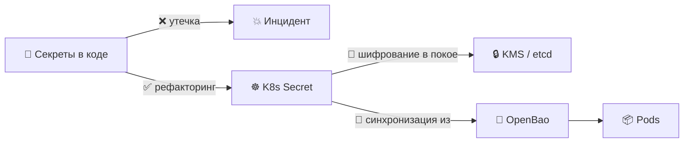
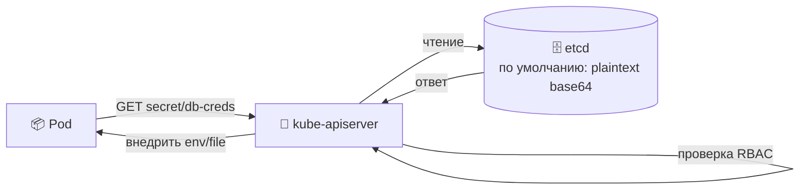
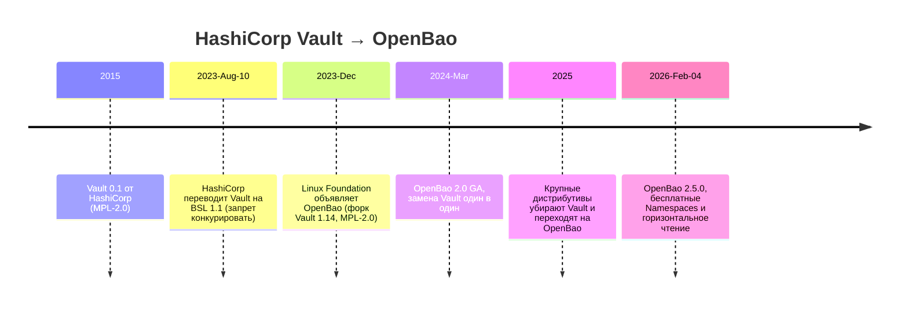
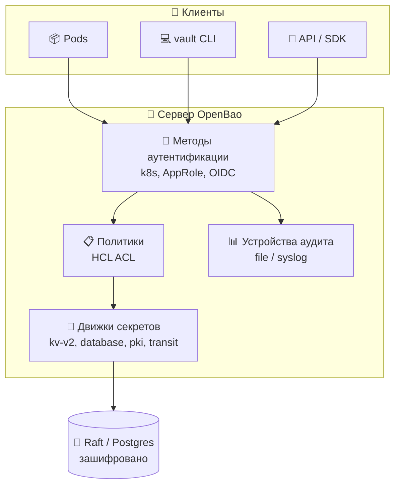
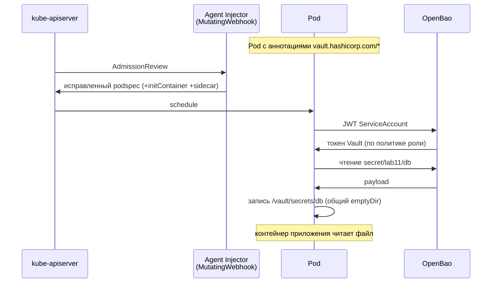
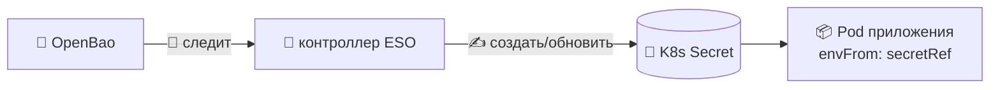
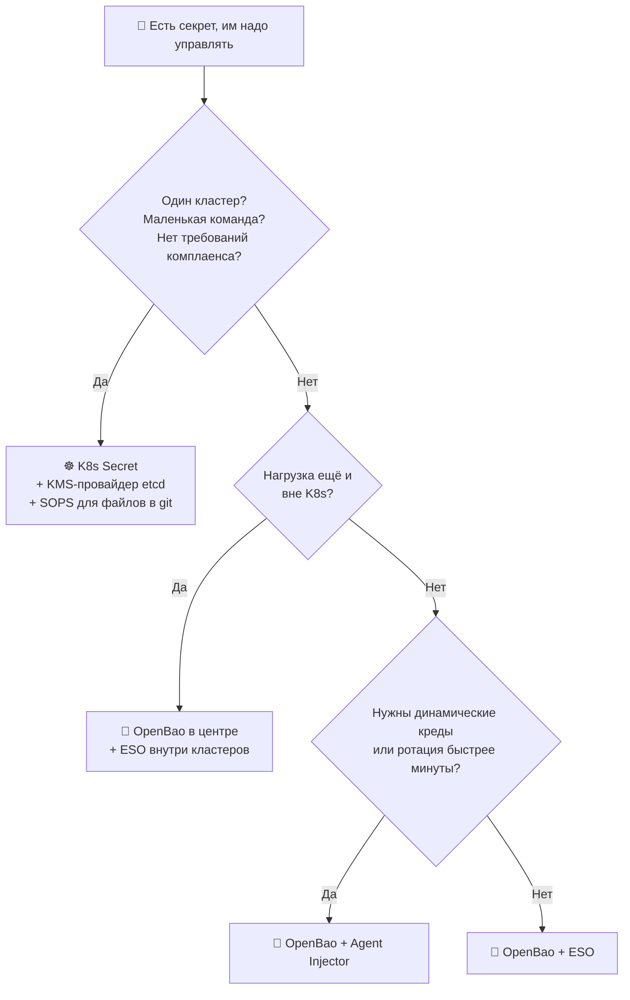
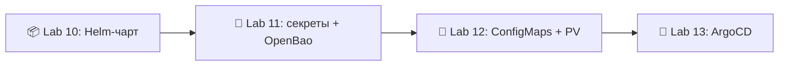

# 📌 Lecture 11 — Секреты и OpenBao: хватит класть пароли в Git

## 📍 Slide 1 – 🔐 Добро пожаловать в управление секретами

* 🌍 **После Lab 10 у вас чистый Helm-чарт** — Deployment, Service, Ingress, values на каждое окружение. Одна проблема: живому приложению нужны пароль БД, API-ключ, TLS-сертификат. Класть их в `values.yaml` и делать push на GitHub нельзя.
* 😱 **Секреты в коде — причина №1 облачных утечек**, и предотвратить её дешевле всего.
* 🎯 Эта лекция: K8s `Secret` (что это на самом деле), encryption-at-rest (шифрование данных в покое), проект **OpenBao** (открытый наследник Vault) и два паттерна, как доставить секреты в Pod — **Vault Agent Injector** и **External Secrets Operator**.
* 🔗 **Связка с Lab 11:** добавить `templates/secrets.yaml` в чарт Lab 10, поставить **OpenBao** через Helm, настроить Kubernetes auth и внедрить секрет аннотациями Vault Agent.



---

## 📍 Slide 2 – 🎯 Результаты обучения

| # | Результат |
|---|---------|
| 1 | 🧠 Объяснить, почему K8s `Secret` **не зашифрован** по умолчанию (это base64) |
| 2 | 🔐 Включить **encryption-at-rest** в etcd через `EncryptionConfiguration` и KMS-провайдер |
| 3 | 🏰 Запустить **OpenBao 2.5.0** в Kubernetes; настроить KV-v2, Kubernetes auth и политику на чтение |
| 4 | 💉 Через sidecar **Vault Agent Injector** записать секреты в файл внутри Pod |
| 5 | 🤖 Через **External Secrets Operator** (ESO) синхронизировать OpenBao в нативный K8s `Secret` |
| 6 | 🗺️ Выбрать паттерн: Agent Injector, ESO, CSI, Sealed Secrets или SOPS |

**Стек зафиксирован на май 2026:** Kubernetes **1.36**, **OpenBao 2.5.0** (Linux Foundation, MPL-2.0), External Secrets Operator **v2.5.0**, CLI `vault` (по-прежнему ходит в OpenBao — совместим по протоколу).

---

## 📍 Slide 3 – 💀 Цена ошибки

> 💬 *«Единственная по-настоящему безопасная система — та, что выключена, залита в бетонный блок и запечатана в комнате со свинцовыми стенами под вооружённой охраной.»* — Gene Spafford

* 💸 **IBM Cost of a Data Breach 2025:** среднее в мире **$4.44M** за утечку; рекорд США **$10.22M**
* 🔍 **Злоупотребление кредами** — вектор первого входа №1 в Verizon DBIR каждый год с 2019
* ⏱️ **Среднее время обнаружения** утечки кредов: ~204 дня (IBM 2025)
* 🤖 **GitGuardian 2024:** ~12.8M новых секретов утекло на публичный GitHub за год — большинство так и не ротировали

> 🤔 **Подумайте:** сколько файлов `.env` сейчас лежит у вас на ноутбуке с настоящим паролем от production?

---

## 📍 Slide 4 – 📜 Реальные инциденты — учимся на чужой боли

| Год | Кто | Что |
|------|-----|------|
| 2014 | **Code Spaces** | root-ключи AWS в коде → атакующий стёр все бэкапы и все данные клиентов → **компания закрылась за 12 часов** |
| 2016 | **Uber** | креды AWS захардкожены в приватном репозитории GitHub (увели аккаунт разработчика) → дамп S3 на **57M пользователей** → **мировое на $148M** |
| 2022 | **Dropbox** | 130 приватных репозиториев GH украдены фишингом — утекли внутренние API-ключи и сторонние креды |
| 2022 | **Toyota** | каталог `.git` отдавался с публичного ресурса → креды БД с данными клиентов светились **10 лет** |
| 2025 | **tj-actions/changed-files** | CVE-2025-30066, взломанный популярный GitHub Action **слил каждый секрет** в CI-логи 23,000+ репозиториев |

> 🔥 **Паттерн:** каждый случай — **секрет лежал не там** (код, git, логи CI, публичный ресурс). Не zero-day. Не 0-click. Просто креды не в том файле.

---

## 📍 Slide 5 – ☸️ Объект Kubernetes `Secret`

`Secret` — полноценный объект API K8s, отдельно от `ConfigMap`, потому что он *задуман* под чувствительные данные.

```yaml
apiVersion: v1
kind: Secret
metadata:
  name: db-creds
  namespace: lab11
type: Opaque
data:                                  # ⚠️ values must be base64-encoded
  username: YWRtaW4=
  password: U3VwZXJTZWNyZXQxMjM=
# stringData:                          # ✅ alternative: K8s base64-encodes for you
#   username: admin
#   password: SuperSecret123
```

* 📦 Три способа создать: `kubectl create secret` (императивно), YAML `kind: Secret` (декларативно), Helm `templates/secrets.yaml`
* 🔑 **Встроенные типы:** `Opaque` (общий), `kubernetes.io/dockerconfigjson` (pull образов), `kubernetes.io/tls` (сертификат и ключ), `kubernetes.io/service-account-token`
* 🚦 Pod берёт их как **переменные окружения** (`envFrom`/`secretKeyRef`) или как **файл** (volume `projected` / `secret`)

---

## 📍 Slide 6 – ⚠️ Base64 — это не шифрование

> ⚠️ **Факт, который чаще всего спрашивают на экзаменах по K8s** — и ошибка за каждой утечкой у джунов.

```bash
$ echo "SuperSecret123" | base64
U3VwZXJTZWNyZXQxMjMK
$ echo "U3VwZXJTZWNyZXQxMjMK" | base64 -d
SuperSecret123                         # 🔓 No key. No password. Just decode.
```

| 🔄 Кодирование (base64) | 🔐 Шифрование (AES-GCM, KMS, …) |
|----------------------|----------------------------------|
| ✅ Обратимо для любого, у кого есть строка | 🔑 Чтобы расшифровать, нужен ключ |
| 🎯 Чтобы бинарные данные ехали текстом | 🛡️ Чтобы данные остались тайной |
| 📦 Те же данные, другой формат | 🔒 Другие данные, стойкость на математике |

> 🔥 **Зачем тогда base64?** Значения `Secret.data` должны быть нормальными строками JSON/YAML — бинарник вроде TLS-ключа иначе не влезет. Тайну хранят API-сервер и etcd, не base64.

---

## 📍 Slide 7 – 🗄️ Где секреты лежат на самом деле: etcd



Два жёстких факта про etcd:

* 🔓 **По умолчанию etcd хранит Secret как base64 (по сути открытый текст).** Кто добрался до диска member etcd, до бэкапа или до снапшота, снимет все секреты.
* 🛡️ **RBAC закрывает путь через API, не данные в покое.** Нода с `etcdctl get /registry/secrets/...` обходит API-сервер целиком.

> 🤔 **Вопрос:** ваш managed control plane (EKS, GKE, AKS) шифрует etcd? **Часто да** — но на уровне *диска* (шифрование облака), не на уровне K8s `EncryptionConfiguration`. Модели угроз разные.

---

## 📍 Slide 8 – 🔐 Encryption-at-Rest в etcd

В K8s есть API `EncryptionConfiguration`: kube-apiserver шифрует payload Secret **до** записи в etcd.

```yaml
# /etc/kubernetes/enc/enc-config.yaml
apiVersion: apiserver.config.k8s.io/v1
kind: EncryptionConfiguration
resources:
  - resources: ["secrets"]
    providers:
      - kms:                           # 🥇 prefer KMS provider (AWS KMS, GCP KMS, Vault)
          name: aws-kms
          endpoint: unix:///var/run/kmsplugin/socket.sock
          cachesize: 1000
      - aescbc:                        # 🥈 fallback: local AES-256-CBC
          keys:
            - name: key1
              secret: <base64-32-byte-key>
      - identity: {}                   # ⚠️ identity = no encryption; must be LAST
```

Как включить:
* 🛠️ Флаг kube-apiserver: `--encryption-provider-config=/etc/kubernetes/enc/enc-config.yaml`
* 🔄 **Перешифровать уже лежащие секреты** после включения: `kubectl get secrets -A -o json | kubectl replace -f -`
* 🔑 **Ротация** — новый ключ в начало списка, заменить все секреты, старый ключ опустить или убрать

> ⚠️ **Ловушка:** если `identity` не последний, секреты так и лежат без шифрования. Порядок важен.

---

## 📍 Slide 9 – 🪦 История: от Vault к OpenBao



* ⚖️ **BSL 1.1** — исходники доступны, но нельзя продавать Vault как managed-сервис в конкуренции с HashiCorp.
* 🍴 Форком OpenBao рулит **Linux Foundation**, лицензия MPL-2.0 (настоящий open source), по протоколу совместим с CLI `vault`.
* 💡 **Платные функции HashiCorp** (Namespaces, горизонтальное масштабирование чтения, MFA) в **OpenBao 2.5.0 бесплатны**.

> 🔥 **Почему учим OpenBao, а не Vault:** лаба поедет на ноутбуках студентов. BSL это разрешает. Но каждый манифест, который пригодится ещё раз, завтра окажется в production-кластере. Берите лицензию, по которой не придётся судиться заново.

---

## 📍 Slide 10 – 🏰 Архитектура OpenBao



**Три вещи, которые надо знать:**
* 🔐 **Secret Engines** (движки секретов) — где секреты лежат или рождаются. `kv-v2` (статические, с версиями), `database` (динамические креды), `pki` (выпуск сертификатов), `transit` (шифрование как сервис).
* 🔑 **Auth Methods** — как клиент доказывает, кто он. Для Pod в K8s: `kubernetes` (сверяет JWT ServiceAccount пода с API TokenReview).
* 📋 **Policies** — файлы HCL: что можно делать на конкретном пути (`read`, `list`, `create`, `update`, `delete`, `sudo`, `deny`).

---

## 📍 Slide 11 – 🛠️ Ставим OpenBao через Helm

```bash
helm repo add openbao https://openbao.github.io/openbao-helm
helm repo update

helm install openbao openbao/openbao \
  --namespace openbao --create-namespace \
  --set "server.dev.enabled=true" \         # 🚨 dev mode = unsealed + in-memory, NEVER prod
  --set "injector.enabled=true" \           # 💉 deploy the Agent Sidecar Injector
  --set "server.image.tag=2.5.0"

kubectl get pods -n openbao
# NAME                                    READY   STATUS
# openbao-0                               1/1     Running
# openbao-agent-injector-7f...            1/1     Running
```

* 🚨 **Dev mode** сам делает init и unseal, хранит всё в RAM. Рестарт — секреты пропали. **Только для лабы.**
* 🏢 **Prod:** integrated storage (Raft) на 3–5 нодах, auto-unseal через KMS, audit device в агрегатор логов, TLS везде.

> 🔥 **CLI `vault` работает.** OpenBao сохранил совместимость API и CLI. `vault status`, `vault kv put`, `vault login` — те же команды.

---

## 📍 Slide 12 – 🔑 Настройка: KV-v2, Kubernetes auth, политика

```bash
kubectl exec -n openbao -it openbao-0 -- /bin/sh

# 🔐 Enable KV v2 (versioned secrets)
vault secrets enable -path=secret kv-v2

# 📝 Write a secret
vault kv put secret/lab11/db \
  username=app password='S3cure!2026'

# 🔑 Enable Kubernetes auth (validates pod ServiceAccount JWT)
vault auth enable kubernetes
vault write auth/kubernetes/config \
  kubernetes_host="https://$KUBERNETES_PORT_443_TCP_ADDR:443"

# 📋 Policy: read-only on this exact path
vault policy write lab11-read - <<EOF
path "secret/data/lab11/db" {
  capabilities = ["read"]
}
EOF

# 🎯 Bind the policy to a ServiceAccount + namespace
vault write auth/kubernetes/role/lab11 \
  bound_service_account_names=lab11-sa \
  bound_service_account_namespaces=lab11 \
  policies=lab11-read \
  ttl=1h
```

* 🎯 **Роль** склеивает три вещи: какой SA может войти, какая политика к нему прицепится и сколько живёт токен.

---

## 📍 Slide 13 – 💉 Vault Agent Injector: паттерн sidecar



* 🪝 Инжектор — это **MutatingAdmissionWebhook**. Он правит podspec на admission. Автору чарта хватает аннотаций.
* 🔄 **Init-контейнер** забирает секрет до старта приложения, чтобы файл уже был. **Sidecar** продлевает токен и обновляет файл.
* 📁 Секреты попадают в `/vault/secrets/<name>` на общем volume `emptyDir`.

---

## 📍 Slide 14 – 🏷️ Аннотации Vault Agent

```yaml
spec:
  template:
    metadata:
      annotations:
        vault.hashicorp.com/agent-inject: "true"
        vault.hashicorp.com/role: "lab11"
        # 🎯 Plain key=value file at /vault/secrets/db
        vault.hashicorp.com/agent-inject-secret-db: "secret/data/lab11/db"
        # 🎨 Custom template — render as .env
        vault.hashicorp.com/agent-inject-template-db: |
          {{- with secret "secret/data/lab11/db" -}}
          DB_USER={{ .Data.data.username }}
          DB_PASS={{ .Data.data.password }}
          {{- end -}}
        # 🔄 Re-render every 30s; signal SIGHUP to PID 1
        vault.hashicorp.com/agent-inject-default-template: "json"
        vault.hashicorp.com/agent-inject-command-db: "kill -HUP 1"
    spec:
      serviceAccountName: lab11-sa
      containers: [...]
```

* 🎨 `agent-inject-template-*` рендерит секрет в **любой формат**: `.env`, JSON, YAML, HCL, целый конфиг приложения.
* 🔁 `agent-inject-command-*` после нового рендера запускает команду в Pod (сигнал приложению перечитать конфиг).

---

## 📍 Slide 15 – 🤖 External Secrets Operator (ESO): второй паттерн

ESO **синхронизирует** секреты из внешнего хранилища в обычный K8s `Secret`. Sidecar нет. Приложение читает нормальный `Secret` и про ESO не знает.



```yaml
apiVersion: external-secrets.io/v1
kind: SecretStore
metadata: {name: openbao, namespace: lab11}
spec:
  provider:
    vault:                                   # ✅ ESO's vault provider works with OpenBao
      server: "http://openbao.openbao:8200"
      path: "secret"
      version: "v2"
      auth:
        kubernetes:
          mountPath: "kubernetes"
          role: "lab11"
          serviceAccountRef: {name: lab11-sa}
---
apiVersion: external-secrets.io/v1
kind: ExternalSecret
metadata: {name: db, namespace: lab11}
spec:
  refreshInterval: 1h                        # ⏱️ controller polls every hour
  secretStoreRef: {name: openbao, kind: SecretStore}
  target: {name: db-creds}                   # ⬅️ produces a K8s Secret with this name
  data:
    - secretKey: password
      remoteRef: {key: lab11/db, property: password}
```

---

## 📍 Slide 16 – 💉 Agent Injector vs ESO vs CSI: выберите один

| Что смотрим | Agent Injector | ESO | Secrets Store CSI |
|---------|----------------|-----|-------------------|
| 📦 Секрет лежит в K8s `Secret`? | ❌ только файл | ✅ да | ⚠️ синхронизация по желанию |
| 🔁 Само обновляется при ротации | ✅ сразу (шаблон + сигнал) | ⚠️ интервал опроса | ⚠️ при рестарте Pod |
| 🧊 Цена по ресурсам Pod | ❌ sidecar на каждый Pod | ✅ один контроллер | ✅ DaemonSet на ноду |
| 🔑 Какие auth умеет | ✅ все методы Vault | ✅ все | ⚠️ только k8s |
| 🎯 Когда брать | динамические креды, короткий TTL, перезагрузка по сигналу | большинству Pod нужен `envFrom`, опроса хватает | нельзя держать K8s Secret, нужен файл |
| 🚦 Сложность | 🟡 средняя | 🟢 низкая | 🟡 средняя |

> 🔥 **В 2026 большинство команд берёт ESO по умолчанию** и добавляет Agent Injector только тем Pod, которым нужны динамические креды БД или ротация быстрее минуты.

---

## 📍 Slide 17 – 🌳 Альтернативы: SOPS и Sealed Secrets

Не у каждой команды есть кластер Vault или OpenBao. Две замены, которые дружат с GitOps:

* 🔏 **Mozilla SOPS** — шифрует YAML/JSON **на уровне файла** через AWS KMS / GCP KMS / age / PGP. Зашифрованный файл можно коммитить. CI/CD pipeline (цепочка автоматической сборки и выкладки) или плагин `helm-secrets` расшифровывает на apply.
  ```bash
  sops --encrypt --age $AGE_RECIPIENT secrets.yaml > secrets.enc.yaml
  # commit secrets.enc.yaml, *.gitignore secrets.yaml
  ```
* 🔒 **Sealed Secrets** (Bitnami) — CRD и контроллер в кластере. Шифруете локально публичным ключом контроллера. Расшифровать может только этот кластер. Зашифрованный ресурс можно коммитить и применять.
  ```bash
  kubeseal --controller-namespace=kube-system < secret.yaml > sealed.yaml
  ```

| | SOPS | Sealed Secrets | OpenBao + ESO |
|---|------|----------------|---------------|
| 🔄 Ротация | ❌ перешифровать руками | ❌ перешифровать руками | ✅ из центра |
| 🔍 Журнал аудита | ❌ история git | ❌ история git | ✅ аудит Vault |
| 🌍 Общий доступ на несколько кластеров | ✅ | ❌ свой ключ на кластер | ✅ |
| 🎚️ Сложность | 🟢 низкая | 🟢 низкая | 🟡 средняя |

---

## 📍 Slide 18 – 🪞 OpenBao 2.5.0: что нового (4 февраля 2026)

* 🏷️ **Namespaces** теперь бесплатны — изоляция секретов между арендаторами, раньше это продавал только HashiCorp Enterprise. У каждого namespace свои политики, auth и mount.
* 🚀 **Горизонтальное масштабирование чтения** — standby-ноды Raft отвечают на **read** сами, без пересылки на лидера. Нагрузка с кучей чтений (представьте 10K Pod, все опрашивают один секрет с конфигом) внезапно дешевеет.
* 🔒 **`disable_unauthed_rekey_endpoints: true` по умолчанию** — закрывает поверхность атаки без аутентификации (дыра класса CVE в старом Vault).
* 🛠️ Auto-unseal для управляемых ключей стал жёстче (AWS KMS / GCP KMS / Azure Key Vault).
* 🧹 Чистка identity-group на unseal — чинит давний баг Vault, когда битые записи не пускали процесс на старт.

> 🔥 **На практике:** команды CLI `vault`, которые вы пишете сегодня против OpenBao, без правок пойдут на production любого масштаба. Старые туториалы по Vault верны примерно на 95%.

---

## 📍 Slide 19 – 🚫 Антипаттерны

1. ❌ **`echo $PASSWORD | base64` и коммит результата** — base64 это кодирование, не шифрование. История Git вечна.
2. ❌ **Голый `Secret` без шифрования etcd** — у кого есть снапшот etcd, тот владеет вашим prod.
3. ❌ **Один токен Vault на приложение, без ротации** — весь смысл менеджера секретов пропадает.
4. ❌ **Dev mode Vault в production** — данные в RAM, один ключ, auto-unseal. Рестарт процесса — секретов нет.
5. ❌ **Долгоживущие токены ServiceAccount, смонтированные по умолчанию** — ставьте `automountServiceAccountToken: false` на SA, которым не нужен auth в Vault.
6. ❌ **`vault.hashicorp.com/role: admin` на каждом Pod** — минимальные привилегии; одна роль на приложение на окружение.
7. ❌ **Нет ритма ротации** — выберите срок (30/60/90 дней), автоматизируйте, смотрите, кто выбился.
8. ❌ **Боевые значения в `values.yaml`** — файл уедет в git вместе с чартом. Берите ESO или Agent Injector, не `--set` из шага CI, который пишет логи.

---

## 📍 Slide 20 – 🧪 Как находят утечки

Хорошая новость: сканирование секретов дешёвое, быстрое и нормально живёт в CI.

* 🔍 **gitleaks**, **trufflehog**, **detect-secrets** — хуки pre-commit и проверки в CI. Ищут ключи AWS, сервисные аккаунты GCP, PEM-ключи, токены GH.
* 🐙 **GitHub Secret Scanning** — встроен в github.com; партнёрские интеграции сами отзывают утёкшие токены AWS, GCP, Slack, Stripe, …
* 📊 **OWASP Top 10 (A07: Identification and Authentication Failures)** — прямо ставит управление кредами в риски первого ряда.

```yaml
# .pre-commit-config.yaml
repos:
  - repo: https://github.com/gitleaks/gitleaks
    rev: v8.21.2
    hooks: [{id: gitleaks}]
```

> 🔥 **Гоняйте gitleaks на каждом PR.** Он ловит момент, когда человек ошибся. Инструменты сильнее политики.

---

## 📍 Slide 21 – 🗺️ Дерево решений



* 🟢 **Начните с малого:** K8s Secret и шифрование etcd — это уже 80% пути.
* 🟡 **Добавьте OpenBao и ESO**, когда кластеров ≥2 или есть потребители вне K8s.
* 🔴 **Добавьте Agent Injector и динамические креды**, когда этого требует аудит или комплаенс.

---

## 📍 Slide 22 – 🎯 Главное

1. 🔓 **K8s `Secret` — это base64, не шифрование.** Тайну дают RBAC и шифрование etcd в покое, не сам ресурс.
2. 🔐 **Включите `EncryptionConfiguration`** с KMS-провайдером. `identity` всегда последний.
3. 🪦 **HashiCorp Vault перешёл на BSL в августе 2023.** Сообщество ушло в **OpenBao** (LF / MPL-2.0). CLI `vault` по-прежнему работает.
4. 🏰 **OpenBao 2.5.0** даёт бесплатные Namespaces и горизонтальное масштабирование чтения.
5. 💉 **Два способа внедрить секрет:** Agent Injector (sidecar, динамика, по сигналу) и ESO (контроллер пишет K8s Secret). Выбирайте по нагрузке, не по хайпу.
6. 🌳 **SOPS и Sealed Secrets** — нормальная замена в духе GitOps, если кластер Vault поднять нельзя.
7. 🔍 **Сканируйте каждый коммит** через gitleaks или trufflehog. Поймать дешевле, чем ротировать.

> 💬 *«Безопасность — это не продукт, а процесс.»* — Bruce Schneier

---

## 📍 Slide 23 – 🚀 Что дальше

**📚 Следующая лекция: *ConfigMaps и Persistent Volumes*** — несекретный конфиг, как его монтировать и как stateful-приложения переживают рестарт Pod.

* 📁 `ConfigMap` и `Secret` — когда что брать
* 💾 PersistentVolume / PersistentVolumeClaim / StorageClass — динамическое выделение
* 🔧 Как монтировать: subPath, projected volumes, неизменяемые конфиги
* 🗂️ StatefulSet и Deployment — когда важен порядок

**🔬 Что сдать в Lab 11:**
* Создайте Secret `app-credentials` через `kubectl create secret`, посмотрите и декодируйте
* Добавьте `templates/secrets.yaml` в чарт Lab 10, внедрите через `envFrom`
* Поставьте **OpenBao** в dev mode через чарт OpenBao
* Включите KV-v2, Kubernetes auth, политику на чтение и роль на ваш SA
* Добавьте аннотации Vault Agent в Deployment; проверьте, что в Pod есть `/vault/secrets/...`
* Опишите всё в `k8s/SECRETS.md`
* **Бонус (+2.5 балла):** свой `agent-inject-template-*` с рендером `.env`, именованный шаблон в `_helpers.tpl`, описание механизма обновления



> 🌊 Пароли в git больше не кладём. Дальше настроим всё остальное.

---

## 📚 Материалы

* 📕 *Container Security* — Liz Rice (O'Reilly, 2020) — глава про Secrets и модель угроз
* 📕 *Kubernetes Security and Observability* — Brendan Creane & Amit Gupta (O'Reilly, 2021)
* 🌐 [openbao.org/docs](https://openbao.org/docs/) — официальная документация OpenBao
* 🌐 [заметки к релизу OpenBao 2.5.0](https://openbao.org/community/release-notes/2-5-0/) — 4 февраля 2026
* 🌐 [external-secrets.io](https://external-secrets.io/) — документация ESO и список провайдеров
* 🌐 [kubernetes.io/docs/concepts/configuration/secret](https://kubernetes.io/docs/concepts/configuration/secret/) — справочник по K8s Secrets
* 🌐 [kubernetes.io/docs/tasks/administer-cluster/encrypt-data](https://kubernetes.io/docs/tasks/administer-cluster/encrypt-data/) — как включить encryption-at-rest
* 🌐 [getsops.io](https://getsops.io/) — документация SOPS
* 🌐 [github.com/bitnami-labs/sealed-secrets](https://github.com/bitnami-labs/sealed-secrets) — Sealed Secrets
* 🎥 *Kubernetes Secrets Are Not Secret* — доклад Liz Rice на KubeCon (поверхность атаки через etcd)

**🎓 Квиз:** квиз после лекции идёт в окно таблицы лидеров недель 10–12.
