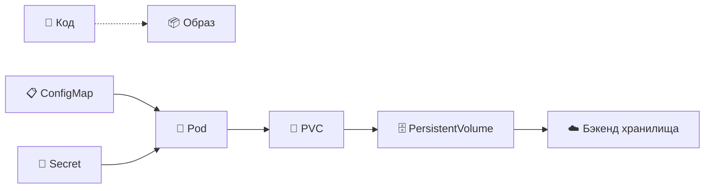
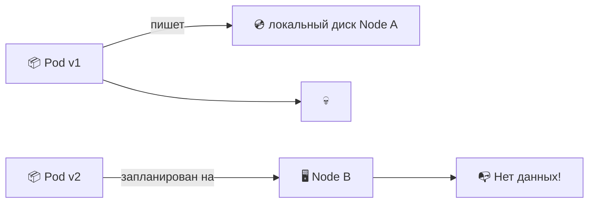
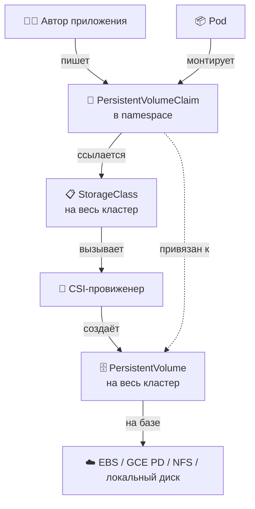
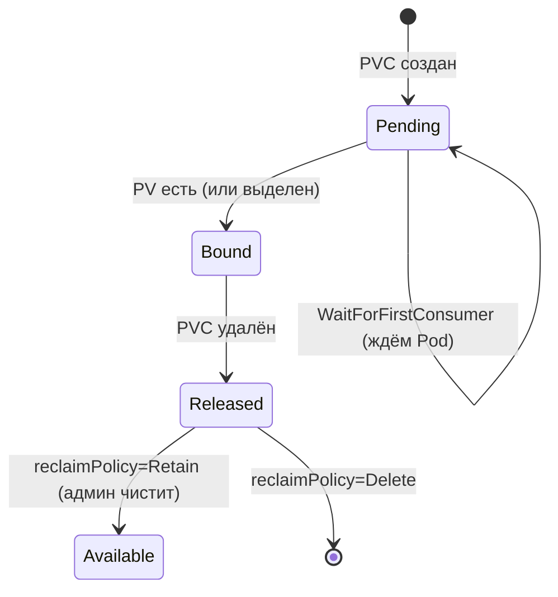
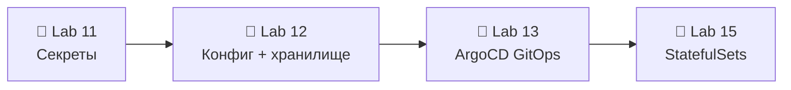

# 📌 Lecture 12 — Конфигурация и хранилище: ConfigMap и Persistent Volumes

## 📍 Slide 1 – 💾 Добро пожаловать: конфиг и хранилище

* 🌍 **Lecture 11 спрятала секреты** в Kubernetes Secrets и OpenBao. Но не каждое значение — секрет. Уровни логов, feature flags, хосты БД, конфиги NGINX — им место в **ConfigMap**.
* 📦 **Правило 12-Factor (фактор III):** «Храните конфиг в окружении, а не в коде.» Один образ, три окружения, ноль пересборок.
* 💾 И ещё **состояние**. Контейнеры эфемерны. Загрузки пользователей, файлы БД и счётчики визитов хотят хранилище, которое **переживает рестарт Pod**. Для этого есть `PersistentVolumeClaim`.
* 🎯 Эта лекция: ConfigMap (как внедрять и зачем неизменяемость), PV/PVC (модель claim — заявка на том — и динамическое выделение) и ловушка hot-reload.
* 🔗 **Связка с Lab 12:** ConfigMap с `config.json`, смонтированный файлом, второй ConfigMap через `envFrom` и счётчик `/data/visits` на PVC, который переживает `kubectl delete pod`.



---

## 📍 Slide 2 – 🎯 Результаты обучения

| # | Результат |
|---|---------|
| 1 | 📋 Создавать ConfigMap из литералов, файлов и YAML; выбрать верный способ внедрения |
| 2 | 🚪 Внедрить конфиг тремя путями: одна переменная, `envFrom`, монтирование volume |
| 3 | 🔒 Ставить `immutable: true` там, где уместно; понимать выигрыш по скорости и цену для hot-reload |
| 4 | 💾 Отличать `PersistentVolume` (на весь кластер) от `PersistentVolumeClaim` (в namespace) |
| 5 | 🤖 Брать `StorageClass` для динамического выделения; выбрать верные `AccessMode` и `reclaimPolicy` |
| 6 | 🔄 Сделать hot-reload через аннотацию с checksum, Reloader или fsnotify в приложении |

**Стек зафиксирован на май 2026:** Kubernetes **1.36 "Haru"** (релиз 22 апреля 2026). CSI-драйверы: **AWS EBS CSI**, **GCE PD CSI**, **local-path-provisioner** (для `kind`). Неизменяемые ConfigMap стабильны с **1.21**. `ReadWriteOncePod` в GA с **1.29**. VolumeSnapshot в GA с **1.20**.

---

## 📍 Slide 3 – ❓ Почему зашитый конфиг — это плохо

Представьте, что в образ запечён `DATABASE_URL=postgres://prod-db:5432/app`. Дальше:

* 🔄 **Три окружения — три сборки образа.** CI бежит 3× на каждый merge. Покрытие на dev-образе ≠ покрытие на prod-образе.
* 🐛 **Одна опечатка — одна пересборка.** Понизить `LOG_LEVEL` с `DEBUG` до `INFO`? Сборка, скан, подпись, push, выкатка. 10 минут ради одной строки.
* 💀 **Секреты в слоях образа.** `docker history` показывает каждый `ENV DB_PASSWORD=...`. Слои лежат в реестре навсегда.
* 🚦 **Промоушен ≠ промоушен.** «Dev-контейнер едет в prod» — только в dev-образе конфиг dev, и для prod вы всё равно пересобираете. Тестировали один артефакт, выкатываете другой.

> 🔥 **The 12-Factor App** (Heroku, 2011) сделал это общим правилом: **артефакт один во всех окружениях, конфиг приезжает в рантайме**. Контейнеры и Kubernetes проводят это в жизнь через ConfigMap и Secret.

---

## 📍 Slide 4 – 📋 Что такое ConfigMap на самом деле

`ConfigMap` — объект Kubernetes **внутри namespace**. В нём несекретные пары ключ–значение. API в core `v1` (стабилен с 1.2 — старше большинства ваших студентов).

```yaml
apiVersion: v1
kind: ConfigMap
metadata:
  name: app-config
  namespace: dev
data:
  LOG_LEVEL: "info"
  CACHE_TTL: "3600"
  config.yaml: |              # ← multi-line file content
    server:
      port: 8080
      timeout: 30s
binaryData:                   # ← base64 for non-UTF-8 (rare)
  tls.crt: <base64-blob>
```

* 📏 **Лимит: 1 MiB** на объект (лимит значения в etcd). Упёрлись? Режьте на несколько ConfigMap или берите нормальную систему раздачи конфига.
* 🚫 **По умолчанию не шифруется в покое.** Кто может `get configmap` по RBAC, читает всё. В etcd это открытый текст.
* ❌ **Не для секретов.** Пароли БД, API-ключи, TLS-ключи — это `Secret` (Lecture 11). `Secret` в etcd тоже base64, но глаголы RBAC и аудит у него свои.

---

## 📍 Slide 5 – 🛠️ Три способа создать

```bash
# 1️⃣ From literals — fastest for one-off values
kubectl create configmap app-config \
  --from-literal=LOG_LEVEL=info \
  --from-literal=CACHE_TTL=3600

# 2️⃣ From a file — preserves structure (nginx.conf, prometheus.yml)
kubectl create configmap nginx-config \
  --from-file=nginx.conf=./nginx.conf

# 3️⃣ From an env-file — bulk import .env-style config
kubectl create configmap app-env --from-env-file=./prod.env

# 4️⃣ From YAML — the only one that belongs in git
kubectl apply -f configmap.yaml
```

> ✅ **В жизни живёт только `4️⃣`.** `create` — для разовой отладки. В production всё декларативно: YAML в Helm-чарте или оверлее Kustomize, apply через GitOps (Lecture 13).

---

## 📍 Slide 6 – 🚪 Способ внедрения 1: одна переменная

```yaml
spec:
  containers:
    - name: web
      env:
        - name: LOG_LEVEL                  # ← env var name in the container
          valueFrom:
            configMapKeyRef:
              name: app-config
              key: LOG_LEVEL               # ← key inside the ConfigMap
              optional: false              # ← pod won't start if key missing
```

Когда так делать:
* 🎯 Надо **переименовать** переменную (`LOG_LEVEL` в CM → `APP_LOG_LEVEL` в контейнере)
* 🎯 Нужна **пара ключей** из большого ConfigMap
* 🎯 Нужен свой `optional` на каждый ключ

> ⚠️ **Переменные окружения запекаются на старте Pod.** ConfigMap обновили — живой Pod видит старое значение, пока его не перезапустят. Всегда.

---

## 📍 Slide 7 – 🚪 Способ внедрения 2: `envFrom` (пачкой)

```yaml
spec:
  containers:
    - name: web
      envFrom:
        - configMapRef:
            name: app-env           # ← every key becomes an env var
            optional: false
        - secretRef:
            name: app-secrets       # ← Secrets work the same way
        - prefix: APP_              # ← optionally prefix all keys
          configMapRef:
            name: feature-flags
```

* 🚀 **Одна строка на источник.** Все ключи `app-env` становятся переменными как есть.
* 🚫 **Кривые имена переменных молча пропускаются** (точка в ключе, первая цифра). Держитесь шаблона `[A-Z_][A-Z0-9_]*`.
* 🏷️ **`prefix`** разводит ConfigMap, если у двух источников ключи называются одинаково.

> 🔥 **Ловушка:** `envFrom` *не* умеет переименовать или отфильтровать ключи. 30 ключей в ConfigMap — 30 переменных в контейнере. Режьте ConfigMap, а не внедрение.

---

## 📍 Slide 8 – 🚪 Способ внедрения 3: монтирование volume

```yaml
spec:
  volumes:
    - name: config-vol
      configMap:
        name: nginx-config
        items:                      # ← optional: project specific keys
          - key: nginx.conf
            path: nginx.conf
            mode: 0644
  containers:
    - name: nginx
      volumeMounts:
        - name: config-vol
          mountPath: /etc/nginx     # ← whole dir, files auto-update
        # ✅ OR with subPath: single file, but NO auto-update:
        # - name: config-vol
        #   mountPath: /etc/nginx/nginx.conf
        #   subPath: nginx.conf
```

* 📁 **Весь каталог** — kubelet подхватывает правки ConfigMap примерно за `kubelet --sync-frequency` (по умолчанию 60s) плюс TTL кэша. Файлы меняются атомарно: подмена симлинка `..data`.
* 🚫 **`subPath` — разовая копия.** Файл появляется один раз на старте Pod и **больше не обновляется**. Путь монтирования чистый, live-reload пропадает.
* 🎚️ **`defaultMode` / `mode`** задают права на файл (по умолчанию `0644`).

---

## 📍 Slide 9 – 🔒 Неизменяемые ConfigMap (стабильно с 1.21)

```yaml
apiVersion: v1
kind: ConfigMap
metadata:
  name: app-config-v3
immutable: true                     # ← cannot be edited; can only be deleted+recreated
data:
  LOG_LEVEL: "info"
  CACHE_TTL: "3600"
```

Зачем это:
* ⚡ **Скорость:** kubelet больше не делает `watch` на ConfigMap. 10k Pod × 20 ConfigMap = на 200k watch меньше.
* 🛡️ **Защита от случайной правки.** `kubectl edit configmap app-config-v3` падает с "field is immutable".

Как пользоваться:
* 🏷️ **Версия в имени** — `app-config-v1`, `app-config-v2`, …
* 🔁 **Deployment ссылается на имя с версией.** Смена `app-config-v2 → v3` меняет шаблон Deployment — rolling update сам.
* 🗑️ **Старые версии убирает** задача GC, когда ссылок больше нет.

> 🔥 **Обмен:** immutable убивает hot-reload. Если приложение перечитывает файл по таймеру, immutable нормален. Нужна смена конфига без рестарта — оставляйте изменяемый ConfigMap и схемы со Slide 16.

---

## 📍 Slide 10 – 📊 ConfigMap vs Secret — коротко

| Аспект | `ConfigMap` | `Secret` |
|---|---|---|
| Тип в API | `v1.ConfigMap` | `v1.Secret` (типы: `Opaque`, `kubernetes.io/tls`, …) |
| Как лежит в etcd | Открытый текст | Base64 (это НЕ шифрование — encryption-at-rest требует `EncryptionConfiguration`) |
| Для чего | Несекретный конфиг | Пароли, токены, сертификаты |
| Глагол RBAC | `get configmaps` | `get secrets` (обычно жёстче) |
| Volume на tmpfs? | Нет (обычная ФС) | Да (монтируется как `tmpfs`, диск не трогает) |
| Лимит размера | 1 MiB | 1 MiB |
| Поле immutable | ✅ с 1.21 | ✅ с 1.21 |

> 🔥 **Ориентир:** если потеря завтра заставит писать инцидент по безопасности, это Secret.

---

## 📍 Slide 11 – 💾 Новый раздел — почему с хранилищем трудно

Модель контейнера — **неизменяемость и эфемерность**:
* 📦 Pod умер — записываемый слой умер с ним
* 🔄 Rolling update — новый Pod, пустая файловая система
* 🧭 Pod уехал на другую ноду — локальный диск старой ноды уже не достать

Для **stateless** (web, API) это идеально. Для **stateful** (БД, загрузки файлов, очереди) — катастрофа:



Ответ Kubernetes: **отвязать хранилище от Pod**. Pod просит том по имени. На какой ноде он окажется, том едет следом.

---

## 📍 Slide 12 – 🏗️ Трио PV / PVC / StorageClass



* 💾 **PVC (PersistentVolumeClaim)** — *заявка*. «Хочу 10Gi, RWO, быстрый SSD.» Живёт в namespace. Пишут авторы приложений.
* 🗄️ **PV (PersistentVolume)** — *ресурс*. На весь кластер (без namespace). Создаёт админ (статически) или provisioner (динамически).
* 📋 **StorageClass** — *шаблон*. «Вот как делать новые PV типа `fast-ssd`.» На весь кластер.

> 🎯 **Модель:** PVC к PV — как Pod к Node. Pod не выбирает ноду, это делает scheduler. PVC не выбирает PV, это делает binder.

---

## 📍 Slide 13 – 🤖 Статика и динамика

**Статика (стиль до 1.6, всё ещё годится):** админ заранее создаёт PV, PVC цепляется к тому, что подходит.

```yaml
# Admin creates this once
apiVersion: v1
kind: PersistentVolume
metadata: {name: pv-data-01}
spec:
  capacity: {storage: 10Gi}
  accessModes: [ReadWriteOnce]
  hostPath: {path: /mnt/data}        # ← demo only; never in prod
```

**Динамика (по умолчанию с 1.6):** PVC называет `StorageClass`, кластер сам создаёт PV.

```yaml
apiVersion: storage.k8s.io/v1
kind: StorageClass
metadata: {name: fast-ssd}
provisioner: ebs.csi.aws.com         # ← AWS EBS CSI driver
parameters:
  type: gp3
  iops: "3000"
  throughput: "125"
reclaimPolicy: Delete
volumeBindingMode: WaitForFirstConsumer    # ← bind only when a Pod uses the PVC
allowVolumeExpansion: true
```

> 🔥 **`WaitForFirstConsumer`** — то, что нужно в кластере на несколько AZ. Без него PV создаётся в зоне X, а Pod садится в зону Y, и `kubectl describe pod` пишет `volume node affinity conflict`. Добро пожаловать в отладку EBS в полночь.

---

## 📍 Slide 14 – 🔓 Режимы доступа

| Режим | Сокр. | Смысл | Обычный бэкенд |
|---|---|---|---|
| `ReadWriteOnce` | RWO | RW с одной **ноды** (несколько Pod на этой ноде можно) | EBS, GCE PD, Azure Disk |
| `ReadOnlyMany` | ROX | RO со многих нод | NFS, S3-CSI, раздача контента |
| `ReadWriteMany` | RWX | RW со многих нод сразу | NFS, EFS, Azure Files, CephFS |
| `ReadWriteOncePod` | RWOP | RW ровно **одним Pod** на весь кластер | Любой CSI-драйвер, GA с K8s 1.29 |

* 🔒 **`ReadWriteOncePod`** (GA в K8s 1.29) строже RWO. RWO пускает несколько Pod на одну ноду. RWOP — ровно один Pod на весь кластер. Для выбора лидера и БД с одним писателем.
* 🧨 **Блочные диски облака — только RWO.** EBS, GCE PD, Azure Disk — блочные устройства. Ядро облака не отдаёт их на запись нескольким хостам сразу.
* 📡 **Нужен RWX?** Это NFS, EFS, Azure Files или CephFS. Медленнее, дороже, местами eventually-consistent.

---

## 📍 Slide 15 – ♻️ Политики reclaim

PVC удалили. Что будет с диском под ним?

| Политика | Поведение | Когда брать |
|---|---|---|
| `Delete` | PV и диск под ним удаляются (облачный том исчезает) | По умолчанию у облачных SC. Нормально для кэша и черновиков |
| `Retain` | PV остаётся, диск не трогают. Чистит оператор руками | Базы и всё, что жалко потерять |
| `Recycle` | `rm -rf /thevolume/*`, потом PV снова свободен | ⚠️ **Устарело**, только NFS/hostPath, на CSI не работает — не используйте |

```yaml
spec:
  persistentVolumeReclaimPolicy: Retain    # ← override the StorageClass default per-PV
```

> 🔥 **Правило для production:** у PVC с бизнес-данными ставьте `Retain` и напишите runbook, как чистить. `Delete` удобен ровно до дня, когда вы удалите namespace и потеряете 200 GB загрузок клиентов.

---

## 📍 Slide 16 – 🔄 Hot reload — три стратегии

Правка ConfigMap **не рестартует Pod**. У Pod остаётся снимок переменных со старта. Файлы в volume обновятся (не сразу), но большинство приложений не следит за конфигом через `inotify`. Три рабочих схемы:

**1. Рестарт Pod при смене конфига (путь GitOps) — аннотация с checksum:**
```yaml
spec:
  template:
    metadata:
      annotations:
        checksum/config: {{ include "myapp.configmapHash" . }}
```
Helm считает хеш. Любая правка CM меняет аннотацию → выкатка Deployment → свежие Pod. Чисто, декларативно, родное для GitOps.

**2. Контроллер Reloader** — `stakater/Reloader` следит за ConfigMap и Secret, потом патчит Deployment и StatefulSet, которым они принадлежат, и так запускает выкатку. Код приложения не трогаете. Аннотация: `reloader.stakater.com/auto: "true"`.

**3. Перечитать на месте, в самом приложении:**
* Монтируйте ConfigMap как volume (не переменная и не subPath).
* Приложение следит за файлом: `fsnotify` (Go), `inotify` (Linux) или опрос раз в 30s.
* На изменение — перечитать, подменить конфиг атомарно, записать в лог. Так из коробки умеют NGINX, Envoy, Prometheus, Loki.

> ⚠️ **Монтирование через `subPath` само не обновляется.** Причина №1, почему «hot reload не работает».

---

## 📍 Slide 17 – 📸 VolumeSnapshot (GA в 1.20)

Бэкапы внутри Kubernetes, на стороне CSI-драйвера.

```yaml
# 1. Take a snapshot of a PVC
apiVersion: snapshot.storage.k8s.io/v1
kind: VolumeSnapshot
metadata: {name: data-snap-2026-05-26}
spec:
  volumeSnapshotClassName: csi-aws-ebs
  source:
    persistentVolumeClaimName: app-data
---
# 2. Restore by creating a new PVC from the snapshot
apiVersion: v1
kind: PersistentVolumeClaim
metadata: {name: app-data-restored}
spec:
  accessModes: [ReadWriteOnce]
  resources: {requests: {storage: 10Gi}}
  dataSource:
    name: data-snap-2026-05-26
    kind: VolumeSnapshot
    apiGroup: snapshot.storage.k8s.io
```

* 📸 **`VolumeSnapshot`** (в namespace) и **`VolumeSnapshotContent`** (на кластере) повторяют пару PVC/PV.
* 🧰 Нужен CSI-драйвер со снапшотами: AWS EBS CSI ✅, GCE PD CSI ✅, local-path-provisioner ❌.
* 🆕 В **K8s 1.36** (апрель 2026) **VolumeGroupSnapshot стал GA** — атомарный снапшот нескольких PVC для приложений на нескольких томах (например, БД и WAL).

---

## 📍 Slide 18 – ☁️ CSI-драйверы в 2026

| Драйвер | Бэкенд | Доступ | Снапшот | Расширение | Заметки |
|---|---|---|---|---|---|
| `ebs.csi.aws.com` | AWS EBS | RWO, RWOP | ✅ | ✅ | gp3 по умолчанию в новых кластерах |
| `efs.csi.aws.com` | AWS EFS | RWX | ❌ | н/д | NFSv4, плата за ГБ и IOPS |
| `pd.csi.storage.gke.io` | GCE PD | RWO, RWOP | ✅ | ✅ | региональный PD — варианты ROX/RWX |
| `disk.csi.azure.com` | Azure Disk | RWO, RWOP | ✅ | ✅ | похож на EBS |
| `file.csi.azure.com` | Azure Files | RWX | ✅ | ✅ | протокол SMB или NFS |
| `rancher.io/local-path` | диск хоста | RWO | ❌ | ❌ | по умолчанию в `kind`/k3d/Rancher |

* 🔌 **CSI (Container Storage Interface)** в GA с K8s 1.13. Современные драйверы хранилища — все CSI. In-tree драйверы (`kubernetes.io/aws-ebs` и остальные) переехали или устарели.
* 🧪 **В Lab 12** будет `local-path-provisioner` (StorageClass по умолчанию в k3d). Только RWO, без снапшотов. Для счётчика визитов хватит. В prod так не запускают.

---

## 📍 Slide 19 – 📜 Состояния PVC



Что видно в `kubectl get pvc`:
* ⏳ **Pending** — подходящего PV ещё нет. С `WaitForFirstConsumer` так и должно быть, пока Pod его не возьмёт.
* ✅ **Bound** — штатный путь.
* 🔓 **Released** — PVC уже нет, PV и данные на месте. Так у политики `Retain`.
* ❌ **Failed** — provisioner вернул ошибку. `kubectl describe pvc <name>` → смотрите Events.

> 🐛 **Классика застрявшего PVC:** вечный `Pending`, потому что в кластере нет `StorageClass` по умолчанию, а PVC не указал `storageClassName`. Лечение: `kubectl patch storageclass <name> -p '{"metadata":{"annotations":{"storageclass.kubernetes.io/is-default-class":"true"}}}'`.

---

## 📍 Slide 20 – 🧱 Stateful и stateless (задел на Lec 15)

| Свойство | Stateless | Stateful |
|---|---|---|
| Нагрузка в K8s | `Deployment` | `StatefulSet` (Lecture 15) |
| Идентичность Pod | Взаимозаменяемые, `app-7d-xyz` | Стабильные: `db-0`, `db-1`, `db-2` |
| Хранилище | `emptyDir` или ничего | Свой PVC на Pod, сам создаётся из `volumeClaimTemplates` |
| Масштаб | `kubectl scale --replicas=10` сразу | По порядку: 0 → 1 → 2 → …, шаг после health-проверки |
| Примеры | Веб-фронтенд, API, воркер | Postgres, Kafka, Elasticsearch, кластер Redis |

* 🍱 **В сегодняшней лабе — Deployment и PVC.** Нормально: одна реплика пишет в один том.
* 🪜 **Lecture 15 знакомит со StatefulSet** — три реплики Postgres, у каждой свой PVC, после переезда сетевые ID те же.

> 💡 **Pets vs cattle** («питомцы и стадо», Bill Baker, 2012): Deployment — cattle, StatefulSet — pets. Оба варианта нормальны. Выбирайте по модели данных.

---

## 📍 Slide 21 – 🚫 Антипаттерны

1. ❌ **Секреты в ConfigMap** — файл в git, открытый etcd, широкий RBAC. Берите `Secret` или External Secrets Operator.
2. ❌ **Volume `hostPath` в production** — Pod прибит к ноде, переезд ломается, данные легко утащить. Только для демо.
3. ❌ **`emptyDir` для данных, которые жалко** — сотрётся вместе с Pod. Нужен PVC.
4. ❌ **Reclaim `Delete` на данных prod** — один `kubectl delete pvc`, и том в AWS исчез. Для ценного ставьте `Retain`.
5. ❌ **`subPath` и ожидание hot reload** — обновления не будет. Монтируйте каталог.
6. ❌ **RWX на блочных дисках облака** — такого нет. EBS, PD и Azure Disk — это RWO. Нужны EFS, Files или NFS.
7. ❌ **ConfigMap больше 1 MiB** — etcd откажет. Режьте или уносите объём на нормальный сервер конфигов.
8. ❌ **Изменяемые ConfigMap на горячем пути** — каждый Pod держит watch. На 10k Pod это груз на control plane. Ставьте `immutable: true` и имена с версией.
9. ❌ **Нет `volumeBindingMode: WaitForFirstConsumer`** в кластере на несколько AZ — зоны Pod и диска разъедутся.
10. ❌ **Верить слову Bound** — PV есть, а данные не обязательно те, что вы писали. Бэкапы (VolumeSnapshot) живут на другой оси.

---

## 📍 Slide 22 – 🎯 Главное

1. 📋 **ConfigMap — несекретный конфиг на рантайме.** В namespace, потолок 1 MiB, в etcd открытым текстом. Три способа внедрить: одна переменная, `envFrom`, volume.
2. 🔒 **`immutable: true`** (стабильно с 1.21) даёт скорость и защиту на кластерах с кучей Pod. В паре с именем-версией.
3. 💾 **PVC (namespace, заявка) ↔ PV (кластер, ресурс) ↔ StorageClass (шаблон).** Динамическое выделение — норма с 1.6.
4. 🔓 **AccessModes:** RWO (одна нода), ROX (много читателей), RWX (много писателей, только файлы), RWOP (один Pod, GA с K8s 1.29). Блочные диски облака — только RWO и RWOP.
5. ♻️ **Политика reclaim:** `Retain` для данных, по которым будете плакать; `Delete` для кэша; `Recycle` не используйте.
6. 🔄 **Hot reload:** аннотация с checksum, или Reloader, или fsnotify в приложении на каталоге. `subPath` обновления блокирует.
7. 📸 **VolumeSnapshot в GA с 1.20.** Групповой снапшот — GA в 1.36, для приложений на нескольких томах.
8. 🧱 **Deployment и PVC** хватает на одну реплику. Три реплики Postgres — это **StatefulSet** (Lecture 15).

> 💬 *«Артефакт один и тот же во всех окружениях; конфигурация внедряется в рантайме.»* — the 12-Factor App, спустя 15 лет всё ещё верно.

---

## 📍 Slide 23 – 🚀 Что дальше

**📚 Следующая лекция: *Lecture 13 — GitOps с ArgoCD*** — каждый ConfigMap, каждый PVC и каждый файл values, что мы сегодня написали, должен лежать в git. **ArgoCD** смотрит в git и приводит кластер к этому состоянию.

* 🔄 **Модель pull:** желаемое состояние кластер забирает из git сам. CI в кластер не пушит
* 🤖 **ArgoCD 3.4** — App-of-Apps, волны синхронизации, ApplicationSet
* 🎯 Обнаружение drift: «кластер разъехался с git → почини (или пришли алерт)»
* ↩️ Откат = `git revert`

**🔬 Что сдать в Lab 12 (10 + 2.5 бонус):**
* Счётчик визитов в `/data/visits` (файл, переживает рестарт)
* ConfigMap смонтирован как файл `config.json`, второй ConfigMap приезжает через `envFrom`
* PVC на `/data`, проверка: `kubectl delete pod` — счётчик жив
* `k8s/CONFIGMAPS.md` с выводом команд и скриншотами
* Бонус: hot-reload через аннотацию с checksum, Reloader или fsnotify; описано ограничение `subPath`



> 🌊 От захардкоженных значений к динамическому, постоянному конфигу под GitOps — по одному тому за раз.

---

## 📚 Материалы

* 📕 *Kubernetes Up & Running* (3e, 2022) — Burns, Beda, Hightower — главы про ConfigMap и Volume
* 📕 *Kubernetes Patterns* (2e, 2023) — Bilgin Ibryam & Roland Huß — каталог паттернов
* 🌐 [kubernetes.io/docs/concepts/configuration/configmap](https://kubernetes.io/docs/concepts/configuration/configmap/)
* 🌐 [kubernetes.io/docs/concepts/storage/persistent-volumes](https://kubernetes.io/docs/concepts/storage/persistent-volumes/)
* 🌐 [kubernetes.io/docs/concepts/storage/volume-snapshots](https://kubernetes.io/docs/concepts/storage/volume-snapshots/)
* 🌐 [12factor.net/config](https://12factor.net/config) — фактор III
* 🌐 [github.com/stakater/Reloader](https://github.com/stakater/Reloader) — авторестарт при смене CM или Secret
* 🌐 [github.com/kubernetes-sigs/aws-ebs-csi-driver](https://github.com/kubernetes-sigs/aws-ebs-csi-driver)
* 🌐 [github.com/rancher/local-path-provisioner](https://github.com/rancher/local-path-provisioner) — по умолчанию в `kind`/k3d

**🎓 Квиз:** квиз после лекции идёт в окно таблицы лидеров недель 10–12.
