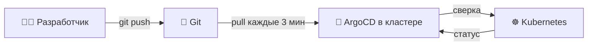
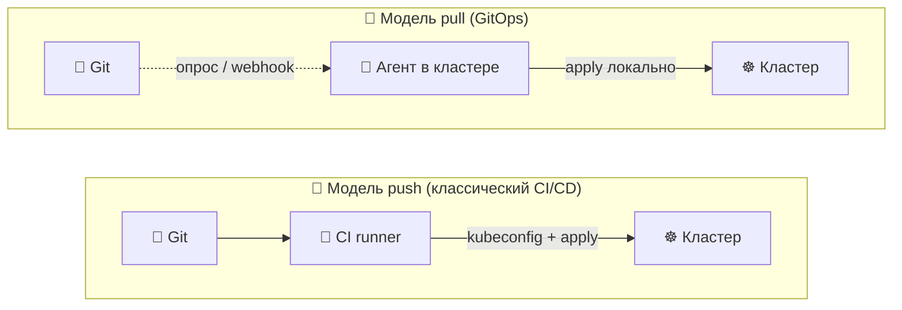
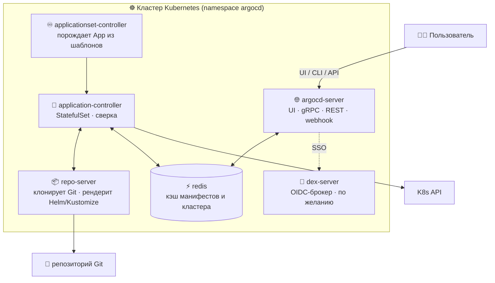
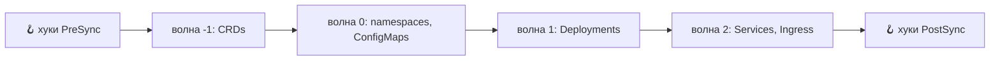
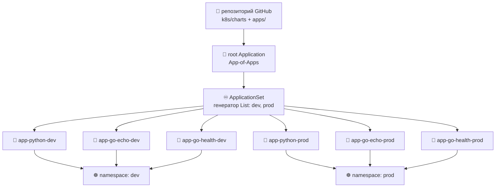
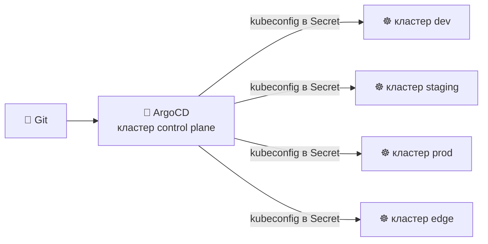
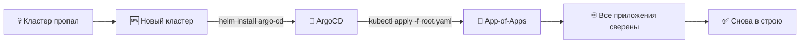
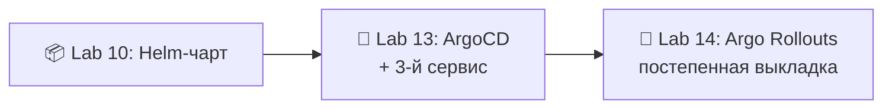

# 📌 Lecture 13 — GitOps с ArgoCD: Git как источник истины

## 📍 Слайд 1 – 🚀 Добро пожаловать в GitOps

* 🌍 **Lectures 9-12 оставили вам живой кластер:** Python-сервис в Helm-чарте и Go echo sidecar, секреты в OpenBao, постоянное состояние на PVC. Deployment по-прежнему делаете вы: `helm upgrade` с ноутбука.
* 🤖 **GitOps** переносит этот «ноутбук» *внутрь* кластера: агент смотрит Git, забирает желаемое состояние и непрерывно сверяет с ним кластер. Руками, через `kubectl` в обход, в кластер больше никто не лезет.
* 🎯 Эта лекция: модель GitOps и архитектура **ArgoCD 3.4** (май 2026), CRD Application и ApplicationSet, политики sync, паттерн App-of-Apps и почему всё это интересно, только когда сервисов **три**.
* 🔗 **Связка с Lab 13:** поставьте ArgoCD через Helm, опишите манифесты Application для `app-python`, `app-go-echo` **и третьего служебного сервиса `app-go-health`**, и пусть `ApplicationSet` из одного шаблона породит копии для dev и prod.



---

## 📍 Слайд 2 – 🎯 Чему научитесь

| # | Результат |
|---|---------|
| 1 | 📜 Назвать **четыре принципа OpenGitOps** и объяснить, зачем каждый |
| 2 | 🔁 Сравнить модели выкладки **push и pull** по месту учётных данных, drift (расхождение кластера с Git) и аудиту |
| 3 | 🏗️ Набросать **архитектуру ArgoCD 3.4**: argocd-server, application-controller, repo-server, redis, Dex |
| 4 | 📝 Читать и писать CRD **Application** с `source`, `destination`, `syncPolicy` |
| 5 | 🌳 Собирать выкладки паттерном **App-of-Apps** и генераторами **ApplicationSet** |
| 6 | 🛡️ Понимать **sync waves, хуки, self-heal, prune** и когда ручной sync выигрывает |

**Стек зафиксирован на май 2026:** **ArgoCD 3.4.x** (GA в начале мая 2026; **2.x в EOL с ноября 2025, с релиза 3.2**), Kubernetes **1.36** "Haru", один GitOps-репозиторий на GitHub, выкладки идут из Helm-чарта Lab 10.

---

## 📍 Слайд 3 – ❓ Почему pull лучше push

В Lab 12 CI-workflow уже гоняет `helm upgrade` в кластер. Работает. Зачем переезжать?

* 🔑 **Учётные данные.** CI нужен kubeconfig с cluster-admin, чтобы применять манифесты. Этот kubeconfig живёт в секретах GitHub, на ноутбуках, в скриптах. Любая утечка — компрометация кластера.
* 🌊 **Drift.** Кто-то в три ночи делает `kubectl edit` у Deployment, чтобы «починить» прод. Чарт в Git больше не совпадает с кластером. Следующий `helm upgrade` молча затирает починку.
* 🕵️ **Аудит.** «Кто поднял прод-Ingress до 12 реплик?» — ответ в истории shell, не в Git.
* 🚑 **Восстановление.** Кластер пропал? В push CI/CD вы заново гоняете pipeline (цепочка автоматической сборки и выкладки); в GitOps достаточно `helm install argo-cd && kubectl apply -f root.yaml`, и кластер собирает себя сам.

> 🔥 **Жёстко:** GitOps — не инструмент, а *инверсия управления*. Кластер сам тянется к Git; снаружи в кластер никто не ходит.

---

## 📍 Слайд 4 – 📜 Четыре принципа OpenGitOps

Рабочая группа CNCF **OpenGitOps** утвердила четыре принципа (v1.0.0). Выучите их. Инструмент без этих четырёх — не GitOps.

1. 📝 **Декларативность** — желаемое состояние описано декларативно (YAML, HCL, …), без императивных команд.
2. 🔒 **Версии и неизменяемость** — состояние хранится с полной историей; всегда можно взять коммит `abc123` и знать, что именно было выкачено.
3. 🤖 **Автоматический pull** — агенты *внутри* целевой системы сами забирают желаемое состояние. Снаружи никто не делает push.
4. ♾️ **Непрерывная сверка** — агенты сравнивают фактическое с желаемым и сами сводят их. Постоянно.

> 💡 **Проверка:** уберите агента — кластер разъедется с Git? Если да, у вас GitOps. Если нет (сверять было некому), у вас был просто «YAML в Git».

---

## 📍 Слайд 5 – 🔄 Push и pull рядом



| Аспект | 🔄 Push CI/CD | 🚀 Pull GitOps |
|--------|--------------|----------------|
| Учётные данные кластера | Живут в секретах CI | Остаются внутри кластера |
| Обнаружение drift | Нет: CI отработал и забыл | Непрерывно, каждые 3 минуты |
| След аудита | Логи CI (их ротируют) | `git log` (неизменяемый) |
| Аварийное восстановление | Заново прогнать pipeline на новом кластере | Поставить агента и указать на Git |
| Что блокирует выкладку | Доступность CI runner | Доступность Git |

---

## 📍 Слайд 6 – 🛠️ Инструменты GitOps

| Инструмент | Происхождение | Сильная сторона |
|------|---------|-----------|
| **ArgoCD** | CNCF graduated (Intuit, 2018) | Сначала UI, декларативный CRD `Application`, sync waves |
| **Flux CD v2** | CNCF graduated (Weaveworks, 2020) | Сначала CLI, контроллер на ресурс (Kustomization, HelmRelease, GitRepository) |
| **Rancher Fleet** | SUSE/Rancher | Огромные флоты кластеров (edge, ритейл) |
| **Codefresh GitOps** | Octopus (коммерческий) | ArgoCD под капотом, плюс дашборды, drift, RBAC на много команд |
| **Jenkins X** | CD Foundation | Если Jenkins нельзя бросить |

Курс берёт **ArgoCD**, потому что (a) это самый распространённый инструмент GitOps, (b) UI показывает drift людям вне Kubernetes, (c) CRD `Application` и `ApplicationSet` хорошо садятся на схему «много окружений и много сервисов».

> 🔥 **Честно:** Flux правда хорош — легче, ближе к Unix, нет UI, который надо держать живым. Для homelab берите его. В компаниях выигрывает ArgoCD: по дашборду человек вне инженерии видит, что выкладка прошла.

---

## 📍 Слайд 7 – 🏗️ Архитектура ArgoCD



* 🌐 **argocd-server** — UI и API gRPC/REST; с ним говорят люди и CI. Без состояния, масштабируется горизонтально.
* 🔄 **application-controller** — сердце. Сверяет каждый CR `Application` с кластером. StatefulSet, чтобы шардировать работу на много кластеров.
* 📦 **repo-server** — клонирует Git, запускает `helm template` / `kustomize build`, отдаёт контроллеру готовые манифесты. Без состояния, тяжёлый по кэшу.
* ⚡ **redis** — кэш манифестов, состояния кластера и ревизий Git. Пропадёт — сверка замедлится, результат останется верным.
* 🔐 **dex-server** — OIDC-брокер для SSO GitHub, Google и Okta. Необязателен; в лабораторных хватит локальных пользователей.
* ♾️ **applicationset-controller** — из одного шаблона и генератора делает много CR `Application`.

---

## 📍 Слайд 8 – 📝 CRD Application

Атомарная единица ArgoCD — один `Application`. Это указатель: «эта папка, этот репозиторий, эта ревизия → этот namespace на этом кластере».

```yaml
apiVersion: argoproj.io/v1alpha1
kind: Application
metadata:
  name: app-python-dev
  namespace: argocd
  finalizers:
    - resources-finalizer.argocd.argoproj.io   # 🗑️ cascade-delete K8s resources on app delete
spec:
  project: default
  source:
    repoURL: https://github.com/innodevops/student-repo.git
    targetRevision: main                         # 📌 branch, tag, or commit SHA
    path: k8s/charts/app-python
    helm:
      valueFiles:
        - values-dev.yaml
  destination:
    server: https://kubernetes.default.svc        # in-cluster
    namespace: dev
  syncPolicy:
    automated:
      prune: true                                 # 🗑️ delete resources removed from Git
      selfHeal: true                              # 💚 revert manual cluster edits
    syncOptions:
      - CreateNamespace=true
```

Ключи:
* 📌 **`targetRevision: main`** и **SHA**: ветка следит за движущимся HEAD (нормально для dev), SHA фиксирует ревизию точно (так делают прод-релизы).
* 🗑️ Без **`finalizers:`** удаление `Application` оставляет ресурсы Kubernetes сиротами.
* 🔄 Блок **`automated`** включает авто-sync. *Если его нет*, приложение на ручном sync: кнопка в UI или `argocd app sync`.

---

## 📍 Слайд 9 – 🔄 Состояния sync, health и операции

У каждого `Application` два независимых состояния и ещё короткая операция.

| Состояние sync | Смысл |
|------------|---------|
| 🟢 **Synced** | Живой кластер совпадает с отрисованными манифестами |
| 🟡 **OutOfSync** | Git и кластер разъехались (это полезно: расхождение видно) |
| ❓ **Unknown** | Репозиторий недоступен, или контроллер ещё не проверял |

| Состояние health | Смысл |
|--------------|---------|
| 💚 **Healthy** | Все ресурсы готовы (Deployment available, Pod running и так далее) |
| 🔵 **Progressing** | Выкладка идёт, дайте минуту |
| 🔴 **Degraded** | Что-то сломалось (CrashLoopBackOff, ошибка схемы) |
| ⚪ **Suspended** | Хуки на паузе или приложение на паузе |
| 🚫 **Missing** | Ресурса в кластере нет |

> 💡 Приложение бывает **Synced + Degraded** (Git честно говорит «выкати этот сломанный Pod») и **OutOfSync + Healthy** (кластер жив, но с Git не совпадает). Оба состояния — уже диагноз.

В ArgoCD 3.4 рядом с Sync и Health появился фильтр **Operation Status**. UI показывает, что синкается прямо сейчас. На инциденте это как раз то, что нужно.

---

## 📍 Слайд 10 – 🎚️ Политики sync: ручной режим, авто, self-heal, prune

```yaml
syncPolicy:
  automated:
    prune: true
    selfHeal: true
    allowEmpty: false       # 🛡️ refuse to apply if rendering produced 0 manifests
  syncOptions:
    - CreateNamespace=true
    - ServerSideApply=true
    - PruneLast=true
    - ApplyOutOfSyncOnly=true
  retry:
    limit: 5
    backoff:
      duration: 5s
      factor: 2
      maxDuration: 3m
```

* 🔄 **Нет блока `automated:` — ручной sync.** В UI большая кнопка «SYNC». Для прода это норма.
* 🤖 **`automated:` — авто-sync** на каждое изменение Git *и* на каждую периодическую сверку (по умолчанию 3 минуты).
* 💚 **`selfHeal: true`** возвращает ручные правки в кластере к состоянию из Git. Выключите, если ресурсом владеет другой контроллер (HPA пишет `replicas`).
* 🗑️ **`prune: true`** удаляет ресурсы, которые из Git *убрали*. Без этого удалённый файл оставляет в кластере сироту.
* ⚙️ **`ServerSideApply=true`** включает server-side apply Kubernetes: нет проблемы с аннотацией last-applied-configuration, и это уживается с HPA/VPA.

> ⚠️ **Здравый дефолт для прода:** ручной sync, `prune: false`, `selfHeal: false`. Каждое изменение смотрит человек. В dev включайте всё.

---

## 📍 Слайд 11 – 🌊 Sync waves и хуки

Часть ресурсов должна подняться *раньше* других. CRD раньше custom resource, namespace раньше всего, миграции БД раньше приложения.

```yaml
metadata:
  annotations:
    argocd.argoproj.io/sync-wave: "-1"           # 🌊 negative = earlier, positive = later (default 0)
    argocd.argoproj.io/hook: PreSync             # 🪝 PreSync | Sync | PostSync | SyncFail | PostDelete
    argocd.argoproj.io/hook-delete-policy: HookSucceeded
```



* 🪝 **Хуки** — любые ресурсы Kubernetes (обычно Job), которые бегут в точках жизненного цикла. Классика: Job на `pre-sync`, который гоняет `flyway migrate`, пока новые Pod приложения ещё не стартовали.
* 🌊 **Волны** задают порядок ресурсов в фазе Sync. Контроллер применяет всё на волне `N`, ждёт health и только потом идёт на `N+1`.
* 🧹 **`hook-delete-policy`** не даёт кластеру зарасти: `HookSucceeded` удаляет Job, как только тот закончился зелёным.

---

## 📍 Слайд 12 – 🌳 Паттерн App-of-Apps

Проблема старта: приложениями ArgoCD управляет через CR `Application` в namespace `argocd`. Кто управляет *этими* CR? Другой `Application`.

```
gitops-repo/
└── apps/
    ├── root.yaml              # 👈 the "App-of-Apps" — points at ./apps
    ├── app-python.yaml        # Application CR for the Python service
    ├── app-go-echo.yaml       # Application CR for the Go echo service
    └── app-go-health.yaml     # Application CR for the Go health service
```

```yaml
# root.yaml — the seed
apiVersion: argoproj.io/v1alpha1
kind: Application
metadata:
  name: root
  namespace: argocd
spec:
  project: default
  source:
    repoURL: https://github.com/innodevops/student-repo.git
    targetRevision: main
    path: apps                                # 📂 directory full of Application YAMLs
  destination:
    server: https://kubernetes.default.svc
    namespace: argocd
  syncPolicy:
    automated: { prune: true, selfHeal: true }
```

Один `kubectl apply -f root.yaml` — и ArgoCD находит каждый дочерний `Application` и синкает его. Дальше кластер ведёт себя сам: восстановление = заново поставить ArgoCD и снова применить `root.yaml`.

---

## 📍 Слайд 13 – 🧬 Топология ArgoCD на три сервиса



* 🐍 **app-python** — сервис из Lab 2 → Lab 10 (FastAPI).
* 🦫 **app-go-echo** — служебный напарник из Lab 9 (Go HTTP echo).
* 💚 **app-go-health** — **новый в Lab 13**. Крошечный Go-сервис health/static из plumbing. Он нужен *именно* затем, чтобы ApplicationSet и App-of-Apps перестали быть игрушечными схемами.

> 💡 **Зачем это:** ApplicationSet на одном сервисе — тот же `kubectl apply`, только длиннее. На **двух** сервисах в **двух** окружениях он начинает окупаться. **Три сервиса × два окружения = шесть Application** из одного шаблона на 30 строк, и польза уже очевидна. Поэтому Lab 13 вводит `app-go-health`.

---

## 📍 Слайд 14 – ♾️ ApplicationSet: один шаблон, много приложений

```yaml
apiVersion: argoproj.io/v1alpha1
kind: ApplicationSet
metadata:
  name: all-apps
  namespace: argocd
spec:
  generators:
    - matrix:
        generators:
          - list:                       # 1️⃣ which apps
              elements:
                - { svc: app-python,     path: k8s/charts/app-python }
                - { svc: app-go-echo,    path: k8s/charts/app-go-echo }
                - { svc: app-go-health,  path: k8s/charts/app-go-health }
          - list:                       # 2️⃣ which environments
              elements:
                - { env: dev,  autoSync: "true" }
                - { env: prod, autoSync: "false" }
  template:
    metadata:
      name: '{{svc}}-{{env}}'
    spec:
      project: default
      source:
        repoURL: https://github.com/innodevops/student-repo.git
        targetRevision: main
        path: '{{path}}'
        helm:
          valueFiles:
            - 'values-{{env}}.yaml'
      destination:
        server: https://kubernetes.default.svc
        namespace: '{{env}}'
      syncPolicy:
        syncOptions: [CreateNamespace=true]
```

Генератор **matrix** скрещивает два генератора **list**: 3 сервиса × 2 окружения = **6 CR `Application`**, и они появляются сами. Четвёртый сервис — одна строка в первом списке.

---

## 📍 Слайд 15 – 🧰 Остальные генераторы ApplicationSet

| Генератор | По чему идёт | Когда брать |
|-----------|----------------------|----------|
| **List** | Литералы прямо в манифесте | Маленький стабильный набор (dev/staging/prod) |
| **Cluster** | Все кластеры, зарегистрированные в ArgoCD | Выкладка на флот кластеров |
| **Git (Directory)** | Папки под путём в репозитории | Папка на приложение: новые находятся сами |
| **Git (File)** | Файлы YAML/JSON по пути | Один файл конфига на тенанта |
| **Matrix** | Скрещивание двух генераторов | Приложения × окружения, сервисы × кластеры |
| **Merge** | Inner join и переопределение | Оверрайды конкретного кластера поверх базового списка |
| **SCM Provider** | Репозитории организации GitHub/GitLab | GitOps на всю организацию, много репозиториев сервисов |
| **Pull Request** | Открытые PR в репозитории | Эфемерное preview-окружение на каждый PR |
| **Cluster Decision** | CRD, который выбирает кластеры | Куда сажать приложение, решает внешняя логика |
| **Plugin** | HTTP-сервис, который пишете вы | Всё, что строками выше не выразить |

> 💡 **В Lab 13 — List и Matrix.** Бонус: направьте генератор Git Directory на `k8s/charts/`. Новая папка чарта сама создаёт Application.

---

## 📍 Слайд 16 – 🔐 RBAC и AppProject

Из коробки каждый `Application` попадает в проект `default`, а тот может выкатывать куда угодно. В проде доступ режут CR **AppProject**.

```yaml
apiVersion: argoproj.io/v1alpha1
kind: AppProject
metadata:
  name: team-payments
  namespace: argocd
spec:
  sourceRepos:
    - https://github.com/innodevops/payments-*    # 🔒 only these repos
  destinations:
    - namespace: payments-*                       # 🔒 only these namespaces
      server: https://kubernetes.default.svc
  clusterResourceWhitelist:                       # 🔒 only these cluster-scoped kinds
    - group: ''
      kind: Namespace
  namespaceResourceBlacklist:
    - group: ''
      kind: ResourceQuota
  roles:
    - name: deployer
      policies:
        - p, proj:team-payments:deployer, applications, sync, team-payments/*, allow
      groups: [innodevops:payments]
```

Пользовательский ConfigMap **argocd-rbac-cm** связывает группы OIDC, роли и права. Схема: один проект на команду, в проде без `default`, живые роли — через группы OIDC.

---

## 📍 Слайд 17 – 🔒 Секреты в мире GitOps

GitOps хочет «всё в Git». Секрет открытым текстом в Git — это сразу компрометация. Три рабочих ответа:

| Паттерн | Как устроено | Компромисс |
|---------|--------------|----------|
| **Sealed Secrets** (Bitnami) | У контроллера в кластере пара ключей; `kubeseal` превращает `Secret` в `SealedSecret` (шифр лежит в YAML); при apply контроллер расшифровывает | Ключ свой у каждого кластера: на ротации запечатывать заново |
| **External Secrets Operator + OpenBao** | В Git только *ссылка* `ExternalSecret`; в момент sync ESO забирает значение из OpenBao, Vault или SSM | В эксплуатации вы зависите от хранилища секретов |
| **SOPS + KMS / age** | Файлы в Git зашифрованы через `sops`; плагин ArgoCD (`argocd-vault-plugin`, `helm-secrets`) расшифровывает на рендере | Надо поставить плагин и вести ключи |

**Lab 11** уже связал OpenBao и ESO. Lab 13 живёт на том же паттерне. Ресурсов `Secret` в Git нет, только ссылки `ExternalSecret`.

> 🔥 **Никогда** не кладите секреты открытым текстом в GitOps-репозиторий, даже в приватный. История Git вечна.

---

## 📍 Слайд 18 – 🌐 GitOps на много кластеров

ArgoCD в **одном** кластере control plane может вести **много** рабочих кластеров.



* 🔑 Целевой кластер регистрируют через `argocd cluster add <context>`. В namespace `argocd` появляется `Secret` с его kubeconfig.
* ♾️ Генератор **Cluster** в ApplicationSet стыкует это с одним шаблоном: «выкати приложение на каждый кластер с меткой `tier=edge`».
* ⏸️ **В ArgoCD 3.4 сверку можно поставить на паузу по одному кластеру.** Тумблер замораживает один больной кластер посреди инцидента, остальные живут как жили.

> 💡 **Хаб со спицами и федерация:** хаб проще. Кластеров больше 50 или сеть жёстко режется — ставьте **Argo CD в каждый кластер** и контроллер флота уровнем выше (Fleet, Cluster API).

---

## 📍 Слайд 19 – 🩺 Наблюдаем сам ArgoCD

Метрики Prometheus у ArgoCD есть сразу. Стек из Lab 8 их скрейпит.

| Метрика | На что смотреть |
|--------|-----------|
| `argocd_app_info{sync_status="OutOfSync"}` | Затяжной drift |
| `argocd_app_info{health_status="Degraded"}` | Сломанные приложения |
| `argocd_app_sync_total{phase="Failed"}` | Падающие sync |
| `argocd_app_reconcile_bucket` | Гистограмма задержки сверки |
| `argocd_cluster_api_resource_objects` | Рост числа объектов (пора масштабировать) |
| `argocd_redis_request_total` | Нагрузка на кэш |

Заведите их в Grafana из Lab 8. Алерты: **Degraded дольше 5 минут** и **OutOfSync дольше 30 минут**. При авто-sync приложение не должно столько сидеть в OutOfSync. Если сидит, что-то заклинило.

---

## 📍 Слайд 20 – 🚨 Аварийное восстановление: бэкап — это Git

Чистая история восстановления в GitOps:



1. 🆕 Поднимите новый кластер (Terraform / kubeadm / kOps).
2. 📦 `helm install argo-cd argo/argo-cd -n argocd --create-namespace`.
3. 🌱 `kubectl apply -f apps/root.yaml`.
4. ☕ Ждите. Всё остальное уже в Git.

> ⚠️ **Что *не* вернётся:** данные с состоянием (PVC, базы). GitOps возвращает **конфигурацию**, не **состояние**. Рядом нужны снимки PV, Velero или бэкапы баз. Тот же урок, который вбили Labs 11 (секреты) и 12 (PVC).

---

## 📍 Слайд 21 – 🧰 Антипаттерны и частые баги

1. ❌ **`kubectl apply` в namespace, которым владеет GitOps.** Self-heal откатит правку за 3 минуты, и день уйдёт на отладку. Меняйте в Git.
2. ❌ **`prune: true` на первой установке.** Кривой `path:` — и ArgoCD радостно удалит всё, чего не видит. Начните с `prune: false`, проверьте, потом включайте.
3. ❌ **`targetRevision` смотрит на `HEAD` в проде.** Каждый коммит в `main` тихо выкатывается. Берите тег или ветку `release/*`.
4. ❌ **YAML `Secret` открытым текстом в Git.** Даже в приватном репозитории. Sealed Secrets, ESO или SOPS.
5. ❌ **Один огромный `Application` на «всё».** Пропадают sync, статус и RBAC на приложение. Один Application на пару (сервис × окружение).
6. ❌ **Смешивать роли репозитория.** **Код приложения** и **манифесты GitOps** держите в *разных* репозиториях (или хотя бы в разных путях). CI собирает образ, GitOps-репозиторий ссылается на новый тег.
7. ❌ **Забыли finalizer.** После `kubectl delete app` остаются сироты. Так бесхозные Pod живут в проде по году.
8. ❌ **selfHeal на ресурсах с HPA.** HPA пишет `spec.replicas`, ArgoCD откатывает, начинается драка. Поставьте `ignoreDifferences:` на `/spec/replicas`.

---

## 📍 Слайд 22 – 🌍 GitOps вживую

* 🏢 **Intuit** открыл исходники ArgoCD в 2018, чтобы вести ~2000 микросервисов. Сотни выкладок в день идут из Git.
* 🛒 **BlackRock, Adobe, Tesla, Red Hat OpenShift GitOps** крутят ArgoCD в большом проде.
* 📊 **CNCF Annual Survey 2024:** GitOps — самая быстрорастущая практика Kubernetes. В ответах лидирует **ArgoCD**.
* 🏷️ **Проект Argo получил статус CNCF Graduated** в декабре 2022. Та же ступень зрелости, что у Kubernetes, Prometheus и Envoy.
* 🚀 **ArgoCD 3.4** (начало мая 2026) делает ставку на Day-2: пауза сверки на один кластер, богаче фильтры UI, версия Kubernetes как Major.Minor.Patch, трассировка OpenTelemetry через поток OIDC.

> 📊 **Одна цифра:** опрос Codefresh «State of GitOps» за 2024 ставит **ArgoCD примерно на 70% GitOps-выкладок**, Flux примерно на 25%, остальное — длинный хвост.

---

## 📍 Слайд 23 – 🎯 Главное

1. 📜 **GitOps = четыре принципа OpenGitOps:** декларативно, с версиями, через pull, непрерывная сверка. Всё остальное — детали реализации.
2. 🚀 **Pull лучше push** по месту учётных данных, по обнаружению drift и по аварийному восстановлению.
3. 🏗️ **ArgoCD — это 5 компонентов:** argocd-server, application-controller, repo-server, redis, dex (и ещё applicationset-controller). Запомните, кто что делает.
4. 📝 **CRD Application** — атомарная единица. **App-of-Apps** поднимает весь кластер из одного корневого манифеста.
5. ♾️ **ApplicationSet** с Matrix(List × List) порождает N сервисов × M окружений из одного шаблона. Это паттерн лабораторной.
6. 🎚️ **Политика sync: ручная для прода, automated + selfHeal + prune для dev.** Здравый дефолт.
7. 🌊 **Sync waves и хуки** ставят миграции БД раньше Pod приложения, а задания очистки — после.
8. 🔒 **Секреты в Git не живут.** Sealed Secrets, ESO + OpenBao, SOPS. Навсегда.

> 💬 *"Operations by Pull Request."* (эксплуатация через pull request) — Kelsey Hightower

---

## 📍 Слайд 24 – 🚀 Что дальше

**📚 Следующая лекция: *Постепенная выкладка с Argo Rollouts*.** GitOps выкатывает сразу на merge, и следующий вопрос — *«как выкатывать **осторожно**?»* Canary, blue-green, анализ без человека.

* 🐤 **Canary** — 10% → 50% → 100%, ворота из запросов Prometheus
* 🔵 **Blue-green** — два полных стека, мгновенное переключение, мгновенный откат
* 📊 **AnalysisTemplate** — продвижение и откат по метрикам
* 🔄 **Argo Rollouts** и Flagger — два претендента

**🔬 Что сдать в Lab 13:**
* Поставить ArgoCD 3.4 через Helm в свой кластер
* Добавить **третий сервис** — `app-go-health` (файлы plumbing лежат в `app_go_health/`)
* Описать `Application` на каждый из **трёх** сервисов в **двух** окружениях (dev и prod) — всего шесть Application
* Заменить шесть одним **ApplicationSet** с генератором Matrix(List, List)
* Обернуть всё корневым Application в паттерне **App-of-Apps**
* Авто-sync для dev, с selfHeal и prune; prod оставить **ручным**
* Бонус 2.5 балла: перейти на генератор Git Directory, который сам находит новые чарты под `k8s/charts/*`



> 🌊 От «это выкатил я» к «это выкатил Git» — по одному merge за раз.

---

## 📚 Материалы

* 📕 *GitOps and Kubernetes* — Yuen, Matyushentsev, Ekenstam, Suen (Manning, 2021) — каноническая книга про паттерн
* 📕 *The Path to GitOps* — Christian Hernandez (электронная книга Red Hat, 2024) — короткая, для практика
* 🌐 [argo-cd.readthedocs.io](https://argo-cd.readthedocs.io/en/stable/) — официальная документация ArgoCD
* 🌐 [opengitops.dev](https://opengitops.dev/) — четыре принципа, уже утверждённые
* 🌐 [github.com/argoproj/argo-cd](https://github.com/argoproj/argo-cd) — исходники и релизы
* 🌐 [fluxcd.io](https://fluxcd.io/) — второй инструмент GitOps в CNCF, который стоит знать
* 🌐 [опрос Codefresh «State of GitOps»](https://codefresh.io/) — ежегодные цифры внедрения
* 🎙️ Доклад KubeCon 2023 — *"GitOps at Intuit"* (Hong Wang) — как ArgoCD вырос до большого масштаба

**🎓 Квиз:** квиз после лекции попадает в окно таблицы лидеров за недели 13-16.
