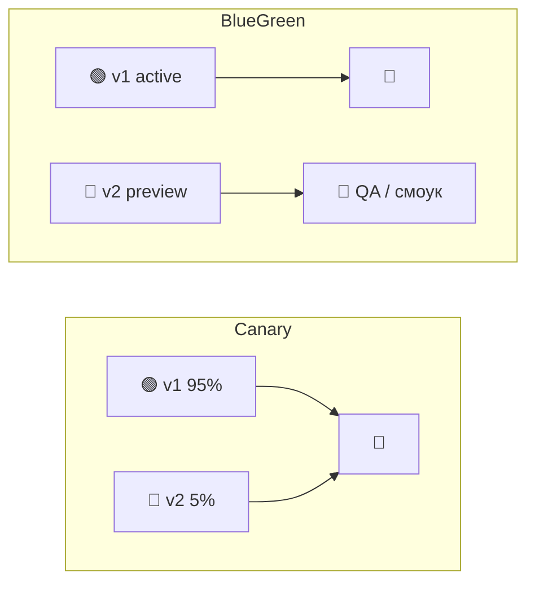
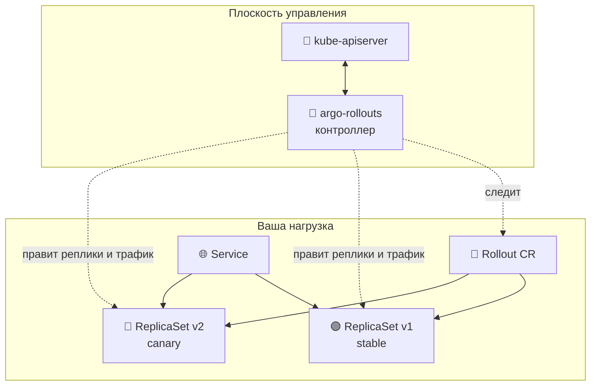
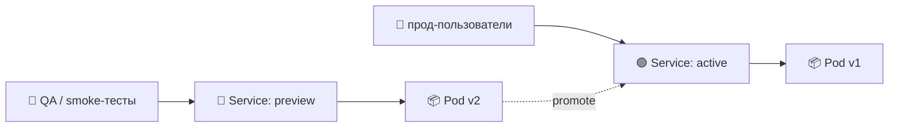
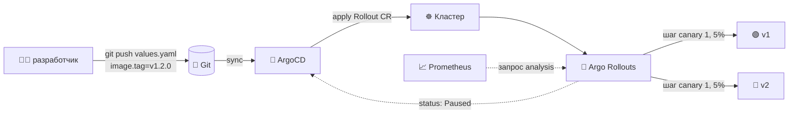
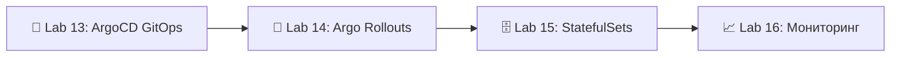

# 📌 Lecture 14 — Постепенная выкладка с Argo Rollouts

## 📍 Слайд 1 – 🚦 Добро пожаловать в постепенную выкладку

* 🌍 **Lecture 13 дала вам GitOps.** ArgoCD сверяет Helm-чарт из Git с кластером за секунды. Источник истины закрыт.
* 🐤 **«Задеплоено» ≠ «выпущено».** Выкат Deployment меняет Pod пачками по 25% и перестаёт мерить, как только те проходят liveness probe. Баг в новом образе — тот, что стреляет только на 5% запросов, — уезжает к 100% пользователей.
* 🎯 Эта лекция: меняем `kind: Deployment` на `kind: Rollout`, режем трафик шагами (5% → 25% → 50% → 100%), метрики решают, продвигать или откатывать — **без человека, который в пятницу в 17:00 смотрит в Grafana**.
* 🔗 **Связка с Lab 14:** переведите чарт Lab 13 с `Deployment` на `Rollout`, выкатите canary со сдвигом трафика в 5 шагов, затем параллельный blue-green с `previewService` и бонусный `AnalysisTemplate` для Prometheus.

```mermaid
flowchart LR
  Deploy[📦 kind: Deployment] -->|25% Pod за раз, без метрик| Done[✅ "Выкатили"]
  Rollout[🐤 kind: Rollout] -->|5% → 25% → 50% → 100%<br/>+ ворота по метрикам| Released[🎯 "Выпустили"]
```

---

## 📍 Слайд 2 – 🎯 Чему научитесь

| # | Результат |
|---|---------|
| 1 | 🧠 Отличить **deployment** (Pod уже на новом коде) от **релиза** (пользователи видят новый код) |
| 2 | 🐤 Настроить **canary**: веса по шагам и паузы |
| 3 | 🔵 Настроить **blue-green** с `activeService` и `previewService` |
| 4 | 📊 Написать **`AnalysisTemplate`**, который спрашивает Prometheus и сам продвигает или прерывает |
| 5 | 🚦 Подключить **нарезку трафика** через NGINX, ALB, Istio или плагин Gateway API |
| 6 | 🛠️ Вести rollout через `kubectl argo rollouts`: `get`, `promote`, `abort`, `retry`, `undo` |

**Стек зафиксирован на май 2026:** **Argo Rollouts 1.8.4** (вышел 13 февраля 2026), Kubernetes **1.36 "Haru"**, ArgoCD **3.4.x** для sync, **Prometheus 3.11.3** (или линейка 3.5 LTS) для метрик анализа — тот самый Prometheus, который вы подняли в Lab 8.

---

## 📍 Слайд 3 – ❓ Deployment ≠ релиз

С Lab 9 вы делаете rolling update обычным `kind: Deployment`. Почему этого мало?

* 🩺 **Единственный сигнал здоровья у Deployment — probe на уровне Pod.** Readiness стал зелёным — Kubernetes перекладывает трафик. Утечки памяти, хвост латентности и всплески 5xx для выката невидимы.
* ⏱️ **`maxSurge` и `maxUnavailable` — грубые ручки.** При maxSurge 25% ко второй минуте четверть трафика уже на сломанной сборке, и автоматического abort нет.
* 🌐 **Примитива «процент трафика» нет.** Deployment не умеет «отправь 5% HTTP-запросов на v2 и 95% на v1». Он умеет только «замени N Pod».
* 🚫 **С метриками он не связан.** Сказать ему «откатись, если 5xx > 1%» нельзя. *Argo Rollouts* можно сказать ровно это.

> 🔥 **Жёстко:** «Move fast and break things» (двигайся быстро и ломай) умерло. Сильные команды живут иначе: «двигайся быстро и сразу видь обратную связь». Постепенная выкладка замыкает петлю между *выкладкой кода* и *знанием, что он работает*.

---

## 📍 Слайд 4 – 📜 Короткая история постепенной выкладки

* 📅 **2010** — Humble и Farley публикуют *Continuous Delivery*. В книге появляется метафора canary: «выкати на один сервер, посмотри, потом продвигай».
* 📅 **2014** — Netflix открывает **Spinnaker** со встроенными стадиями canary на внутреннем ACA (Automated Canary Analysis).
* 📅 **2018** — Netflix и Google открывают **Kayenta**, статистического судью canary (тест Манна–Уитни, Mann-Whitney U). Пользователи Spinnaker получают продвижение по метрикам.
* 📅 **2019** — Weaveworks в блоге называет это **"progressive delivery"** (постепенная выкладка) и выпускает **Flagger** рядом с Flux. В том же году команда Argo выпускает **Argo Rollouts** рядом с ArgoCD.
* 📅 **2021** — **v1.0 GA** у Argo Rollouts. Вместе с ArgoCD, Workflows и Events проект входит в CNCF Incubating. Статус Graduated — **декабрь 2022**.
* 📅 **2024** — CNCF архивирует спецификацию **SMI** (Service Mesh Interface). **Gateway API** и плагин Gateway API для Argo Rollouts становятся рекомендуемым способом резать трафик в mesh.
* 📅 **2026 (Feb 13)** — **Argo Rollouts 1.8.4**. Багфикс анализа blue-green (кейс «преждевременный успех, когда ReplicaSet становится unsaturated») и обновление зависимостей.

> 📚 *The Phoenix Project* и *Accelerate* называют постепенную выкладку самым сильным предиктором низкого change failure rate (доля изменений, которые ломают прод). DORA 2024: у элиты **change failure rate < 5%**, у слабых команд он 15-30%.

---

## 📍 Слайд 5 – 🐤 Canary, blue-green и остальные

Четыре стратегии, которые встречаются вживую. Первые две Argo Rollouts умеет из коробки. Остальные живут в коде приложения.

| Стратегия | Как сдвигает трафик | Цена по ресурсам | Когда брать |
|----------|----------------------|----------------|----------|
| 🟰 **Rolling** (встроен в Deployment) | Число Pod, не процент запросов | 1x + maxSurge | Stateless, низкий риск |
| 🐤 **Canary** | Процент запросов через traffic router (маршрутизатор доли запросов): 5 → 25 → 50 → 100 | 1x + реплики canary | Большинство прод-выкладок |
| 🔵 **Blue-Green** | Обмен сервиса целиком, всё сразу | 2x на время переключения | Миграции БД, ломающие изменения API |
| 🚩 **Feature flag** | На каждый запрос, внутри приложения | 1x (это просто код) | Только внутри или эксперименты A/B |



> 🤔 **Подумайте:** какую стратегию взять, если v1 не умеет читать новую схему БД? *(Подсказка: canary тут мимо. 5% пользователей на сломанной схеме — всё ещё 5% пользователей.)*

---

## 📍 Слайд 6 – 🤖 Argo Rollouts: встаёт на место Deployment

Argo Rollouts — контроллер Kubernetes со своим CRD `Rollout`. Форма на 95% как у `Deployment`: те же `replicas`, `selector`, `template`. Сверху блок `strategy`, где вы описываете, *как* выкатывать.



* 📜 **Один CRD вместо Deployment.** Контроллер ведёт два ReplicaSet, stable и canary, и сдвигает между ними Pod и веса HTTP.
* 🔧 **Плагин kubectl** (`kubectl argo rollouts`) даёт `get`, `promote`, `abort`, `retry`, `undo` и подкоманду `dashboard` для локального UI.
* 🤝 **ArgoCD уже понимает Rollouts.** Поменяли в чарте `Deployment` на `Rollout` — UI ArgoCD рисует прогресс rollout как объект первого класса. Лишней настройки нет.

> 🔥 **Миграция механическая:** `sed -i 's/kind: Deployment/kind: Rollout/' templates/*.yaml`, затем добавьте блок `strategy:`. Шаблон Pod тот же.

---

## 📍 Слайд 7 – 📜 Минимальный Rollout

```yaml
apiVersion: argoproj.io/v1alpha1
kind: Rollout
metadata:
  name: lab14-app
spec:
  replicas: 10
  selector:
    matchLabels:
      app: lab14-app
  template:
    metadata:
      labels:
        app: lab14-app
    spec:
      containers:
        - name: web
          image: ghcr.io/innodevops/lab2-app:v1.2.0
          ports: [{containerPort: 8080}]
          readinessProbe:
            httpGet: {path: /ready, port: 8080}
  strategy:
    canary:
      steps:
        - setWeight: 5
        - pause: {duration: 2m}
        - setWeight: 25
        - pause: {duration: 5m}
        - setWeight: 50
        - pause: {duration: 5m}
        - setWeight: 100
```

* 🐤 **Шаги идут сверху вниз.** Каждый `setWeight` — процент *реплик*, если traffic router нет, или процент *запросов*, если он есть (слайд 12).
* ⏸️ **`pause: {duration: ...}`** — пауза по таймеру. **`pause: {}`** — жёсткий ручной шлагбаум: rollout стоит, пока вы не выполните `kubectl argo rollouts promote`.
* 🎯 **`setWeight: 100` в конце не обязателен.** Когда шаги кончились, контроллер считает конечным состоянием 100%.

---

## 📍 Слайд 8 – ⏱️ Что происходит на каждом шаге

| Время | Реплики stable | Реплики canary | Трафик на v2 | Состояние |
|------|----------------|----------------|----------------|-------|
| T+0   | 10 | 0 | 0%   | `Progressing` (canary выкатывается) |
| T+0.5 | 10 | 1 | 5%   | `Paused` (таймер 2 мин) |
| T+2.5 | 8  | 3 | 25%  | `Paused` (таймер 5 мин) |
| T+7.5 | 5  | 5 | 50%  | `Paused` (таймер 5 мин) |
| T+12.5 | 0 | 10 | 100% | `Healthy` ✅ |

* 🔄 **Без traffic router** Argo Rollouts приближает вес отношением числа реплик и надеется на round-robin у `Service`. На 10 репликах 5% округляется до одного Pod canary.
* 🚦 **С traffic router** (NGINX, ALB, Istio, Gateway API) вес точный на уровне HTTP, число реплик тут ни при чём. Можно пустить 5% трафика на 10% Pod.
* 💥 **`Degraded`** появляется, если ReplicaSet canary не уложился в progress deadline или шаг `analysis` упал.

---

## 📍 Слайд 9 – 🔵 Стратегия blue-green

Когда версии нельзя мешать — например, миграция схемы, которую старый код не читает, — переключайте весь трафик сразу.

```yaml
strategy:
  blueGreen:
    activeService: lab14-app
    previewService: lab14-app-preview
    autoPromotionEnabled: false      # require manual `promote`
    scaleDownDelaySeconds: 300       # keep old pods 5 min for fast rollback
    prePromotionAnalysis:
      templates: [{templateName: smoke-tests}]
```



* 🟢 **`activeService`** — куда идёт прод-трафик. Селектор переписывает контроллер: он смотрит на текущий живой ReplicaSet.
* 🔵 **`previewService`** смотрит на новый ReplicaSet. Сюда ходят QA, smoke-тесты и синтетические мониторы.
* ⏪ **`scaleDownDelaySeconds`** держит старые Pod живыми N секунд после продвижения. Пока таймер не истёк, мгновенный откат — `kubectl argo rollouts undo`.

> ⚠️ **Про деньги:** на переключении крутятся 2x Pod (active и preview) и 2x стоимость кластера на это окно. Заложите это в бюджет.

---

## 📍 Слайд 10 – 📊 AnalysisTemplate — решение по метрикам

Самое сильное в Argo Rollouts: запрос, условие успеха, порог провала. Сошлитесь на это из шага rollout — при регрессии контроллер *сам* прервёт выкат.

```yaml
apiVersion: argoproj.io/v1alpha1
kind: AnalysisTemplate
metadata:
  name: success-rate
spec:
  args:
    - name: service-name
  metrics:
    - name: success-rate
      interval: 1m              # query every minute
      count: 5                  # take 5 samples
      successCondition: result[0] >= 0.99
      failureLimit: 2           # 2 failures → abort
      provider:
        prometheus:
          address: http://prometheus.monitoring:9090
          query: |
            sum(rate(http_requests_total{
              service="{{args.service-name}}",
              status!~"5.."
            }[2m]))
            /
            sum(rate(http_requests_total{
              service="{{args.service-name}}"
            }[2m]))
```

* 🎯 **`successCondition`** — выражение Go над `result`. Prometheus возвращает `[]float64`; для мгновенного запроса берите индекс 0.
* ❌ **`failureLimit: 2`** — два плохих замера ещё терпимы, третий прерывает rollout.
* ⚠️ **`inconclusiveLimit`** (на схеме его нет) ставит паузу, а не abort, когда данных нет. Полезно, если Prometheus медленно скрейпит новые Pod.

---

## 📍 Слайд 11 – 🔗 Как вставить анализ в canary

Поставьте шаг `analysis` между сменами веса. Дальше rollout не пойдёт, пока анализ не вернёт `Successful`.

```yaml
strategy:
  canary:
    steps:
      - setWeight: 5
      - pause: {duration: 2m}
      - analysis:
          templates: [{templateName: success-rate}]
          args:
            - name: service-name
              value: lab14-app-canary
      - setWeight: 25
      - analysis:
          templates: [{templateName: success-rate}]
          args:
            - name: service-name
              value: lab14-app-canary
      - setWeight: 100
```

Чем кончается анализ:

| Результат | Что делает rollout |
|--------|----------------|
| ✅ `Successful` | Следующий шаг |
| ❌ `Failed` | Авто-abort, свернуть canary, вернуть трафик на stable |
| ⚠️ `Inconclusive` | Пауза; дальше вручную через `promote` |
| 🐢 `Running` | Сэмплировать дальше, пока не наберётся count или failureLimit |

> 🔥 **Приём:** повесьте `analysis` ещё и как `backgroundAnalysis` на уровне spec. Он идёт параллельно каждому шагу с момента старта, и регрессия посреди шага прерывает сразу, не дожидаясь следующих ворот.

---

## 📍 Слайд 12 – 🚦 Маршрутизация: отношение реплик и настоящие веса HTTP

Без traffic router «5% трафика» — это отношение числа реплик. На маленьком N это грубо и мимо. **Traffic router** даёт контроллеру прописать настоящие HTTP-веса в ingress или mesh.

| Роутер | Что правит Argo Rollouts | Когда |
|--------|------------------------------|------|
| 🌐 **NGINX Ingress** | Второй `Ingress` с `nginx.ingress.kubernetes.io/canary: true` и `canary-weight` | Самый частый ingress в Kubernetes |
| 🚢 **AWS ALB** | Вес `TargetGroupBinding` в `ListenerRule` | EKS и управляемый ALB |
| 🕸️ **Istio** | Веса HTTP-маршрута в `VirtualService` | Mesh Istio уже стоит |
| 🔗 **Linkerd** | **SMI** TrafficSplit (наследие) или **Gateway API** (рекомендуется) | Пользователи Linkerd |
| 🌉 **Плагин Gateway API** | Взвешенные бэкенды `HTTPRoute` — любая реализация GW API | Новые выкладки, mesh не важен |

Пример на NGINX:

```yaml
strategy:
  canary:
    canaryService: lab14-app-canary
    stableService: lab14-app-stable
    trafficRouting:
      nginx:
        stableIngress: lab14-app-ingress
    steps:
      - setWeight: 5
      - pause: {duration: 2m}
      - setWeight: 100
```

> 📚 **В 2024 CNCF заархивировал спецификацию SMI.** Новую работу ведите на **Kubernetes Gateway API** через плагин `argoproj-labs/rollouts-plugin-trafficrouter-gatewayapi`: один плагин, любой совместимый mesh.

---

## 📍 Слайд 13 – 🛠️ kubectl argo rollouts — набор, чтобы выжить

```bash
# 📊 Live status — refreshes in place, shows weight, pods, analysis
kubectl argo rollouts get rollout lab14-app --watch

# ⏯️ Move past a manual `pause: {}`
kubectl argo rollouts promote lab14-app

# ⏩ Skip ALL remaining steps and go to 100% (use sparingly)
kubectl argo rollouts promote lab14-app --full

# 💥 Abort the in-progress rollout — traffic flips back to stable
kubectl argo rollouts abort lab14-app

# 🔁 Restart a Degraded rollout from step 0 (after you've fixed the image)
kubectl argo rollouts retry rollout lab14-app

# ⏪ Roll back to the previous stable ReplicaSet (after promotion)
kubectl argo rollouts undo lab14-app

# 🖥️ Local dashboard at http://localhost:3100
kubectl argo rollouts dashboard
```

> 🔧 **Совет:** повесьте алиас на длинную команду — `alias kr='kubectl argo rollouts'`. К середине Lab 14 скажете себе спасибо.

---

## 📍 Слайд 14 – 🔁 ArgoCD + Argo Rollouts — полный цикл GitOps

Lab 13 подключил ArgoCD, Lab 14 меняет тип нагрузки. Для ArgoCD `Rollout` — ресурс первого класса: он смотрит `.status.phase` на `Healthy`, `Paused` и `Degraded`.



* ✅ ArgoCD ставит приложению `Healthy` *только* когда Rollout в `Healthy`. Canary на паузе виден как `Progressing`, прерванный rollout — как `Degraded`. Ловушки «Synced, а по факту сломано» больше нет.
* 🚫 **Не включайте авто-sync ArgoCD с `selfHeal: true` на поля `status` у CR Rollout.** По умолчанию ArgoCD диффит только spec. Расширите diff на status — начнёте драться с контроллером rollout.

---

## 📍 Слайд 15 – 🐦 Flagger — второй вариант

Argo Rollouts не единственный. **Flagger** (Weaveworks, теперь подпроект Flux) — второй крупный контроллер постепенной выкладки.

| | 🐤 **Argo Rollouts** | 🐦 **Flagger** |
|---|------------------------|----------------|
| Модель ресурса | Меняет Deployment на CRD `Rollout` | Оставляет ваш Deployment, добавляет CR `Canary` |
| Форма выката | Явный список `steps:` (каждый вес пишете вы) | Декларативные `stepWeight` и `maxWeight`: контроллер наращивает сам |
| Пара в GitOps | ArgoCD (та же семья проектов) | Flux CD (та же семья проектов) |
| Mesh | Из коробки: NGINX, ALB, Istio, Traefik, AppMesh, плагины (Gateway API, Contour, Consul…) | Из коробки: Istio, Linkerd, AppMesh, Contour, NGINX, Gloo, Gateway API |
| Метрики | Prometheus, Datadog, NewRelic, Wavefront, CloudWatch, Graphite, InfluxDB, Kayenta, Web | Prometheus, Datadog, CloudWatch, NewRelic, Graphite, свои webhook |
| Ручные шлагбаумы | Из коробки (`pause: {}`) | Можно через webhook, менее удобно |

> 🔥 **Правило:** на ArgoCD берите Argo Rollouts. На Flux берите Flagger. Близкие родственники: цели одни, эргономика чуть разная. Курс берёт Argo Rollouts, потому что Lab 13 уже поднял ArgoCD.

---

## 📍 Слайд 16 – 🔥 Частые антипаттерны

1. ❌ **Canary без анализа.** Пауза по времени «5 минут на 5%» — медленная русская рулетка. Всегда подключайте `AnalysisTemplate`.
2. ❌ **`successCondition: result[0] >= 0.95`.** Слишком мягко: это разрешает 5% ошибок. Живые SLO — от 99.9%.
3. ❌ **Нет `failureLimit`.** Один чих Prometheus прерывает каждый rollout. Ставьте `failureLimit: 2` или `3`.
4. ❌ **Селектор по меткам `version: v1`.** Селектор Service ссорится с метками rollout. Argo Rollouts сам ставит `rollouts-pod-template-hash`, и Service развалится.
5. ❌ **`scaleDownDelaySeconds: 0` в blue-green.** Старые Pod исчезают в момент promote. Баг через 10 секунд — откатываться *некуда*.
6. ❌ **Canary вместе с миграцией БД.** 5% пользователей попадают на v2, v2 пишет колонку, которую v1 не читает, и 95% получают 500. Схему меняйте через blue-green, миграцию повесьте на анализ до продвижения.
7. ❌ **В CI нет плагина kubectl.** Джоба гоняет `kubectl rollout status` (команда Deployment), путается и пишет «успех», пока canary ещё на 5%. Нужен `kubectl argo rollouts status`.

---

## 📍 Слайд 17 – 🏭 Постепенная выкладка вживую

* 🎬 **Netflix** — первопроходцы автоматического анализа canary с Kayenta (2018, вместе с Google). Каждый pipeline Spinnaker в Netflix пускает прод только после статистического сравнения метрик canary и baseline. Судья canary берёт тест Манна–Уитни, чтобы оценить значимость временных рядов.
* 🏢 **Google** — внутри canary и blue-green. Одна задача Borg на регион, трафик между регионами сдвигается часами, не минутами. Глава 8 книги SRE.
* 🐙 **GitHub** — preview-окружение на каждое внутреннее изменение до merge. Прод идёт регион за регионом, с воротами по метрикам.
* 🐦 **Twitter (ныне X)** — инженерный блог (2023) про выкат алгоритма ленты: canary 0.1% → 1% → 10%, окна наблюдения по 24 часа.
* 💸 **Capital One** — кейс (2022): после аварии на $20M ушли с чистого blue-green на canary с анализом. Сломанный сервис аутентификации тогда уехал на 100% сразу.

> 📊 **DORA 2024:** у команд с постепенной выкладкой **change failure rate на 41% ниже**, чем у тех, кто всё ещё на rolling Deployment.

---

## 📍 Слайд 18 – 🎚️ Как выбрать размер шагов

Универсального списка шагов canary нет. Калибруйте по ожидаемому **error budget** (бюджет ошибок) и по **объёму трафика**.

| Тип сервиса | Трафик | Какие шаги |
|--------------|---------|--------------------|
| 🌐 Внутренняя админка | < 100 rpm | `25 → 50 → 100`, паузы 2 мин |
| 🏬 API среднего трафика | 1k-10k rpm | `5 → 25 → 50 → 100`, паузы 5 мин и анализ |
| 🌍 Публичный сервис с большим трафиком | > 100k rpm | `1 → 5 → 10 → 25 → 50 → 100`, паузы 30 мин и фоновый анализ |
| 💳 Платежи и аутентификация (большой радиус поражения) | любой | `1 → 5 → 25 → 50 → 100`, ручной шлагбаум между КАЖДЫМ шагом и анализ в нескольких окнах |

* 📏 **Правило:** меньше первый шаг и длиннее пауза, когда плохая выкладка дорого стоит. Canary 5% на сервисе в 1M req/min всё равно подставляет под баги 50,000 req/min.
* ⏱️ **Длина паузы** не короче окна выборки анализа. Rate за 5 минут — пауза минимум 5 минут, чтобы первый анализ видел только трафик canary.

---

## 📍 Слайд 19 – 🧪 Lab 14 подробно

Берёте Helm-чарт из Lab 13. Им уже управляет ArgoCD.

**Задача 1 — основы (2 балла):** поставьте контроллер Argo Rollouts, плагин `kubectl argo rollouts` и дашборд. Проверка: `kubectl argo rollouts version`.

**Задача 2 — canary (3 балла):** `templates/deployment.yaml` → `templates/rollout.yaml`. Canary из 5 шагов `20 → 40 → 60 → 80 → 100`, ручной шлагбаум после шага 1. Запустите rollout сменой тега образа, пройдите promote в дашборде, сделайте abort посреди выката и проверьте, что трафик вернулся на stable.

**Задача 3 — blue-green (3 балла):** добавьте второй файл значений `values-bluegreen.yaml`. Настройте `activeService` и `previewService`. Выкатите v1, затем v2, сходите в preview-сервис, сделайте promote, сразу `undo` и смотрите, как активный сервис отщёлкивается назад.

**Задача 4 — документация (2 балла):** напишите `k8s/ROLLOUTS.md`. Обе стратегии, скриншоты дашборда Argo Rollouts, шпаргалка команд CLI и ваша рекомендация, какую стратегию когда брать.

**Бонус (+2.5 балла):** подключите `AnalysisTemplate` к Prometheus из Lab 8. Провайдер `web` на `/health` — нижняя планка. Настоящий провайдер `prometheus` с `rate(http_requests_total{status=~"5.."}[2m])` — полный опыт. Покажите **автооткат**: специально выкатите образ, который отвечает 500.

> 🔗 **Перенос в Lab 16:** AnalysisTemplate отсюда — ровно то, что подхватывает Lab 16 в части «мониторинг и алерты». Правила Prometheus и ворота rollout замыкают петлю между *наблюдением* и *реакцией*.

---

## 📍 Слайд 20 – 📊 Дашборд и уведомления

```bash
kubectl argo rollouts dashboard           # http://localhost:3100
```

Дашборд показывает каждый Rollout в кластере: текущий шаг, реплики canary и stable, вес трафика, живой статус анализа, который ещё идёт. Три кнопки решают дело: `Promote`, `Abort`, `Restart`.

Для **уведомлений** (Slack, MS Teams, почта) поставьте `argo-rollouts-notifications` и опишите триггеры `NotificationConfiguration`:

```yaml
apiVersion: notifications.argoproj.io/v1alpha1
kind: NotificationConfiguration
spec:
  triggers:
    - name: on-rollout-aborted
      condition: rollout.status.phase == 'Degraded'
      template: rollout-aborted
  templates:
    - name: rollout-aborted
      slack:
        attachments: |
          [{"title": "Rollout {{.rollout.metadata.name}} aborted",
            "color": "#E96D76"}]
```

> 🚨 **Правило прода:** каждая команда получает пинг в Slack, когда rollout в `Degraded`. Тихий провал выглядит так: через неделю выясняется, что прод сидит на v1.1, потому что каждое продвижение с тех пор само прерывается.

---

## 📍 Слайд 21 – ✨ Что нового в Argo Rollouts 1.8.x

Проект стабильный. Линейка 1.8 — точечная доводка, не революция.

* 🩹 **1.8.4 (Feb 13 2026)** — фикс «анализ bluegreen преждевременно успешен, если новый ReplicaSet становится unsaturated» (PR #4604). `hashicorp/go-plugin` поднят до 1.6.3. **В Lab 14 фиксируйте эту версию.**
* 🔌 **Плагины выросли.** Для интеграций вне ядра теперь берут плагины traffic-router и провайдеров метрик. Gateway API, Contour, kgateway и Consul живут в `argoproj-labs/`.
* 📜 **Traffic router `apisix`** стал GA раньше, на линейке 1.8.
* 🏃 **Скорость.** На больших кластерах (10k+ rollout) контроллер агрессивнее пользуется кэшами informer.
* 🚫 **Напоминание:** встроенный traffic router `smi` ещё работает, но после архивации спецификации SMI его дни сочтены. Новую работу ведите на плагине Gateway API.

> 📚 **Источник:** [релизы Argo Rollouts](https://github.com/argoproj/argo-rollouts/releases). Для стабильности фиксируйте `v1.8.4`. `v1.9` выходит в середине 2026.

---

## 📍 Слайд 22 – 🎯 Главное

1. 🐤 **Rollout — это Deployment плюс стратегия.** Тот же шаблон Pod, другой контроллер, релиз заметно безопаснее.
2. 🎚️ **Canary сдвигает трафик шагами, blue-green переключает его целиком.** В Argo Rollouts оба — объекты первого класса.
3. 📊 **`AnalysisTemplate` — это ключ.** Без ворот по метрикам вы просто замедлили плохую выкладку. С ними откат делает контроллер.
4. 🚦 **Для точных маленьких процентов traffic router лучше отношения реплик.** NGINX в большинстве случаев, плагин Gateway API — когда mesh не важен.
5. 🧰 **`kubectl argo rollouts` — инструмент на каждый день:** `get --watch`, `promote`, `abort`, `undo`. Повесьте алиас.
6. 🔁 **ArgoCD + Argo Rollouts — каноническая связка GitOps и постепенной выкладки.** Lab 13 и Lab 14 стоят рядом специально.
7. 🚫 **Canary и ломающее изменение вместе не живут.** 5% пользователей на несовместимой схеме — всё равно плохой день. Берите blue-green.

> 💡 **Паттерн:** push в Git → sync ArgoCD → стартует Rollout → анализ спрашивает Prometheus → шаг или откат. Петля идёт без человека.

---

## 📍 Слайд 23 – 🧠 Другой взгляд

| 😰 Обычный Deployment | 🐤 Постепенная выкладка |
|---|---|
| «Выкатилось — отдаём» | «Выкатилось, *и метрики удержались* — отдаём» |
| `kubectl rollout undo` (руками) | `kubectl argo rollouts abort` (само, при регрессии) |
| Радиус поражения 100% с первой минуты | Радиус поражения 5%, дальше пускает анализ |
| Выкладка в пятницу = страшно | Выкладка в пятницу = выкладка во вторник |
| Откат — это постмортем | Откат — решение контроллера |
| «Задеплоилось?» | «Задеплоилось *и выпустилось*?» |

---

## 📍 Слайд 24 – 🚀 Что дальше

**📚 Следующая лекция: *StatefulSet и постоянное хранилище*.** Stateless-выкаты простые. Базы, Kafka, Elastic, Redis — другое дело.

* 🗄️ **StatefulSet:** порядок, стабильное сетевое имя, PVC на каждый Pod
* 💾 **PersistentVolume и PersistentVolumeClaim:** абстракция хранилища
* 🪣 **StorageClass:** динамическое выделение (gp3, ssd, nfs)
* 📦 **Снимки томов и восстановление:** бэкапы внутри Kubernetes
* 🔄 **Стратегии OnDelete и RollingUpdate:** обновление StatefulSet — это не постепенная выкладка в смысле Rollout

**🔬 Что сдать в Lab 14 (кратко):**
* Контроллер Argo Rollouts 1.8.4 и дашборд
* Helm-чарт с ресурсом `Rollout`, стратегии canary и blue-green
* Проход по `kubectl argo rollouts`: promote, abort, retry, undo
* Бонус: `AnalysisTemplate` и откат на специально сломанном образе



> 🌊 От «задеплоено» к «выпущено» — по одному взвешенному шагу.

---

## 📚 Материалы

* 📕 *Continuous Delivery* (2010) — Humble и Farley. Откуда метафора canary вошла в общий обиход.
* 📕 *Accelerate* (2018) — Forsgren, Humble, Kim. Данные DORA по change failure rate.
* 🌐 [Документация Argo Rollouts](https://argoproj.github.io/argo-rollouts/) — официальная; раздел *Features* отличный
* 🌐 [Релизы Argo Rollouts](https://github.com/argoproj/argo-rollouts/releases) — фиксируйте v1.8.4
* 🌐 [Плагин Gateway API](https://github.com/argoproj-labs/rollouts-plugin-trafficrouter-gatewayapi) — маршрутизация трафика без привязки к mesh
* 🌐 [Документация Flagger](https://flagger.app/) — альтернатива со стороны Flux
* 🌐 [Kayenta в Netflix Tech Blog](https://netflixtechblog.com/automated-canary-analysis-at-netflix-with-kayenta-3260bc7acc69) — статистический анализ canary от тех, кто это придумал
* 🌐 [CNCF: введение в progressive delivery](https://www.cncf.io/blog/2024/02/27/flagger-vs-argo-rollouts-vs-service-meshes-a-guide-to-progressive-delivery-in-kubernetes/)
* 🎥 [Argo и Flagger, панель KubeCon](https://www.cncf.io/online-programs/) — прямое сравнение двух контроллеров

**🎓 Квиз:** квиз после лекции попадает в окно таблицы лидеров за недели 13-16.
