# 📌 Lecture 15 — StatefulSets и постоянное хранилище: запускаем то, что помнит

> 🎯 **От скота без состояния к идентичности со состоянием — когда «любой Pod сойдёт» уже неправда**

---

## 📍 Слайд 1 – 🗄️ Нагрузки, которые не забывают

До Lab 14 включительно каждый Pod был расходным. Убил — получил новый, со случайным именем и пустым диском; пользователь не замечал. Так выходило, потому что эти Pod ничего не *помнили* между запросами: состояние жило в самом запросе или в чужой базе.

* 📦 Большинство нагрузок без состояния: веб, API, воркеры, edge-прокси
* 🗄️ Некоторые помнят: базы, очереди сообщений, поисковые кластеры, кэши с прогретым рабочим набором
* 💥 Обращаться со второй группой как с первой — так в проде пропадают данные

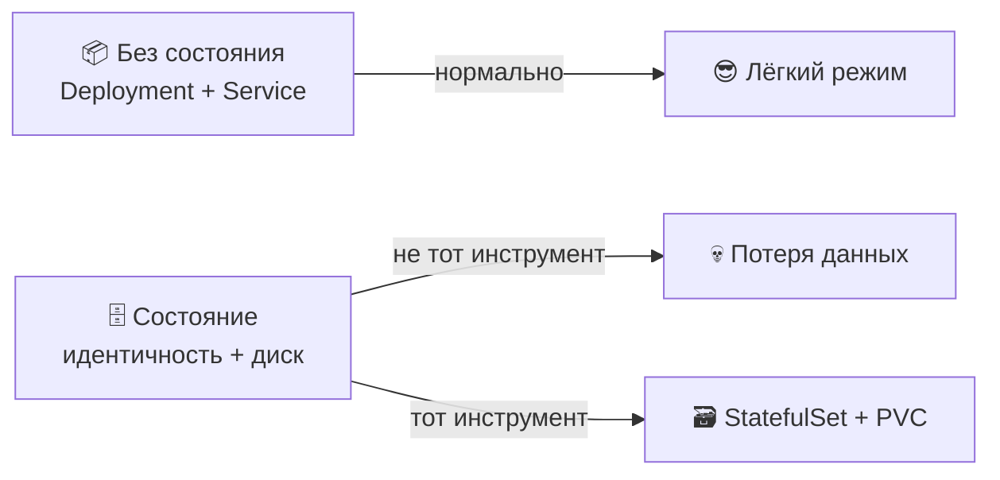

> 🔗 **Связка с Lab 15:** вы переводите Helm-чарт из Lab 12 с `Deployment` на `StatefulSet` с `volumeClaimTemplates` и headless `Service`, затем доказываете, что у каждого Pod свой счётчик визитов и он переживает убийство Pod.

---

## 📍 Слайд 2 – 🎯 Чему научитесь

| # | Результат |
|---|---------|
| 1 | 🧠 Отличить нагрузку без состояния от нагрузки со состоянием и выбрать нужный контроллер |
| 2 | 🏗️ Читать и писать манифесты `StatefulSet` с `volumeClaimTemplates` |
| 3 | 🌐 Настроить headless `Service` (`clusterIP: None`) и резолвить DNS конкретного Pod |
| 4 | 🔢 Понимать, когда нужен порядок, а когда хватит `Parallel` |
| 5 | 🔄 Выбирать между `RollingUpdate` (с partition) и `OnDelete` |
| 6 | 🤖 Знать, когда бросить StatefulSet и взять оператор (CloudNativePG, Strimzi, Rook) |

**Стек зафиксирован на May 2026:** Kubernetes **1.36** "Haru", **CloudNativePG 1.29** (оператор PostgreSQL), **Rook v1.18+ (Ceph 19 Squid)**, **Longhorn 1.9** как лёгкий вариант хранилища CNCF. `StatefulSet` в API `apps/v1` в статусе GA с **Kubernetes 1.9 (Dec 2017)**. Контракт API железобетонный. Режимы отказа — нет.

---

## 📍 Слайд 3 – ⚠️ Почему Deployment не годится для Postgres

Всё, за что `Deployment` любят у веба без состояния, *ровно то*, что ломает нагрузку со состоянием.

| Поведение Deployment | Почему вебу это хорошо | Почему Postgres это плохо |
|---|---|---|
| 🎲 Случайные имена Pod (`web-7b9c4-x4f2k`) | Pod взаимозаменяемы | Реплике нужно знать, *какой* Pod — primary |
| 📦 Общий `PersistentVolumeClaim` (или его нет) | Нет состояния = нет диска | Два процесса Postgres пишут в один WAL = порча |
| ⚡ Параллельный старт Pod | Быстрее рост | Гонка выборов на старте; split-brain |
| 🔁 IP Pod меняется после рестарта | `Service` это сглаживает | Строки подключения реплик рвутся на середине |
| 📉 Scale to zero безопасен | Это просто рестарт | «Scale to zero» = данные ещё на PVC, *но точно?* |

> 🔥 **Жёстко:** день, когда кто-то заводит инцидент *«pod базы перезапустился, и данные пропали»*, — день, когда становится ясно: `Deployment` + `emptyDir` это не база. Для этого есть `StatefulSet`.

---

## 📍 Слайд 4 – 🐾 Питомцы и скот, ещё раз

Lecture 1 ввела **pets vs cattle** (питомцы и скот; Bill Baker, 2012). Нагрузки без состояния — скот: заменяемые, номер случайный. Нагрузки со состоянием — питомцы, но **управляемые питомцы**, не снежинки.

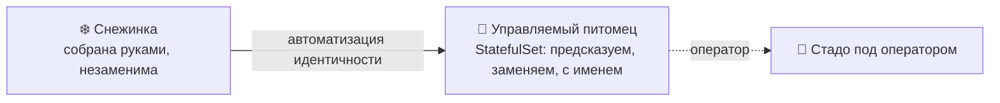

* 🐶 **Питомец** = стабильная идентичность, стабильный диск, вы точно знаете, кто такой pod-0
* 🐮 **Скот** = бери любой, разницы нет — Deployment
* 🏥 **Управляемое стадо** = оператор (CloudNativePG, Strimzi) ведёт каждого питомца, человеку не нужно

> 💡 StatefulSet — примитив K8s для *управляемых питомцев*. Операторы — примитив для *управляемых стад*.

---

## 📍 Слайд 5 – 🏗️ Гарантии StatefulSet

Три гарантии, которых нет у Deployment. Запомните.

* 🔢 **Стабильная уникальная сетевая идентичность.** Имена Pod: `<sts-name>-<ordinal>` (ordinal — порядковый номер): `postgres-0`, `postgres-1`, `postgres-2`. Имя *переживает перепланирование, рестарт и смерть ноды*.
* 💾 **Стабильный постоянный диск.** У каждого ordinal свой `PersistentVolumeClaim`, созданный из блока `volumeClaimTemplates`. Перепланировали pod-1 — тот же PVC едет за ним.
* 📊 **Упорядоченные выкладка, масштабирование и корректная остановка.** pod-0 должен быть Ready, прежде чем стартует pod-1. При уменьшении первым уходит старший ordinal.

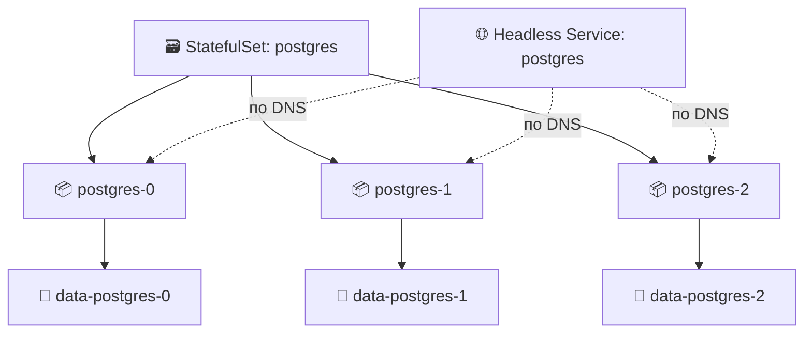

> 📚 **Источник:** [Документация Kubernetes — StatefulSet](https://kubernetes.io/docs/concepts/workloads/controllers/statefulset/) (apps/v1, GA с 1.9).

---

## 📍 Слайд 6 – 🌐 Headless Service — DNS без балансировщика

Обычный `Service` получает виртуальный `clusterIP`, и `kube-proxy` балансирует по эндпоинтам. У **headless** Service (без виртуального IP) стоит `clusterIP: None`, и поведение другое: DNS кластера отдаёт **A-записи каждого Pod**, а не один виртуальный IP.

```yaml
# 🌐 Regular Service — one virtual IP, round-robin to pods
apiVersion: v1
kind: Service
metadata:
  name: postgres
spec:
  selector: { app: postgres }
  ports: [{ port: 5432 }]
---
# 🌐 Headless Service — no IP, returns every pod's IP
apiVersion: v1
kind: Service
metadata:
  name: postgres-headless
spec:
  clusterIP: None              # 🔑 the magic
  selector: { app: postgres }
  ports: [{ port: 5432 }]
```

| DNS-запрос | Обычный Service | Headless Service |
|-----------|-----------------|------------------|
| `postgres.default.svc` | `10.96.0.42` (один виртуальный IP) | `10.244.1.7, 10.244.2.3, 10.244.3.9` (каждый Pod) |
| `postgres-0.postgres-headless.default.svc` | ❌ не существует | `10.244.1.7` (только pod-0) |

> 🔑 **Зачем это нужно:** связка StatefulSet и DNS *требует* управляющего headless Service. Без него `pod-0` напрямую не адресовать, а значит строку подключения Postgres к primary не написать.

---

## 📍 Слайд 7 – 🔗 DNS-имя на каждый Pod

У каждого Pod в `StatefulSet` есть стабильная DNS-запись под управляющим headless Service:

```
<pod-name>.<headless-service>.<namespace>.svc.cluster.local
```

Для StatefulSet `postgres` с `serviceName: postgres-headless` в namespace `prod`:

```
postgres-0.postgres-headless.prod.svc.cluster.local
postgres-1.postgres-headless.prod.svc.cluster.local
postgres-2.postgres-headless.prod.svc.cluster.local
```

* ✅ Для данного ordinal имя **не меняется никогда** — `postgres-0` это `postgres-0` навсегда
* ✅ Резолв работает **из любого Pod кластера** — так реплики находят primary
* ✅ Если `postgres-0` уехал на другую ноду, имя всё равно резолвится в новый IP Pod

> 🔧 **Проверьте в Lab 15:** `kubectl exec postgres-0 -- nslookup postgres-1.postgres-headless` — одна A-запись, и она совпадает с текущим IP pod-1.

---

## 📍 Слайд 8 – 💾 volumeClaimTemplates: свой PVC на каждый Pod, само собой

Главная фича. Блок `volumeClaimTemplates` говорит контроллеру StatefulSet: *на каждый ordinal создай PVC по этому шаблону*. Руками PVC никто не пишет.

```yaml
apiVersion: apps/v1
kind: StatefulSet
metadata: { name: postgres }
spec:
  serviceName: postgres-headless
  replicas: 3
  selector: { matchLabels: { app: postgres } }
  template:
    metadata: { labels: { app: postgres } }
    spec:
      containers:
        - name: postgres
          image: postgres:17.5
          volumeMounts:
            - { name: data, mountPath: /var/lib/postgresql/data }
  volumeClaimTemplates:                  # 🔑 per-pod PVC provisioning
    - metadata: { name: data }
      spec:
        accessModes: [ReadWriteOnce]
        storageClassName: standard
        resources: { requests: { storage: 20Gi } }
```

**Результат после `kubectl apply`:**

```
PVC data-postgres-0   →   PV   →   bound to postgres-0
PVC data-postgres-1   →   PV   →   bound to postgres-1
PVC data-postgres-2   →   PV   →   bound to postgres-2
```

> ⚠️ **Критично:** PVC из `volumeClaimTemplates` **не удаляются**, когда вы уменьшаете StatefulSet или удаляете сам StatefulSet. Это фича: данные переживают ошибки. Плата — чистить их самим, командой `kubectl delete pvc`.

---

## 📍 Слайд 9 – 🔄 Упорядоченные выкладка и масштаб

По умолчанию pod-N ждёт, пока pod-(N-1) станет Ready, и только потом стартует. Уменьшение идёт в обратную сторону.

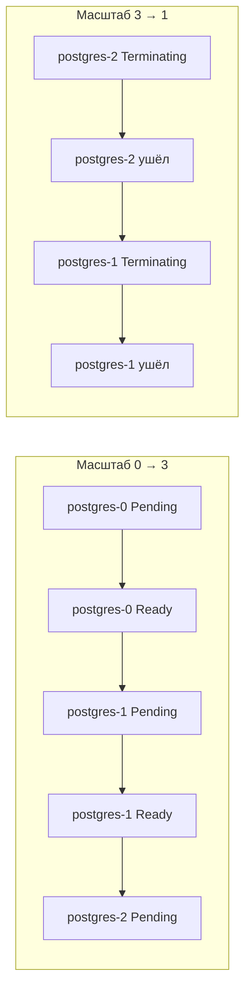

* 🔢 Старт по очереди: pod-0 становится primary → pod-1 входит репликой → pod-2 входит
* 📉 Остановка с хвоста: pod-2 останавливается → pod-1 останавливается → pod-0 (primary) живёт до последнего
* ⏱️ Заклинивший pod-1 **не пускает** pod-2 — медленно, зато безопасно

**Переопределите это через `podManagementPolicy: Parallel`**, если порядок не нужен. Пример: кластер шардов без состояния, которые находят друг друга лениво. По умолчанию стоит `OrderedReady`.

```yaml
spec:
  podManagementPolicy: Parallel   # start all pods at once; PVCs still per-ordinal
```

> 🔥 **Когда уместен `Parallel`:** кластер в духе Cassandra, где все ноды равны, а обнаружение идёт через gossip, не через «найди pod-0». Большинству баз нужен `OrderedReady`.

---

## 📍 Слайд 10 – 🔄 Стратегии обновления: RollingUpdate и OnDelete

Обновление StatefulSet серьёзнее, чем обновление Deployment: вы обновляете *основную базу*, не веб-фронтенд.

**RollingUpdate (по умолчанию)** — меняет Pod по одному, *сначала старший ordinal*:

```yaml
spec:
  updateStrategy:
    type: RollingUpdate
    rollingUpdate:
      partition: 0           # update everything from ordinal 0 upward (i.e., all pods)
```

**OnDelete** — на смену spec контроллер *не реагирует*; Pod удаляете вы сами, когда готовы:

```yaml
spec:
  updateStrategy:
    type: OnDelete
```

| Стратегия | Чем запускается | Когда брать |
|---|---|---|
| `RollingUpdate` | `kubectl apply` нового шаблона Pod | Почти всегда — пусть ведёт K8s |
| `RollingUpdate` + `partition` | apply и ручное снижение partition | Canary одной реплики, потом остальные |
| `OnDelete` | ручной `kubectl delete pod` | Жёсткое окно изменений; согласованное обновление БД |

> 🔧 **Бонус Lab 15:** попробуйте оба. Схема `OnDelete` — так в проде обычно и обновляют базы: человек в контуре, потому что цена автоматической ошибки — «восстановление из бэкапа».

---

## 📍 Слайд 11 – 🎯 Выкладка с partition (canary для приложений со состоянием)

Поле `partition` — canary для StatefulSet. Pod с ordinal `>= partition` получают новый шаблон. Остальные остаются на старом.

```yaml
spec:
  replicas: 5
  updateStrategy:
    type: RollingUpdate
    rollingUpdate:
      partition: 4           # 🐤 only postgres-4 updates
```

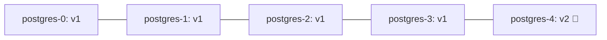

* 🐤 Обновление садится только на pod-4 — это ваш canary
* ✅ Смотрите метрики, лаг репликации, ошибки приложения
* 🔽 Опускайте `partition: 4 → 3 → 2 → 1 → 0`, чтобы прокатить обновление дальше
* ⏪ Верните `partition` на большое число и заново примените старый образ — это откат

> 📊 **Сравнение с Lab 14 (Rollouts):** Argo Rollouts смещает трафик по весам для приложений *без состояния*. Partition у StatefulSet говорит «этот ordinal на новой версии» для приложений *со состоянием*. Разные задачи, разные инструменты.

---

## 📍 Слайд 12 – ⏱️ Типичные отказы

| Симптом | Вероятная причина | Что делать |
|---|---|---|
| 🟡 `postgres-1` навсегда в `Pending` | PVC не биндится: нет storage class, квота кончилась, RWO PVC уже смонтирован на ноде | `kubectl describe pvc data-postgres-1`; проверьте `StorageClass`; посмотрите ноду, где сидит pod-0 |
| 🔁 Pod рестартует каждую минуту | Падает liveness probe; readiness смотрит не в тот порт | `kubectl logs --previous`; поправьте пути probe |
| ❌ Pod-2 так и не стартует | Pod-1 не Ready, контроллер ждёт | Сначала почините pod-1. Либо `podManagementPolicy: Parallel`, если приложение это умеет |
| 💾 Уменьшение «стёрло» данные | Не стёрло. PVC специально остаются: уменьшили StatefulSet, PVC на месте | `kubectl get pvc` — данные на месте; верните `replicas` обратно |
| 🌐 `postgres-0.postgres-headless` не резолвится | Нет headless Service или selector не тот | `serviceName` в STS должен совпасть с Service, у которого `clusterIP: None`, и selector должен попасть в лейблы Pod |
| 🐢 Рост 0→10 занимает 20 минут | `OrderedReady` по умолчанию ждёт каждый Pod | Ставьте `podManagementPolicy: Parallel`, если порядок не нужен |

> 🔍 **Порядок отладки:** `kubectl get sts,pod,pvc,svc` — эти четыре вместе рассказывают всю историю.

---

## 📍 Слайд 13 – 💽 Persistent Volume: модель из двух слоёв

`PersistentVolumeClaim` — это *запрос*. `PersistentVolume` — сам диск. `StorageClass` кластера создаёт PV динамически. Без него PVC висят вечно.

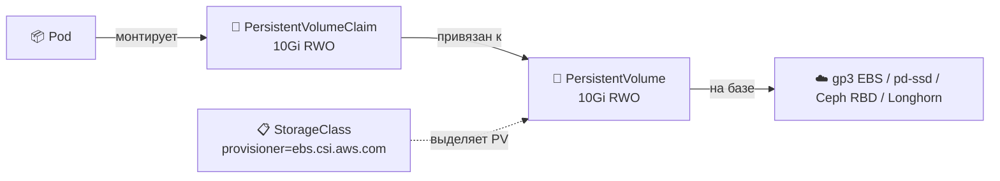

| Режим доступа | Смысл | Обычный бэкенд |
|---|---|---|
| `ReadWriteOnce` (RWO) | Одна нода пишет в один момент | Блочное (EBS, GCE PD, Ceph RBD) — дефолт для StatefulSet |
| `ReadOnlyMany` (ROX) | Много нод, только чтение | Объектное хранилище поверх |
| `ReadWriteMany` (RWX) | Много нод пишут сразу | NFS, CephFS, EFS — общая ФС, для баз редко |
| `ReadWriteOncePod` (RWOP, GA 1.29) | Ровно один Pod пишет на весь кластер | Строже RWO; режет multi-attach на той же ноде |

> ⚠️ **Политика возврата:** у PV есть `persistentVolumeReclaimPolicy`. `Retain` оставляет данные после удаления PVC (безопаснее). `Delete` стирает их. У большинства облачных `StorageClass` по умолчанию `Delete`. **На всё важное ставьте `Retain`.**

---

## 📍 Слайд 14 – 🌩️ Облачные варианты хранилища (May 2026)

Не каждый кластер живёт на EBS или GCE PD. Для on-prem и нескольких облаков хранилище вы приносите с собой.

| Проект | Стиль | Сильные стороны | Цена |
|---|---|---|---|
| **Rook v1.18 + Ceph 19 Squid** | Распределённое (блок + файл + объект) | Обкатано на масштабе; блок, файл и объект в одном; выпускник CNCF | Тяжёлый: нужно ≥3 ноды и аккуратный расчёт ёмкости |
| **Longhorn 1.9** (SUSE → CNCF) | Распределённый блок, родной для K8s | Простой UI, лёгкие снимки, бэкапы в S3, маленькие кластеры | Только блок; реплики тома стоят места |
| **OpenEBS Mayastor** | NVMe-over-TCP, гиперконвергенция | Максимум скорости на NVMe; движок по умолчанию в новых установках | Моложе; нужны возможности ядра |
| **Драйверы CSI облаков** (EBS, GCE PD, Azure Disk) | Блок одного облака | Управляемый, быстрый, дешёвый | Привязка к вендору; только RWO |

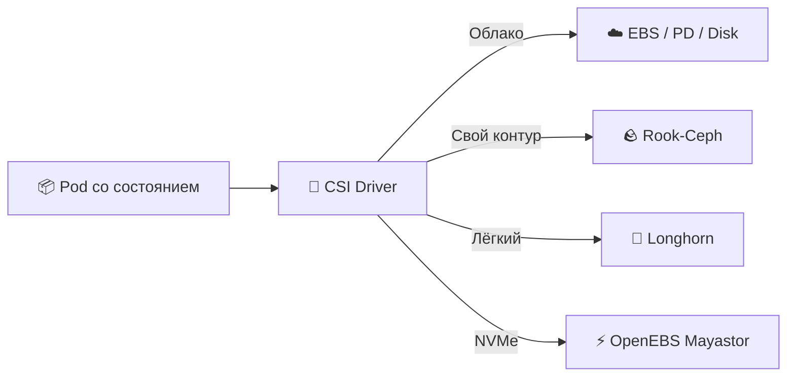

> 🔧 **Связка с курсом:** в Lab 15 берётся `StorageClass` по умолчанию у k3d (local-path-provisioner). Принципы те же. В проде подставляете EBS или Rook.

---

## 📍 Слайд 15 – 🏥 Дальше StatefulSet: когда нужен оператор

StatefulSet даёт *идентичность + диск*. Он не даёт:

* 🩺 Оркестрацию failover (поднять реплику, когда умер primary)
* 💾 Согласованные бэкапы (`pg_basebackup`, архивация WAL)
* 🔄 Восстановление на точку времени из S3
* 📊 Мониторинг лага репликации
* 🔐 Ротацию учётных данных по тенантам

Это **оператор** — контроллер, который понимает именно вашу базу. Операторы приезжают как CRD (Custom Resource Definitions, свои типы ресурсов) плюс Pod контроллера, который за ними следит.

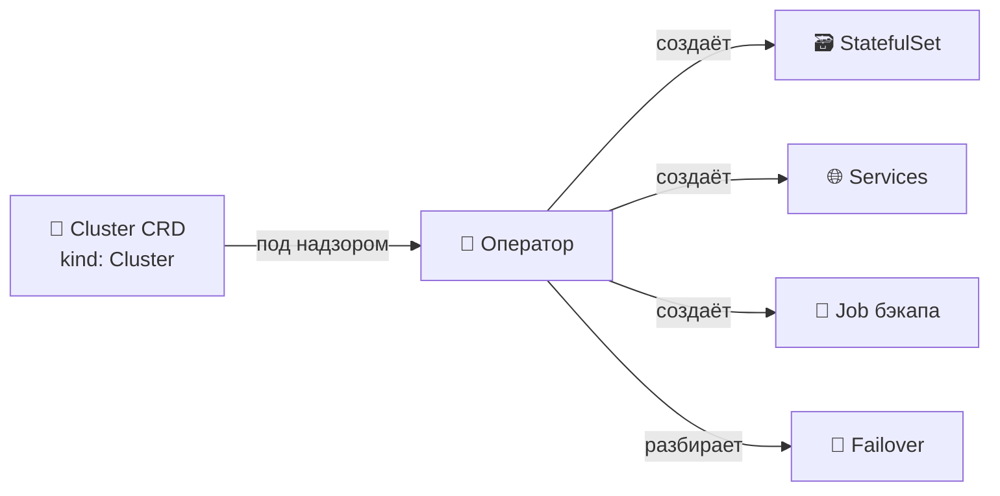

**Операторы уровня прода в 2026:**

| Нагрузка | Оператор | Заметки |
|---|---|---|
| 🐘 PostgreSQL | **CloudNativePG 1.29** (CNCF Sandbox) | Дефолт многих платформенных команд; PG 18.3 поддерживается; failover по кворуму стабилен |
| 🐬 MySQL | **MySQL Operator for K8s** (Oracle) или **Percona XtraDB Operator** | Два рабочих варианта; Percona — когда нужна высокая доступность |
| 🟢 MongoDB | **MongoDB Community Operator** | Не выходит за границу лицензии SSPL |
| 🍂 Redis | **Redis Operator** (OT/Spotahome) или **Dragonfly Operator** | Dragonfly — совместимая замена Redis |
| 📨 Kafka | **Strimzi** (CNCF) | Фактический оператор Kafka для K8s |
| 🐘 ClickHouse | **Altinity ClickHouse Operator** | |

> 💡 **Ориентир:** если за падение этой базы вы встанете в 3 ночи — запускайте её оператором, не голым StatefulSet.

---

## 📍 Слайд 16 – 🐘 CloudNativePG за 90 секунд

Вот что покупает оператор. Сравните с ручным StatefulSet Postgres на 3 Pod.

```yaml
apiVersion: postgresql.cnpg.io/v1
kind: Cluster
metadata:
  name: app-db
spec:
  instances: 3                        # 🔢 1 primary + 2 replicas
  imageName: ghcr.io/cloudnative-pg/postgresql:18.3
  storage:
    size: 50Gi
    storageClass: standard
  backup:
    barmanObjectStore:
      destinationPath: s3://my-backups/app-db
      s3Credentials:
        accessKeyId:     { name: backup-creds, key: ACCESS_KEY_ID }
        secretAccessKey: { name: backup-creds, key: SECRET_ACCESS_KEY }
    retentionPolicy: "30d"
  monitoring:
    enablePodMonitor: true            # 📊 Prometheus scraping out of the box
```

* 🔄 Сам выбирает primary (failover по кворуму, стабилен с 1.28)
* 💾 Непрерывно архивирует WAL в S3
* ♻️ Катит минорные обновления согласованно по всему кластеру
* 📊 В комплекте `PodMonitor` и дашборды

> 📚 **Источник:** [cloudnative-pg.io](https://cloudnative-pg.io/) — GA 1.29 вышел в 2026; образ по умолчанию — PostgreSQL 18.3.

---

## 📍 Слайд 17 – 💾 Бэкап и восстановление (кратко)

> 📘 **Подробнее:** в элективе SRE-Intro есть отдельная лекция про стратегии бэкапа, RPO/RTO и хаос-тест восстановления. Здесь только ставим флажок.

**Три правила для K8s со состоянием в 2026:**

1. 💾 **Снимок — это не бэкап.** Снимки EBS не знают про приложение. Восстановить полузаписанный WAL — получить порчу. Берите родной инструмент базы (`pg_basebackup`, `mongodump`, `xtrabackup`).
2. 🔁 **Непроверенный бэкап — это мечта.** Учения по восстановлению, по расписанию, в свежий кластер. Инцидент GitLab.com в 2017: данные пропали, потому что сломаны были 5 механизмов бэкапа из 5. Никто не проверял.
3. 📦 **Бэкапы храните вне кластера.** S3, GCS или внешнее объектное хранилище Ceph. Умрёт кластер — бэкапы не должны умереть с ним.

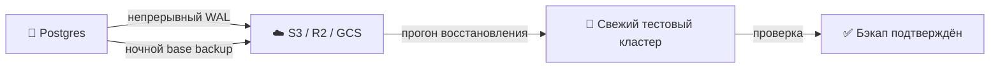

> 🔥 **Снова плюс оператора:** CloudNativePG, Strimzi и компания отдают бэкап *и* восстановление как CRD. Объявляете `kind: Backup` и `kind: ScheduledBackup`. Для восстановления объявляете `kind: Cluster.spec.bootstrap.recovery`. Bash-скрипты не нужны.

---

## 📍 Слайд 18 – 📋 Полный пример StatefulSet (шаблон Lab 15)

Минимальный рабочий StatefulSet. К нему сходится чарт Lab 15:

```yaml
apiVersion: v1
kind: Service
metadata: { name: visits-headless }
spec:
  clusterIP: None
  selector: { app: visits }
  ports: [{ port: 8000, name: http }]
---
apiVersion: apps/v1
kind: StatefulSet
metadata: { name: visits }
spec:
  serviceName: visits-headless        # 🔑 must match the headless Service
  replicas: 3
  selector: { matchLabels: { app: visits } }
  template:
    metadata: { labels: { app: visits } }
    spec:
      containers:
        - name: app
          image: ghcr.io/innodevops/lab12-app:v1.2.0
          ports: [{ containerPort: 8000, name: http }]
          volumeMounts:
            - { name: data, mountPath: /data }
          readinessProbe:
            httpGet: { path: /health, port: http }
            initialDelaySeconds: 3
            periodSeconds: 5
  volumeClaimTemplates:
    - metadata: { name: data }
      spec:
        accessModes: [ReadWriteOnce]
        resources: { requests: { storage: 1Gi } }
```

**Проверка в Lab 15:**

```bash
kubectl get sts,pod,pvc,svc                                  # all four resources present
kubectl exec visits-0 -- nslookup visits-1.visits-headless   # 🔗 per-pod DNS works
for i in 0 1 2; do                                           # 💾 per-pod state
  kubectl exec visits-$i -- cat /data/visits
done
kubectl delete pod visits-0                                  # pod-0 restarts, same PVC, same data
```

---

## 📍 Слайд 19 – ⚠️ Грабли в проде

| Грабля | Симптом | Что делать |
|---|---|---|
| 🗑️ Забытые PVC | Кластер забит осиротевшими PVC | `kubectl delete pvc data-postgres-{0..N}`, когда выводите StatefulSet |
| 🔄 Политика возврата `Delete` | Данные стираются вместе с PVC | В проде поставьте у `StorageClass` значение `Retain`; проверьте на самом PV |
| 🌐 Нет headless Service | DNS молча сломан | Применяйте Service *раньше* StatefulSet; пусть CI это линтит |
| 📊 Слишком агрессивный liveness probe | Pod рестартует посреди сброса WAL | Readiness — на трафик; liveness — только на глухой deadlock |
| 🐢 Кластер из двух реплик | Худшее с обеих сторон | Кластеру со состоянием нужно **нечётное** число ≥3, чтобы был кворум. Либо один инстанс и бэкапы |
| 🔁 Правка `volumeClaimTemplates` | Поле **иммутабельно** после создания | Ресайз: правьте PVC напрямую (если в StorageClass стоит `allowVolumeExpansion: true`) |
| 📦 Сначала падает pod-0, остальные не стартуют | Дефолтный `OrderedReady` всё стопорит | Чините причину у pod-0. На `Parallel` переходите, только если приложение это умеет |

> 🔥 **Ловушка ресайза:** поправить `volumeClaimTemplates.spec.resources` и ждать, что правка разъедется, нельзя. Контроллер StatefulSet молча её игнорирует. Ресайз PVC делайте *вручную*. StatefulSet пересоздайте с `--cascade=orphan`, если важен diff шаблона.

---

## 📍 Слайд 20 – 🆚 Deployment vs StatefulSet vs DaemonSet vs Job

В курсе уже были все четыре. Короткая сводка:

| Контроллер | Имена Pod | Диск | Порядок | Зачем |
|---|---|---|---|---|
| **Deployment** | случайный суффикс | общий / нет | параллельно | Без состояния (веб, API, воркеры) |
| **StatefulSet** | ordinal (`-0`, `-1`) | свой, из шаблона | по умолчанию по порядку | Базы, очереди, всё с идентичностью |
| **DaemonSet** | один на ноду | hostPath / на ноду | по одному на ноду | Агенты ноды (сборщик логов, драйвер CSI, сетевой плагин) |
| **Job / CronJob** | случайное; до завершения | на задачу | параллельно или по порядку | Пакет, миграции, задачи по расписанию |

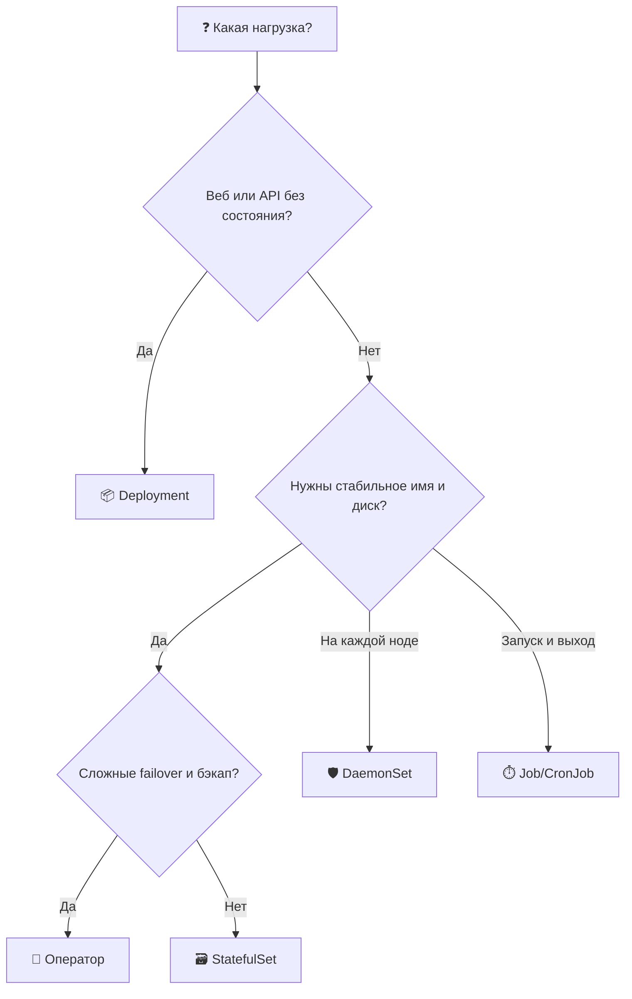

> 💡 **Большинство Pod, которые вы напишете, — это Deployment.** StatefulSet берите, когда нужна идентичность *или* свой диск на Pod. Оператор берите, как только в картине появляются failover, бэкапы или хореография обновлений.

---

## 📍 Слайд 21 – 🎯 Главное

1. 🗃️ **StatefulSet = идентичность + свой диск на Pod + упорядоченный жизненный цикл.** Три гарантии, которых нет у Deployment.
2. 🌐 **Headless Service (`clusterIP: None`) обязателен.** Он даёт DNS на каждый Pod. Без этого идентичность бесполезна.
3. 💾 **`volumeClaimTemplates` создаёт один PVC на ordinal**, и при уменьшении эти PVC специально остаются.
4. 🔢 **Порядок по умолчанию — `OrderedReady`.** `Parallel` включаете сами, если кластеру не нужно, чтобы pod-0 поднялся первым.
5. 🔄 **`RollingUpdate` + `partition`** — canary для обновлений со состоянием. **`OnDelete`** — ручное обновление в окне изменений.
6. 🤖 **Настоящую базу ведите оператором** (CloudNativePG, Strimzi, Percona). Голый StatefulSet — *примитив*, не *ответ*.
7. 💾 **Снимок — это не бэкап.** Инструмент, который понимает приложение, плюс проверенные учения по восстановлению. Иначе бэкапов нет.
8. 🐾 **StatefulSet — управляемые питомцы.** Операторы — управляемые стада. Оба лучше снежинок.

> 💡 **Мантра:** *если за его падение вы встанете по вызову — не запускайте его как Deployment.*

---

## 📍 Слайд 22 – 🧠 Сдвиг в голове

| 😰 Раньше | 🚀 Со StatefulSet |
|---|---|
| «Поднимем ещё Pod, они все одинаковые» | «pod-0 — это primary, имя важно» |
| «Повесим один PVC на все реплики» | «У каждой реплики свой PVC из шаблона» |
| «Это база, выкатим как приложение» | «Failover делает оператор, мы объявляем `kind: Cluster`» |
| «Бэкап — это то, что сделает облачный снимок» | «Бэкап понимает приложение, лежит вне кластера и проверен восстановлением» |
| «Почему выкладка застряла на pod-1?» | «Потому что pod-0 не Ready. Ищите причину, не обходите её через Parallel» |
| «Scale to zero и обратно» | «PVC остаются, данные остаются, масштаб крутите спокойно» |

> 🤔 Какая строка про команду, в которой вы работали?

---

## 📍 Слайд 23 – 🚀 Что дальше

**📚 Следующая лекция: *Lecture 16 — За пределами Kubernetes*** — когда кластер избыточен *и* когда у кластера не та форма.

* 🌐 **Cloudflare Workers** — изоляты V8 на edge; холодный старт 0 мс; крошечные бандлы
* ❄️ **Nix** — воспроизводимые сборки и dev shell, контейнер не нужен
* 🤔 **Компромиссы** — когда K8s лучше пропустить; когда поставить рядом что-то ещё
* 🎁 **Бонусные Lab 17 и 18** — выкатить сервис из Lab 1 на Cloudflare Workers; упаковать его Nix flakes

**Что сдать в Lab 15:**

* Переведите чарт из Lab 12: `Deployment` → `StatefulSet`
* Добавьте headless `Service` (`clusterIP: None`), на который ссылается `serviceName`
* Настройте `volumeClaimTemplates`, чтобы у каждого Pod был свой PVC
* Докажите состояние на Pod: зайдите через `kubectl port-forward` и смотрите независимые счётчики визитов
* Убейте `app-0` и убедитесь, что те же данные вернулись после перепланирования
* **Бонус (2.5 балла):** покажите `RollingUpdate` с `partition` *и* выкладку `OnDelete`

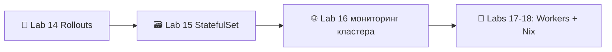

> 🌊 От скота к управляемым питомцам — по одному ordinal.

Квиз после лекции идёт в окно таблицы лидеров недель 13-16.

---

## 📚 Материалы

**📕 Книги:**

* *Kubernetes Up & Running* (3e, 2022) — Burns, Beda, Hightower. Глава про StatefulSet — канонический текст.
* *Kubernetes Patterns* (2e, 2024) — Ibryam & Huß. Паттерны «Stateful Service» и «Service Discovery».
* *Database Reliability Engineering* (2017) — Campbell & Majors. Зачем нужны операторы, в форме книги.

**🔗 Ссылки:**

* 🌐 [Концепции StatefulSet](https://kubernetes.io/docs/concepts/workloads/controllers/statefulset/) — официально
* 🌐 [Headless Service](https://kubernetes.io/docs/concepts/services-networking/service/#headless-services)
* 🌐 [Шаблоны volume claim](https://kubernetes.io/docs/concepts/workloads/controllers/statefulset/#volume-claim-templates)
* 🌐 [Стратегии обновления и выкладка с partition](https://kubernetes.io/docs/concepts/workloads/controllers/statefulset/#update-strategies)
* 🌐 [Паттерн оператора](https://kubernetes.io/docs/concepts/extend-kubernetes/operator/)
* 🌐 [OperatorHub.io](https://operatorhub.io/) — каталог операторов с отбором
* 🌐 [CloudNativePG](https://cloudnative-pg.io/) — оператор PostgreSQL, на который мы ссылаемся по ходу
* 🌐 [Rook](https://rook.io/) — хранилище для прода на Ceph
* 🌐 [Longhorn](https://longhorn.io/) — лёгкое блочное хранилище CNCF
