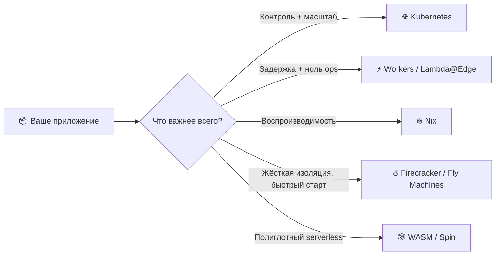
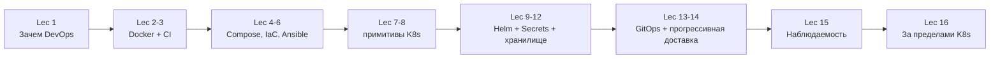
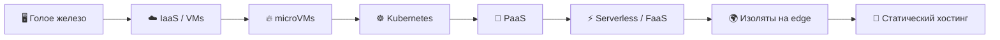
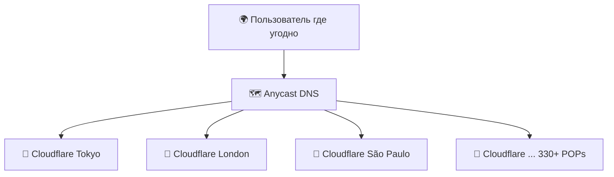
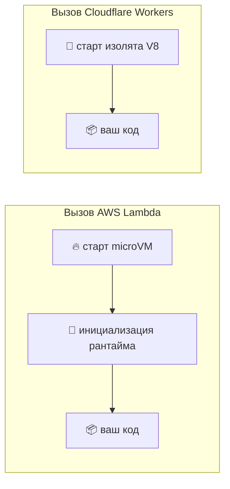
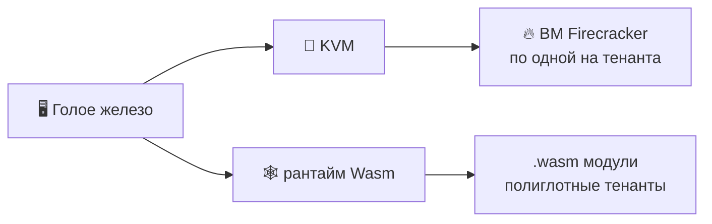
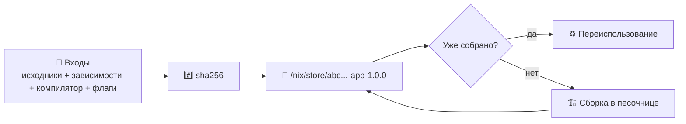
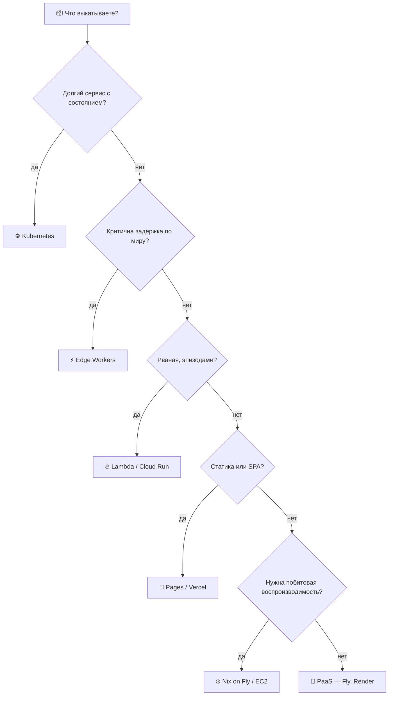
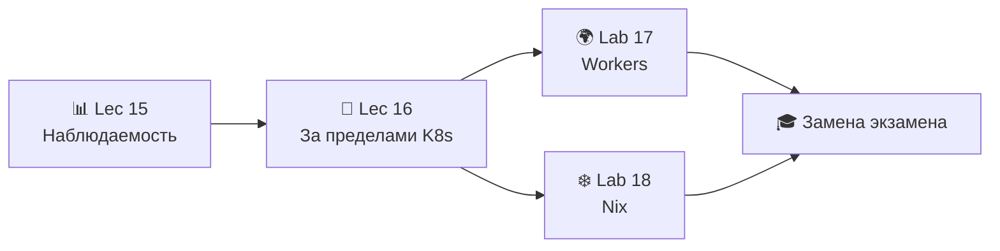

# 📌 Lecture 16 — За пределами Kubernetes: другие модели выкладки

> 🎯 **Финал курса.** 15 лекций вы учились запускать контейнеры на кластере. Теперь вопрос, который сильный инженер рано или поздно задаёт: *а кластер нам вообще был нужен?*

---

## 📍 Слайд 1 – 🚀 Вопрос, который архитектор рано или поздно задаёт

* ☸️ Выкатить на Kubernetes вы умеете. **Вы доказали это в Lab 8–16.**
* 🤔 Для многих нагрузок K8s — **не та абстракция**: слишком много поверхности на слишком малый выигрыш
* 🌍 В 2026 меню выкладки — уже не «ВМ или контейнер». Это **спектр** рантаймов под очень разные задачи
* 🎯 Сегодня: serverless на edge (lab 17) и воспроизводимые сборки (lab 18), плюс когда каждый из них бьёт K8s



> 📚 **Рамка на сегодня:** каждая модель на этом слайде тоже годится для прода. Навык — понимать, какую задачу каждая закрывает и какую не закрывает.

---

## 📍 Слайд 2 – 🎯 Чему научитесь

К концу этой лекции вы умеете:

| # | Результат |
|---|---------|
| 1 | 🧠 Объяснить, что такое **изолят V8** (V8 isolate) и почему холодный старт <5 мс |
| 2 | ⚖️ Сравнить **serverless на edge** (Workers) с **региональным FaaS** (Lambda) |
| 3 | ❄️ Описать, что гарантирует **деривация Nix** (Nix derivation), а Dockerfile не гарантирует |
| 4 | 📊 Выбрать между K8s, edge, microVM, PaaS и статическим хостингом по матрице сценариев |
| 5 | 🚀 Положить Lab 17 (Cloudflare Workers) и Lab 18 (Nix) на спектр выкладки |
| 6 | 🔮 Назвать рантаймы следующей волны (WASM, unikernel, Firecracker) и зачем они |

---

## 📍 Слайд 3 – 🧰 Стек на сегодня (May 2026)

| Инструмент | Версия / статус | Заметки |
|------|------------------|-------|
| **Cloudflare Workers** | workerd + изоляты V8, 330+ POP на edge | Холодный старт <5 мс; бесплатный тариф 100k запросов/день, 10 мс CPU; $5/мес тариф Paid = 10M запросов + 50 мс CPU |
| **Wrangler CLI** | **4.94+** | По умолчанию локально; `--remote` теперь по желанию |
| **Workers KV / D1 / R2 / Durable Objects** | GA | Примитивы состояния рядом с edge |
| **Nix** | **2.25** (Nov 2024), 2.26+ в разработке | Установщик Determinate включает flakes по умолчанию |
| **Lix** | Форк сообщества (форк в Mar 2024) | Замена `nix` один в один; FlakeHub — реестр SemVer |
| **Рантайм AWS Lambda** | microVM Firecracker, старт ~125 мс | Изоляция на каждый вызов |
| **Fly.io** | Fly Machines на Firecracker | Та же microVM, что у Lambda; ВМ остаётся у вас |
| **Fermyon Spin** | v3.5 (preview WASI 0.3) | Куплен Akamai в Dec 2025 → Akamai Functions |

> 🧷 Два инструмента из списка — **Cloudflare Workers** и **Nix** — это всё содержание Lab 17 и 18. Остальное — контекст мира, в который вы входите.

---

## 📍 Слайд 4 – 🗺️ Дуга курса, в последний раз



Вы поднялись по лестнице абстракций: `chroot` → контейнеры → оркестрация → GitOps. Сегодня смотрим **вбок**, на рантаймы, которые шли на гору другой тропой.

---

## 📍 Слайд 5 – ⚠️ Налог на Kubernetes

K8s даёт контроль. У контроля есть ценник:

* 🔧 **Эксплуатация кластера** — обновления control plane, миграции CRD, бэкапы etcd
* 🧠 **Экспертиза команды** — kubectl, RBAC, сеть, storage class, ingress-контроллеры
* 💰 **Деньги вхолостую** — control plane ($72/мес на EKS) плюс минимум 3 worker-ноды даже при нулевом трафике
* ⏱️ **Lead time до первой выкладки** — у свежей команды это дни. С управляемым K8s и платформенной командой — всё равно часы
* 🕵️ **Поверхность атаки** — каждый CRD, каждый webhook, каждый оператор. Это код внутри вашего кластера

> 💬 **Kelsey Hightower, 2017 (всё ещё правда):** *«Kubernetes — платформа, на которой строят платформы. Хорошее место, чтобы начать. Не финиш.»*

Статический сайт в одном регионе или вебхук на 200 запусков в день: накладные расходы платформы съедают пользу.

---

## 📍 Слайд 6 – 🚩 Сигналы, что K8s избыточен

| 🚩 Сигнал | 💡 Куда лучше |
|----------|---------------|
| 1–2 сервиса, горизонтальный масштаб не нужен | PaaS (Fly.io, Render, Railway) |
| Рваный трафик и длинные окна простоя | Serverless (Lambda, Cloud Run) |
| Задержка важна по всему миру | Рантайм на edge (Workers, Lambda@Edge) |
| Чистый статический сайт или SPA | Pages / Netlify / Vercel |
| Воспроизводимость важнее оркестрации | Nix + голое железо или microVM |
| Один человек в команде, «надо выкатить к пятнице» | **Что угодно, кроме K8s** |

> 💬 **Из DORA:** сильные команды оптимизируют **поток**, а не парад технологий. Самая простая выкладка, которая даёт бизнес-результат, обычно и есть верная.

---

## 📍 Слайд 7 – 📊 Спектр абстракций



| Слой | Ведёте вы | Ведёт платформа | Старт |
|-------|-----------|------------------|-----------|
| Голое железо | ОС, драйверы, рантайм, приложение | ничего | минуты |
| ВМ (EC2) | ОС, рантайм, приложение | железо | 30–60 с |
| microVM (Firecracker, Fly) | рантайм, приложение | гипервизор + ядро | ~125 мс |
| Kubernetes | манифесты + приложение | планирование, сеть | секунды (Pod), дни (кластер) |
| PaaS | код приложения + конфиг | всё остальное | минуты |
| Serverless / FaaS | функция | рантайм, масштаб | 100 мс – 1 с |
| Изоляты на edge | функция | глобальная маршрутизация | **<5 мс** |
| Статический хостинг | файлы | CDN | 0 (без вычислений) |

Каждая строка меняет **контроль** на **простоту**. Берите самую верхнюю строку, которую ещё выдержите.

---

## 📍 Слайд 8 – 🌍 Раздел 1: вычисления на edge — код там, где пользователи

**Обычное облако:**
```
Tokyo user → 200 ms → us-east-1 → response
```

**Вычисления на edge:**
```
Tokyo user → 20 ms → Cloudflare Tokyo POP → response
```



* ⚡ **Скачок задержки** пропадает: код уже там, где пользователь
* 🌍 **Регион выбирать не нужно:** в краю edge нет «us-east-1»
* 💸 **Платите за запрос, а не за час простоя:** честный scale-to-zero
* 📏 **Жёсткие рамки:** короткий бюджет CPU, дерево зависимостей меньше, нативных бинарников нет

---

## 📍 Слайд 9 – 🧪 Изоляты V8 — как Cloudflare Workers обходится без контейнера



* 🧬 **Изолят ≠ контейнер.** Это песочница JS-кучи внутри уже работающего процесса V8
* ⏱️ **Холодный старт: <5 мс.** Контейнеры Lambda: 100 мс – 1 с+
* 🧠 **Память: ~3 МБ на изолят.** microVM Lambda: ≥128 МБ
* 🏭 **Плотность:** одна нода Worker держит тысячи тенантов на одном процессе V8
* 🚫 **Цена:** нет файловой системы, нет нативных модулей, 10 мс CPU на бесплатном тарифе (50 мс на платном, бурст до 5 мин)

> 🔬 **Архитектурная ставка:** песочница на слое **рантайма языка**, не на слое **ядра ОС**. Меньше радиус поражения, меньше цена старта.

---

## 📍 Слайд 10 – 🛠️ Анатомия Worker

`src/index.ts`:
```ts
export interface Env {
  APP_NAME: string;          // wrangler.jsonc var
  API_TOKEN: string;         // wrangler secret put
  SETTINGS: KVNamespace;     // bound KV namespace
}

export default {
  async fetch(req: Request, env: Env): Promise<Response> {
    const url = new URL(req.url);
    if (url.pathname === "/health") return Response.json({ status: "ok" });
    if (url.pathname === "/edge")   return Response.json({
      colo: req.cf?.colo, country: req.cf?.country, tls: req.cf?.tlsVersion,
    });
    if (url.pathname === "/counter") {
      const n = Number(await env.SETTINGS.get("visits") ?? "0") + 1;
      await env.SETTINGS.put("visits", String(n));
      return Response.json({ visits: n });
    }
    return new Response("Not Found", { status: 404 });
  },
};
```

Целый HTTP API в одном default export. Без Dockerfile, без ingress, без HPA.

---

## 📍 Слайд 11 – 🛫 Выкладка Worker

```bash
npm create cloudflare@latest -- edge-api    # scaffold
cd edge-api
npx wrangler login                           # OAuth in browser
npx wrangler dev                             # local; uses workerd locally
npx wrangler deploy                          # global rollout in seconds
```

**Примитивы состояния, привязанные на edge:**

| Привязка | Что это | Зачем |
|---------|-----------|----------|
| **KV** | key/value, согласованность в итоге | флаги, конфиг, счётчики |
| **D1** | SQLite на регион, с репликацией | небольшая реляционная БД |
| **R2** | блобы, совместимые с S3, без платы за исходящий трафик | ассеты, бэкапы |
| **Durable Objects** | актор со строгой согласованностью и состоянием | чаты, рейтинги |

> 🔗 **Связка с Lab 17:** вы выкатываете Worker с `/health`, `/edge`, секретами, счётчиком на KV, двумя выкладками и откатом — и таблицей «Kubernetes против Workers» в `WORKERS.md`.

---

## 📍 Слайд 12 – ⚖️ Workers, Lambda и K8s в цифрах

| Метрика | ☸️ Pod в K8s | 🔥 AWS Lambda | ⚡ Cloudflare Workers |
|--------|-----------|---------------|----------------------|
| Холодный старт | секунды (планирование + pull образа) | 100–1000 мс | **<5 мс** |
| Минимум памяти | request контейнера (например 128 Mi) | 128 MB | ~3 MB |
| Глобально по умолчанию? | нет, выбираете регион(ы) | нет, выбираете регион | **да, все POP** |
| Модель цены | ноды 24/7 | за запрос + GB-s | за запрос, без цены за регион |
| Бесплатный тариф | только локально (k3d) | 1M запросов/мес | **100k запросов/день** |
| Цена при 0 трафика | полный счёт за ноды | ~$0 | ~$0 |
| Долгие задачи | да (любые) | до 15 мин | 30 с wall-clock (платный; CPU 50 мс–5 мин) |
| Нативные бинарники / колёса Python | да | да | ограниченно (Python через Pyodide, без расширений на C) |

**Как читать:** Workers берут задержку и нижнюю цену. Lambda берёт гибкость рантайма на запрос. K8s берёт долгие, нативные нагрузки со состоянием.

---

## 📍 Слайд 13 – 🧭 Раздел 2: другие игроки на edge

Edge — не монополия Cloudflare:

| Платформа | Рантайм | Где сильнее |
|----------|---------|-----------|
| **Cloudflare Workers** | изоляты V8 (workerd) | JS/TS на каждом POP |
| **Vercel Edge Functions** | изоляты V8 на инфре Cloudflare | middleware Next.js |
| **AWS Lambda@Edge** | Lambda в POP CloudFront | переписывание запросов |
| **AWS CloudFront Functions** | JS, доли миллисекунды | только переписывание заголовков |
| **Deno Deploy** | изоляты V8, API Deno | сначала TS |
| **Fastly Compute** | Wasmtime (WASM) | задержка и переносимость |
| **Akamai Functions** (бывший Fermyon) | Spin / WASM | после покупки Akamai, Dec 2025 |

> 💡 **Паттерн:** все сходятся к схеме **изолят или Wasm + глобальный anycast**. Контейнера на схеме нет специально.

---

## 📍 Слайд 14 – 🔥🕸️ microVM и WASM — другие лёгкие рантаймы

Если изолят V8 слишком узкий, а контейнер слишком тяжёлый:

| Рантайм | Старт | Изоляция | Кто берёт |
|---------|------|-----------|--------------|
| 🔥 **Firecracker microVM** | ~125 мс, накладные <5 MiB | Настоящий KVM, на уровне железа | AWS Lambda, Fargate, **Fly.io**, e2b.dev, modal.com |
| 🕸️ **WASM** (Wasmtime, workerd) | доли миллисекунды | Песочница языка + WASI на capabilities | Fermyon Spin, Fastly Compute, функции Shopify, Cloudflare |



* 🔥 **Firecracker** — AWS открыл его в 2018, 150 microVM/с на хост. **Lambda и Fly.io взяли один кирпич и выставили разные API.**
* 🕸️ **WASM** — полиглот (Rust/Go/Python/TS → один бинарник). WASI 0.2 (Feb 2024, компонентная модель). WASI 0.3 (асинхронный ввод-вывод, late 2025).
* 🏭 **Масштаб в проде:** Fermyon Spin доходил до 75M запросов/с, пока **Akamai не купил Fermyon в Dec 2025** и не перезапустил его как Akamai Functions.
* ⚠️ **Оговорка 2026 по WASM:** дыры ещё есть. Полного сетевого стека нет везде. На edge сегодня отлично. До обычных бэкендов ещё не дотягивает.

---

## 📍 Слайд 15 – ❄️ Раздел 3: воспроизводимые сборки — другой фронтир

Контейнеры закрыли «у меня на машине работает». **Точно закрыли?**

* 🐳 `FROM python:3.13-slim` — что в этом теге *сегодня* и что было полгода назад? Не одно и то же.
* 📦 `pip install -r requirements.txt` — транзитивные зависимости плывут даже при пинах `==`
* 🕒 В слои Docker вшиты метки времени → тот же `Dockerfile`, на каждой сборке другой SHA образа
* 🐛 Инцидент Toyota (2022) и бэкдор xz-utils (Mar 2024) оба жили в зазоре между *«что вы думали, что собрали»* и *«что уехало»*

**Обещание Nix:** *побитово тот же вывод, на любой машине, сегодня и в 2036* — потому что каждый вход (компиляторы, исходники, флаги) входит в хеш пути результата.

> 💬 **Модель задала диссертация Eelco Dolstra (2006).** Двадцать лет спустя это единственная система, которая её правда выполняет.

---

## 📍 Слайд 16 – 🧬 Nix на одном слайде

* 📦 **Менеджер пакетов + система сборки + система конфигов** — один инструмент, три работы
* 🗄️ **Хранилище Nix** — `/nix/store/<sha256>-<name>-<version>` — адрес по содержимому, иммутабельно
* 🔒 **Чистые сборки** — песочница, без сети (кроме fixed-output derivation), без `/home`, без часов
* ❄️ **Один хеш везде** — попадание в `cache.nixos.org` значит без пересборки
* 🌊 **Ленивое вычисление** — в nixpkgs 100k+ пакетов, собирается только то, на что есть ссылка



**Одно предложение:** Nix делает сборку чистой функцией своих входов.

---

## 📍 Слайд 17 – 🧪 Деривация, конкретно

`default.nix` — сервис Flask из Lab 1, собранный на Nix:

```nix
{ pkgs ? import <nixpkgs> {} }:
pkgs.python3Packages.buildPythonApplication {
  pname   = "devops-info-service";
  version = "1.0.0";
  src     = ./.;
  format  = "other";
  propagatedBuildInputs = with pkgs.python3Packages; [ flask ];
  nativeBuildInputs     = [ pkgs.makeWrapper ];
  installPhase = ''
    mkdir -p $out/bin
    cp app.py $out/bin/devops-info-service
    wrapProgram $out/bin/devops-info-service --prefix PYTHONPATH : "$PYTHONPATH"
  '';
}
```

```bash
nix-build           # → ./result symlink into /nix/store/<hash>-...
./result/bin/devops-info-service
nix-hash --type sha256 result   # this hash is the same on every machine, forever
```

---

## 📍 Слайд 18 – 📦 dockerTools — воспроизводимые контейнеры без Dockerfile

```nix
# docker.nix
{ pkgs ? import <nixpkgs> {} }:
let app = import ./default.nix { inherit pkgs; }; in
pkgs.dockerTools.buildLayeredImage {
  name    = "devops-info-service-nix";
  tag     = "1.0.0";
  contents = [ app ];
  config = {
    Cmd          = [ "${app}/bin/devops-info-service" ];
    ExposedPorts = { "5000/tcp" = {}; };
  };
  created = "1970-01-01T00:00:01Z";   # ← THE reproducibility trick
}
```

```bash
nix-build docker.nix
docker load < result          # tarball → docker image
sha256sum result              # build twice → same hash. Try that with `docker build`.
```

**Почему здесь получается то, чего у `docker build` не получается:**

| Проблема | `docker build` | Nix `dockerTools` |
|---------|---------------|-------------------|
| Метки времени сборки | пишутся в каждый слой | прибиты к эпохе |
| Дрейф базового образа | `python:3.13-slim` уезжает из-под вас | ревизия nixpkgs захеширована в вывод |
| `apt-get install` | каждый запуск резолвится в latest | каждая зависимость — путь в store |
| Хеш итогового образа | меняется на каждой сборке | **один и тот же на каждой сборке** |

> 🔗 **Связка с Lab 18:** вы сделаете ровно это. Пересоберёте приложение на Python из Lab 1 и образ Docker из Lab 2 через Nix, затем докажете равенство хешей через `sha256sum`.

---

## 📍 Слайд 19 – 🌊 Flakes — Nix с lock-файлом

До flakes Nix был воспроизводим, *если держать дисциплину.* Flakes делают это режимом по умолчанию.

`flake.nix`:
```nix
{
  description = "DevOps Info Service — reproducible build";

  inputs.nixpkgs.url = "github:NixOS/nixpkgs/nixos-24.11";

  outputs = { self, nixpkgs }:
    let
      system = "x86_64-linux";
      pkgs   = nixpkgs.legacyPackages.${system};
    in {
      packages.${system}.default    = import ./default.nix  { inherit pkgs; };
      packages.${system}.dockerImg  = import ./docker.nix   { inherit pkgs; };
      devShells.${system}.default   = pkgs.mkShell {
        buildInputs = [ pkgs.python313 pkgs.python313Packages.flask ];
      };
    };
}
```

```bash
nix flake update         # → flake.lock pins nixpkgs to an exact git SHA
nix build                # builds packages.default
nix develop              # drops you into a shell with pinned Python + Flask
```

**`flake.lock` — тот самый недостающий кусок.** Как `package-lock.json` или `Cargo.lock`, только на **всё замыкание зависимостей**, вплоть до libc.

---

## 📍 Слайд 20 – 🪐 Экосистема Nix в 2026

| Игрок | Одной строкой |
|--------|-----------|
| **Классический CLI** (`nix-build`, `nix-shell`) | Ещё живёт — в Lab 18 начнёте с этого |
| **Команда `nix`** (Nix 2.4+, зрелая в 2.25) | UX родной для flakes: `nix build`, `nix develop`, `nix flake` |
| **Determinate Nix** | Подобранный установщик и корпоративная сборка; flakes включены сразу |
| **Lix** (форк сообщества, Mar 2024) | Замена один в один; быстрее eval, мягче управление |
| **NixOS** | Полный дистрибутив Linux на деривациях Nix |
| **FlakeHub** (Determinate Systems) | Реестр flakes: SemVer и подписи |
| **`devenv`, `flox`** | Оболочки dev shell уровнем выше, поверх Nix |

**Кто в проде:** Mercury, Replit, Shopify, Anthropic, CI в духе Cachix. **Честная оговорка:** кривая обучения настоящая — дайте две недели, потом судите.

---

## 📍 Слайд 21 – 🧮 Раздел 4: матрица решений



**Шпаргалка по сценариям:**

| Нагрузка | Куда лучше |
|---------|---------|
| Бэкенд из нескольких сервисов, внутренняя платформа | ☸️ Kubernetes |
| Приёмник вебхуков, API с низкой задержкой | ⚡ Cloudflare Workers |
| Инференс ML, cron, пакет | 🔥 Lambda / Cloud Run |
| Сайт документации, маркетинговая страница | 📄 Pages / Vercel / Netlify |
| Игровой бэкенд, региональная база | 🚂 Fly.io |
| Артефакт сборки под аудит безопасности | ❄️ Nix |

---

## 📍 Слайд 22 – 🚫 Антипаттерны, которые встретите вживую

1. ❌ **K8s ради маркетингового сайта одного тенанта** — $200/мес за то, что `index.html` на Cloudflare Pages делает бесплатно
2. ❌ **Lambda ради API 24/7** — соединения поднимаются заново и съедают бюджет задержки; на ровном трафике HPA в K8s дешевле
3. ❌ **Cloudflare Workers ради долгой задачи на данных на Python** — 30 с wall-clock и Python только через Pyodide для этого не сделаны
4. ❌ **Nix в команде, которая его не видела** — без чемпиона кривая обучения топит внедрение (две недели разгона — это правда)
5. ❌ **«Edge на всё»** — база сидит в us-east-1; круг с edge обратно на origin съедает выигрыш по задержке
6. ❌ **microVM ради статики** — для HTML Firecracker избыточен

> 💡 **Лечение одно:** сначала назовите задачу, абстракцию берите в конце.

---

## 📍 Слайд 23 – 🏢 Выборы из жизни

* 🟧 **Сам Cloudflare** — дашборд `workers.cloudflare.com` работает на Workers + D1
* 🟦 **Shopify Functions** — WASM, своя логика checkout на edge
* ✈️ **Fly.io** — каждый контейнер клиента как microVM Firecracker, K8s в стеке нет
* 🟣 **Anthropic, Mercury, Replit** — Nix в проде: воспроизводимые сборки и dev shell
* 🟢 **Раннеры GitHub Actions** — microVM Firecracker с 2023, для усиленных раннеров
* 🟡 **Discord** — изоляты V8 выполняют slash-команды
* 🟠 **Akamai (бывший Fermyon, Dec 2025)** — serverless на Spin/WASM, рядом с Workers

**Паттерн:** скучный дефолт для бэкендов со состоянием — по-прежнему K8s. Живое происходит на краях спектра: и на настоящем edge, и по краям выбора.

---

## 📍 Слайд 24 – 🔮 Что дальше (после 2026)

| Тренд | Куда идёт |
|-------|------------------|
| **WASI 0.3 + Component Model** | Полиглотный serverless, который правда работает |
| **Unikernel** (`unikraft`, `nanos`) | ВМ под одно приложение, старт <50 мс |
| **Плотность microVM** | 1000+ ВМ Firecracker на хост, со общим снимком ядра |
| **Конфиденциальные вычисления** | AMD SEV / Intel TDX: изоляция тенанта в недоверенном облаке |
| **Платформы под управлением ИИ** | Автомасштаб кластера и реакция на инциденты силами агентов LLM |
| **Приложения local-first** | CRDT и синхронизация с edge; сервер становится необязательным |

> 💬 *«Облако — это чужой компьютер. Edge — компьютер всех. Будущее — ничей компьютер.»*

Берите абстракцию, на которой команда быстрее всего едет **сегодня**. Отраслевую прессу читайте: планка не стоит на месте.

---

## 📍 Слайд 25 – 🎯 Главное и сдвиг в голове

1. ☸️ **K8s** = долгий, со состоянием, из нескольких сервисов. **Не** вебхук.
2. ⚡ **Изолят V8 ≠ контейнер** — песочница на слое языка, холодный старт <5 мс, нижняя граница памяти ~3 МБ
3. 🔥 **Firecracker** крутит Lambda и Fly.io — один кирпич, очень разные продукты
4. 🕸️ **WASM** — полиглотная ставка на edge. Сегодня на edge отлично. Для обычных бэкендов ещё нет
5. ❄️ **Nix** закрывает *воспроизводимость*. Это рядом с оркестрацией, не вместо неё
6. 🧮 **Матрица решений важнее войны стеков** — сначала нагрузка, потом рантайм

| 😰 Вы на Lecture 1 | 🚀 Вы на Lecture 16 |
|------------------|-------------------|
| «Просто запихнём в Docker» | «А контейнер ему нужен?» |
| «Куда это выкатывать?» | «Какая модель выкладки подходит нагрузке?» |
| «Kubernetes — это ответ» | «K8s — **один из** ответов. Какой вопрос мы задаём?» |
| «У меня работает» | «Работает в деривации — работает на любой машине» |
| «DevOps — это YAML» | «DevOps — это укорачивать петлю обратной связи, каким бы путём мы к ней ни пришли» |

> 💬 *«Лучшая архитектура — та, с которой команда спокойно живёт в пятницу после обеда.»*

---

## 📍 Слайд 26 – 🚀 Что дальше

**Это последняя лекция.** Осталось:

* 🧪 **Lab 16** — Kube-Prometheus + init-контейнеры (обязательно, закрывает основной трек)
* 🌍 **Lab 17 (бонус / альтернатива экзамену)** — edge API на Cloudflare Workers. 10 основных баллов + 2 бонусных.
* ❄️ **Lab 18 (бонус / альтернатива экзамену)** — воспроизводимые Python и Docker на Nix. 10 основных баллов + 2 бонусных.
* 🏆 **Lab 17 + Lab 18 вместе** = трек бонусных лаб = **20% оценки** = полная **замена экзамена**



> 🎓 **Квиз после лекции идёт в окно таблицы лидеров недель 13–16. Серия лекций закрыта — доделайте Lab 16 и выберите бонусные лабы.**

---

## 📚 Материалы

**Cloudflare Workers:**
* 🌐 [Документация Cloudflare Workers](https://developers.cloudflare.com/workers/) — рантайм, KV, D1, R2, Durable Objects
* 🌐 [Гайд миграции Wrangler v3 → v4](https://developers.cloudflare.com/workers/wrangler/migration/update-v3-to-v4/) — главное изменение: локально по умолчанию
* 🌐 [Цены Workers](https://developers.cloudflare.com/workers/platform/pricing/) — бесплатный тариф всё ещё 100k запросов/день
* 📕 *Cloudflare Workers Up and Running* — Cordova & White, 2024

**Nix:**
* 🌐 [nix.dev](https://nix.dev/) — официальные туториалы
* 🌐 [Zero to Nix](https://zero-to-nix.com/) — входной трек Determinate Systems
* 🌐 [Nix Pills](https://nixos.org/guides/nix-pills/) — глубокое погружение для любопытных
* 🌐 [FlakeHub](https://flakehub.com/) — реестр flakes с semver
* 📕 *Nix from the Ground Up* — Burkitt, 2024

**Edge / microVM / WASM:**
* 🌐 [Firecracker](https://firecracker-microvm.github.io/) — microVM, на котором работают Lambda и Fly.io
* 🌐 [Архитектура Fly.io](https://fly.io/docs/reference/architecture/) — microVM на практике
* 🌐 [Fermyon Spin](https://www.fermyon.com/spin) — serverless на WASI, теперь у Akamai
* 🎥 *Containers from Scratch* — Liz Rice, GopherCon 2017 (до сих пор лучшие 40 минут про слой рантайма)

**Чтение на закрытие курса:**
* 📕 *Accelerate* — Forsgren, Humble, Kim (2018) — данные DORA за тезисом «выкатывайте мало и часто»
* 📕 *The DevOps Handbook* — Kim, Humble, Debois, Willis (2016, 2e 2021)
* 🌐 [CNCF Landscape](https://landscape.cncf.io/) — карта всё время меняется; заходите раз в год

**🎓 Квиз:** квиз после лекции идёт в окно **таблицы лидеров недель 13–16**. Серия лекций закрыта — доделайте Lab 16 и выберите бонусные лабы.
