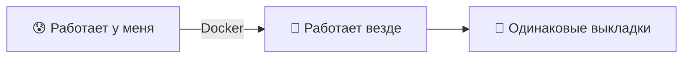
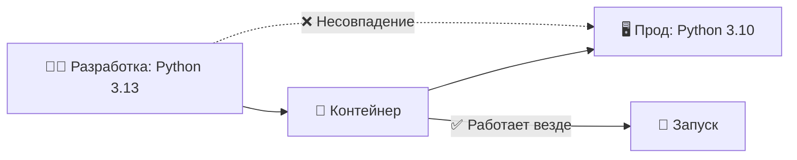
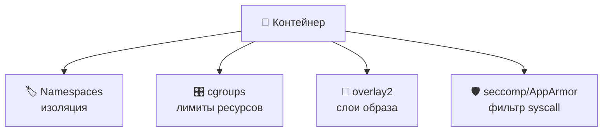
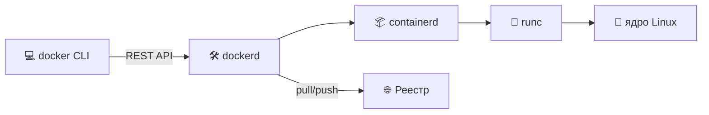
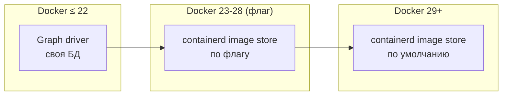
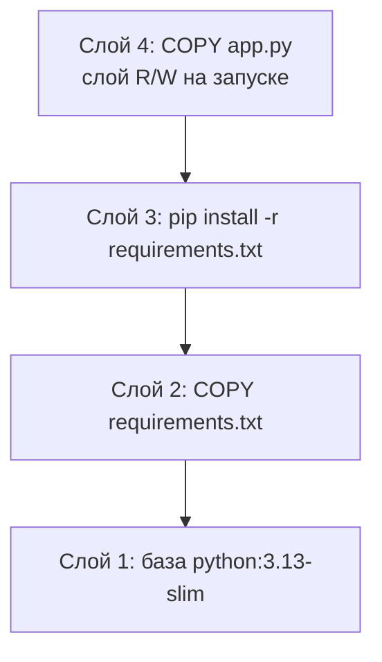
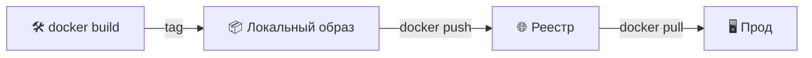
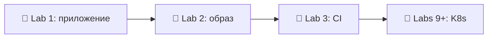

# 📌 Lecture 2 — Контейнеризация с Docker: от «работает у меня» до «работает везде»

## 📍 Слайд 1 – 🐳 Добро пожаловать в контейнеризацию

* 🌍 **«Работает у меня»** — самая дорогая фраза в разработке (сквозная шутка Lecture 1, теперь её чиним)
* 📦 **Контейнеры** = приложение + зависимости + рантайм в одной единице поставки
* 🚀 **Docker** = инструмент, который в 2013 сделал контейнеры мейнстримом
* 🎯 Эта лекция: контейнеры прод-уровня — маленькие, безопасные, воспроизводимые



> 🔗 **Связка с Lab 2:** вы упакуете Python-сервис из Lab 1 в контейнер. К концу будет multi-stage Dockerfile, финальный образ меньше 100 МБ.

---

## 📍 Слайд 2 – 🎯 Чему научитесь

| # | Результат |
|---|---------|
| 1 | 🧠 Объяснить, как namespaces и cgroups в Linux делают контейнеры возможными |
| 2 | 📝 Писать production-ready Dockerfile |
| 3 | 🔐 Применять паттерны rootless и distroless |
| 4 | 📦 Резать размер образа multi-stage сборкой |
| 5 | 🚀 Делать push и pull из Docker Hub или GHCR |

**Стек на май 2026:** Docker Engine **29.5+** (вышел в мае 2026; хранилище образов containerd теперь по умолчанию), BuildKit включён по умолчанию, Compose v2 на Go (Python Compose v1 дошёл до EOL в июле 2023).

---

## 📍 Слайд 3 – ❓ Главный вопрос

* 📊 **~65%** организаций гоняют контейнеры в проде (CNCF Annual Survey 2024)
* 🐳 В Docker Hub **15M+** публичных образов и **~17B** pull в месяц
* 💥 При этом скан Snyk за 2024 нашёл хотя бы одну CVE уровня HIGH в **~80%** публичных образов

> 💬 *«Контейнеры — новая единица выкладки.»* — Kelsey Hightower

**🤔 Обсуждение:** если любой образ может быть дырявым, какой Dockerfile хороший?

---

## 📍 Слайд 4 – 🔥 Проблема зависимостей

* 👨‍💻 **Машина разработчика:** Python 3.13, glibc 2.40, OpenSSL 3.3
* 🖥️ **Прод:** Python 3.10, glibc 2.31, OpenSSL 1.1
* 💥 В проде приложение падает с `GLIBC_2.34 not found`, и локально это никто не повторит



Контейнер замораживает весь userspace (пользовательское пространство) — интерпретатор, библиотеки, системные утилиты — в один неизменяемый артефакт. Общее только ядро.

---

## 📍 Слайд 5 – 😱 Решение через ВМ (и почему победили контейнеры)

В 2000-х изоляцию решали ВМ — виртуализацией **железа**: своя ОС на каждое приложение.

| 📊 | 🖥️ ВМ | 🐳 Контейнер |
|----|------|-------------|
| Загрузка | минуты | секунды |
| Накладные расходы | своя ОС на приложение (~ГБ) | общее ядро (~МБ) |
| Плотность на хосте | десятки | сотни и тысячи |
| Размер образа | 1–10 ГБ | 5 МБ – 1 ГБ |
| Изоляция | уровень железа | уровень процесса + namespaces |

> 🔥 **Жёстко:** изоляция контейнеров слабее. CVE ядра выходит из контейнера, но не из ВМ. Поэтому прод-кластеры K8s часто сидят на ВМ.

---

## 📍 Слайд 6 – 📜 Короткая история контейнеров

* 📅 **1979** — в Unix V7 добавили `chroot()`. Предок всех контейнеров.
* 📅 **2000** — FreeBSD Jails: chroot плюс изоляция процессов.
* 📅 **2008** — **LXC** (Linux Containers): namespaces и cgroups вместе.
* 📅 **2013** — **Docker** открывает исходники. Компания ещё называется dotCloud, потом её переименуют. Демо Solomon Hykes на PyCon разлетается.
* 📅 **2015** — Docker отдаёт спецификацию рантайма контейнеров (OCI). containerd отделяется от Docker.
* 📅 **2016** — Kubernetes достигает 1.0; оркестрация контейнеров выходит на первый план в проде.
* 📅 **2020** — Kubernetes отказывается от Docker как от рантайма (берёт containerd напрямую). Образы Docker живы — они OCI.
* 📅 **2023** — Docker Compose v1 (Python) доходит до EOL в июле 2023. Стандарт — **Compose v2 (Go)**.
* 📅 **2026** — выходит Docker Engine **29** (май 2026). Хранилище образов containerd становится умолчанием на новых установках. Так заканчивается путь «Docker становится containerd плюс обвязка», начатый в 2015.

---

## 📍 Слайд 7 – 🐧 Примитивы ядра, на которых это стоит

Контейнер — не фича. Это *композиция* возможностей Linux:

| Примитив | Что изолирует |
|-----------|------------------|
| 🏷️ **Namespaces** (PID, NET, MNT, UTS, IPC, USER, CGROUP) | Деревья процессов, сети, точки монтирования, hostname, IPC, UID, вид cgroup |
| 🎛️ **cgroups (v2)** | CPU, память, блочный I/O, PID — *квоты*, не изоляция |
| 📂 **Union-файловые системы** (overlay2) | Стопка слоёв только для чтения + один слой R/W = модель образа |
| 🛡️ **Capabilities + seccomp + AppArmor** | Какие syscall контейнеру разрешены |



> 📖 *Containers from Scratch* (доклад Liz Rice, 2017) — контейнер в 100 строках Go на этих примитивах.

---

## 📍 Слайд 8 – 🏗️ Архитектура Docker



* **`docker` CLI** — то, что вы набираете
* **`dockerd`** — демон; говорит с containerd по gRPC
* **`containerd`** — менеджер OCI-рантайма (K8s тоже ходит в него напрямую)
* **`runc`** — именно он порождает процесс и зовёт ядро
* **Реестр** — Docker Hub, GHCR, ECR, GAR, Harbor — хранит образы

> 📝 **Rootless Docker** (по умолчанию с Docker 23): `dockerd` работает от вашего пользователя, не от root. Берите этот режим.

---

## 📍 Слайд 9 – 🔁 Docker 29 и хранилище образов containerd

Десять лет Docker хранил образы сам (*graph driver* — `overlay2`, `aufs` и другие). У containerd хранилище было *другое*. На диске те же OCI-образы, описывают их две базы. В Docker 23 (2023) хранилище containerd включили флагом. **Docker 29 (май 2026) делает его умолчанием для новых установок.**

Зачем вам это:
* 🪞 **Ленивые pull** — качаете только нужные слои (eStargz / SOCI)
* 🖥️ **Мультиплатформенные образы локально** — `docker buildx build --platform linux/amd64,linux/arm64` наконец работает без круга через реестр
* 📦 **Диск чистится честнее** — GC образов как у `nerdctl` и Kubernetes
* 🧹 **Одна база образов** на хосте, не две



> 🔥 **Жёстко:** движок Docker теперь в основном аккуратный UX поверх containerd и BuildKit. Для экосистемы это *хорошо*: Kubernetes, nerdctl, podman и Docker сходятся в рантайме.

---

## 📍 Слайд 10 – 📚 Слои образа — модель в голове

Каждая инструкция Dockerfile даёт **слой только для чтения**. Слои складывает overlayfs; у живого контейнера сверху ещё один слой R/W.



**Почему это важно:**
* 🚀 Слои **кешируются** — неизменённый шаг не пересобирается
* 📦 Слои **общие** — три образа на одной базе хранят базу один раз
* 💀 Слои **только добавляются** — файл, удалённый в позднем слое, спрятан, но байты остаются в раннем слое

> 🔥 **Антипаттерн:** `COPY secrets.env / && rm secrets.env` секрет НЕ удаляет. Он остаётся в раннем слое. Каждый слой считайте вечным.

---

## 📍 Слайд 11 – 📝 База Dockerfile — прочитайте дважды

```dockerfile
# 🏗️ Base image — alpine, debian-slim, distroless, scratch
FROM python:3.13-slim

# 👤 Don't run as root (we'll harden this later)
RUN useradd --create-home --shell /bin/bash app
USER app
WORKDIR /home/app

# 📦 Dependencies FIRST (changes rarely → cached)
COPY --chown=app:app requirements.txt .
RUN pip install --user --no-cache-dir -r requirements.txt

# 💻 App code LAST (changes often → only this layer rebuilds)
COPY --chown=app:app . .

# 🚪 Document the port
EXPOSE 8080

# 🚀 Use exec form (PID 1 = your app → signals work)
CMD ["python", "app.py"]
```

> ⚠️ **Ловушка PID 1:** форма shell (`CMD python app.py`) делает `/bin/sh` PID 1, а приложение — PID 2. Сигналы (SIGTERM) до него не доходят. Всегда берите exec-форму `CMD ["python", "app.py"]`.

---

## 📍 Слайд 12 – ⚡ До и после Docker

| 😰 Без Docker | 🚀 С Docker |
|---|---|
| В README 14 шагов `apt-get install` | `docker run myapp` |
| «На Linux работает, на Windows нет» | Одинаково на Linux, macOS и Windows (Linux-контейнеры) |
| Drift в проде копится | Образ неизменяем, пересборка воспроизводима |
| Новичка заводят часами | `docker compose up` — и можно писать код |
| Одна кривая зависимость = переустановка всего сервера | `docker stop && docker rm && docker run` — и готово |

---

## 📍 Слайд 13 – 🎮 Сценарий 1: запуск от root

**Сбой:**
```dockerfile
FROM python:3.13-slim
COPY . /app
CMD ["python", "/app/server.py"]
```
Процесс идёт от **root внутри контейнера**. CVE ядра (например, CVE-2022-0185, побег FILESYSTEM\_MOUNT) позволяет процессу стать root на хосте. Это побег из контейнера.

**Починка — сбросить привилегии:**
```dockerfile
FROM python:3.13-slim
RUN useradd --uid 10001 --create-home --shell /bin/bash app
WORKDIR /home/app
COPY --chown=app:app . .
USER 10001     # 👤 numeric UID survives renames
CMD ["python", "server.py"]
```

> 🔒 **Бонус:** на `docker run` добавьте `--read-only` и `--cap-drop=ALL`. Lab 2 проводит по этим флагам.

---

## 📍 Слайд 14 – 🐌 Сценарий 2: медленные сборки (плохой порядок слоёв)

**Неверный порядок: любое изменение кода заново ставит все зависимости (сборка на 5 минут):**
```dockerfile
COPY . /app                 # 🚫 Every change invalidates everything below
RUN pip install -r /app/requirements.txt
```

**Верный порядок: слой зависимостей в кеше, пока не изменится `requirements.txt`:**
```dockerfile
COPY requirements.txt .     # ✅ Rarely changes
RUN pip install -r requirements.txt
COPY . .                    # ✅ Code changes don't bust the deps layer
```

**Правило:** слои от самых редких изменений к самым частым. База → пакеты системы → зависимости языка → код.

---

## 📍 Слайд 15 – 📦 Сценарий 3: раздутые образы

Наивный образ Python весит **~1.2 ГБ**. Это проблема:
* 🐢 Медленный `docker pull` → медленные деплои и медленный автоскейл
* 💸 Хранение и исходящий трафик растут вместе с образом
* 🛡️ Больше образ = больше пакетов = больше CVE

**Как похудеть:**
| Базовый образ | Размер | Компромисс |
|------------|-----:|-----------|
| `python:3.13` (debian) | ~1.2 ГБ | всё на месте |
| `python:3.13-slim` | ~150 МБ | нет man-страниц, меньше системных библиотек |
| `python:3.13-alpine` | ~60 МБ | musl libc: часть wheels ломается |
| `gcr.io/distroless/python3` | ~50 МБ | нет shell, нет пакетного менеджера |
| `scratch` (для Go/Rust) | ~10 МБ | только ваш бинарник |

---

## 📍 Слайд 16 – 📁 Сценарий 4: нет `.dockerignore`

Без `.dockerignore` команда `COPY . .` кладёт в образ локальные `node_modules/`, `.git`, `.venv`, конфиги IDE и **секреты**. Контекст сборки легко весит сотни МБ.

```gitignore
# .dockerignore — same syntax as .gitignore
.git
.venv
venv/
__pycache__/
node_modules/
.env
*.pyc
docs/
tests/
README.md
.idea/
.vscode/
```

> 🔍 **Реальный случай:** в 2022 Toyota слила данные клиентов, потому что в выкаченный контейнер попал каталог `.git`. `.dockerignore` нужен всегда.

---

## 📍 Слайд 17 – 🚀 Multi-stage сборки: главный трюк

Собирайте в тяжёлом образе, **в крошечный финальный копируйте только артефакт**.

```dockerfile
# 🏗️ Build stage: full toolchain
FROM golang:1.23 AS build
WORKDIR /src
COPY . .
RUN CGO_ENABLED=0 go build -o /app ./cmd/server

# 🚀 Final stage: just the binary
FROM gcr.io/distroless/static-debian12
COPY --from=build /app /app
USER nonroot:nonroot
ENTRYPOINT ["/app"]
```

Итог для обычного Go-сервиса:
* Один этап, образ `golang:1.23`: **~900 МБ**
* Multi-stage, distroless: **~15 МБ**
* Тот же бинарник, **в 60 раз меньше**, **ноль shell**, **ноль пакетного менеджера**

> 🔗 **Бонус Lab 2:** перепишите Go-приложение из Lab 1 в multi-stage сборку на distroless.

---

## 📍 Слайд 18 – 🔐 Distroless и `scratch`

**Distroless** (Google, 2018): рантайм и приложение, но **без shell, без apt, без busybox**. Поверхность атаки резко меньше.

```dockerfile
# ❌ Standard slim — debug-friendly, larger, more CVEs
FROM python:3.13-slim
COPY . /app
CMD ["python", "/app/server.py"]

# ✅ Distroless — production
FROM gcr.io/distroless/python3-debian12
COPY --from=build /app /app
CMD ["/app/server.py"]
```

**`scratch`** — пустой образ. Только для статически слинкованных бинарников (Go с `CGO_ENABLED=0`, Rust с musl). 0 CVE: больше в образе ничего нет.

> 📖 **Liz Rice, *Container Security* (O'Reilly, 2020)** — справочник по ужесточению образов.

---

## 📍 Слайд 19 – 🌐 Docker Hub и реестры



| Реестр | Заметки |
|----------|-------|
| 🐳 **Docker Hub** | По умолчанию; 1 бесплатный приватный репозиторий; лимиты бьют по CI |
| 🐙 **GHCR** (ghcr.io) | Публичные бесплатно, рядом GitHub Actions |
| ☁️ **ECR / GAR / ACR** | Родные для облака; доступ через IAM; их берут в прод AWS/GCP/Azure |
| 🏠 **Harbor** | У себя; статус CNCF graduated; подпись образов и скан уязвимостей сразу в комплекте |

**Ссылка на образ:** `[registry/]namespace/repo[:tag][@digest]`
- `nginx` → `docker.io/library/nginx:latest`
- `ghcr.io/innodevops/lab2-app:v1.2.3@sha256:abc…` — в проде фиксируйте digest

---

## 📍 Слайд 20 – 🏷️ Как тегировать

> 🚫 **Никогда не выкатывайте `:latest` в прод.** Тег меняется; вчерашний деплой не повторить.

| Стратегия | Пример | Когда |
|----------|---------|------|
| 📌 **SemVer** | `v1.4.2` | Релиз библиотеки или продукта |
| 🔢 **Git SHA** | `git-3a7f29c` | Сборки CI, всегда уникальны |
| 📅 **CalVer** | `2026.04.0` | Релизы по календарю |
| 🌿 **Ветка** | `main`, `develop` | Только пока разрабатываете |
| 🔒 **Пин по digest** | `@sha256:…` | Прод: ссылка не меняется |

**Как лучше:** на каждую сборку пушьте два тега — SemVer или SHA, чтобы можно было повторить, и движущийся `main` для удобства. Прод смотрит на неизменяемый.

---

## 📍 Слайд 21 – 🛡️ Безопасность контейнеров: что делать

Чеклист на любой Dockerfile:

1. ✅ **Фиксируйте версию базового образа** — `python:3.13-slim`, не `python:slim` и не `python:latest`
2. ✅ **Падайте на UID не-root** — `USER 10001`
3. ✅ **Ставьте `HEALTHCHECK`**, чтобы оркестратор видел, что приложение живо
4. ✅ **Не запекайте секреты** — `--build-arg` виден в `docker history`; берите секреты BuildKit или env на запуске
5. ✅ **Задавайте `WORKDIR` явно** — `/app`, не `/` и не `~`
6. ✅ **Берите `COPY`, не `ADD`**, если вам не нужны загрузка по URL и автораспаковка tar
7. ✅ **Сканируйте образы** — Trivy, Grype или Snyk в CI; роняйте сборку на CVE уровня HIGH/CRITICAL
8. ✅ **Подписывайте образы** — cosign + Sigstore; проверяйте в admission controller (это на курсе DevSecOps по выбору)

```bash
# 🔍 Lab 2 will use this
trivy image --severity HIGH,CRITICAL --exit-code 1 myapp:v1.0.0
```

---

## 📍 Слайд 22 – 🐙 Compose: несколько контейнеров локально

`docker-compose.yml` описывает стек из нескольких контейнеров декларативно. Удобно локально и для дымовых тестов в CI.

```yaml
services:
  app:
    build: ./app_python
    ports: ["8080:8080"]
    environment:
      DATABASE_URL: postgres://db:5432/app
    depends_on:
      db:
        condition: service_healthy
  db:
    image: postgres:17
    healthcheck:
      test: ["CMD-SHELL", "pg_isready -U postgres"]
      interval: 5s
    environment:
      POSTGRES_PASSWORD: dev
```

> 🔗 **Compose будет в Labs 6, 7, 8.** Прод из нескольких контейнеров дальше забирает Kubernetes (Lab 9+).

---

## 📍 Слайд 23 – 🌍 Как контейнеры используют вживую

* 🎬 **Netflix** — каждый микросервис уходит образом контейнера; тысячи сборок в день пушат во внутренний реестр на S3.
* 📦 **Amazon (Bottlerocket)** — ОС заточена под контейнеры: на хосте больше почти ничего не крутится.
* 🔍 **Google** — придумали контейнеры в проде (Borg, 2003); внутри пушат ~2 миллиарда контейнеров в неделю.
* 💬 **GitHub** — *каждый* PR крутится в контейнере через Actions; ~100 миллионов контейнеров в месяц.
* 🏦 **Capital One** — перевели ядро банка с ВМ на контейнеры в EKS; вычисления подешевели примерно на 40%.

> 🔥 **Общее:** так современные инженерные организации выкатывают на масштабе.

---

## 📍 Слайд 24 – 🎯 Главное

1. 📦 **Контейнеры — не магия:** namespaces + cgroups + overlayfs + реестр
2. 🏗️ **Слои от стабильных к изменчивым** — держите кеш горячим
3. 👤 **Никогда не работайте от root** — падайте до ненулевого UID, лучше числового
4. 🛡️ **Multi-stage + distroless** — меньше образ, меньше CVE, быстрее pull
5. 🏷️ **Тегируйте SemVer или SHA; никогда не выкатывайте `:latest`**
6. 🔍 **Сканируйте каждый образ в CI** — Trivy или Grype, роняйте сборку на HIGH/CRITICAL
7. 📄 **`.dockerignore` обязателен** — секреты и `.git` остаются снаружи

> 💡 **Хороший Dockerfile маленький, безопасный и воспроизводимый. Два из трёх — уже баг.**

---

## 📍 Слайд 25 – 🧠 Смена взгляда

| 😰 Раньше | 🚀 Под контейнеры |
|-------|---------------------|
| «Подними сервер» | Опиши окружение в `Dockerfile` |
| «Обнови машину в проде» | Собери новый образ и выкати заново |
| «Работает у меня» | Работает в образе, образ работает везде |
| «Большой монолит на ВМ» | Много маленьких сервисов, каждый в своём контейнере |
| Образ — чёрный ящик | Образ — артефакт с версией, его сканируют и подписывают |

---

## 📍 Слайд 26 – 🚀 Что дальше

**📚 Следующая лекция: *Непрерывная интеграция*.** Каждый push гоняет тесты, собирает образ и сканирует его до мержа.

* 🔄 Почему CI не пускает сбои из Lecture 1
* 🛠️ Синтаксис workflow в GitHub Actions
* 🧪 Пирамида тестов: модульные → интеграционные → сквозные
* 🐳 Образ из Lab 2 собирается и пушится сам

**🔬 Lab 2:** упакуйте сервис из Lab 1 в multi-stage Dockerfile, просканируйте Trivy, запушьте в GHCR. Образ этой недели пойдёт за сервисом по всем оставшимся лабам. K8s его выкатывает (Lab 9), Helm упаковывает (Lab 10), ArgoCD доставляет (Lab 13).



**👋 Увидимся в Lecture 3.**

---

## 📚 Материалы

* 📕 *Docker Deep Dive* — Nigel Poulton (свежее издание покрывает BuildKit и Compose v2)
* 📕 *Container Security* — Liz Rice, O'Reilly 2020 (бесплатный PDF на aquasec.com)
* 🎥 *Containers from Scratch* — доклад Liz Rice на GopherCon (YouTube, 2017)
* 🌐 [docs.docker.com](https://docs.docker.com) — официальная документация Docker (Engine 27.x)
* 🌐 [distroless](https://github.com/GoogleContainerTools/distroless) — образы distroless от Google
* 🌐 [opencontainers.org](https://opencontainers.org) — спецификация OCI (image, runtime, distribution)
* 🌐 [CIS Docker Benchmark](https://www.cisecurity.org/benchmark/docker) — чеклист ужесточения

**🎓 Квиз:** после лекции он кормит окно таблицы лидеров недель 1–3.
