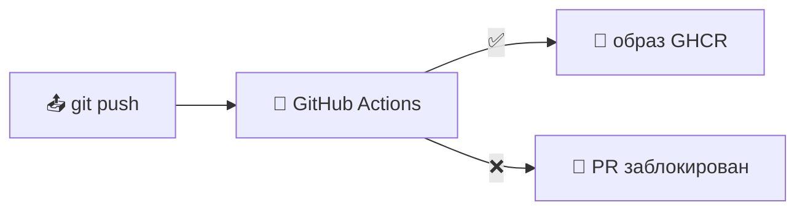
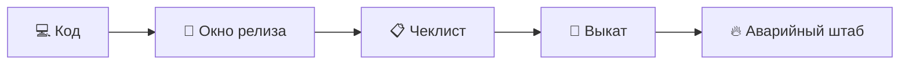
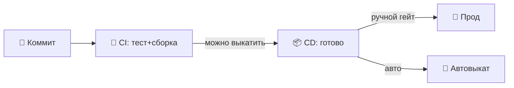
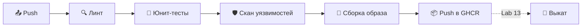
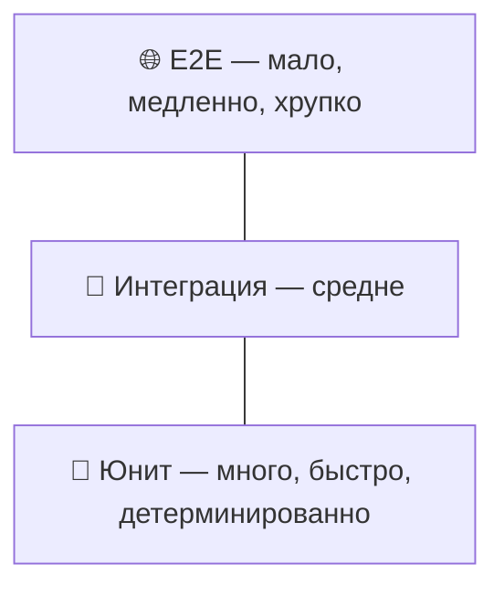
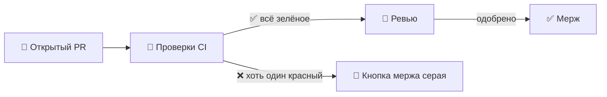
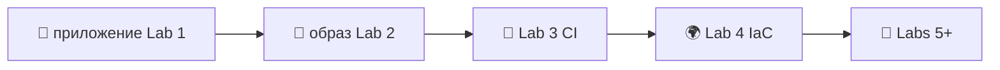

# 📌 Lecture 3 — Непрерывная интеграция: от «недели мержа» к зелёному на каждый push

## 📍 Slide 1 – 🤖 Добро пожаловать в CI/CD

* 🐳 Lecture 2 закончилась образом, который «работает везде» — но только если не забыть пересобрать, просканировать и сделать push
* 🤖 **Continuous Integration** превращает это «если» в «когда»: каждый коммит гоняет один и тот же pipeline (цепочка автоматической сборки и выкладки), на том же runner, тем же сканером
* 🎯 Эта лекция: собрать workflow GitHub Actions, который просит Lab 3 — test → lint → scan → build → publish, гейт на каждый PR
* 🔗 **Lab 3 собирает ровно этот workflow** для Python-сервиса из Lab 1 и образа из Lab 2



> 📚 **Рамка:** CI — мост между «я поменял код на ноутбуке» (Lec 1) и «в K8s крутится ровно этот образ» (Lec 9). Без CI мост — прыжок веры.

---

## 📍 Slide 2 – 🎯 Чему научитесь

| # | Результат |
|---|---------|
| 1 | 🧠 Сформулировать CI, CD и CDeploy в терминах Humble и Farley |
| 2 | 🔺 Применить тестовую пирамиду: много unit, тонко integration, редко E2E |
| 3 | 📝 Прочитать и написать workflow GitHub Actions с нуля |
| 4 | 🛡️ Не пускать мерж без скана уязвимостей Trivy и обязательных checks |
| 5 | 🏷️ Выбрать SemVer или CalVer и тегировать образы по выбранной схеме |
| 6 | ⚡ Разобрать медленный CI: кэш, матрицы, фильтры путей, concurrency |

---

## 📍 Slide 3 – 🛠️ Стек (зафиксирован на май 2026)

| Компонент | Версия | Зачем пин |
|-----------|--------:|------------|
| Runner | `ubuntu-24.04` | LTS; `ubuntu-latest` переезжает и ломает воспроизводимость |
| `actions/checkout` | `@v4` | Рантайм Node 20; v3 устарел в феврале 2024 |
| `actions/setup-python` | `@v5` | Встроенный `cache: pip`, ключ от `requirements.txt` |
| `docker/build-push-action` | `@v6` | BuildKit и мультиплатформенные сборки; v5 — EOL с апреля 2025 |
| `docker/metadata-action` | `@v5` | Теги SemVer, CalVer и SHA в одном шаге |
| Trivy | `v0.69.3+` | ⚠️ Атака на цепочку поставок в марте 2026 (вредоносный v0.69.4 — см. слайд 15); база CVE обновляется каждый день; альтернативы: Grype, Snyk (платный) |
| Cosign | `2.4` | Клиент Sigstore; подпись образов — в элективе DevSecOps |
| pytest | `8.3+` | Совместим с Python 3.13 |

> 📌 **Action пиньте на мажорный тег** (`@v4`), инструменты — на минор, базовые образы в проде — по digest. Lab 3 требует первых двух.

---

## 📍 Slide 4 – ❓ Главный вопрос

* 📊 **DORA 2024:** элитные команды выкатывают по запросу, по несколько раз в день; слабые — реже одного раза в месяц
* 🐛 **Capers Jones (2012):** починить баг в проде стоит **в 30–100 раз** дороже, чем поймать его в dev
* 🔍 **Sonatype 2024:** 1 из 8 скачиваний open source уже с известной уязвимостью — зависимости и есть поверхность атаки

> 💬 *«Если больно — делайте это чаще.»* — Martin Fowler, *Continuous Integration* (2006)

---

## 📍 Slide 5 – 🔥 Проблема: ад ручного тестирования

Команда без CI выглядит так:

* 📋 Чеклист на 50 шагов перед каждым релизом
* 🗓️ Релизы раз в месяц: каждый съедает целый день
* 😴 QA снова забыл проверить `/health`
* 💥 Прод падает; что именно выкатили, никто не повторит



> 📖 Lecture 1 назвала это *адом ручных релизов*. CI — практика, которая это хоронит.

---

## 📍 Slide 6 – 💥 Проблема интеграции («неделя мержа»)

До CI слияние долгоживущих веток ставили в календарь:

* 🌿 Пять человек на feature-ветках **3 недели**
* 📅 «Пятница интеграции» — все разом мержат в `main`
* 🔀 Часы разбора конфликтов; diff не понимает никто
* 💀 `main` сломан неделю; выкатить нельзя

> 📖 Kent Beck (*Extreme Programming*, 1999) прописал лекарство: **интегрироваться хотя бы раз в день**. Humble и Farley записали это в *Continuous Delivery* (2010).

**Лечение:** маленькие коммиты, trunk-based development (работа в общем стволе), каждый push проверяет CI.

---

## 📍 Slide 7 – 🔓 Дыра в безопасности

Lecture 2 закончилась на `trivy image`. Прогоните один раз руками — и забудете. CVE в следующий вторник никого не разбудит.

* 🔍 **Sonatype 2024:** среднее корпоративное приложение тянет **180+ зависимостей из open source**
* ⏱️ Медиана, за сколько находят уязвимую зависимость без скана: **218 дней** (Snyk *State of Open Source 2024*)
* 🤖 **GitGuardian 2024:** утёкшие учётные данные в публичных репозиториях боты-сканеры находят **меньше чем за 5 минут**

> 🔥 **Именно в CI безопасность сдвигается влево** — скан идёт на каждый PR, а не «когда руки дойдут».

---

## 📍 Slide 8 – 💡 Что такое CI/CD на самом деле

Три термина, их часто смешивают. В *Continuous Delivery* (2010) Humble и Farley проводят границы:

| Термин | Определение | Триггер |
|------|------------|---------|
| 🤖 **Continuous Integration** | Каждый коммит собирается и тестируется в общем стволе | Push / PR |
| 📦 **Continuous Delivery** | Каждый зелёный коммит **можно выкатить** в любой момент | Мерж в `main` |
| 🚀 **Continuous Deployment** | Каждый зелёный коммит **сам выкатывается** в прод | Мерж в `main` |



> 📖 Jez Humble: *«Continuous Delivery — это не Continuous Deployment. Разница в том, кто жмёт кнопку.»*

---

## 📍 Slide 9 – 🔄 Анатомия pipeline

У современного CI-pipeline один и тот же скелет — Lab 3 собирает вот эти шаги:



* 🔍 **Lint** — `ruff` / `flake8` / `pylint`. Секунды.
* 🧪 **Test** — `pytest` по эндпоинтам Lab 1. Десятки секунд.
* 🛡️ **Scan** — Trivy или Grype по зависимостям и образу. ~1 мин.
* 🐳 **Build** — многоступенчатый Dockerfile из Lab 2, кэш BuildKit.
* 📦 **Publish** — GHCR (бесплатно для публичных, нативно для GitHub, `GITHUB_TOKEN`).

> 🔗 Выкат (пунктир) — это Lecture 13 / Lab 13: ArgoCD смотрит в реестр.

---

## 📍 Slide 10 – 🔺 Тестовая пирамида

Пирамида Mike Cohn (*Succeeding with Agile*, 2009) до сих пор рабочая модель:



| Слой | Доля | Скорость | Что ловит |
|-------|------:|------:|---------|
| 🧪 Unit | ~70% | мс | Ошибки логики в чистых функциях |
| 🔗 Integration | ~20% | секунды | Неверный HTTP-статус, форма запроса к БД |
| 🌐 E2E | ~10% | минуты | Сквозные сценарии между сервисами, UI |

> ⚠️ **Перевёрнутая пирамида (много E2E) = медленный флакающий CI.** В *Testing Blog* Google это антипаттерн *ice-cream cone* (рожок мороженого). Lab 3 сидит на слое unit; интеграционные тесты начнутся в Lab 7+.

---

## 📍 Slide 11 – 📝 Анатомия workflow в GitHub Actions

Workflow — это YAML в `.github/workflows/`. Ключи читайте сверху вниз:

```yaml
name: Python CI                    # 👁️ shown in the Actions tab
on:                                # ⚡ triggers
  push: { branches: [main] }
  pull_request:
permissions:                       # 🔒 minimum required
  contents: read
  packages: write                  # for GHCR push
concurrency:                       # ♻️ cancel superseded runs on the same PR
  group: ci-${{ github.ref }}
  cancel-in-progress: true

jobs:
  test:
    runs-on: ubuntu-24.04          # 📌 pinned, not :latest
    steps:
      - uses: actions/checkout@v4
      - uses: actions/setup-python@v5
        with: { python-version: "3.13", cache: pip }
      - run: pip install -r requirements.txt -r requirements-dev.txt
      - run: ruff check .
      - run: pytest -q
```

> 📌 **Action пиньте на мажорный тег** (`@v4`). Пин на `@main` — и компрометация апстрима тихо приезжает в ваш CI (см. атаку на цепочку поставок **tj-actions/changed-files**, **14–15 марта 2025**, **CVE-2025-30066** — секреты утекли в логи CI у 23 000+ репозиториев; починили в v46.0.1).

---

## 📍 Slide 12 – 🧩 Jobs, steps, needs, матрицы

* 🧱 **Workflow** → много **jobs** → много **steps**
* 🧱 **Jobs по умолчанию параллельны**; очередь задаёт `needs:`
* 🧱 **Каждый job — новая VM.** Файлы между job не едут, пока не сделаете `upload-artifact`/`download-artifact`
* 🧱 **Матрица** размножает один job на много параметров

```yaml
jobs:
  test:
    strategy:
      fail-fast: false             # don't kill 3.12 when 3.13 fails
      matrix:
        python-version: ["3.11", "3.12", "3.13"]
    runs-on: ubuntu-24.04
    steps:
      - uses: actions/setup-python@v5
        with: { python-version: "${{ matrix.python-version }}" }
      - run: pytest

  docker:
    needs: test                    # 🔗 only runs if every matrix cell passed
    runs-on: ubuntu-24.04
    steps: ...
```

> 💡 **Concurrency × matrix:** 3 job × N PR быстро съедают минуты бесплатного тарифа. Всегда ставьте `cancel-in-progress` (слайд 11).

---

## 📍 Slide 13 – 🎮 Сценарий 1: нет тестов → pytest в CI

**Сбой:**

```python
# app.py from Lab 1
@app.route("/")
def home():
    return {"message": "Hello", "hostname": os.environ["HOSTNAME"]}
```

Опечатка в `os.environ` даёт `KeyError`. На ноутбуке живёт: там `HOSTNAME` задан. В контейнере, где его нет, падает.

**Лечение — pytest в CI:**

```python
# tests/test_app.py
def test_home_returns_hostname_field(client, monkeypatch):
    monkeypatch.delenv("HOSTNAME", raising=False)
    r = client.get("/")
    assert r.status_code == 200
    assert "hostname" in r.get_json()

def test_health_endpoint(client):
    r = client.get("/health")
    assert r.status_code == 200
    assert r.get_json()["status"] == "healthy"
```

> 🔗 **Lab 3 Task 1** просит написать ровно эти тесты на `/` и `/health` — и обосновать pytest против unittest. Фикстуры pytest и голый `assert` побеждают в большинстве проектов.

---

## 📍 Slide 14 – 🎮 Сценарий 2: ручной docker build → build-push-action

**Сбой (ручной поток из Lab 2):**

```bash
docker build -t myapp:latest .
docker tag myapp:latest ghcr.io/me/myapp:v1.2.3
docker login ghcr.io                       # ← typed by hand
docker push ghcr.io/me/myapp:v1.2.3
docker push ghcr.io/me/myapp:latest
# 😱 forgot to push :v1.2.3 → prod runs yesterday's bug
```

**Лечение:**

```yaml
docker:
  needs: test
  runs-on: ubuntu-24.04
  permissions: { contents: read, packages: write }
  steps:
    - uses: actions/checkout@v4
    - uses: docker/login-action@v3
      with:
        registry: ghcr.io
        username: ${{ github.actor }}
        password: ${{ secrets.GITHUB_TOKEN }}    # 🔒 ephemeral, no secret to rotate
    - uses: docker/metadata-action@v5
      id: meta
      with:
        images: ghcr.io/${{ github.repository }}
        tags: |
          type=semver,pattern={{version}}
          type=sha,prefix=git-
          type=raw,value=latest,enable={{is_default_branch}}
    - uses: docker/build-push-action@v6
      with:
        context: ./app_python
        push: true
        tags: ${{ steps.meta.outputs.tags }}
        cache-from: type=gha
        cache-to: type=gha,mode=max
```

> 🔗 **Lab 3 Task 2** собирает ровно этот job. `GITHUB_TOKEN` выдаётся на каждый прогон сам — отдельные креды Docker Hub не нужны.

---

## 📍 Slide 15 – 🎮 Сценарий 3: уязвимые зависимости → Trivy + Dependabot

**Сбой:**

```
# requirements.txt
flask==2.0.1            # CVE-2023-30861 (high) — session cookie disclosure
requests==2.25.0        # CVE-2023-32681 (medium) — proxy auth leak
```

Lecture 2 показала `trivy image`. CI гоняет его на каждый PR.

```yaml
- uses: aquasecurity/trivy-action@0.35.0   # 📌 v0.35.0+ post-incident-safe (see callout)
  with:
    scan-type: fs                      # scan requirements.txt + lockfiles
    severity: HIGH,CRITICAL
    exit-code: "1"                     # 🚫 fail the job
    ignore-unfixed: true               # skip CVEs with no patch yet
```

> ⚠️ **Атака на цепочку поставок Trivy (19 марта 2026 — CVE-2026-33634).** Вредоносный бинарник **Trivy v0.69.4** выложили на официальную страницу релизов GitHub: ключи подписи мейнтейнера были скомпрометированы. Любой CI-job, который пинил `trivy-action` на плавающие `master`/`latest` или вызывал `curl -sfL .../install.sh | sh` 19–20 марта, выполнил код атакующего на runner — с полным доступом к хранилищу секретов CI. Починка вышла за 24 часа (Trivy **v0.69.3** откатили на последнюю заведомо исправную сборку; `trivy-action **v0.35.0+`**, `setup-trivy **v0.2.6+`** безопасны после инцидента). **Урок этой лекции:** *сам сканер* входит в вашу цепочку поставок. Запиньте его. Проверьте подпись. Тот же приём (мейнтейнер скомпрометирован → вредоносный релиз) годом раньше утопил tj-actions/changed-files — дважды за 12 месяцев у двух самых ходовых инструментов безопасности в CI/CD.


**В пару к этому — Dependabot** (`.github/dependabot.yml` — штатный, без токена, без третьей стороны):

```yaml
version: 2
updates:
  - package-ecosystem: pip
    directory: /app_python
    schedule: { interval: weekly }
  - package-ecosystem: github-actions  # 🔒 keep actions/checkout@v4 fresh
    directory: /
    schedule: { interval: weekly }
```

> 🛡️ **Чем сканировать:** Trivy (Aqua, Apache-2.0) и Grype (Anchore, Apache-2.0) — полноценный FOSS. Snyk богатый, но после бесплатного тарифа платный. Lab 3 принимает любой из трёх.

---

## 📍 Slide 16 – 🎮 Сценарий 4: медленный CI → кэш

```
[Run 1] pip install ........................ 2m 18s
[Run 2] pip install ........................ 2m 14s     # identical deps
[Run 3] pip install ........................ 2m 21s     # 😴 still downloading
```

**Лечение — уже внутри `setup-python`:**

```yaml
- uses: actions/setup-python@v5
  with:
    python-version: "3.13"
    cache: pip
    cache-dependency-path: app_python/requirements.txt
```

Ключ кэша — `runner.os + python-version + hash(requirements.txt)`. Поменяли `requirements.txt` — кэш сбросился сам.

**Добавьте кэш Docker BuildKit** (его уже показывает слайд 14):

```yaml
cache-from: type=gha
cache-to: type=gha,mode=max
```

**Фильтр путей не запускает workflow на чужих изменениях:**

```yaml
on:
  push:
    paths: ["app_python/**", ".github/workflows/python-ci.yml"]
```

**Замер на типичном Lab 3:** 5m 30s → 45s на тёплом кэше. Быстрее ~7×.

> ⚠️ **Не кэшируйте `~/.cache/pip` руками, если вам подходит `setup-python`:** встроенный кэш сам правильно сбрасывается.

---

## 📍 Slide 17 – 📊 Покрытие: полезно, но не святыня

```yaml
- run: pytest --cov=app_python --cov-report=xml --cov-fail-under=70
- uses: codecov/codecov-action@v4
  with: { files: ./coverage.xml }
```

| Покрытие | Как читать |
|---------:|---------|
| < 50% | Скорее всего, тестов как культуры нет |
| 70–85% | Норма для обычного кода приложения |
| 95%+ | Библиотеки и safety-critical |
| 100% | Почти всегда лишнее: отдача падает |

> 🔥 **Martin Fowler:** *покрытие помогает найти код без тестов; целью его делать не надо.* Высокое покрытие при слабых проверках — театр.

---

## 📍 Slide 18 – 🔁 Что переиспользовать

Когда CI растёт, копипаста протухает. У GitHub два способа переиспользовать куски:

| Инструмент | Область | Когда |
|------|-------|------|
| 🧩 **Composite action** (`action.yml`) | Пачка **steps** | «Поднять Python, кэш и зависимости» |
| 🔁 **Reusable workflow** (`uses: org/repo/.github/workflows/x.yml@v1`) | Целый **job** | «Одинаковый CI для каждого Python-сервиса» |

> 🔗 **Lab 3 этого не требует**, но продовые монорепы на это сильно опираются. Вернёмся в Lecture 13.

---

## 📍 Slide 19 – 🏷️ Версии: SemVer

`MAJOR.MINOR.PATCH` — спецификация Tom Preston-Werner (semver.org, 2013).

| Шаг | Когда | Пример |
|------|------|---------|
| **MAJOR** | Ломающее изменение API | `1.4.2 → 2.0.0` |
| **MINOR** | Новая обратно совместимая фича | `1.4.2 → 1.5.0` |
| **PATCH** | Только исправление бага | `1.4.2 → 1.4.3` |

`docker/metadata-action` собирает SemVer-теги из git-тега (`git tag v1.2.3 && git push --tags`):

```yaml
tags: |
  type=semver,pattern={{version}}    # 1.2.3
  type=semver,pattern={{major}}.{{minor}}    # 1.2
  type=semver,pattern={{major}}    # 1
```

**SemVer — для:** библиотек, SDK и API, которые пинят внешние потребители.

---

## 📍 Slide 20 – 📅 Версии: CalVer

`YYYY.MM.DD` или `YYYY.MM.PATCH` — calver.org. Так версионируют Ubuntu (`24.04`) и pip (`24.3`).

```yaml
- id: ver
  run: echo "v=$(date -u +%Y.%m.%d)" >> $GITHUB_OUTPUT
- uses: docker/build-push-action@v6
  with:
    tags: |
      ghcr.io/${{ github.repository }}:${{ steps.ver.outputs.v }}
      ghcr.io/${{ github.repository }}:latest
```

**CalVer — для:** сервисов с continuous deployment, где «ломающее изменение» ни при чём: вас снаружи никто не пинит (свой сервис, его выкатывает ваш же CI).

> 🚫 **Никогда не выкатывайте `:latest` в прод.** Тег мутабельный: завтра образ с тем же тегом — другой артефакт. Пиньте по SemVer или по digest. (Тот же урок, что в Lecture 2.)

---

## 📍 Slide 21 – 🛡️ Защита веток: CI полезен, только когда блокирует

Зелёный бейдж CI — украшение. **Required status checks** — вот гейт.

В `Settings → Branches → Branch protection rules` для `main`:

* ✅ Pull request обязателен до мержа (≥1 ревью)
* ✅ Status checks должны пройти до мержа — отметьте `test`, `docker`, `trivy`
* ✅ Ветка должна быть актуальной до мержа
* ✅ Линейная история (без merge-коммитов) — иначе `git bisect` врёт
* ✅ Обход запрещён, даже админам
* ✅ Ограничить push, которые создают такие же ветки



> 🔗 **Lab 3 Task 3** включает эту защиту на вашем форке.

---

## 📍 Slide 22 – 🚫 Антипаттерны CI

| ❌ Антипаттерн | ✅ Как надо |
|----------------|------|
| `runs-on: ubuntu-latest` | Пин: `ubuntu-24.04` |
| `actions/checkout@main` | Пин на мажорный тег (или SHA для рискованных action) |
| Секреты в `env:` на уровне workflow | Через `secrets:` на уровне job, права минимальные |
| CI на 30 минут, который все пропускают | Кэш + фильтр путей + урезать матрицу; цель < 10 мин |
| Тесты ходят на прод-URL | Моки и фикстуры; у runner нет прод-доступов не просто так |
| `--ignore-unfixed` включён навсегда | Незакрытые CVE ведите в issue; смотрите раз в неделю |
| Один файл workflow на 800 строк | Дробите по смыслу; общие job — в reusable workflow |
| CI пропускают через `[skip ci]` | Нельзя. Следующий вольёт регрессию. |

---

## 📍 Slide 23 – 📈 Метрики CI, которые имеют значение

Смотрите их рядом с метриками DORA (Lec 1, слайд 23):

| Метрика | Норма | Зачем |
|--------|---------------:|-----|
| ⏱️ **Длительность pipeline (p50)** | < 10 мин | Задержка обратной связи: в *Accelerate* Форсгрен связывает её с частотой выката |
| ✅ **Доля зелёного CI на main** | > 95% | Ниже флаки съедают доверие: красное начинают игнорировать |
| 🔄 **Среднее время до зелёного** после красного | < 1 ч | Как быстро вы чините `main` |
| 🛡️ **CVE, пойманные в CI, а не в проде** | В основном CI | Обратная величина срока жизни утёкшей уязвимости |
| 📦 **Попадания в кэш** | > 80% | Прямо двигает счёт на hosted runner |

> 📊 **Источники:** Forsgren et al., *Accelerate* (2018); CircleCI *State of Software Delivery 2024*.

---

## 📍 Slide 24 – 🏢 CI в масштабе: живые цифры

* 🐙 **Сам GitHub** — ~100 млн прогонов Actions в месяц по публичным репозиториям; каждый PR в `github/github` гоняет ~30 тысяч тестов
* 🛒 **Shopify** — прод выкатывают десятки раз в день; ответ CI меньше 5 минут на главном монолите (Shopify Engineering, 2024)
* 🎬 **Netflix** — каждый микросервис собирается и тестируется на коммит; ~3000+ сборок в день
* 🔍 **Google** — один trunk, **два миллиарда** строк, ~100 млн тестов в день на Bazel (Winters et al., *Software Engineering at Google*, 2020)
* 🏦 **Capital One** — 50+ команд на общих reusable workflow; pipeline держит платформенная команда, продуктовые его не изобретают заново

> 🔥 **Общее:** медленный CI — налог на каждого инженера, каждый день. Минута, сэкономленная на прогоне, окупается на всю компанию.

---

## 📍 Slide 25 – 🎯 Главное

1. 🤖 **CI интегрирует часто** — каждый push, на чистом runner, по одному и тому же workflow
2. 🔺 **Пирамида: много unit, тонко integration, редко E2E** — наоборот выходит флакающе и медленно
3. 📌 **Пиньте всё** — ОС runner, мажорные версии action, базовые образы в проде по digest
4. 🛡️ **Скан в CI, фикс в PR** — Trivy или Grype по файлам и по образу; Dependabot держит зависимости свежими
5. ⚡ **Кэшируйте нужное** — `setup-python` для pip, кэш BuildKit в GHA для слоёв, фильтры путей для чужих push
6. 🏷️ **SemVer для библиотек, CalVer для сервисов; `:latest` в прод не выкатывайте**
7. 🚦 **Обязательные checks важнее бейджей** — работает защита веток
8. 📊 **Меряйте длительность pipeline и долю зелёных** — медленный флакающий CI начинают игнорировать

> 💡 **Хороший pipeline быстрый, детерминированный и скучный. Если в CI интересно — это запах.**

---

## 📍 Slide 26 – 🚀 Что дальше

**📚 Следующая лекция: *Инфраструктура как код — Terraform и Pulumi*.** CI собирает образ. Lecture 4 — про то, как облачные ресурсы, которые этот образ *запускают*, создаются воспроизводимо, кодом, проходят ревью и применяются через такой же pipeline, какой вы собрали сегодня.

* 🌍 Декларативный и императивный провижининг
* 🏗️ Модули Terraform 1.15; Pulumi 3.x, когда инфраструктура пишется обычным кодом
* 🔐 Удалённый state, блокировки, поиск drift
* 🧪 `terraform plan` как гейт в CI — та же идея, что вы уже применили к тестам

**🔬 Что сдать в Lab 3:**

* `app_python/tests/` с pytest на `/` и `/health`
* `.github/workflows/python-ci.yml` — lint → test → Trivy → build → push в GHCR
* Защита веток на `main`: эти checks обязательны
* Бейджи статуса и покрытия в README
* Бонус: второй workflow для приложения на компилируемом языке за фильтром `paths:`



**👋 До встречи на Lecture 4.**

---

## 📚 Материалы

**📕 Книги:**
* *Continuous Delivery* — Jez Humble и David Farley (Addison-Wesley, 2010). Канон.
* *Continuous Integration* — Duvall, Matyas, Glover (2007). Ещё до облака, принципы те же.
* *Accelerate* — Forsgren, Humble, Kim (2018). Наука за DORA.
* *Software Engineering at Google* — Winters, Manshreck, Wright (2020). CI на одном огромном trunk.

**🔗 Ссылки:**
* 🌐 [docs.github.com/actions](https://docs.github.com/actions) — официальный справочник
* 🌐 [github.com/aquasecurity/trivy](https://github.com/aquasecurity/trivy) / [anchore/grype](https://github.com/anchore/grype)
* 🌐 [semver.org](https://semver.org) / [calver.org](https://calver.org)
* 🌐 [martinfowler.com/articles/continuousIntegration.html](https://martinfowler.com/articles/continuousIntegration.html) — Fowler, 2006

**🛠️ Локальные инструменты:** [`act`](https://github.com/nektos/act) (Actions локально), [`actionlint`](https://github.com/rhysd/actionlint) (линт workflow), [`gh`](https://cli.github.com/) (`gh run watch`).

**🎓 Квиз:** квиз после лекции идёт в окно таблицы лидеров за недели 1–3 (см. `README.md` → Grading).
