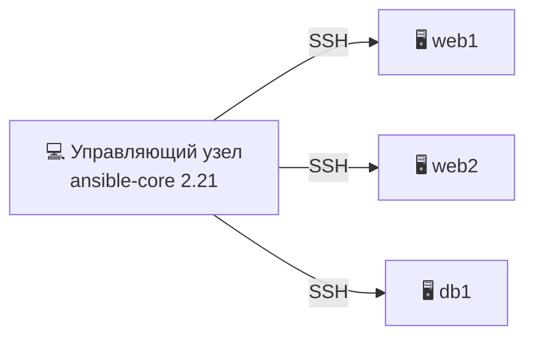
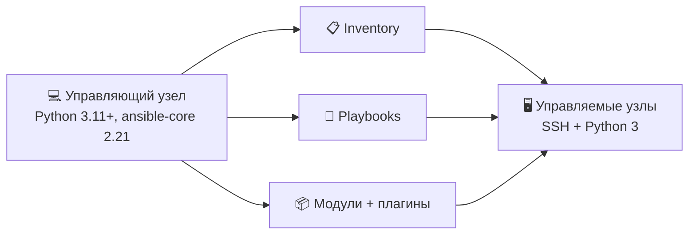
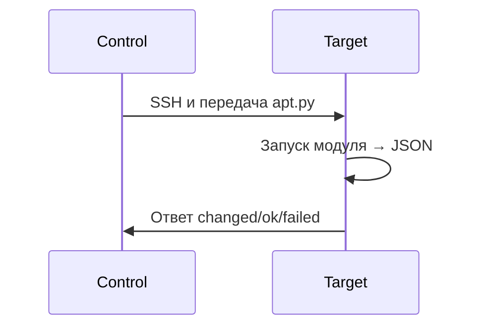
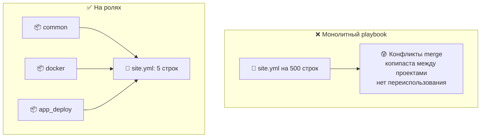
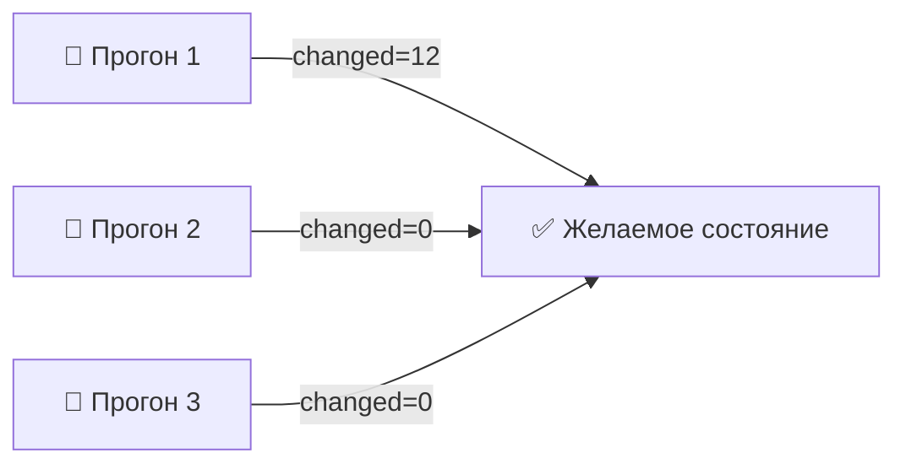
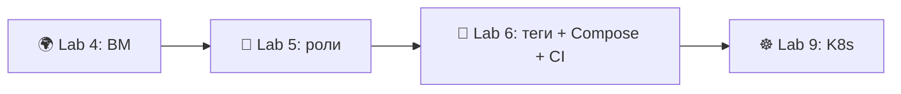

# 📌 Lecture 5 — Основы Ansible: управление конфигурацией, которое не кусается

## 📍 Slide 1 – 🔧 Добро пожаловать в управление конфигурацией

* 🌍 **Lecture 4 создала машину** — Terraform/Pulumi подняли ВМ, выдали IP, открыли порты
* 🤔 Внутри пусто: нет Docker, нет пользователя приложения, нет конфига nginx, нет TLS, нет настроек демона
* 🔧 **Ansible настраивает внутренности** — пакеты, файлы, сервисы, секреты — декларативно, на `ansible-core 2.21` (май 2026)


> 🔗 **Связка с Lab 5:** соберёте три роли (`common`, `docker`, `app_deploy`), настроите ими ВМ из Lab 4 и запустите на ней образ контейнера из Lab 2.

---

## 📍 Slide 2 – 🎯 Результаты обучения

| # | Результат |
|---|---------|
| 1 | 🧠 Объяснить agentless (без агента), push-модель конфигурации и чем она отличается от инструментов с агентом |
| 2 | 📋 Написать и разложить статический inventory (список хостов); понимать, когда переходить на динамический |
| 3 | 📝 Писать идемпотентные playbook на нужных модулях (`apt`, `service`, `template`, `lineinfile`) |
| 4 | 📦 Собрать переиспользуемую логику в роли (tasks / handlers / defaults / templates) |
| 5 | 🔐 Шифровать секреты через Ansible Vault и безопасно передавать их в playbook |

**Стек зафиксирован на май 2026:** `ansible-core` **2.21** (пакет сообщества **ansible 13.6.0**, апрель 2026), Python **3.11+** на управляющем узле, `ansible-galaxy` для коллекций, OpenSSH на управляемых узлах.

> 📌 **Заметка про «LTS»:** у Ansible-core **нет формальной метки LTS.** Red Hat поставляет *Ansible Automation Platform* с расширенной поддержкой, но открытый `ansible-core` гарантирует лишь ~6 месяцев исправлений безопасности на минорный релиз. Сейчас из open-source поддерживаются **2.18, 2.19, 2.20, 2.21**. Старые слайды в интернете про «2.17 LTS» написаны до уточнения политики — не смотрите на них.

---

## 📍 Slide 3 – 🆚 Ansible и остальной IaC

* 🌍 **Terraform / Pulumi (Lec 4)** = *provisioning* (создание инфраструктуры) — «создать 3 ВМ, 1 LB, 1 инстанс RDS»
* 🔧 **Ansible (Lec 5)** = *конфигурация* — «поставить Docker, отрендерить `daemon.json`, запустить сервис»
* 🐳 **Docker (Lec 2)** = *упаковка* — «заморозить приложение и его runtime»
* ☸️ **Kubernetes (Lec 9+)** = *оркестрация* — «держать N реплик, поднять после падения, выкатить обновление»

> 🔥 **Не путайте.** Terraform делает так, что машина есть. Ansible делает так, что от машины есть толк. Оба живут в Git, обоим место в CI.


---

## 📍 Slide 4 – 🔥 Раздел 1: Проблема конфигурации

```bash
# 😱 The bash script that "works" — once
#!/bin/bash
apt-get update
apt-get install -y nginx
echo "Welcome" > /var/www/html/index.html
systemctl start nginx
```

Два запуска: `apt-get install` переживёт, а `echo >` перезапишет файл каждый раз. Ubuntu 22.04 и 24.04 — имена пакетов разъедутся. Сервер, где кто-то руками правил `index.html`, — ваша правка молча затрёт чужую.

**Вся проблема на одном слайде.** Shell-скрипты — императивные рецепты: они описывают не *конечное состояние*, а только *шаги*. Всё, что не совпало с картиной в голове автора, их ломает.

---

## 📍 Slide 5 – 📝 Документация расходится с реальностью

* 📝 Документацию написали один раз, сервер правили сто раз — вики никто не обновляет
* 🚪 Инженер, который знал настоящий конфиг, ушёл в 2024
* 💀 Реальность ≠ документация; команда верит тому, что сегодня подводит меньше
* 🔇 «Runbook говорит X, а прод уже делает Y» — эту фразу вы услышите в каждом постмортеме
* 🧪 Тест аварийного восстановления падает: *настоящий* конфиг так и не записали

> ⚠️ **Устаревшая документация хуже её отсутствия** — она уверенно ведёт не туда.

---

## 📍 Slide 6 – 💸 Цена серверов, настроенных руками

| 🔥 Режим сбоя | 💥 Последствие |
|---|---|
| 🐢 Ручной патчинг, сервер за сервером | Критичные CVE неделями без патча |
| 📋 Ручные правки по SSH | Опечатка роняет прод |
| 👉 Серверы-снежинки | «На сервере 1 работает, на сервере 2 сломано» |
| 🙈 Нет следа аудита | Compliance-аудит провален; кто менял `sshd_config`, неизвестно |
| 🐶 Серверы-питомцы | Умер один — с нуля не собрать |

> 📖 **2024 Verizon DBIR:** ~85% взломов завязаны на человеческий фактор — в облачных инцидентах лидируют ошибки конфигурации. Задача Ansible — стереть эту таблицу целиком.

---

## 📍 Slide 7 – 💡 Раздел 2: Что такое Ansible

* 🔧 **Инструмент управления конфигурацией** — описывает *желаемое состояние* парка машин
* 🌐 **Agentless** — говорит по SSH (Linux) или WinRM (Windows); на целях нечего ставить и патчить
* 📤 **Push-модель** — управляющий узел пушит команды, когда вы его запускаете; нет цикла pull, нет heartbeat агента
* 📝 **YAML + Jinja2** — синтаксис почти декларативный, в Git ложится как любой код
* 🔄 **Идемпотентный по замыслу** — два прогона одного playbook сходятся в одно состояние



> 📖 **Определение:** Ansible — открытый движок автоматизации, который по SSH и YAML приводит парк машин в задокументированное, версионируемое состояние.

---

## 📍 Slide 8 – 📜 Краткая история Ansible

* 📅 **2012** — Michael DeHaan выпускает Ansible; прямая реакция на сложность агентов Puppet/Chef
* 📅 **2013** — основана AnsibleWorks; первый коммерческий релиз
* 📅 **2015** — **Red Hat покупает AnsibleWorks** за ~$150M
* 📅 **2019** — IBM покупает Red Hat; Ansible остаётся open-source
* 📅 **2021** — разделение проекта: **`ansible-core`** (движок) и **`ansible`** (пакет сообщества, внутри сотни коллекций)
* 📅 **2024+** — коллекции становятся основной единицей поставки; пакет `community.ansible` тащит их сотнями
* 📅 **Май 2026** — `ansible-core 2.21` (пакет сообщества **ansible 13.6.0**) — им вы работаете в Lab 5

> 🤔 **Заметьте:** ставка Ansible — *никаких агентов* — старше GitOps на годы, и для конфигурации парка это до сих пор верный выбор.

---

## 📍 Slide 9 – 🚫 Ansible — это не

| ❌ Миф | ✅ Как на самом деле |
|---|---|
| «Заменяет Terraform» | 🤝 Terraform создаёт, Ansible настраивает. Другой слой. |
| «Нужны агенты на каждом сервере» | 🌐 Только SSH. В этом весь смысл. |
| «Только Linux» | 🪟 Windows работает через WinRM/PowerShell; сетевое железо — через API-модули |
| «Просто bash в YAML» | 📦 Идемпотентные модули + модель состояния + handlers + Jinja2 |
| «Тормозит на большом парке» | ⚡ По умолчанию forks=5; масштаб — `forks=50`, mitogen или AAP |

> 🔥 **Жёсткий тезис:** как только серверов больше трёх, нужен Ansible (или аналог). Ручной SSH не масштабируется.

---

## 📍 Slide 10 – 🏗️ Архитектура



| 🧱 Компонент | 🎯 Зачем |
|---|---|
| 💻 **Управляющий узел** | Ваш ноутбук или CI runner. Python 3.11+ и `ansible-core 2.21`. |
| 🖥️ **Управляемые узлы** | Серверы, которые вы настраиваете. SSH + Python 3. |
| 📋 **Inventory** | Статический INI/YAML или динамический облачный плагин. Хосты, группы, переменные. |
| 📦 **Модули** | Единицы работы на Python (`apt`, `service`, `template`, `copy`, `file`). |
| 📚 **Коллекции** | Единица упаковки. Ставятся через `ansible-galaxy collection install`. |

---

## 📍 Slide 11 – 🔁 Как на самом деле выполняется одна задача

1. 📋 Читает inventory → решает, какие хосты цели
2. 🔐 SSH на каждый хост (параллельно, по умолчанию `forks=5`)
3. 📤 Кладёт небольшой Python-модуль во временный каталог и запускает его Python-ом цели
4. 📊 Модуль возвращает JSON: `{"changed": true, "msg": "..."}`
5. 🧹 Стирает временные файлы, закрывает SSH



> 📝 **Следствие:** на цели нужен Python — он уже есть на любой машине Ubuntu 22.04+. Это единственный «агент», который Ansible требует.

---

## 📍 Slide 12 – 📋 Inventory: статический (INI / YAML)

```ini
# inventory/hosts.ini
[webservers]
web1 ansible_host=10.0.1.10
web2 ansible_host=10.0.1.11

[databases]
db1  ansible_host=10.0.2.10

[production:children]
webservers
databases

[all:vars]
ansible_user=ubuntu
ansible_ssh_private_key_file=~/.ssh/lab4_id_ed25519
```

* 🏷️ **Группы** собирают хосты по роли, окружению или географии
* 🪆 **Группа групп** (`:children`) строит иерархию: `production` ⊃ `webservers`+`databases`
* 🎯 **Куда целиться**: `hosts: webservers`, `hosts: all`, `hosts: production:!web2` (исключить один хост)

---

## 📍 Slide 13 – 🌐 Inventory: динамический (облачные плагины)

Статический список протухает, как только ВМ пересоздали и у неё новый IP. Плагины inventory спрашивают облако в момент запуска.

```yaml
# inventory/aws.yml
plugin: amazon.aws.aws_ec2
regions:
  - eu-central-1
filters:
  tag:Project: devops-core
  instance-state-name: running
keyed_groups:
  - key: tags.Role
    prefix: role
compose:
  ansible_host: public_ip_address
```

```bash
ansible-galaxy collection install amazon.aws
ansible-inventory -i inventory/aws.yml --graph
```

| Облако | Коллекция | Плагин |
|---|---|---|
| AWS | `amazon.aws` | `aws_ec2` |
| GCP | `google.cloud` | `gcp_compute` |
| Azure | `azure.azcollection` | `azure_rm` |
| Yandex Cloud | `yandex.cloud` | `yandex_compute` |

> 🔗 **Бонус Lab 5** делает это на ВМ, которую вы создали в Lab 4 через Terraform/Pulumi.

---

## 📍 Slide 14 – 📝 Первый playbook — прочитайте дважды

```yaml
---
- name: Configure web servers
  hosts: webservers
  become: true                # 🔐 sudo to root
  gather_facts: true          # 🧠 collect ansible_distribution, ansible_memtotal_mb, ...

  tasks:
    - name: Update apt cache (max 1h old)
      ansible.builtin.apt:
        update_cache: yes
        cache_valid_time: 3600

    - name: Install nginx
      ansible.builtin.apt:
        name: nginx
        state: present

    - name: Ensure nginx is running and enabled
      ansible.builtin.service:
        name: nginx
        state: started
        enabled: yes
```

```bash
ansible-playbook -i inventory/hosts.ini playbook.yml
```

> 📌 **Читайте FQCN** (полное имя модуля): `ansible.builtin.apt` — коллекция `ansible.builtin`, модуль `apt`. После разделения 2021 года так на модули и ссылаются.

---

## 📍 Slide 15 – 🎨 Как читать вывод

```text
TASK [Install nginx] ********************************************************
changed: [web1]
TASK [Ensure nginx is running and enabled] **********************************
ok: [web1]

PLAY RECAP ******************************************************************
web1 : ok=3  changed=1  unreachable=0  failed=0
```

| Цвет | Статус | Смысл |
|---|---|---|
| 🟢 | **ok** | Уже в нужном состоянии — менять нечего |
| 🟡 | **changed** | Модулю пришлось сработать, чтобы дойти до нужного состояния |
| 🔴 | **failed** | Модуль вернул ошибку |
| ⚫ | **skipped** | Условие `when:` было ложным |

> 🎯 **Цель зрелого playbook:** первый прогон в основном жёлтый. Каждый следующий — целиком зелёный.

---

## 📍 Slide 16 – 📦 Модули, которыми вы пользуетесь чаще всего

| Модуль | Работа | Идемпотентный? |
|---|---|---|
| 🧰 `ansible.builtin.apt` | Поставить или снять пакеты .deb | ✅ |
| ⚙️ `ansible.builtin.service` / `systemd` | Сервисы | ✅ |
| 📄 `ansible.builtin.template` | Jinja2 → файл на машине | ✅ |
| 🗃️ `ansible.builtin.copy` | Залить статический файл | ✅ |
| 🧷 `ansible.builtin.file` | Права, симлинки, каталоги | ✅ |
| ➕ `ansible.builtin.lineinfile` / `blockinfile` | Правка конфига строкой или блоком | ✅ |
| 👤 `ansible.builtin.user` / `group` | Учётные записи Linux | ✅ |
| 🐳 `community.docker.docker_container` | Запуск контейнера | ✅ |
| 💥 `ansible.builtin.shell` / `command` | Произвольные команды | ❌ — аварийный люк |

> ⚠️ **`shell` и `command` — последний резерв.** Модели состояния у них нет: Ansible не знает, изменил ли ваш `echo >> file` хоть что-нибудь. Сначала идемпотентный модуль; к этим двум — только если своего модуля нет.

---

## 📍 Slide 17 – 🎭 `command` или `shell`: берите нужный

```yaml
# command — exec(), no shell. Safer. No pipes, no redirects, no $VARS.
- ansible.builtin.command: /usr/bin/curl https://example.com/health

# shell — full /bin/sh. Use ONLY when you actually need shell features.
- ansible.builtin.shell: |
    set -euo pipefail
    journalctl -u nginx | grep -c "200 OK" > /tmp/ok_count

# When you must use them, bolt idempotency on with creates: / removes:
- name: Run init script only if marker file is missing
  ansible.builtin.command: /usr/local/bin/init-once
  args:
    creates: /var/lib/myapp/.initialized
```

`creates:` и `removes:` — так к одноразовому скрипту прикручивают идемпотентность.

---

## 📍 Slide 18 – 📦 Раздел 3: Роли

*Роль* — дерево каталогов с привычными подпапками. Внутри задачи, переменные, шаблоны и handlers: в любой playbook они встают одной строкой.

```text
roles/
└── docker/
    ├── tasks/main.yml          # the work
    ├── handlers/main.yml       # event reactions
    ├── defaults/main.yml       # variables (lowest precedence)
    ├── vars/main.yml           # variables (high precedence)
    ├── templates/daemon.json.j2
    ├── files/install.sh
    └── meta/main.yml           # dependencies, supported platforms
```

> 🔥 **Одно правило:** скопировали один и тот же блок задач во второй playbook — это уже роль.

---

## 📍 Slide 19 – 📁 Почему роли лучше одного гигантского playbook



* 🔄 **Переиспользуемые** — одни роли на проекты, организации и даже Ansible Galaxy
* 📁 **Предсказуемые** — раскладка у всех ролей одна; новый человек разбирается за минуты
* 🧪 **Тестируемые** — Molecule поднимает роль в контейнере и гоняет её playbook отдельно
* 🔬 **Компонуемые** — роль `webserver` может зависеть от `common` через `meta/main.yml`

---

## 📍 Slide 20 – 🐳 Пример роли: `docker` (главный результат Lab 5)

```yaml
# roles/docker/tasks/main.yml
---
- name: Install prerequisites
  ansible.builtin.apt:
    name: [apt-transport-https, ca-certificates, curl, gnupg, lsb-release]
    state: present
    update_cache: yes

- name: Add Docker APT key
  ansible.builtin.apt_key:
    url: https://download.docker.com/linux/ubuntu/gpg
    state: present

- name: Add Docker repository
  ansible.builtin.apt_repository:
    repo: "deb https://download.docker.com/linux/ubuntu {{ ansible_distribution_release }} stable"
    state: present

- name: Install Docker Engine
  ansible.builtin.apt:
    name: [docker-ce, docker-ce-cli, containerd.io]
    state: present
  notify: restart docker

- name: Add user to docker group
  ansible.builtin.user:
    name: "{{ docker_user }}"
    groups: docker
    append: yes
```

> 🔗 **Смотрите на факт в Jinja2:** `{{ ansible_distribution_release }}` равен `noble` на Ubuntu 24.04 и `jammy` на 22.04. Одна роль, оба дистрибутива.

---

## 📍 Slide 21 – 🔔 Handlers — рестарт только если вы реально что-то поменяли

```yaml
# roles/docker/handlers/main.yml
---
- name: restart docker
  ansible.builtin.service:
    name: docker
    state: restarted
```

```yaml
# roles/docker/tasks/main.yml (continued)
- name: Render /etc/docker/daemon.json
  ansible.builtin.template:
    src: daemon.json.j2
    dest: /etc/docker/daemon.json
    mode: "0644"
  notify: restart docker     # 🔔 only fires if template changed
```

**Как работают handlers:**
* 🎯 **Их будит `notify:`** — только если задача сообщила `changed: true`
* ⏱️ **Один раз в конце play** — несколько notify одного handler схлопываются в один рестарт
* 🚦 **На втором прогоне тишина** — файл уже верный, изменений нет, рестарта нет, простоя нет

> 💡 **В этом весь смысл.** Наивный рестарт сервиса на каждом прогоне пинает Docker и ваши контейнеры каждый раз. Handler перезапускает, только когда конфиг реально разъехался.

---

## 📍 Slide 22 – 📊 Переменные: где лежат и кто побеждает

```yaml
# roles/docker/defaults/main.yml    (lowest precedence — easy to override)
---
docker_user: ubuntu
docker_data_root: /var/lib/docker
docker_log_max_size: "10m"
```

**Приоритет, коротко, от меньшего к большему:**
1. 📁 `defaults/main.yml` роли
2. 📋 group_vars / host_vars в inventory
3. 📄 Блок `vars:` в playbook
4. 🔧 `vars/main.yml` роли
5. ⚡ `-e var=value` в CLI (**всегда побеждает**)

> 📖 **Договорённость:** то, что *можно* переопределить, — в `defaults/`; то, что *фиксировано*, — в `vars/`. Пользователь не должен это менять — значит, место в `vars/`.

---

## 📍 Slide 23 – 🔄 Раздел 4: Идемпотентность — главная фишка Ansible



**Задача идемпотентна, когда** второй запуск делает то же, что и первый.

Модули сначала смотрят состояние и только потом действуют:
* `apt: state=present` → спросить dpkg, ставить только если пакета нет
* `service: state=started` → спросить systemd, стартовать только если сервис остановлен
* `file: state=directory` → stat пути, создать каталог только если его нет
* `template:` → сравнить рендер с текущим файлом, писать только если есть отличие

```bash
# Dry-run: report changes without making them
ansible-playbook playbook.yml --check --diff
```

> 🧪 **Критерий приёмки:** второй прогон подряд даёт `changed=0`. Если что-то всё ещё меняется, задача не идемпотентна — обычно случайный `shell:` или шаблон с таймстемпами. **Lab 5 оценивает именно это.**

---

## 📍 Slide 24 – 🔐 Ansible Vault — секреты в Git без слёз

```bash
# Create / edit / view encrypted files (AES-256)
ansible-vault create  group_vars/all/vault.yml
ansible-vault edit    group_vars/all/vault.yml

# Encrypt a string inline
ansible-vault encrypt_string 'supersecret' --name dockerhub_password
```

```yaml
# group_vars/all/vault.yml (encrypted at rest)
dockerhub_username: lab5student
dockerhub_password: dckr_pat_xxxxxxxxxxxxxxxxxxxxxxxxxx
```

```bash
ansible-playbook deploy.yml --ask-vault-pass                       # prompt
ansible-playbook deploy.yml --vault-password-file ~/.vault_pass    # file (gitignored)
ansible-playbook deploy.yml --vault-id dev@~/.vd --vault-id prod@prompt   # multi-env
```

> 🔗 **Lab 11 стыкует это с OpenBao** — в проде вы переходите от Vault-шифровальщика-файлов к Vault-хранилищу-секретов. В Lab 5 Ansible Vault по размеру задачи: несколько секретов, шифр в Git, никакой лишней инфры.

---

## 📍 Slide 25 – 🌍 Ansible в реальном мире

* 🛡️ **NASA JPL** — ведёт наземные системы марсианских миссий (открытые доклады с 2016)
* 🏦 **Capital One** — Ansible Tower гоняет ночной compliance на десятках тысяч инстансов EC2
* 🎮 **Riot Games** — provisioning парка серверов League of Legends
* 🔭 **CERN** — патчи на вычислительном гриде LHC
* 🐧 **Red Hat** — установщик OpenShift по сути огромная коллекция playbook Ansible

> 🔥 **Общая нить:** парк больше ~50 машин уже живёт на *каком-то* инструменте управления конфигурацией. Чаще всего это Ansible: модель без агента снижает порог до «да» на порядок.

---

## 📍 Slide 26 – ⚡ До и после Ansible

| 😰 До | 🚀 После |
|---|---|
| 📞 SSH на 30 серверов по одному | Один вызов `ansible-playbook` |
| 📝 Runbook «выполните эти 14 команд» | YAML в Git, diff в PR |
| 🐶 Каждый сервер доведён руками и хрупок | Роли держат одинаковое состояние |
| 😨 День патчей съедает у команды весь день | День патчей — один прогон CI |
| 📚 Документация уезжает от реальности | Playbook *и есть* документация |
| 🔥 Восстановление = собирать по памяти | Восстановление = `terraform apply` + `ansible-playbook` |

---

## 📍 Slide 27 – 🎯 Главное

1. 🔧 **Ansible — agentless** — весь «агент» это SSH + Python на цели
2. 📋 **Inventory — половина работы** — статический в лабах, динамический на прод-парке
3. 📦 **Роль — единица переиспользования** — `tasks/`, `handlers/`, `defaults/`, `templates/`
4. 🔄 **Идемпотентность — фича** — `changed=0` на втором прогоне и есть критерий приёмки
5. 🔔 **Handlers не дают флапать** — Docker рестартует, только если конфиг реально изменился
6. 📌 **Модули через FQCN** — `ansible.builtin.apt`, не голый `apt`; так живёте и после разделения 2021
7. 🛑 **`shell:` — последний резерв** — если деваться некуда, оберните `creates:` / `removes:`
8. 🔐 **Vault шифрует секреты на диске** — мост к OpenBao из Lab 11 в проде

> 💡 **Сдвиг в голове:** не говорите серверу, *как* туда идти. Скажите, *где надо оказаться*. Дальше Ansible разберётся сам.

---

## 📍 Slide 28 – 🚀 Что дальше

**📚 Lecture 6: *Продвинутый Ansible и непрерывный деплой*** — берёт роли из Lab 5 и доводит их до прода:

* 🏷️ **Теги** — `ansible-playbook --tags docker`, чтобы прогнать кусок
* 🧱 **Блоки + `rescue:` / `always:`** — try/catch для задач
* 🚀 **Стратегии деплоя** — rolling, serial, max_fail_percentage
* 🐙 **Шаблоны Docker Compose**, которые рендерит Ansible
* 🤖 **CI/CD** — Ansible из GitHub Actions на каждый push в `main`

**🔬 Что сдать в Lab 5 (на этой неделе):**
* `roles/common` — базовые пакеты, часовой пояс
* `roles/docker` — установка Docker (пример на слайде 20)
* `roles/app_deploy` — скачать образ из Lab 2, запустить контейнером, открыть порт 5000, проверить `/health`
* `group_vars/all/vault.yml` — зашифрованные учётные данные Docker Hub
* `docs/LAB05.md` — доказательство идемпотентности (вывод двух прогонов подряд)
* Бонус по желанию: **динамический inventory** по облаку из Lab 4



**👋 До встречи в Lecture 6.**

---

## 📚 Материалы

* 📕 *Ansible for DevOps* — Jeff Geerling (обновляется каждый год; практический справочник)
* 📕 *Ansible: Up & Running* — Hochstein & Moser, O'Reilly (3-е изд. покрывает `ansible-core`)
* 🎥 [Серия Ansible 101 от Jeff Geerling](https://www.youtube.com/playlist?list=PL2_OBreMn7FqZkvMYt6ATmgC0KAGGJNAN) — бесплатно на YouTube
* 🌐 [docs.ansible.com](https://docs.ansible.com/ansible-core/2.21/) — официальная документация `ansible-core 2.21`
* 🌐 [galaxy.ansible.com](https://galaxy.ansible.com) — роли и коллекции сообщества
* 🌐 [Molecule](https://ansible.readthedocs.io/projects/molecule/) — фреймворк для тестов ролей

**🎓 Квиз после лекции попадает в окно таблицы лидеров недель 4–6.**
