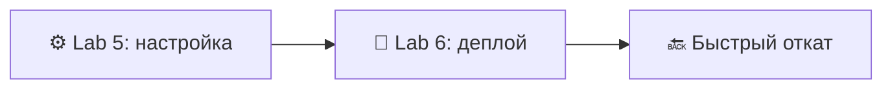
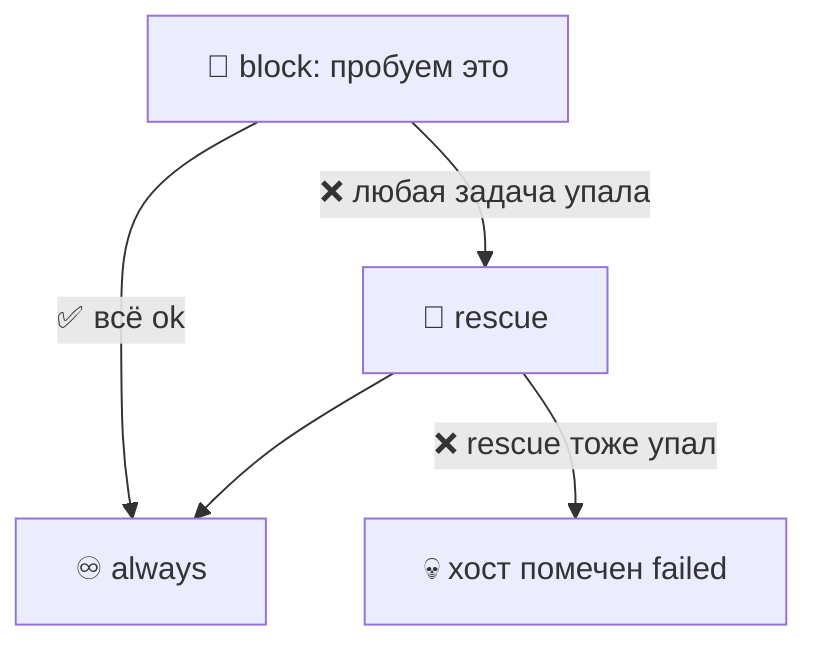
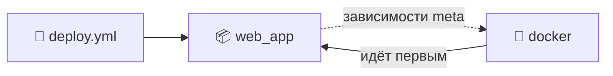
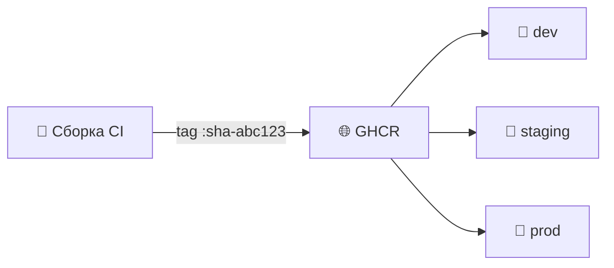
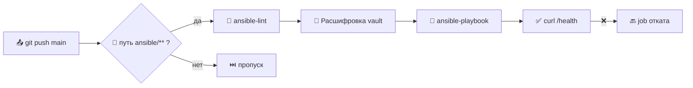
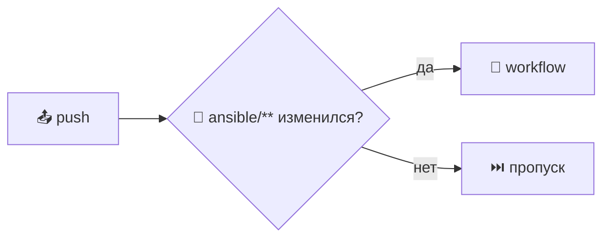
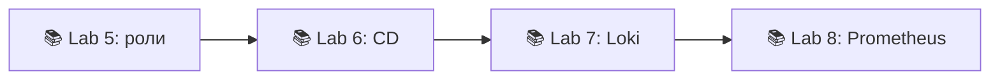

# 📌 Lecture 6 — Продвинутый Ansible и непрерывный деплой

## 📍 Slide 1 – 🚀 Добро пожаловать в непрерывный деплой

* 🧩 Lecture 5 дала вам **playbook, роли, inventory, идемпотентность, базовые модули** — сервер вы уже настраиваете
* 🚀 Сегодня превращаем это в **pipeline деплоя** (цепочка автоматической сборки и выкладки) — push в `main`, приложение на машине, откат за минуты
* 🛠️ Прод-паттерны: `block`/`rescue`/`always`, теги, Docker Compose из шаблонов Jinja2, runner GitHub Actions
* 🎯 Стек на май 2026: **ansible-core 2.21**, **Docker Compose v2**, `community.docker` 4.x



> 🔗 **Связка с Lab 6:** перерабатываете playbook из Lab 5 блоками и тегами, шаблонизируете `docker-compose.yml.j2`, добавляете чистую переустановку `web_app_wipe` и запускаете всё это из GitHub Actions на каждый push в `ansible/**`.

---

## 📍 Slide 2 – 🎯 Результаты обучения

| # | Результат |
|---|---------|
| 1 | 🧱 Использовать `block` / `rescue` / `always` в fail-fast playbook |
| 2 | 🏷️ Спроектировать стратегию тегов под `--tags` и `--skip-tags` |
| 3 | 📝 Шаблонизировать `docker-compose.yml` через Jinja2 и `community.docker.docker_compose_v2` |
| 4 | 🧹 Сделать wipe (полная зачистка) с двойными воротами: переменная + тег |
| 5 | 🤖 Запускать Ansible из GitHub Actions с секретами и фильтрами путей |
| 6 | 🔙 Разбирать rollout: rolling, all-at-once и serial-percentage |

> ⚙️ **Что нужно из Lecture 5:** синтаксис YAML-playbook, раскладка роли (`tasks/`, `handlers/`, `defaults/`, `meta/`), inventory и group_vars, Ansible Vault. Повторять это **не** будем.

---

## 📍 Slide 3 – 🔥 От конфигурации к поставке

Lecture 5 закончилась на: *«сервер настроен — и что дальше?»*

* 📦 Управление конфигурацией отвечает, **что должно стоять**
* 🚀 Непрерывный деплой отвечает, **какая версия работает прямо сейчас**
* 🔄 Тот же движок playbook, другой ритм — provisioning раз в квартал, деплой десять раз в день

> 🔥 **Жёсткий тезис:** если деплой — это Bash-файл, который кто-то гоняет по SSH прямо на машине, автоматизация у вас **для настройки**, но не **для поставки**. Тот же разрыв, что Dev и Ops в Lecture 1.

---

## 📍 Slide 4 – 😱 Ад ручного деплоя

Скрипт, с которого начинает почти каждая команда:

```bash
ssh prod-1
cd /opt/app && git pull
docker stop app; docker rm app
docker pull myorg/app:latest && docker run -d --name app -p 80:8080 myorg/app:latest
```

Почему это ломается на масштабе:

* 🐢 SSH на N хостов по очереди — минуты на деплой, часы на 50 хостах
* 🤷 Нет записи, *что* выехало и *когда* — `:latest` можно перезаписать
* 💥 Сбой на хосте 3: 1 и 2 уже на новом коде, 3–N на старом — **split-brain в проде**
* 🌙 В пятницу деплоить никто не решается: кнопки отката нет

> 📊 DORA 2024: **change failure rate** у low performers — **46–60%**. В основном это плохие ручные деплои, а не плохой код.

---

## 📍 Slide 5 – 🔙 Кошмары отката

Откатить код легко. А вот это:

| 🔥 Риск | 💥 Что взрывается |
|------------|------------------|
| 💾 Миграция базы | Новая схема уже выехала; старый бинарь её не читает |
| ⚙️ Drift конфига | Перезапущенный контейнер подхватывает только новые env |
| 🏷️ Изменяемый тег | `myorg/app:latest` теперь смотрит на сломанную сборку |
| 🔐 Ротация секрета | Новое значение Vault уже подтянуто; откат ловит 403 |

> ⚠️ **Практическое правило:** если откат не укладывается **в 5 минут**, вы не деплоите — вы *коммитите*. Логика wipe из Lab 6 и неизменяемый тег (`docker_tag: 1.2.3`) — нижняя планка.

---

## 📍 Slide 6 – 🧱 Блоки: сгруппировать и поймать ошибку

В Lab 5 списки задач были линейными. `block` собирает задачи под общими директивами **и** даёт обработать сбой.

```yaml
- name: Install Docker engine
  block:
    - ansible.builtin.apt_repository:
        repo: "deb https://download.docker.com/linux/ubuntu jammy stable"
    - ansible.builtin.apt: { name: docker-ce, update_cache: true }
  rescue:
    - name: GPG / mirror flake — retry
      ansible.builtin.apt: { name: docker-ce, update_cache: true }
      retries: 3
      delay: 10
  always:
    - ansible.builtin.systemd: { name: docker, enabled: true }
  become: true
  tags: [docker, docker_install]
```

> 📖 `block` принимает `become`, `when`, `tags`, `vars` — они действуют на каждую задачу внутри. Гораздо чище, чем копировать `become: true` повсюду.

---

## 📍 Slide 7 – 🎯 Семантика block / rescue / always



* 🟢 `block` прошёл → выполняется `always`
* 🔴 задача в `block` упала → выполняется `rescue` → выполняется `always` → хост **идёт дальше**, если rescue успешен
* ⛔ `rescue` тоже упал → хост помечается failed, `always` всё равно выполняется (уборка священна)

> ⚠️ `rescue` — это **не** «игнорировать ошибки». Это «есть план, как подняться». Без rescue playbook останавливается на упавшем хосте.

---

## 📍 Slide 8 – ⚡ Fail-fast или простить

| 🎚️ Стратегия | Когда | Пример |
|--------------|------|---------|
| ❌ **Fail fast** (по умолчанию) | Provisioning, миграции | Упавшая установка Docker обязана остановить прогон |
| 🔄 **Rescue + retry** | Дёрганая сеть, зеркала GPG | Повторить `apt update` через 10 с |
| 😶 `ignore_errors: yes` | Косметическая уборка | `rm /tmp/stale.lock`, если результат не важен |
| 🔁 `until:` + `retries:` | Health-проверки | Ждать до 10 × 6 с, пока `/health` не ответит 200 |

```yaml
- name: Wait for app to come up
  ansible.builtin.uri:
    url: "http://localhost:{{ app_port }}/health"
    status_code: 200
  register: hc
  retries: 10
  delay: 6
  until: hc.status == 200
```

> 🔥 **Антипаттерн:** сыпать `ignore_errors: yes`, чтобы CI позеленел. Деплой только что стал подбрасыванием монетки.

---

## 📍 Slide 9 – 🏷️ Теги: запускайте только нужное

Теги помечают задачи, чтобы в момент запуска брать нужный кусок. Тег вешается на задачу, блок или роль.

```bash
ansible-playbook site.yml --tags "docker,app_deploy"
ansible-playbook site.yml --skip-tags "common"
ansible-playbook site.yml --list-tags
ansible-playbook site.yml --tags "docker" --check     # dry-run
```

* 🏷️ Теги **наследуются** вниз — тег на блоке действует на каждую задачу внутри
* 🔒 Два **особых тега**: `always` (выполняется всегда, пока его не пропустят) и `never` (не выполняется, пока явно не попросят)
* 📦 Роль можно тегировать при импорте: `roles: [{ role: docker, tags: [docker] }]`

> 🔥 **В Lab 6** теги на трёх уровнях — роль, блок, отдельная задача — чтобы `--tags docker_install` попал в нужный кусок и не притащил лишнее.

---

## 📍 Slide 10 – 🗂️ Стратегия тегов, которая не разваливается

Возьмите **три оси тегов** и не отходите от них:

| 🧭 Ось | Имена тегов | Пример |
|---------|-----------|---------|
| 🧩 **Компонент** | `common`, `docker`, `web_app` | `--tags docker` трогает только роль docker |
| 🛠️ **Действие** | `install`, `config`, `deploy`, `wipe` | `--tags deploy` пропускает установку |
| ⚠️ **Ворота риска** | `web_app_wipe`, `db_migrate` | Опасные, только по явному включению |

```yaml
- name: Application deployment
  block: [...]
  tags: [web_app, app_deploy, deploy]

- name: Application wipe
  block: [...]
  when: web_app_wipe | bool
  tags: [web_app, web_app_wipe]   # gated by both when + tag
```

> 📖 **Источник:** документация Ansible — *Tags* и *Common Tagging Patterns*. Чистая таксономия тегов — это деплой на 10 минут, а не на 90.

---

## 📍 Slide 11 – 📝 Jinja2 — слой шаблонов

Модуль `template` рендерит файлы **Jinja2** в момент прогона. В Lecture 5 он промелькнул; Lab 6 на него опирается всерьёз.

```jinja
{# roles/web_app/templates/docker-compose.yml.j2 #}
services:
  {{ app_name }}:
    image: {{ docker_image }}:{{ docker_tag }}
    ports:
      - "{{ app_port }}:{{ app_internal_port }}"
    environment:

      {{ k }}: "{{ v }}"

    restart: {{ restart_policy | default('unless-stopped') }}
```

* `{{ var }}` — подстановка
* `` / `` — ветвление и циклы
* `| default('x')`, `| upper`, `| to_json` — **фильтры**, их цепляют через `|`

> ⚠️ Compose v2 выкинул верхнеуровневое поле `version:`. Если в туториале всё ещё есть `version: '3.8'`, он старше 2023 — не пишите его.

---

## 📍 Slide 12 – 🎛️ Полезные фильтры Jinja2

```yaml
image_tag: "{{ docker_tag | default('latest') }}"
when:      "{{ web_app_wipe | bool }}"            # '-e wipe=true' is a string!
api_key:   "{{ lookup('env', 'API_KEY') | b64encode }}"
```

| 🎛️ Фильтр | Что делает |
|------------|--------------|
| `default(x)` | Запасное значение, если переменная не задана |
| `bool` | Приводит строки `"true"`/`"false"` к bool |
| `to_nice_yaml`, `to_json` | Рендер структурированного конфига |
| `combine(dict2)` | Склеивает два словаря (group_vars + host_vars) |
| `regex_replace(p, r)` | sed в одну строку |

> 📚 Полный список фильтров: `ansible-doc -t filter -l` (идёт в комплекте с ansible-core).

---

## 📍 Slide 13 – 🐳 Docker Compose через Ansible

Берите `community.docker.docker_compose_v2` (Python SDK `docker` плюс плагин Compose — **не** устаревший модуль `docker_compose` v1).

```yaml
- name: Render compose file
  ansible.builtin.template:
    src: docker-compose.yml.j2
    dest: "{{ compose_project_dir }}/docker-compose.yml"
    mode: "0644"

- name: docker compose up -d
  community.docker.docker_compose_v2:
    project_src: "{{ compose_project_dir }}"
    state: present
    pull: always              # always re-pull the tag
    remove_orphans: true
  register: compose_result
```

* 🔌 Коллекция: `ansible-galaxy collection install community.docker`
* 🐍 Нужен `python3-docker` на **цели** (не на управляющем узле)
* ♻️ Идемпотентно — повтор даёт `changed=0`, если отрендеренный файл тот же

> 🔗 **Lab 6 §2.5** проходит весь путь от начала до конца.

---

## 📍 Slide 14 – 🔗 Зависимости ролей (`meta/main.yml`)

Роль может объявить, что должно выполниться раньше. Раскладку роли разобрала Lecture 5; теперь в ход идёт `meta/main.yml`.

```yaml
# roles/web_app/meta/main.yml
---
dependencies:
  - role: docker
    vars:
      docker_users: ["{{ ansible_user }}"]
```



* ✅ `ansible-playbook deploy.yml` с `roles: [web_app]` теперь заодно запускает `docker`
* ⚠️ Зависимости идут **один раз на play**, а не на каждый импорт роли — держите их короткими
* 🚫 Не городите три слоя вложенности: чувство порядка выполнения пропадает быстро

---

## 📍 Slide 15 – 🧹 Логика wipe: зачем и как

**Зачем:** чистая переустановка иногда единственный безопасный откат (битый volume, сломанный кэш, секреты уже ротированы). Кнопка нужна — и она должна быть **за воротами**.

**Паттерн двойных ворот** (Lab 6 §3):

```yaml
# roles/web_app/tasks/wipe.yml
- name: Wipe web application
  block:
    - name: Compose down
      community.docker.docker_compose_v2:
        project_src: "{{ compose_project_dir }}"
        state: absent
    - name: Remove compose dir
      ansible.builtin.file:
        path: "{{ compose_project_dir }}"
        state: absent
  when: web_app_wipe | bool   # gate 1: variable
  tags: [web_app_wipe]        # gate 2: tag
```

| Вызов | Wipe? |
|------------|-------|
| `deploy.yml` | ❌ переменная false, тег не запрошен |
| `deploy.yml --tags web_app_wipe` | ❌ `when` не пускает |
| `deploy.yml -e web_app_wipe=true` | ✅ wipe, **потом** деплой (чистая переустановка) |
| `deploy.yml -e web_app_wipe=true --tags web_app_wipe` | ✅ только wipe |

> 🔥 **Почему не хватает одного тега `never`?** Опечатка в `--tags` всё равно может его включить. Двое независимых ворот: одной опечатки мало, чтобы снести прод.

---

## 📍 Slide 16 – 🌍 Inventory на несколько окружений

Одна роль, разные **group_vars** на каждое окружение.

```
ansible/inventories/
  dev/hosts.ini       group_vars/all.yml   → docker_tag: main
  staging/hosts.ini   group_vars/all.yml   → docker_tag: 1.2.3-rc1
  prod/hosts.ini      group_vars/all.yml   → docker_tag: 1.2.2   # pinned
```

```bash
ansible-playbook -i inventories/staging deploy.yml
ansible-playbook -i inventories/prod    deploy.yml --check    # dry-run prod first
```

* 🎯 **Продвигайте** один и тот же артефакт: dev → staging → prod на тех же ролях и том же образе
* 🔐 Файлы Vault **отдельные на окружение**: утечка в dev не вскрывает prod
* 🚫 Не ветвите playbook условием `inventory_hostname == 'prod'` — ветвите переменными

---

## 📍 Slide 17 – 📦 Как образ идёт по окружениям



* 🏷️ **Один неизменяемый тег** (SHA или SemVer) проходит все окружения — не перетегируйте
* 📌 Пинните `docker_tag` на окружение в group_vars; меняйте его в PR, не по SSH

> 🔥 **Из Lecture 2:** «никогда не деплойте `:latest` в прод». Lab 6 это требует: `docker_tag` обязателен в `group_vars` и проверяется `ansible-lint`.

---

## 📍 Slide 18 – 🤖 Интеграция CI/CD: общая картина



* 🔄 Триггер: push в `main` **или** `workflow_dispatch` для ручного деплоя
* 🧹 Сначала lint — битый YAML на проде это самый глупый простой
* 🚀 Потом `ansible-playbook` на нужный inventory
* ✅ HTTP-проба, прежде чем объявить успех

> 🔗 **Lab 6 §4** пишет `.github/workflows/ansible-deploy.yml` с нуля.

---

## 📍 Slide 19 – 🛠️ Каркас workflow в GitHub Actions

```yaml
# .github/workflows/ansible-deploy.yml
name: Ansible Deploy
on:
  push:
    branches: [main]
    paths: ['ansible/**', '.github/workflows/ansible-deploy.yml']
  workflow_dispatch:

jobs:
  lint:
    runs-on: ubuntu-24.04
    steps:
      - uses: actions/checkout@v4
      - uses: actions/setup-python@v5
        with: { python-version: '3.12' }
      - run: pip install 'ansible-core==2.21.*' ansible-lint
      - run: ansible-lint ansible/

  deploy:
    needs: lint
    runs-on: ubuntu-24.04
    environment: production    # GH approval gate + per-env secrets
    steps:
      - uses: actions/checkout@v4
      - env:
          VAULT: ${{ secrets.VAULT_PASS }}
          SSH:   ${{ secrets.SSH_KEY }}
        run: |
          install -m 600 /dev/stdin ~/.ssh/id_ed25519 <<< "$SSH"
          install -m 600 /dev/stdin /tmp/vault       <<< "$VAULT"
          ansible-playbook -i ansible/inventories/prod \
            ansible/playbooks/deploy.yml --vault-password-file /tmp/vault
```

> 🔧 Зафиксируйте `ansible-core==2.21.*` на семестр, чтобы совпасть с lockfile Lab 5 и 6. (У Ansible-core **нет метки LTS** — пинните ровно тот минор, что в lockfile коллекций.)

---

## 📍 Slide 20 – 🔐 Секреты, OIDC и self-hosted runner

Три уровня работы с секретами, от слабого к сильному:

| 🔐 Уровень | Механизм | Компромисс |
|---------|-----------|-----------|
| 🟡 Секрет репозитория в env | `secrets.SSH_KEY` → `~/.ssh/id_ed25519` | Просто; не печатайте в логи |
| 🟠 GitHub Environment | Секреты на окружение + ручное подтверждение | Нужно для прода; немного ручной работы |
| 🟢 **OIDC + cloud IAM** | Короткоживущие федеративные токены | Долгоживущих ключей нет вообще — так и надо |

```yaml
# OIDC example: assume an AWS role with no static creds
- uses: aws-actions/configure-aws-credentials@v4
  with:
    role-to-assume: arn:aws:iam::123:role/ansible-deploy
    aws-region: eu-central-1
```

* 🖥️ **Self-hosted runner** в сети цели = SSH-ключ не лежит в CI, прогоны быстрее
* ⚠️ Self-hosted runner — это **граница доверия**: не запускайте их на PR из форков

> 🔥 **Жёсткий тезис:** в 2026 долгоживущий SSH-ключ в `secrets.SSH_KEY` — это новый «пароль в репозитории». Берите OIDC там, где цель его умеет.

---

## 📍 Slide 21 – 📁 Фильтры путей: не жгите минуты CI

```yaml
on:
  push:
    paths:
      - 'ansible/**'
      - '!ansible/docs/**'                # exclude docs
      - '.github/workflows/ansible-deploy.yml'
  pull_request:
    paths: ['ansible/**']
```

* ⚡ PR только с доками → деплоя нет, минуты не сгорают
* 🎯 Фильтр путей на **сам файл workflow**: правка файла запускает проверку на себе
* ❗ `paths-ignore` и `paths` вместе нельзя; выберите одно



> 💰 GitHub считает минуты на приватных репозиториях. Команда из 20 человек без фильтров путей легко сжигает в 10 раз больше CI, чем нужно.

---

## 📍 Slide 22 – 🚀 Стратегии деплоя

На N хостов у Ansible одна волшебная ручка: `serial:`.

```yaml
- name: Deploy web tier
  hosts: webservers
  serial: "25%"          # 25% of hosts at a time
  max_fail_percentage: 10  # abort if >10% of a batch fails
  roles: [web_app]
```

| 🚀 Стратегия | `serial:` | Когда |
|-------------|-----------|------|
| 🔄 **Rolling** | `1` или `25%` | Без простоя; балансировщик продолжает выводить хосты |
| 🐤 **Canary** | `1` (только первая пачка, потом пауза) | Проверка на одном хосте, смотрим, идём дальше |
| 💥 **Всё сразу** | не задавать `serial:` | Только dev/staging — на проде это простой |
| 🔵 **Blue/green** | два inventory (`blue`, `green`) + переключение LB | Тяжелее поднять, откат мгновенный |

> 📖 Стратегия Ansible — **push**: ритм задаёт управляющий узел. K8s (Lab 9+) переворачивает модель в pull, но паттерны те же.

---

## 📍 Slide 23 – ✅ Проверка и 🔙 откат

Деплой не закончен, когда `ansible-playbook` вышел с кодом 0. Он закончен, когда **приложение отвечает**.

```yaml
- name: Smoke test
  ansible.builtin.uri:
    url: "http://{{ inventory_hostname }}:{{ app_port }}/health"
    status_code: 200
  register: hc
  retries: 10
  delay: 6
  until: hc.status == 200

- name: Roll back on failure
  community.docker.docker_compose_v2:
    project_src: "{{ compose_project_dir }}"
    state: present
  vars:
    docker_tag: "{{ previous_tag }}"
  when: hc is failed
```

**Чеклист отката:**
* 🏷️ Предыдущий неизменяемый тег снят **до** деплоя (факт `previous_tag`)
* 💾 Миграции БД совместимы вперёд ИЛИ откатываются отдельно
* 🔔 На провал проверки стреляет алерт, чтобы человек узнал

> ⏱️ **DORA «failed deployment recovery time»**: elite < 1 ч, low > 1 месяца. Автоматический откат закрывает именно этот разрыв.

---

## 📍 Slide 24 – 🌍 Паттерны из прода

* 🎬 **Netflix Spinnaker** — версионированный артефакт на каждый коммит; автоматический canary-анализ (open source с 2015)
* 🏦 **Capital One** — Ansible для provisioning ОС, сверху CD контейнеров; один каталог ролей на AWS и on-prem
* 📦 **Shopify** — 30+ деплоев в день через «shipit», на каждом этапе ворота подтверждения
* 🇺🇸 **Red Hat AAP** — Ansible Automation Platform как стандартный слой CD для нагрузок вне K8s
* 🚀 **GitLab Pages** — serial rollout на сотни edge-узлов силами Ansible

> 🔥 **Общая нить:** маленькие, автоматические, наблюдаемые деплои. Квартальный big-bang — пережиток другой эпохи.

---

## 📍 Slide 25 – 🎯 Главное

1. 🧱 **Блоки** группируют задачи и дают `rescue` + `always` — ставьте их на каждой границе ошибок
2. 🏷️ **Теги — это стратегия, не наклейки** — три оси (компонент, действие, риск) держат их в порядке
3. 📝 **Шаблоны Jinja2** превращают одну роль в N приложений через `group_vars` / `vars_files`
4. 🐳 `community.docker.docker_compose_v2` — единственный модуль Compose, который стоит брать в 2026
5. 🧹 **Wipe с двойными воротами** — переменная И тег, никогда что-то одно
6. 🤖 **GitHub Actions и фильтры путей** делают Ansible одной кнопкой — lint, прогон, проверка, откат
7. 🚀 `serial:` и `max_fail_percentage:` — ручка стратегии деплоя

> 💡 **Хороший деплой — маленький, автоматический, наблюдаемый и обратимый.** Три из четырёх всё равно больно.

---

## 📍 Slide 26 – 🚀 Что дальше

**📚 Следующая лекция: *Логи в Loki*** — приложение уже выехало; теперь разберите, что оно сказало.

* 📋 Зачем агрегация логов, как только хостов больше одного
* 🛠️ Архитектура Loki + Promtail + Grafana
* 🔍 LogQL: `{job="web_app"} |= "ERROR"`
* 🧪 Lab 7 выкатывает стек логов теми самыми паттернами Ansible, которые вы только что разобрали



**🔬 Результаты Lab 6, коротко:** роли `common` и `docker` с blocks/rescue/tags; роль `web_app` с `docker-compose.yml.j2` и `community.docker.docker_compose_v2`; `web_app_wipe` с двойными воротами; `.github/workflows/ansible-deploy.yml`, который гоняет lint → deploy → verify.

**👋 До встречи в Lecture 7.**

---

## 📚 Материалы

* 📕 *Continuous Delivery* — Jez Humble, David Farley (2010) — канонический текст
* 📕 *Ansible for DevOps* — Jeff Geerling (издание 2024; ansible-core уже на 2.21, паттерны те же)
* 🌐 [Блоки Ansible](https://docs.ansible.com/ansible/latest/user_guide/playbooks_blocks.html)
* 🌐 [Теги Ansible](https://docs.ansible.com/ansible/latest/user_guide/playbooks_tags.html)
* 🌐 [`community.docker.docker_compose_v2`](https://docs.ansible.com/ansible/latest/collections/community/docker/docker_compose_v2_module.html)
* 🌐 [GitHub Actions: фильтры `paths`](https://docs.github.com/en/actions/using-workflows/triggering-a-workflow#using-filters)
* 🌐 [GitHub OIDC для облачных деплоев](https://docs.github.com/en/actions/deployment/security-hardening-your-deployments/about-security-hardening-with-openid-connect)

> 🎓 Квиз после лекции попадает в окно таблицы лидеров недель 4–6.
