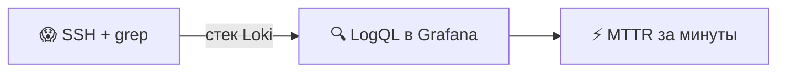
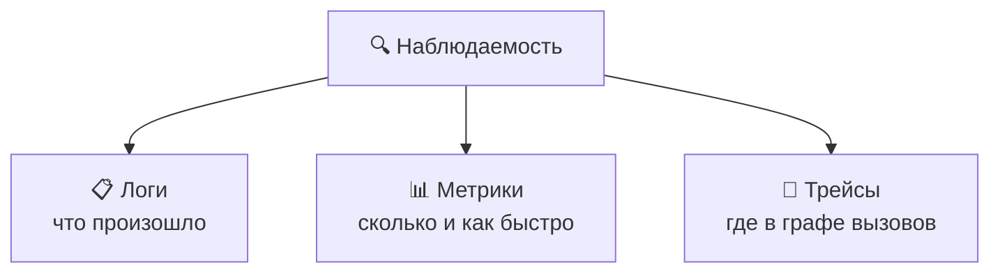
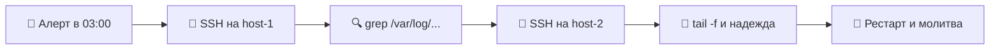
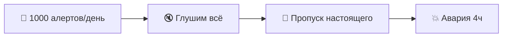
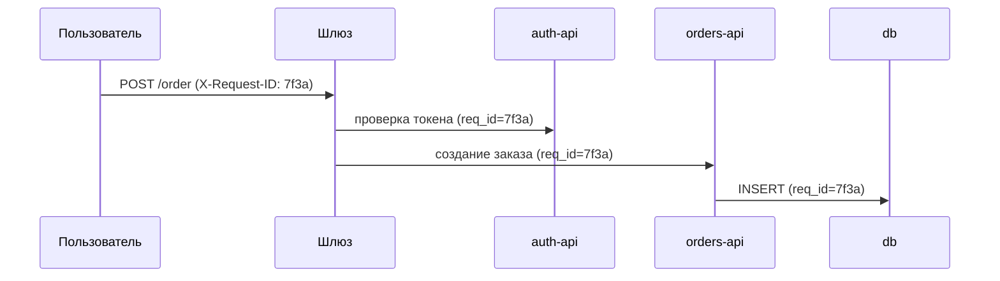
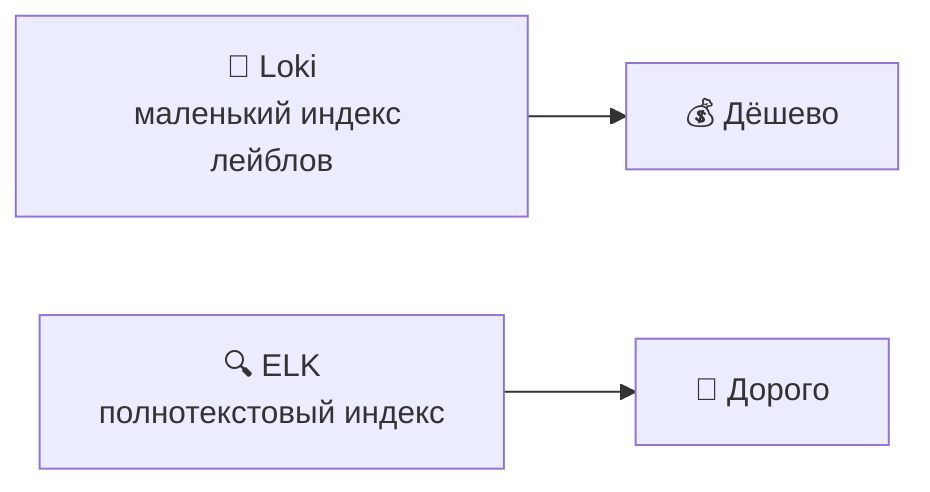
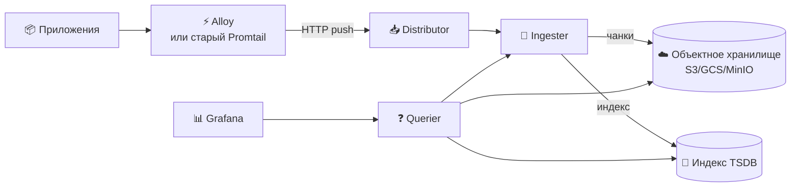
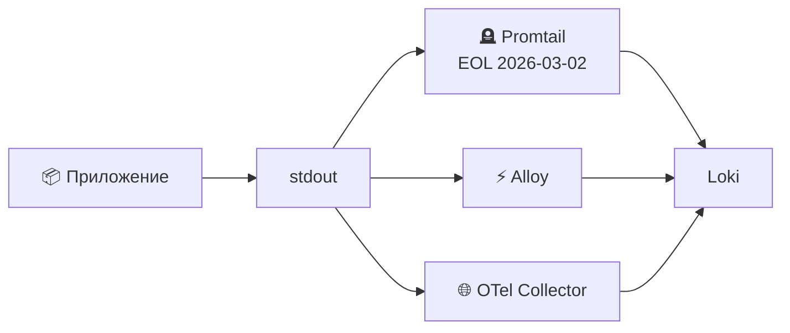
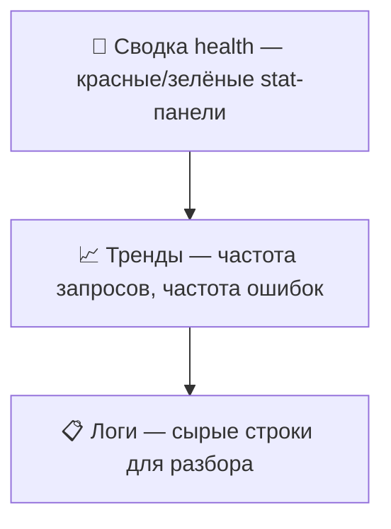
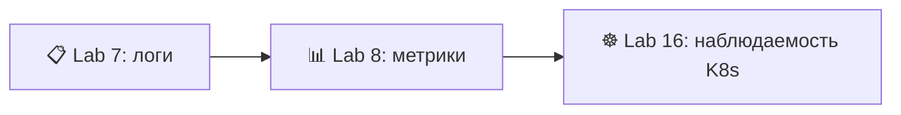

# 📌 Lecture 7 — Наблюдаемость и логирование: от работы вслепую к ясности

## 📍 Slide 1 – 🔍 Добро пожаловать в наблюдаемость

* 🌍 **Приложение работает в проде** — но вы правда знаете, что оно делает?
* 😰 Lecture 1 назвала режим отказа: **Сценарий 4 — слепые операции** (пользователи пишут в Twitter, метрик нет, логов нет, рестарт от безысходности)
* 🔧 Эта лекция **чинит это**: централизованные логи, запрос за секунды
* 🎯 Сегодня: выкатываем стек Loki и учимся спрашивать логи прода



> 🔗 **Связка с Lab 7:** вы выкатите Loki 3.7 + **Grafana Alloy** + Grafana 13 через docker-compose, отправите JSON-логи из Python-приложения Lab 1 и соберёте дашборд из 4 панелей. (Promtail сохранён на слайдах 14–15 ниже как исторический контекст — он достиг **End-of-Life (снят с поддержки) March 2, 2026**.)

---

## 📍 Slide 2 – 🎯 Чему научитесь

| # | Результат |
|---|---------|
| 1 | 🧠 Отличить три столпа: **логи, метрики, трейсы** — и зачем каждый |
| 2 | 🔍 Объяснить, как Loki индексирует **лейблы**, а не полный текст, и почему от этого зависит цена |
| 3 | 📝 Писать **структурированные JSON-логи** с correlation ID из Python-сервиса |
| 4 | 🛠️ Писать в **LogQL** селекторы потоков, фильтры строк и запросы по диапазону |
| 5 | 📊 Собрать в Grafana дашборд логов: один операционный вопрос на панель |

**Стек зафиксирован на May 2026:**
* 💾 **Loki 3.7** (3.0 вышел May 2024; в 3.x устаканилась схема TSDB v13)
* 📊 **Grafana 13** (13.0.1+security-01, вышел May 12 2026)
* ⚡ **Grafana Alloy 1.16.1** (May 6 2026) — канонический агент; **для новых deployment берите его**
* 🪦 **Promtail** достиг **End-of-Life March 2, 2026**. На старых установках ещё работает, исправлений больше нет. Слайды 14–15 — только контекст.

---

## 📍 Slide 3 – 🧱 Три столпа наблюдаемости



| 📊 Столп | 🎯 Вопрос | 🛠️ В этом курсе |
|-----------|------------|----------------|
| 📋 **Логи** | *Какое событие случилось?* | **Lecture 7 + Lab 7** (Loki) |
| 📊 **Метрики** | *Сколько / как быстро / как часто?* | Lecture 8 + Lab 8 (Prometheus) |
| 🔗 **Трейсы** | *Где в запросе ушло время?* | Вне трека Core — факультатив SRE-Intro |
| ☸️ **Взгляд из K8s** | *Все три на кластере* | Lectures 15–16, Lab 16 |

> 📖 **Charity Majors** (сооснователь Honeycomb, *Observability Engineering*, 2022): *«Наблюдаемость — это умение задавать системе новые вопросы, не выкатывая новый код.»*

---

## 📍 Slide 4 – 🙈 Проблема видимости

Без централизованных логов отладка выглядит так:



* 📁 У каждого хоста свои файлы логов, свой формат и своя ротация
* 🔍 Склеить один запрос через три сервиса — три SSH-сессии
* 📅 Логи старше окна ротации просто **исчезают** — ровно когда они нужны
* 💀 Пока найдёте нужную строку, инцидент уже длится лишний час

> 🔥 **Сверка с реальностью (DORA 2024):** элитные команды поднимают сервис меньше чем за 1 час. На SSH + grep так не выйдете.

---

## 📍 Slide 5 – 🚨 Усталость от алертов и «у меня работает»

Две болезни, из-за которых нужна наблюдаемость, а не ещё дашборды:

**1. Усталость от алертов** — 200 предупреждений в день, и каждое ложное. Настоящие аварии заглушают.

**2. «У меня работает»** — пользователи говорят, что приложение тормозит, команда не воспроизводит, данных нет, спор не закрыть. Дальше часы отладки наугад.



> 📖 **Cindy Sridharan**, *Distributed Systems Observability* (O'Reilly, 2018): лекарство — **структурированные данные с высокой кардинальностью**, которые режете по месту, а не ещё пачка заранее заготовленных алертов.

---

## 📍 Slide 6 – 💸 Цена полёта вслепую

| 🔥 Симптом | 💥 Цена |
|-----------|---------|
| 🐢 Медленная отладка | MTTR 4+ часа, эскалации, сорванные SLO |
| 📋 Нет склейки между сервисами | Аварии микросервисов разбирают днями |
| 👉 Нет данных → культура виноватых | Сеньоры уходят |
| 🙈 Тихие сбои | Проблема всплывает, только когда клиент пишет в Twitter |

**📈 Конкретный ориентир (DORA 2024 + книга Google SRE):**
* MTTR без наблюдаемости: типично **4+ часа**
* MTTR со стеком класса Loki: **меньше 30 минут**
* Свой Loki на объектном хранилище: **единицы долларов в месяц** на десятки ГБ в день

> 🔥 **Жёстко:** наблюдаемость — самая дешёвая страховка в стеке. Одна предотвращённая авария окупает её за **секунды**.

---

## 📍 Slide 7 – 💡 Наблюдаемость ≠ мониторинг

Различие, которое разогнали Charity Majors и команда Honeycomb:

| ❓ Вопрос | 📊 Мониторинг | 🔍 Наблюдаемость |
|------------|---------------|------------------|
| На какой вопрос отвечает | *«Система жива?»* | *«Почему система делает это?»* |
| Какие сбои покрывает | **Известные известные** (заранее заданные алерты) | **Неизвестные неизвестные** (новые проблемы) |
| Форма данных | Временные ряды с низкой кардинальностью | Структурированные события с высокой кардинальностью |
| Алерты проектируете под… | Конкретные режимы сбоя | SLO |

> 💬 **Charity Majors:** *«Мониторинг — для известных неизвестных. Наблюдаемость — для неизвестных неизвестных.»*

**🎯 Что из этого следует:** здоровый стек делает и то и другое. Алерты Prometheus (Lecture 8) закрывают известное. Loki и структурированные логи дают копать неизвестное.

---

## 📍 Slide 8 – 📝 Зачем структурированные логи (JSON)

**❌ Неструктурированные — записал и забыл:**
```
2026-04-15 10:23:45 ERROR Connection to database failed on server-1 for user alice (req=7f3a)
```

Фильтр по `user=alice` — регулярка. Сводка по хосту — регулярка ещё хуже.

**✅ Структурированные (JSON) — можно запросить:**
```json
{"ts":"2026-04-15T10:23:45Z","level":"ERROR","service":"user-api",
 "msg":"db connection failed","user":"alice","host":"server-1","req_id":"7f3a"}
```

Теперь `level="ERROR" and user="alice"` — одно условие LogQL. Ошибки по хостам — одна строка.

> 🔥 **Правило:** если логи чаще читает человек, а не машина, вы уже проиграли. Логи — API для вас, будущего дежурного.

---

## 📍 Slide 9 – 🔗 Correlation ID — один запрос, много сервисов

Один клик пользователя задевает 5+ сервисов. Без correlation ID (сквозной id запроса) его не проследить по потокам логов.



**Схема:**
1. 🆔 Шлюз генерирует UUID на каждый входящий запрос → заголовок `X-Request-ID`
2. 📨 Каждый вызов дальше передаёт заголовок
3. 📝 Каждая строка лога пишет ID полем JSON
4. 🔍 В Grafana: `{service=~".+"} | json | req_id="7f3a"` → весь запрос, по порядку

> 📖 В спецификации OpenTelemetry это `traceparent` — та же идея, уже как стандарт.

---

## 📍 Slide 10 – ⚡ Loki против ELK: почему для логов победил Loki

Классический стек логов — Elasticsearch + Logstash + Kibana — индексирует **каждое слово** каждого лога. Это дорого.

| 📊 Аспект | 💾 Loki | 🔍 ELK |
|-----------|---------|--------|
| Индекс | **Только лейблы** (service, env, level…) | **Полный текст** каждой строки |
| Хранение | Дешёвое объектное хранилище (S3/GCS/MinIO) | Локальный SSD под горячий индекс |
| Цена при 100GB/day | ~$10–30/mo | ~$500–2000/mo |
| Язык запросов | LogQL (в стиле Prometheus) | Lucene |
| Лучше всего для | Cloud-native, от лейблов | Разбор по свободному тексту |



> 💬 **Формулировка Grafana Labs (2019):** *"Like Prometheus, but for logs."* («Как Prometheus, но для логов.») — те же лейблы, та же модель федерации, тот же удобный querier.

---

## 📍 Slide 11 – 🏗️ Архитектура Loki



* 📥 **Distributor** — принимает push, проверяет, раздаёт по ingester
* 💾 **Ingester** — держит буфер в памяти, сбрасывает сжатые чанки в объектное хранилище
* ❓ **Querier** — отвечает на LogQL: читает индекс TSDB, потом забирает нужные чанки
* 📇 **Индекс TSDB** (по умолчанию с Loki 3.0, схема v13) — маленький, быстрый, заменяет старый boltdb-shipper

> 🔧 **Два режима deployment:** *single-binary* (один контейнер, тянет до ~100GB/day — так делает Lab 7) и *microservices* (каждый компонент масштабируется сам — прод на объёме).

---

## 📍 Slide 12 – 🏷️ Лейблы: единственное, что нельзя промахнуть

Loki индексирует по **лейблам**. Каждая уникальная комбинация лейблов = один **поток**. Каждый поток ест место в индексе и память.

**✅ Хорошие лейблы — низкая кардинальность:**
* `service="user-api"` (десятки сервисов)
* `env="prod"` (3 значения)
* `level="ERROR"` (5 значений)

**❌ Плохие лейблы — высокая кардинальность:**
* `user_id="12345"` (миллионы пользователей → **миллионы потоков** → OOM у ingester)
* `request_id="7f3a..."` (один на запрос → сразу коллапс)
* `trace_id`, `email`, `path` с id внутри…

> 🔥 **Правило:** если значение уникально на запрос или на пользователя, **ему место в строке лога, не в лейбле.** В запросе пишите `| json | user_id="12345"`.

```logql
# ✅ Good — small label set, filter on parsed JSON field
{service="user-api", env="prod"} | json | user_id="12345"
```

---

## 📍 Slide 13 – ⚙️ Конфиг Loki single-binary (база Lab 7)

```yaml
# loki/config.yml — Loki 3.7, schema v13, single-binary
auth_enabled: false

server:
  http_listen_port: 3100

common:
  path_prefix: /loki
  storage:
    filesystem:
      chunks_directory: /loki/chunks
      rules_directory: /loki/rules
  replication_factor: 1
  ring:
    kvstore: { store: inmemory }

schema_config:
  configs:
    - from: 2024-01-01
      store: tsdb              # 🚀 Replaces boltdb-shipper
      object_store: filesystem # 🪣 Swap to s3/gcs in production
      schema: v13              # 📐 Latest stable
      index: { prefix: index_, period: 24h }

limits_config:
  retention_period: 168h       # 🗓️ 7 days

compactor:
  working_directory: /loki/compactor
  retention_enabled: true      # ⚠️ Required when retention is set
```

> ⚠️ **Частая ловушка:** `retention_period` без блока `compactor` = логи на самом деле не удаляются. Loki молча игнорирует лимит.

---

## 📍 Slide 14 – 🔧 Alloy, Promtail и OTel Collector

**Три способа слать логи в Loki в 2026:**

| Агент | Статус (May 2026) | Когда брать |
|-------|-------------------|--------------|
| ⚡ **Grafana Alloy 1.16.1** | **Канонический агент** — Promtail + агент Prometheus + OTel в одном бинарнике | **Все новые deployment** (включая Lab 7); все три столпа из одного агента |
| 🪦 **Promtail 3.x** | **End-of-Life March 2, 2026** — релизов больше нет, security-исправлений тоже | Старые установки, которые ещё не мигрировали; чтобы читать legacy-конфиги |
| 🌐 **OpenTelemetry Collector** | Нейтральный стандарт CNCF | Несколько бэкендов (Loki + Datadog + …), плюс трейсы |



> 🔗 **Lab 7 идёт через Alloy**, потому что Promtail больше не сопровождают. Конфиг Promtail на следующем слайде оставлен, чтобы читать и мигрировать уже стоящие deployment — но **новый Promtail в 2026 не поднимайте**.

---

## 📍 Slide 15 – 🪦 Конфиг Promtail (legacy / исторический контекст)

> ⚠️ **Promtail в EOL с March 2, 2026.** Слайд оставлен, чтобы читать живые конфиги в проде и переносить их на Alloy. Новый Promtail **не** поднимайте.

```yaml
# promtail/config.yml — LEGACY, see Alloy slide for the modern equivalent
server:
  http_listen_port: 9080

positions:
  filename: /tmp/positions.yaml  # 📍 Resume reading after restart

clients:
  - url: http://loki:3100/loki/api/v1/push

scrape_configs:
  - job_name: docker
    docker_sd_configs:
      - host: unix:///var/run/docker.sock
        refresh_interval: 5s
        filters:
          - name: label
            values: ["logging=promtail"]   # 🏷️ Opt-in via container label
    relabel_configs:
      - source_labels: ['__meta_docker_container_label_app']
        target_label: 'app'
      - source_labels: ['__meta_docker_container_name']
        regex: '/(.*)'
        target_label: 'container'
```

* 📍 **`positions`** — переживает рестарт, чтобы не отправить одно и то же дважды
* 🐳 **Docker SD** — сам находит любой контейнер с лейблом `logging=promtail`
* 🏷️ **Relabel** — поднимает Docker-лейблы в лейблы Loki (кардинальность под контролем)

**Миграция на Alloy** (`config.alloy`, синтаксис River — именно его отдаёт Lab 7):

```hcl
discovery.docker "containers" {
  host             = "unix:///var/run/docker.sock"
  refresh_interval = "5s"
  filter { name = "label" values = ["logging=alloy"] }
}

loki.source.docker "containers" {
  host    = "unix:///var/run/docker.sock"
  targets = discovery.docker.containers.targets
  forward_to = [loki.write.default.receiver]
}

loki.write "default" {
  endpoint { url = "http://loki:3100/loki/api/v1/push" }
}
```

> 🔁 Те же три шага (discover → scrape → push), но Alloy из одного бинарника говорит и на Prometheus, и на OTel.

---

## 📍 Slide 16 – 🔍 LogQL, часть 1: селекторы потоков и фильтры строк

У LogQL две половины: **log-запросы** (возвращают строки логов) и **metric-запросы** (возвращают числа из логов).

**Анатомия:**
```logql
{service="user-api", env="prod"}    |= "error"   != "healthcheck"   |~ "5\\d\\d"
└── stream selector ──────────────┘ └─ contains ┘ └─ excludes ────┘ └─ regex ─┘
```

| 🔧 Оператор | 🎯 Смысл |
|-------------|-----------|
| `{label="v"}` | Точное совпадение лейбла |
| `{label=~"re"}` | Лейбл по регулярке |
| `\|= "x"` | Строка содержит `x` |
| `!= "x"` | Строка **не** содержит `x` |
| `\|~ "re"` | Строка совпадает с регуляркой |
| `!~ "re"` | Строка не совпадает с регуляркой |

> 💡 **Фильтры идут слева направо.** Сначала самый дешёвый и самый узкий — он срезает данные, которые иначе жевали бы остальные.

---

## 📍 Slide 17 – 🔍 LogQL, часть 2: парсеры и фильтры по полям

Когда логи — JSON, поля можно вытащить и фильтровать по ним:

```logql
# Parse JSON, keep only ERRORs from one user
{service="user-api"} | json | level="ERROR" | user_id="alice"

# logfmt instead (key=value lines)
{service="proxy"} | logfmt | status >= 500

# Format the output line
{service="user-api"} | json | line_format "{{.level}} {{.user_id}} {{.msg}}"
```

| 🔧 Стадия | 🎯 Зачем |
|----------|-----------|
| `\| json` | Разобрать JSON → поля можно фильтровать |
| `\| logfmt` | Разобрать формат `key=value` |
| `\| regexp "..."` | Вытащить именованными группами |
| `\| line_format "..."` | Переписать показанную строку |
| `\| label_format` | Переписать или добавить лейблы после запроса |

> 🔥 **Высокая кардинальность без боли:** `user_id` живёт в теле JSON (не в лейблах), Loki его не индексирует — но в момент запроса фильтр по нему работает.

---

## 📍 Slide 18 – 📊 LogQL, часть 3: метрики из логов

Агрегации по диапазону превращают потоки во временные ряды — самое то для графиков Grafana и правил алертов.

```logql
# 📈 Request rate per service (logs/sec)
sum by (service) (rate({env="prod"} [1m]))

# 📈 Error rate per service
sum by (service) (rate({env="prod"} |= "ERROR" [1m]))

# 🥧 Distribution of log levels
sum by (level) (count_over_time({env="prod"} | json [5m]))

# 🐢 P95 latency from JSON field
quantile_over_time(0.95,
  {service="user-api"} | json | unwrap duration_ms [5m])
```

| 🔧 Функция | 🎯 Когда |
|-------------|-------------|
| `rate([range])` | Строк в секунду |
| `count_over_time([range])` | Всего за окно |
| `bytes_rate([range])` | Байт/с (контроль стоимости) |
| `quantile_over_time(q, ...)` | P50/P95/P99 из числовых полей |

---

## 📍 Slide 19 – 🐍 Структурированные логи в Python

**Python-приложение из Lab 1** получает одно улучшение — вывод в JSON. Два нормальных пути:

```python
# Option A — python-json-logger (drop-in, no app changes)
import logging
from pythonjsonlogger.json import JsonFormatter

handler = logging.StreamHandler()
handler.setFormatter(JsonFormatter(
    "%(asctime)s %(levelname)s %(name)s %(message)s",
    rename_fields={"asctime": "ts", "levelname": "level"},
))
logging.basicConfig(level=logging.INFO, handlers=[handler])
logging.info("user login", extra={"user_id": 12345, "req_id": "7f3a"})
```

```python
# Option B — structlog (richer, context vars, recommended for new code)
import structlog
log = structlog.get_logger()
log.info("user login", user_id=12345, req_id="7f3a", path="/login")
# → {"event": "user login", "level": "info", "user_id": 12345, ...}
```

> 🔗 **Результат Lab 7:** добавьте JSON-логи в сервис из Lab 1. Логируйте старт, каждый HTTP-запрос (метод, путь, статус, IP клиента) и каждую ошибку. Тесты проходят, когда `curl localhost:8000/health` даёт JSON-строку в `docker logs`.

---

## 📍 Slide 20 – 📊 Принципы дашбордов Grafana

Дашборд отвечает на **один вопрос** для **одной аудитории**. Не сжимается в одно предложение — делите.



* 🎯 **Один вопрос на дашборд** — *«user-api здоров?»*, а не *«Покажи всё.»*
* 🚦 **Stat-панели сверху** — красный/зелёный, считывается за 2 секунды
* 📈 **Временные ряды посередине** — контекст для цифр
* 📋 **Панель логов снизу** — сырые строки, то же окно времени
* 🔁 **Переменные** `$service` и `$env` — один дашборд, много окружений

> 📖 *«Иерархия визуальной коммуникации»* — закон Тафти на практике: самые важные данные забирают больше пикселей и самый яркий цвет.

---

## 📍 Slide 21 – 📊 Четыре панели Lab 7 (LogQL)

Дашборд Lab 7 несёт четыре панели под самые частые вопросы:

```logql
# 1️⃣ Logs panel — recent activity, all your apps
{app=~"devops-.*"}

# 2️⃣ Request rate (time series) — traffic per app
sum by (app) (rate({app=~"devops-.*"} [1m]))

# 3️⃣ Errors only (logs panel) — drill into failures
{app=~"devops-.*"} | json | level="ERROR"

# 4️⃣ Level distribution (pie) — health at a glance
sum by (level) (count_over_time({app=~"devops-.*"} | json [5m]))
```

| Панель | Визуализация | Отвечает |
|-------|---------------|---------|
| 1 | Логи | *«Что происходит прямо сейчас?»* |
| 2 | Временной ряд | *«Насколько мы загружены?»* |
| 3 | Логи | *«Что сломалось?»* |
| 4 | Круговая / Stat | *«Насколько приложение шумное?»* |

> 🔗 **Нужно доказательство:** скриншот всех четырёх панелей с живыми данными от циклов `curl` в ваше приложение.

---

## 📍 Slide 22 – 🏭 Что учесть в проде

Loki single-binary на ноутбуке — это Lab 7. В проде нужно принять ещё четыре решения:

| 🔧 Решение | 🪜 В лабе | 🏭 В проде |
|-------------|----------------|---------------|
| 💾 Хранение | `filesystem` | **S3 / GCS / MinIO** — дёшево, надёжно, масштаб сам по себе |
| 👥 Тенантность | `auth_enabled: false` | **Мультитенантность** с заголовком `X-Scope-OrgID`; команды изолированы |
| 🗓️ Срок хранения | 168h (7 дней) | **По уровням** — 30 дней для INFO, 1 год для логов security и аудита |
| 📦 Топология | Один бинарник | **Режим microservices** — distributor, ingester, querier масштабируются по отдельности |
| 🔐 Доступ | Нет | **OIDC / mTLS** на краю Grafana плюс заголовок тенанта Loki |
| 💰 Защита от расходов | Нет | **Лимиты скорости и квоты приёма** на тенанта |

> ⚠️ **Ловушка по деньгам:** безлимитный объём логов — способ №1 сжечь бюджет на наблюдаемость. С первого дня поставьте на тенанта `ingestion_rate_mb` и `max_streams_per_user`.

---

## 📍 Slide 23 – 🌍 Как логируют в настоящих компаниях

* 🎬 **Netflix** — Atlas для метрик, **Mantis** и своя платформа логов; тысячи микросервисов льют структурированные события
* 🦄 **GitHub** — Splunk для security-аудита и Loki для логов приложений (вместе ~PB/месяц)
* 🚀 **SpaceX** — *«telemetry-everything»* (телеметрия на всё) — каждый пуск льёт ~3,000 каналов датчиков в хранилище временных рядов
* 🏦 **Stripe** — структурированные логи это API; каждая строка — JSON-событие со стабильной схемой, им пользуются и дата-сайентисты, и дежурные
* 🎮 **Riot Games** — Loki + Grafana для телеметрии игровых сессий, 100M+ активных в месяц
* 📦 **Spotify** — Loki принимает ~1.5PB в месяц, мультитенантность по сквадам

> 🔥 **Общее:** все пишут **структурированный JSON** с **correlation ID** и держат логи запрашиваемым источником, а не свалкой для отладки.

---

## 📍 Slide 24 – 🎯 Что забрать с собой

1. 🔍 **Наблюдаемость = логи + метрики + трейсы.** Эта лекция — про логи. Lecture 8 — про метрики.
2. 📝 **Нет структурированного JSON — это не логи**, а дневник, по которому нельзя искать.
3. 🆔 **Correlation ID** сшивает один запрос через много сервисов. Генерируйте на краю, прокидывайте везде.
4. 🏷️ **Loki индексирует лейблы, не текст.** Кардинальность лейблов держите низкой. Поля с высокой кардинальностью живут в теле JSON, а `| json` — в момент запроса.
5. 🛠️ **LogQL** = селектор потока → фильтр строки → парсер → функция метрики. Сначала самый дешёвый фильтр.
6. 📊 **Дашборд отвечает на один вопрос** для одной аудитории. Красный/зелёный сверху, сырые логи снизу.
7. ⚡ **Promtail в EOL (March 2, 2026), канонический агент — Alloy.** На каждый новый deployment берите Alloy 1.16.1+; OTel Collector — когда бэкендов несколько.

> 💡 **Нельзя починить то, чего не видишь. Сегодня у прода появились глаза.**

---

## 📍 Slide 25 – 🧠 Сдвиг в голове

| 😰 Раньше | 🔍 С наблюдаемостью |
|-------|---------------|
| 🔌 «SSH и grep» | 📊 «Открыть Grafana и LogQL» |
| 📁 «Посмотри логи на server-3» | 🌐 «Все логи, одно место, один запрос» |
| 👉 «Наверное, база» | 📊 «Данные показывают: это слой кэша» |
| 😨 «Отладка занимает часы» | ⚡ «Корневая причина за 5 минут» |
| 💻 «У меня работает» | 📋 «Прод говорит иначе — вот строка лога» |

> ❓ Какой столбец про последний разбор инцидента у вашей команды?

---

## 📍 Slide 26 – 🚀 Что дальше

**📚 Следующая лекция: *Мониторинг с Prometheus*** — столп метрик.

* 📊 Почему метрики во временных рядах дополняют логи (и где кто сильнее)
* 🔢 PromQL — та же модель запроса, что вы только что видели в LogQL, только для чисел
* 📈 Инструментирование Python-приложения через `prometheus_client` (counter, histogram, gauge)
* 🚨 Правила алертов: пороги, длительности и burn rate в духе SLO
* 📊 Дашборд Prometheus + Grafana для сервиса из Lab 1

**🔬 Lab 7:** выкатите Loki 3.7 + Grafana Alloy 1.16.1 + Grafana 13 через docker-compose, добавьте JSON-логи в Python-приложение из Lab 1, соберите дашборд из 4 панелей, укрепите под прод (лимиты ресурсов, health-проверки, Grafana без анонимного доступа). Бонус 2.5 балла: автоматизируйте всё ролью Ansible из Lab 6.



**👋 До встречи в Lecture 8.**

---

## 📚 Материалы и что почитать

**📕 Книги:**
* *Observability Engineering* — Charity Majors, Liz Fong-Jones, George Miranda (O'Reilly, 2022). Главный справочник.
* *Distributed Systems Observability* — Cindy Sridharan (O'Reilly, 2018). Бесплатный PDF на humio.com.
* *Site Reliability Engineering* — Beyer et al. — главы 10–12 про философию мониторинга. Бесплатно на sre.google/books.

**🔗 Ссылки:**
* 🌐 [grafana.com/docs/loki/latest](https://grafana.com/docs/loki/latest/) — документация Loki 3.x
* 🌐 [grafana.com/docs/alloy/latest](https://grafana.com/docs/alloy/latest/) — Alloy (преемник Promtail)
* 🌐 [Справка по LogQL](https://grafana.com/docs/loki/latest/query/) — все операторы, с примерами
* 🌐 [opentelemetry.io](https://opentelemetry.io) — стандарт наблюдаемости CNCF
* 🌐 [structlog.org](https://www.structlog.org) — библиотека структурированных логов для Python

**🎓 Квиз:** квиз после лекции идёт в окно таблицы лидеров недель 7–9.
