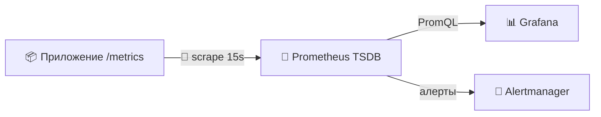
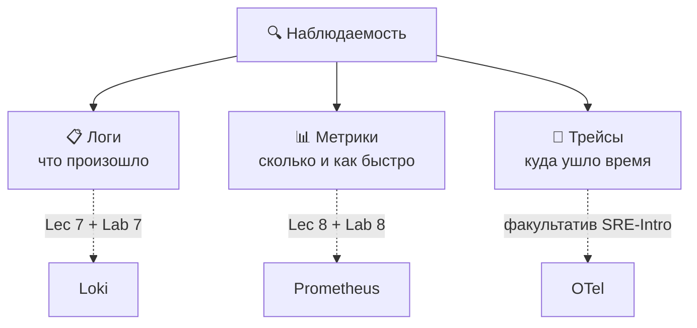
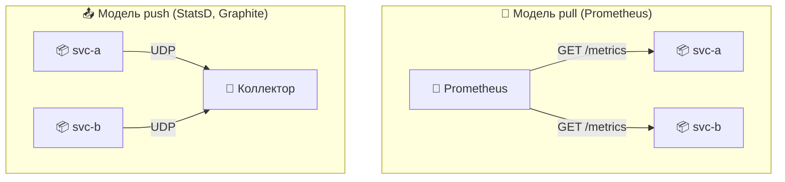
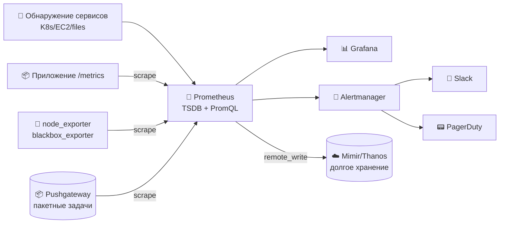
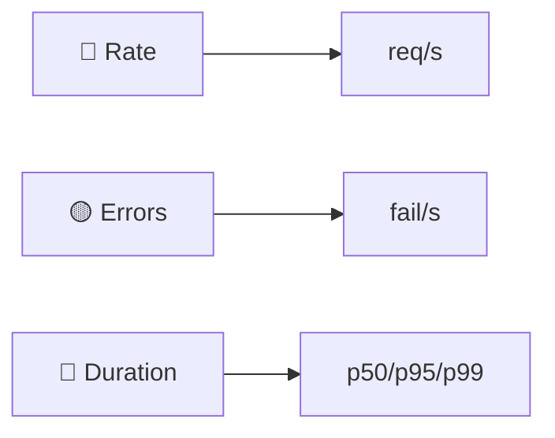
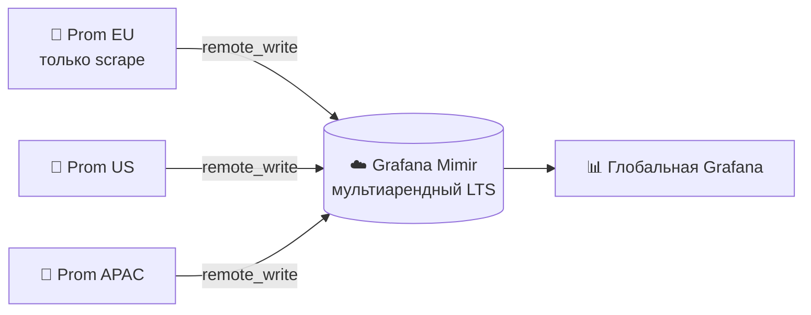
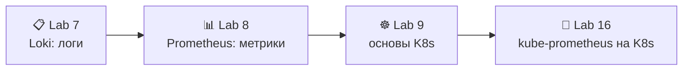

# 📌 Lecture 8 — Метрики и мониторинг с Prometheus: от догадок к измерениям

## 📍 Slide 1 – 📊 Добро пожаловать в столп метрик

* 🌍 **Lecture 7 дала проду глаза — логи.** Эта лекция даёт ему *пульс* — метрики.
* ⏱️ Логи отвечают *«что случилось?»*. Метрики отвечают *«сколько, как быстро, как часто?»* — каждые 15 секунд, всегда.
* 📊 **Prometheus** — стандарт CNCF со статусом graduated для метрик; на нём мониторинг Spotify, GitHub, DigitalOcean и большинства deployment Kubernetes на Земле.
* 🎯 Сегодня: модель scrape, типы метрик, PromQL, методы RED и USE и дашборд, который соберёте в Lab 8.



> 🔗 **Связка с Lab 8:** вы инструментируете Python-приложение из Lab 1 через `prometheus_client`, выкатите Prometheus 3.x + Grafana 13 рядом со стеком Loki с прошлой недели, напишете PromQL для **метода RED** и отдадите дашборд из 6 панелей.

---

## 📍 Slide 2 – 🎯 Чему научитесь

| # | Результат |
|---|---------|
| 1 | 🧠 Выбрать верный тип метрики — **counter, gauge, histogram, summary, native histogram** — под любой сигнал |
| 2 | 🔄 Объяснить, почему Prometheus на **pull**, и что это даёт в эксплуатации |
| 3 | 🐍 Инструментировать Python-сервис через `prometheus_client` и держать **кардинальность лейблов** |
| 4 | 🔍 Писать **PromQL** для rate, перцентилей и агрегаций по сервисам |
| 5 | 📊 Проектировать дашборды вокруг метода **RED** (сервисы) и метода **USE** (ресурсы) |

**Стек зафиксирован на May 2026:**
* 💾 **Prometheus 3.12** (последний стабильный, May 2026) / **3.5 LTS** (поддержка до Jul 31 2026)
* 📊 **Grafana 13.0.1+security-01** (May 12 2026)
* 🐍 **`prometheus_client` 0.23+** для Python (лаба фиксирует 0.23.1; 0.25 — последний)
* 📦 **`prom/prometheus:v3.9.0`** — образ контейнера, который использует Lab 8

> 🆕 **Дефолты Prometheus 3.x** (против 2.x): UTF-8 в именах метрик и лейблов, **native histograms в статусе GA**, встроенный приёмник OTLP, новый протокол remote-write 2.0. Семь feature flags в 3.0 стали поведением по умолчанию.

---

## 📍 Slide 3 – 🧱 Где место метрик (напоминание из Lec 7)



* 📋 **Логи (Loki):** текст без верхней границы, высокая кардинальность, хранятся дни–недели, идеальны для *разбора*
* 📊 **Метрики (Prometheus):** числовые временные ряды, низкая кардинальность, хранятся месяцы, идеальны для *алертов и трендов*
* 🔗 **Трейсы:** разбивка латентности по запросу; вне трека Core, это факультатив SRE-Intro

> 🔥 **Вместе, а не вместо.** Алерт на 5xx из Prometheus поднимает пейдж. Запрос LogQL в Grafana находит stack trace. Трейс показывает, какой вызов дальше по цепочке был медленным. Три столпа, одна Grafana.

---

## 📍 Slide 4 – 💸 Без метрик вы летите вслепую

Одних логов мало на вопросы, которые босс задаёт в 09:00:

* *«Сколько пользователей вчера попало в API?»* — нужен counter.
* *«p95 латентности ползёт от недели к неделе?»* — нужна histogram.
* *«Соединения с базой скоро кончатся?»* — нужен gauge.
* *«Выкатка 20 минут назад изменила долю ошибок?»* — нужен график, не `grep`.

| 🔥 Симптом | 💥 Цена |
|-----------|---------|
| 🐢 Нет базы | Норму не отличить от поломки |
| 📅 Нет тренда | Не предсказать, когда кончится запас |
| 🚨 Нет алертов | Аварию первыми видят пользователи (или Twitter) |
| 🤷 Нет атрибуции | Тормоза микросервисов остаются загадкой |

> 💬 **Brendan Gregg, Netflix:** *«Нельзя оптимизировать то, что не измеряешь, и нельзя измерить то, что не инструментировал.»*

---

## 📍 Slide 5 – 🔄 Pull против Push — почему Prometheus выбрал pull



| 🔧 Аспект | 🔄 Pull | 📤 Push |
|-----------|---------|---------|
| Здоровье цели | **Бесплатно** — неудачный scrape = алерт `up == 0` | Тяжело — тишина ≠ здоровье |
| Кто держит частоту scrape | Это решает Prometheus | Каждое приложение само (хаос) |
| Service discovery | Нативно (K8s, EC2, Consul, файлы) | Приложения должны знать коллектор |
| Направление файрвола | Исходящий от монитора | Входящий на коллектор (часто закрыт) |
| Короткоживущие задачи | ⚠️ Нужен **Pushgateway** | Подходит само |

> 🔥 **Правило:** pull для долгоживущих сервисов; push (через Pushgateway) только для задач в стиле cron, которые кончаются раньше следующего scrape. **Не делайте из Pushgateway прокси метрик** — это костыль только для batch-задач.

---

## 📍 Slide 6 – 🏗️ Архитектура Prometheus



| 🧱 Компонент | 🎯 Роль |
|-------------|---------|
| 💾 **Сервер Prometheus** | Скрейпит, пишет в TSDB, считает правила, отдаёт PromQL |
| 🔌 **Экспортеры** | Переводят системы без Prometheus (Postgres, Redis, Linux) в `/metrics` |
| 🧭 **Service discovery** | Находит цели на лету (API Kubernetes, теги EC2, Consul…) |
| 🚨 **Alertmanager** | Снимает дубли, группирует, маршрутизирует, глушит алерты |
| 📦 **Pushgateway** | Принимает метрики короткоживущих batch-задач (используйте редко) |
| ☁️ **Mimir / Thanos** | Горизонтальный масштаб и мультитенантное долгое хранение (слайд 19) |

---

## 📍 Slide 7 – 🔌 Экспортеры: слой перевода

Сам по себе голый Prometheus запускают редко. Экосистема — десятки **экспортеров**, которые выставляют существующие системы на `/metrics`:

| 🔌 Экспортер | 🎯 Что отдаёт |
|-------------|-----------|
| `node_exporter` | Метрики хоста Linux (CPU, RAM, диск, сеть) |
| `postgres_exporter` | Лаг репликации Postgres, соединения, медленные запросы |
| `redis_exporter` | Операции Redis в секунду, память, keyspace |
| `blackbox_exporter` | Синтетические probe — HTTP/HTTPS/TCP/DNS/ICMP |
| `cAdvisor` | CPU и память по контейнерам (встроен в kubelet) |
| `kube-state-metrics` | Состояние объектов Kubernetes — реплики Deployment, фаза Pod |

* 📦 **Один экспортер на зависимость.** Lab 8 скрейпит Loki и Grafana напрямую (оба отдают `/metrics` сами — экспортер не нужен).
* 🐍 **Для своих приложений:** инструментируйте **клиентской библиотекой** (`prometheus_client` для Python), а не пишите экспортер.

> 💡 **OpenMetrics** — спецификация на треке IETF, выросшая из формата exposition Prometheus. Этот формат понимают все экспортеры и клиентские библиотеки.

---

## 📍 Slide 8 – 📊 Типы метрик: counter

**Counter** только растёт. В ноль падает, когда процесс перезапускается.

```python
from prometheus_client import Counter

http_requests_total = Counter(
    "http_requests_total", "Total HTTP requests",
    ["method", "endpoint", "status"],
)
http_requests_total.labels("GET", "/", "200").inc()
```

**Сам counter почти никогда не запрашивают — берут его `rate()`:**

```promql
# requests per second, last 5 minutes
rate(http_requests_total[5m])

# error rate per endpoint
sum by (endpoint) (rate(http_requests_total{status=~"5.."}[5m]))
```

> ⚠️ **Counter умеет сбрасываться** (рестарт Pod). `rate()` и `increase()` сами обрабатывают сброс — `irate()` и голое вычитание **нет**. Для графиков берите `rate()`.

---

## 📍 Slide 9 – 📊 Типы метрик: gauge

**Gauge** ходит *и* вверх, *и* вниз. Снимок «прямо сейчас».

```python
from prometheus_client import Gauge

queue_depth = Gauge("worker_queue_depth", "Pending jobs")
queue_depth.set(42)
queue_depth.inc()      # +1
queue_depth.dec(5)     # -5
in_flight = Gauge("http_in_flight", "Concurrent requests")
in_flight.track_inprogress()  # context-managed
```

**Шаблоны запросов:**

```promql
# current value across all instances
sum(worker_queue_depth)

# how fast is memory growing? (derivative)
deriv(process_resident_memory_bytes[10m])

# fastest-growing pods
topk(5, rate(container_memory_working_set_bytes[5m]))
```

> 🎯 **Gauge берите для:** активных соединений, глубины очереди, температуры, занятой памяти, текущего числа реплик. **Всё, что умеет уменьшаться.**

---

## 📍 Slide 10 – 📊 Типы метрик: histogram

Counter говорит, *сколько*. Histogram говорит, *как значения разложены* — самое то для **латентности**.

```python
from prometheus_client import Histogram

request_latency = Histogram(
    "http_request_duration_seconds", "Request latency",
    ["method", "endpoint"],
    buckets=(0.005, 0.01, 0.025, 0.05, 0.1, 0.25, 0.5, 1.0, 2.5, 5.0),
)
with request_latency.labels("GET", "/api").time():
    handle_request()
```

**Классическая histogram отдаёт три семейства** временных рядов на набор бакетов:
* `*_bucket{le="0.1"}` — накопленное число наблюдений ≤ 0.1s
* `*_sum` — суммарное время
* `*_count` — всего наблюдений

**Главный запрос — перцентили на стороне сервера:**

```promql
# p95 latency, last 5 minutes
histogram_quantile(0.95,
  sum by (le) (rate(http_request_duration_seconds_bucket[5m])))
```

> ⚠️ **Выбор бакетов решает.** Бакеты, которые не накрывают реальное распределение, дают дико кривые перцентили. Начните с SRE-набора по умолчанию `(.005, .01, .025, .05, .1, .25, .5, 1, 2.5, 5, 10)` и подкрутите по данным прода.

---

## 📍 Slide 11 – ✨ Native histograms (GA в Prometheus 3.x)

**Классические histogram** заставляют заранее выбрать бакеты. Промахнётесь — p99 врёт. **Native histograms** (GA с Prometheus 3.x, стабильны в v3.8) чинят это **экспоненциальными схемами бакетов**, которые выбираются сами.

| 🔧 Аспект | 📊 Классическая histogram | ✨ Native histogram |
|-----------|---------------------|---------------------|
| Бакеты | Руками, на каждую метрику | Сами, экспонента, динамика |
| Временных рядов на метрику | По одному на бакет (10–20) | **Один** |
| Разрешение | Фиксированное | Настраиваемая схема (степени 2) |
| Хранение | Дорого (каждый бакет = ряд) | ~5× дешевле |
| `histogram_quantile()` | Работает | Работает — та же функция |

```python
# Python client (0.23+): opt in by passing `native_histogram_bucket_factor`
Histogram(
    "http_request_duration_seconds", "Latency",
    native_histogram_bucket_factor=1.1,  # ~10% resolution
)
```

> 🆕 **В Prometheus 3.x это включено по умолчанию** (флаг `native-histograms` стал дефолтом в 3.0). Совмещайте свободно: одна метрика может отдавать и классику, *и* native — клиенты договариваются через протокол scrape.

---

## 📍 Slide 12 – 📊 Counter, gauge, histogram, summary

| 📊 Тип | ⬆️⬇️ Поведение | 🎯 Для чего | 🔍 Чем запрашивать |
|---------|----------------|-----------|----------------|
| 🔢 **Counter** | Только вверх (сброс при рестарте) | События: запросы, ошибки, байты | `rate()`, `increase()` |
| 📈 **Gauge** | Вверх и вниз | Состояние: температура, глубина очереди | напрямую, `avg()`, `max()` |
| 📊 **Histogram (классика)** | Несколько временных рядов на метрику | Латентность, размер, длительности | `histogram_quantile()` на сервере |
| ✨ **Native histogram** | Один временной ряд, бакеты сами | То же, что histogram, ~5× дешевле | `histogram_quantile()` — та же функция |
| 📐 **Summary** | Квантили считаются в процессе | Старый способ отдать квантили | Напрямую — но **нельзя агрегировать между инстансами** |

> 🔥 **По умолчанию берите histogram (native, если Prometheus 3.x).** Summary — крайний случай: заранее посчитанные квантили не сливаются между Pod, поэтому всё ломается, как только реплик становится больше одной.

---

## 📍 Slide 13 – 🐍 Инструментируем Python-приложение из Lab 1

Правка в двух файлах, чтобы добавить метрики в сервис на Flask/FastAPI:

```python
# app.py
from prometheus_client import Counter, Histogram, Gauge, generate_latest
from flask import Flask, Response, request
import time

app = Flask(__name__)

REQS = Counter("http_requests_total", "HTTP requests",
               ["method", "endpoint", "status"])
LAT  = Histogram("http_request_duration_seconds", "Latency",
                 ["method", "endpoint"])
INF  = Gauge("http_requests_in_progress", "In-flight requests")

@app.before_request
def _before():
    request._t0 = time.perf_counter()
    INF.inc()

@app.after_request
def _after(resp):
    dur = time.perf_counter() - request._t0
    endpoint = request.url_rule.rule if request.url_rule else "unknown"
    REQS.labels(request.method, endpoint, resp.status_code).inc()
    LAT.labels(request.method, endpoint).observe(dur)
    INF.dec()
    return resp

@app.route("/metrics")
def metrics():
    return Response(generate_latest(), mimetype="text/plain")
```

```txt
# requirements.txt
prometheus-client==0.23.1
```

> 🔗 **Результат Lab 8:** эндпоинт `/metrics` выше плюс одна **бизнес-метрика** (например, `devops_info_endpoint_calls`) — оценка в Task 1.

---

## 📍 Slide 14 – 🏷️ Кардинальность лейблов — способ №1 уложить Prometheus в OOM

Каждая уникальная комбинация лейблов = один **временной ряд**. Ряд стоит ~3–5 KB памяти. Посчитайте.

```python
# ❌ MELT YOUR PROMETHEUS — one series per user, forever
REQS.labels(user_id=u, request_id=r).inc()

# ✅ Use bounded enumerations only
REQS.labels(method="GET", endpoint="/api", status="200").inc()
```

| ✅ Хороший лейбл (есть граница) | ❌ Плохой лейбл (границы нет) |
|------------------------|--------------------------|
| `method` (8 значений) | `user_id` (миллионы) |
| `endpoint` (десятки, нормализован) | `request_id` (один на вызов) |
| `status_code` (~10) | `email`, `path` с id |
| `env="prod"` (3) | `timestamp`, `trace_id` |

**Ориентиры:**
* 📊 **<1000** уникальных комбинаций лейблов на метрику — здорово.
* 🚨 **>100,000** — и до OOM несколько часов.
* 🛡️ Следите за числом рядов через `prometheus_tsdb_head_series` и алертите на рост.

> 🔥 **Правило:** если значение уникально на запрос или на пользователя, **в лейбл ему нельзя**. Тот же урок, что у Loki (Lec 7), тот же радиус поражения.

---

## 📍 Slide 15 – 🔍 PromQL, часть 1: мгновенный вектор и вектор диапазона

Каждое выражение PromQL возвращает один из четырёх типов. Два вы будете использовать постоянно:

```promql
# 🎯 Instant vector — one sample per series, at evaluation time
http_requests_total{status="500"}

# 🎯 Range vector — all samples per series, over a duration
http_requests_total[5m]
```

**Вектор диапазона нельзя нарисовать напрямую** — его надо свернуть функцией (`rate`, `avg_over_time`, …):

```promql
# req/sec averaged over 5-minute windows
rate(http_requests_total[5m])
```

| 🔧 Оператор | 🎯 Смысл |
|-------------|-----------|
| `{label="v"}` / `{label!="v"}` | Точное совпадение / отрицание |
| `{label=~"re"}` / `{label!~"re"}` | Регулярка / регулярка с отрицанием |
| `[5m]`, `[1h]` | Окно назад для вектора диапазона |
| `offset 1h` | Сдвинуть запрос в прошлое |
| `@ 1700000000` | Зафиксировать вычисление на Unix-времени |

> 💡 **Правило:** окно `[Xm]` должно быть ≥ **4× интервала scrape**, чтобы на каждое вычисление хватало семплов. При scrape раз в 15s `[1m]` — минимум, который не врёт.

---

## 📍 Slide 16 – 🔍 PromQL, часть 2: агрегация и rate()

```promql
# Total req/s across the whole fleet
sum(rate(http_requests_total[5m]))

# Per-endpoint req/s (keep that label, sum away the rest)
sum by (endpoint) (rate(http_requests_total[5m]))

# Per-pod req/s, drop a noisy label
sum without (instance) (rate(http_requests_total[5m]))

# Top 5 slowest endpoints (p95)
topk(5,
  histogram_quantile(0.95,
    sum by (endpoint, le) (rate(http_request_duration_seconds_bucket[5m]))))

# Error ratio (5xx as a fraction of total)
sum(rate(http_requests_total{status=~"5.."}[5m]))
  / sum(rate(http_requests_total[5m]))
```

| 🔧 Агрегатор | 🎯 Когда |
|---------------|-------------|
| `sum`, `avg`, `min`, `max` | Сложить ряды |
| `count` | Сколько рядов совпало |
| `topk(N, expr)` / `bottomk` | N самых больших / самых маленьких |
| `quantile(0.5, expr)` | Перцентиль по флоту |
| `group by (l) / without (l)` | Убрать или оставить измерения лейбла |

> ⚠️ **Не усредняйте перцентили.** `avg(histogram_quantile(...))` — математический бред. Всегда `histogram_quantile()` *снаружи* `sum by (le, …)`.

---

## 📍 Slide 17 – 🔍 PromQL, часть 3: recording rules

Некоторые запросы медленные. Некоторые нужны много раз в день. **Recording rules** считают выражение PromQL по расписанию и кладут результат в новую метрику — как материализованное представление.

```yaml
# prometheus.rules.yml
groups:
  - name: app_red
    interval: 30s
    rules:
      - record: job:http_requests:rate5m
        expr: sum by (job) (rate(http_requests_total[5m]))

      - record: job:http_errors:ratio5m
        expr: |
          sum by (job) (rate(http_requests_total{status=~"5.."}[5m]))
            / sum by (job) (rate(http_requests_total[5m]))

      - record: job:http_latency:p95_5m
        expr: |
          histogram_quantile(0.95,
            sum by (job, le) (rate(http_request_duration_seconds_bucket[5m])))
```

* 🏷️ **Имена:** `level:metric:operation` — например, `job:http_requests:rate5m`. Двоеточия здесь нарочно и зарезервированы под recording rules.
* 🚀 **Дашборды остаются быстрыми**, потому что читают уже посчитанный ряд, а не сырые бакеты histogram.
* 🚨 **Правила алертов** используют тот же синтаксис (`alert:` вместо `record:`) и уходят в Alertmanager, когда выражение непустое в течение `for: Xm`.

---

## 📍 Slide 18 – 🔴 Метод RED (Tom Wilkie, Weaveworks, 2015)

**У каждого сервиса на запросах мониторьте три вещи:**

| 🔧 Метрика | 🎯 Вопрос | 📝 PromQL |
|-----------|-------------|------------|
| 🔴 **R**ate | Насколько загружен? | `sum by (svc) (rate(http_requests_total[5m]))` |
| 🟡 **E**rrors | Как часто падает? | `sum by (svc) (rate(http_requests_total{status=~"5.."}[5m]))` |
| 🔵 **D**uration | Насколько медленный? | `histogram_quantile(0.95, sum by (svc, le) (rate(http_request_duration_seconds_bucket[5m])))` |



* 📊 **Почему эти три?** Они прямо про опыт пользователя: *«сервис жив, отвечает верно, отвечает быстро?»*
* 🪞 **Зеркало четырёх золотых сигналов** из книги Google SRE (Rate + Errors + Latency + Saturation) — RED не берёт saturation, это работа метода **USE**.
* 🎯 **Если у сервиса смотрите только три вещи — смотрите эти.**

> 📖 Впервые показал **Tom Wilkie на лондонском митапе Prometheus, 2015**, когда он был в Weaveworks. Сейчас это обычная практика по всему CNCF.

---

## 📍 Slide 19 – 📊 Метод USE (Brendan Gregg, 2012)

**RED** — для сервисов. **USE** — для **ресурсов**: CPU, RAM, диск, сеть, файловые дескрипторы.

| 🔧 Метрика | 🎯 Вопрос | 📝 Пример |
|-----------|-------------|-----------|
| 📊 **U**tilisation | Насколько ресурс занят? | CPU на 80% |
| 🪣 **S**aturation | Сколько лишней работы стоит в очереди? | длина run-queue больше числа ядер |
| ❌ **E**rrors | Есть события ошибок? | ошибки дискового I/O, дропы на NIC |

```promql
# Node CPU utilisation (node_exporter)
1 - avg by (instance) (rate(node_cpu_seconds_total{mode="idle"}[5m]))

# Memory saturation — swap-in pages per second
rate(node_vmstat_pswpin[5m])

# Disk error counter
rate(node_disk_io_errors_total[5m])
```

> 📖 Опубликовал **Brendan Gregg (тогда Joyent, сейчас Netflix/Intel) в 2012** как *"Thinking Methodically about Performance"* (ACM Queue). Чеклисты-спутники на brendangregg.com/usemethod.html до сих пор золотой стандарт обхода счётчиков производительности Linux.

**🎯 Рецепт:** **RED на каждый сервис. USE на каждый ресурс. Вместе они закрывают обе половины любого инцидента.**

---

## 📍 Slide 20 – 📊 Дашборды Grafana для метрик

Та же Grafana из Lab 7 — добавьте Prometheus вторым источником данных:

```yaml
# grafana/provisioning/datasources/datasources.yml
datasources:
  - name: Prometheus
    type: prometheus
    url: http://prometheus:9090
    access: proxy
  - name: Loki
    type: loki
    url: http://loki:3100
```

**Принципы панелей (как в Lec 7):**
* 🎯 **Один вопрос на дашборд** — *«api здоров?»*, а не *«покажи всё»*.
* 🚦 **Stat-панели сверху** — красный/зелёный с одного взгляда.
* 📈 **Временные ряды посередине** — метрики RED, последний час, с порогами.
* 🔥 **Тепловая карта снизу** — распределение латентности (ряды `*_bucket` сразу в панель Heatmap).
* 🔁 **Переменные шаблона** для `$service`, `$env`, `$instance` — один дашборд, много срезов.
* 🔗 **Провал из всплеска метрики** в подходящий запрос LogQL (в Grafana это связь между источниками).

> 💡 **Тепловая карта показывает то, что прячет среднее.** p99 в 800ms может значить «тормозят все» или «брошен 1% пользователей» — тепловая карта показывает, что из двух.

---

## 📍 Slide 21 – 📊 Панели дашборда Lab 8 (PromQL)

Шесть (и больше) панелей, оценка в Task 3:

```promql
# 1️⃣ Request rate per endpoint
sum by (endpoint) (rate(http_requests_total[5m]))

# 2️⃣ Error rate per endpoint
sum by (endpoint) (rate(http_requests_total{status=~"5.."}[5m]))

# 3️⃣ p95 latency
histogram_quantile(0.95,
  sum by (endpoint, le) (rate(http_request_duration_seconds_bucket[5m])))

# 4️⃣ Latency heatmap (drives the Grafana Heatmap panel directly)
sum by (le) (rate(http_request_duration_seconds_bucket[5m]))

# 5️⃣ In-flight requests
http_requests_in_progress

# 6️⃣ Service uptime (1 = up, 0 = down)
up{job="app"}
```

| Панель | Вид | Отвечает |
|-------|-----|---------|
| 1 | Временной ряд | *«Насколько загружены?»* |
| 2 | Временной ряд | *«Как часто падаем?»* |
| 3 | Временной ряд | *«Насколько медленно на 95-м?»* |
| 4 | Тепловая карта | *«Как выглядит длинный хвост?»* |
| 5 | Gauge | *«Сколько сейчас в полёте?»* |
| 6 | Stat | *«Мы вообще живы?»* |

> 🔗 **Нужно доказательство:** скриншоты всех панелей с живым трафиком от цикла `curl` в ваше приложение — оценка в Lab 8 Task 3.

---

## 📍 Slide 22 – 🏭 Прод: федерация, remote_write, Mimir

Lab 8 запускает **один контейнер Prometheus** с хранением 15 дней. В проде нужны четыре апгрейда:

| 🔧 Тема | 🪜 В лабе | 🏭 В проде |
|-----------|----------------|---------------|
| Хранение | Локальный TSDB, 15 дней | **`remote_write` в Mimir / Thanos** (годы, мультитенантность) |
| HA | Один Prometheus | **Две реплики Prometheus** скрейпят одни и те же цели; Alertmanager снимает дубли |
| Масштаб | Один бинарник | **Федерация** — листовой Prometheus на кластер, глобальный Prometheus агрегирует |
| Срок хранения | 15 дней локально | Локально 24 ч + Mimir на долгий срок (дешёвое объектное хранилище) |
| Защита кардинальности | Нет | `remote_write` `relabel_configs`, чтобы выбросить ряды с высокой кардинальностью до отправки |



> 🆕 **Mimir** (Grafana Labs, AGPL/open) заменяет Cortex и тянет **1B+ активных рядов**. **Thanos** (CNCF) — альтернатива на sidecar. Берите Thanos, если уже крутите обычный Prometheus; Mimir — если начинаете с нуля.

---

## 📍 Slide 23 – 🌍 Prometheus в дикой природе

* 🎵 **SoundCloud** — родина; открыли код в 2012, вдохновлён внутренним **Borgmon** в Google.
* ☁️ **DigitalOcean** — ~1B активных рядов на региональных Prometheus + Cortex/Mimir.
* 🐙 **GitHub** — Prometheus + Grafana для инфры; публичная status page — это приодетые алерты Prometheus.
* 🚀 **SpaceX** — пайплайны телеметрии кормят Prometheus и свой TSDB для мониторинга двигателей и авионики.
* 🎬 **Netflix** — **Atlas** (их внутренний TSDB) для продуктовых метрик, Prometheus широко для инфры; метод USE Brendan Gregg вышел из этой команды.
* 🏛️ **CNCF** — Prometheus был **вторым проектом со статусом graduated** (Aug 2018, после Kubernetes). Формат exposition породил **OpenMetrics**, сейчас это черновик IETF.

> 🔥 **Общий шаблон:** Prometheus скрейпит локально для быстрых запросов и алертов; всё уезжает в долгое хранилище (Mimir / Thanos / VictoriaMetrics / Cortex) для дашбордов между регионами.

---

## 📍 Slide 24 – 🎯 Что забрать с собой

1. 📊 **Метрики — второй столп.** Логи говорят *что*, метрики говорят *сколько / как быстро*. Нужны оба.
2. 🔄 **Для сервисов pull лучше push** — scrape принадлежит Prometheus, здоровье цели бесплатное.
3. 📈 **Counter, gauge, histogram, summary, native histogram** — выбирайте по *вопросу*, не по *числу*. Counter нужен `rate()`. Histogram открывает перцентили на сервере. Native histograms (GA в Prom 3.x) ~5× дешевле классики.
4. 🏷️ **Кардинальность лейблов — выстрел в ногу.** Никаких id пользователя, id запроса, меток времени. <1000 рядов на метрику.
5. 🔍 **PromQL = селектор → вектор диапазона → агрегация → квантиль.** Recording rules заранее считают дорогие запросы.
6. 🔴 **RED** (Wilkie, 2015) для **сервисов** — Rate, Errors, Duration.
7. 📊 **USE** (Gregg, 2012) для **ресурсов** — Utilisation, Saturation, Errors.
8. 🆕 **Prometheus 3.x** приносит имена в UTF-8, native histograms GA, приёмник OTLP, remote-write 2.0 — при апгрейде переходите на это.

> 💡 **Нельзя починить то, что не измеряешь, — и нельзя измерить то, что не инструментировал.**

---

## 📍 Slide 25 – 🚀 Что дальше

**📚 Следующая лекция: *Основы Kubernetes*** — Pod, Deployment, Service, база kubectl и почему каждая идея наблюдаемости из Lec 7–8 пересобирается в CRD.

* ☸️ Pod, ReplicaSet, Deployment, Service
* 🔄 Самовосстановление и rolling update
* 🌐 Service discovery и ClusterIP / NodePort / LoadBalancer
* 🧪 Lab 9: выкатите Python-приложение из Lab 1 и мониторинг из Lab 7/8 на настоящий кластер Kubernetes

**🔬 Результаты Lab 8 (на этой неделе):** добавьте `prometheus_client` в Python-приложение, выкатите `prom/prometheus:v3.9.0` + Grafana 13 рядом со стеком Loki из Lab 7, напишите PromQL для метода RED, отдайте дашборд из 6+ панелей, укрепите под прод (health-проверки, лимиты ресурсов, retention, тома). Бонус 2.5 балла: расширьте роль Ansible из Lab 6/7 так, чтобы она шаблоном собирала весь стек.



> 🆕 **Превью Lab 16:** сегодняшний стек на docker-compose станет Helm-чартом **`kube-prometheus-stack`** (~v85, May 2026) с CRD **ServiceMonitor** и **PodMonitor**, которые сами находят цели — те же метрики, тот же PromQL, обвязка средствами Kubernetes.

**👋 До встречи в Lecture 9.**

---

## 📚 Материалы и что почитать

**📕 Книги:**
* *Prometheus: Up & Running* — **Julien Pivotto & Brian Brazil** (O'Reilly, 2nd ed. 2023). Главный справочник; Brazil — разработчик ядра, Pivotto — мейнтейнер сервера.
* *Site Reliability Engineering* — Beyer et al. — гл. 6 (Monitoring) и гл. 10 (Practical Alerting). Бесплатно на sre.google/books.
* *Observability Engineering* — Majors, Fong-Jones, Miranda (O'Reilly, 2022) — ставит метрики в общую картину трёх столпов.

**🔗 Ссылки:**
* 🌐 [prometheus.io/docs](https://prometheus.io/docs/) — официальная документация (3.x)
* 🌐 [Анонс Prometheus 3.0](https://prometheus.io/blog/2024/11/14/prometheus-3-0/) — UTF-8, native histograms, OTLP
* 🌐 [Основы PromQL](https://prometheus.io/docs/prometheus/latest/querying/basics/)
* 🌐 [Метод RED от Tom Wilkie (блог Grafana Labs)](https://grafana.com/blog/the-red-method-how-to-instrument-your-services/)
* 🌐 [Метод USE от Brendan Gregg](https://www.brendangregg.com/usemethod.html)
* 🌐 [Grafana Mimir](https://grafana.com/oss/mimir/) — горизонтально масштабируемое хранилище Prometheus
* 🌐 [Helm-чарт kube-prometheus-stack](https://github.com/prometheus-community/helm-charts/tree/main/charts/kube-prometheus-stack) — превью Lab 16

**🎓 Квиз:** квиз после лекции идёт в окно таблицы лидеров недель 7–9.
