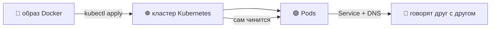
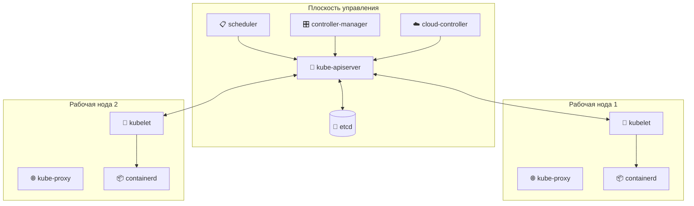
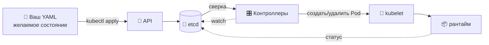
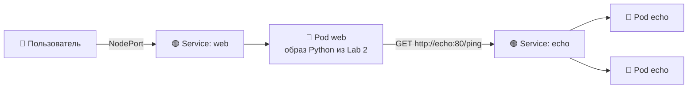
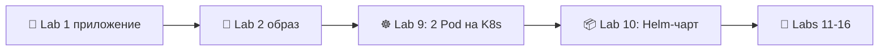

# 📌 Lecture 9 — Основы Kubernetes: оркестрация контейнеров

## 📍 Слайд 1 – ☸️ Добро пожаловать в Kubernetes

* 🌍 **Lectures 2 и 7-8 дали вам образ Docker, логи и метрики.** Теперь оркестрируем.
* 🚢 **Kubernetes (K8s)** = де-факто оркестратор контейнеров, родился в Google в 2014, запускает образ в масштабе, сам себя чинит, катит вперёд и откатывает назад
* 🎯 Эта лекция: модель в голове и ровно столько API, чтобы выкатить образ из Lab 2 как настоящую *cloud-native* нагрузку
* 🔗 **Связка с Lab 9:** поднимете локальный кластер на **k3d** (k3s-in-Docker), задеплоите два Pod (ваш Python-сервис и готовый Go echo из plumbing) и познакомитесь с ними через `Service` и kube-DNS



---

## 📍 Слайд 2 – 🎯 Результаты

| # | Результат |
|---|---------|
| 1 | 🧠 Объяснить, зачем нужна оркестрация и какие задачи Compose не закрывает |
| 2 | 🏗️ Читать и писать манифесты `Pod`, `Deployment`, `ReplicaSet`, `Service`, `Namespace` |
| 3 | 🛠️ Рулить кластером через `kubectl`: `get`, `describe`, `logs`, `exec`, `apply`, `port-forward` |
| 4 | 🔗 Понять связку label/selector (метка и селектор) — клей каждого ресурса K8s |
| 5 | 🌐 Понимать kube-DNS и сеть между сервисами (*весь смысл* двух Pod) |
| 6 | 🩺 Настроить пробы liveness, readiness и startup |

**Стек зафиксирован на май 2026:** Kubernetes **1.36** "Haru" (вышел 22 апреля 2026), **kubectl 1.36**, **k3d 5.7+** (k3s-in-Docker — стандартный локальный кластер курса), манифесты в обычном YAML (Helm — следующая лекция).

---

## 📍 Слайд 3 – ❓ Почему Compose перестаёт хватать

Вы выкатили один Python-сервис (Labs 1-2), прогнали его через CI (Lab 3), подняли VM (Lab 4), настроили её (Labs 5-6) и смотрели логи и метрики (Labs 7-8). Один сервис, один хост, `docker compose up`. Почему на этом история не кончается?

* 💀 **Самовосстановления нет.** Умер хост — умер сервис. Рестарт? Это вы.
* 📈 **Горизонтального масштабирования нет.** Вырос трафик, нужна вторая копия? Второй `docker run` руками и nginx перед ними.
* 🔄 **Rolling update нет.** Выкладка = stop / start. Есть простой.
* 🌐 **Service discovery нет** (сервисы не находят друг друга по имени). Двум сервисам на двух хостах нужна склейка из IP и порта, её ведёте вы.
* 🛡️ **Изоляции ресурсов между тенантами нет.** Compose — это «один проект на каталог», а не «десять команд в кластере».

Kubernetes закрывает все пять. Кривая обучения при этом круче.

> 🔥 **Трезвый взгляд:** для одного маленького сервиса Compose *по-прежнему* правильный ответ. K8s — когда сервисов ≥ 3, окружений несколько или самовосстановление нужно в 3 часа ночи.

---

## 📍 Слайд 4 – 📜 Коротко об истории

* 📅 **2003** — Google запускает **Borg** внутри. Большинство инженеров пользуются им каждый день. Снаружи Google о нём не знает никто.
* 📅 **2014 (июнь)** — Google открывает исходники Kubernetes, идейного наследника Borg. Joe Beda, Brendan Burns, Craig McLuckie — исходная команда.
* 📅 **2015** — анонс **Kubernetes 1.0**. Основали CNCF (Cloud Native Computing Foundation), первый проект — K8s.
* 📅 **2016-2017** — *"Kubernetes the Hard Way"* (Kelsey Hightower) становится обязательным чтением. Появляются Helm, ArgoCD, Istio.
* 📅 **2018** — CNCF даёт Kubernetes статус graduated. Управляемые сервисы (EKS, GKE, AKS) взрослеют.
* 📅 **2020** — K8s снимает Docker с роли runtime (ходит в **containerd** напрямую). Ваши *образы* по-прежнему работают: это OCI.
* 📅 **2024-2025** — Sidecar-контейнеры выходят в GA (1.29 → 1.33). Pod security admission заменяет PodSecurityPolicy (того больше нет).
* 📅 **2026 (22 апреля)** — Kubernetes **1.36 "Haru"** — 70 доработок: 18 выходят в Stable, 25 входят в Beta, 25 новых Alpha. Фокус: укрепление безопасности, поддержка нагрузок AI/ML, масштабируемость API.

> 📖 *Kubernetes Up & Running* (Burns, Beda, Hightower) — стандартная книга для входа в тему. 3-е издание (2022) на уровне API для 1.36 всё ещё точное.

---

## 📍 Слайд 5 – 🏗️ Архитектура: плоскость управления и ноды



* 🚪 **kube-apiserver** — единственный компонент, с которым говорят клиенты (и остальные компоненты control plane). RESTful gRPC поверх HTTP.
* 💾 **etcd** — источник правды. Здесь каждый Pod, каждый Secret, каждая метка. (DR планируйте вокруг него.)
* 📋 **scheduler** — выбирает ноду для Pod в Pending.
* 🎛️ **controller-manager** — крутит циклы сверки (reconciliation): контроллер ReplicaSet, контроллер Node и т.д. Движок «подгони реальность под желаемое состояние».
* 🧠 **kubelet** — агент ноды. Говорит с runtime (containerd) и отдаёт в API статус ноды и Pod.
* 🌐 **kube-proxy** — прописывает правила iptables/IPVS/nftables, чтобы виртуальные IP `Service` вели на живые Pod.

> 🤔 **Подумайте:** что, если etcd потеряет кворум? *(Ответ: кластер замирает. Новых Pod нет, удалений нет. Уже запущенные продолжают работать.)*

---

## 📍 Слайд 6 – 🎯 Декларативная модель

Вы не говорите Kubernetes, *что делать*. Вы говорите, *чего хотите*. Control plane добирает остальное: сверяет **желаемое состояние** (ваш YAML) с **наблюдаемым состоянием** (что реально запущено).



* ✏️ Вы **правите** YAML и делаете `kubectl apply`. Всё.
* 🔁 Контроллеры непрерывно закрывают разрыв между желаемым и наблюдаемым.
* 🛡️ Убили Pod руками? Контроллер ReplicaSet поднимет другой за секунды.

> 📚 **Та же модель, что у Terraform** (Lec 4): декларативный IaC, а цикл сверки *зашит в саму платформу*.

---

## 📍 Слайд 7 – 🟢 Pod — атом K8s

**Pod** — один или несколько контейнеров с общим сетевым namespace и общими томами. Их планируют вместе, жизненный цикл тоже общий.

```yaml
apiVersion: v1
kind: Pod
metadata:
  name: hello-pod
  labels:
    app: hello
spec:
  containers:
    - name: web
      image: ghcr.io/innodevops/lab2-app:v1.0.0
      ports:
        - containerPort: 8080
```

Факты:
* 🆔 У каждого Pod свой IP. Другие Pod кластера до него достучатся.
* 💥 Pod **смертны**. Умирают, их планируют заново, IP меняются. *Никогда* не опирайтесь на IP Pod снаружи.
* 📦 Несколько контейнеров в одном Pod — паттерн **sidecar** (агент логов, прокси, init-помощник).
* 🏷️ **Метки** (labels) — так любой другой ресурс находит этот Pod.

> ⚠️ **Антипаттерн:** запускать Pod напрямую. Первая перезагрузка ноды — и его нет. Всегда оборачивайте контроллером (Deployment / StatefulSet / DaemonSet / Job).

---

## 📍 Слайд 8 – 🎁 Deployment и ReplicaSet — как это реально запускают

**Deployment** объявляет *N Pod по заданному шаблону*. Под капотом он ведёт **ReplicaSet** (напрямую ReplicaSet почти не трогают).

```yaml
apiVersion: apps/v1
kind: Deployment
metadata:
  name: hello
spec:
  replicas: 3
  selector:
    matchLabels:
      app: hello
  template:
    metadata:
      labels:
        app: hello
    spec:
      containers:
        - name: web
          image: ghcr.io/innodevops/lab2-app:v1.0.0
          ports: [{containerPort: 8080}]
          resources:
            requests: {cpu: 100m, memory: 64Mi}
            limits:   {cpu: 500m, memory: 256Mi}
```

* 🔄 `kubectl set image deployment/hello web=…:v1.0.1` → **rolling update** (по умолчанию: 25% maxUnavailable, 25% maxSurge)
* ⏪ `kubectl rollout undo deployment/hello` → откат к предыдущему ReplicaSet
* 📈 `kubectl scale deployment/hello --replicas=10` → больше реплик

> 🔥 **Резкий тезис:** любая «современная» stateless-нагрузка в K8s — это Deployment + Service. Освойте эту пару — и поймёте 70% операций в кластере.

---

## 📍 Слайд 9 – 🌐 Service — стабильный адрес у движущейся цели

Pod приходят и уходят, IP меняются. **Service** — стабильный виртуальный IP и DNS-имя. Он балансирует нагрузку по всем Pod, которые попали в селектор.

```yaml
apiVersion: v1
kind: Service
metadata:
  name: hello
spec:
  type: ClusterIP   # default — internal only
  selector:
    app: hello
  ports:
    - port: 80
      targetPort: 8080
```

| Тип | Откуда доступен | Когда брать |
|------|---------------------|-------------|
| **ClusterIP** | Только внутри кластера | Трафик между сервисами (по умолчанию) |
| **NodePort** | IP каждой ноды:30000-32767 | Dev и быстрый доступ снаружи |
| **LoadBalancer** | Облачный провайдер поднимает внешний LB | Внешний прод-трафик на управляемом K8s |
| **ExternalName** | DNS CNAME на внешний хост | Миграция и прокси на легаси |

* 🌐 Внутри кластера имя `hello.default.svc.cluster.local` (коротко: `hello`) резолвится в ClusterIP
* ⚖️ `kube-proxy` прописывает правила iptables/IPVS. Трафик идёт round-robin по здоровым Pod
* 🚪 Для HTTP снаружи берите `Ingress` или `Gateway API` (бонус Lab 9 и Lab 13)

---

## 📍 Слайд 10 – 🔗 Почему два Pod вдруг имеют смысл

До Lab 8 у вас был **один** сервис. `Service` и kube-DNS казались лишними: «зачем стабильный IP одной штуке?»

**Lab 9 добавляет ВТОРОЙ сервис** (маленький Go-компаньон «echo», курс поставляет его как plumbing в `app_go_echo/`). Картина другая:



И вдруг:
* 🌐 **kube-DNS делает настоящую работу** — `echo` резолвится в ClusterIP с балансировкой
* ⚖️ **Service балансирует** по двум Pod `echo`. Убейте один — трафик идёт дальше
* 🏷️ **Метки решают** — по `app=echo` сервис `Service: echo` находит цели, на какой бы ноде они ни сели
* 🩺 **Пробы начинают отрабатывать себя** — readiness-проба Pod `web` может упасть, если `echo` лежит (зависит от того, как свяжете)

> 🔗 **В этом учебный смысл Lab 9.** Второй сервис не для галочки. Это самая маленькая топология, где «сетевая модель K8s» перестаёт быть абстракцией.

---

## 📍 Слайд 11 – 🏷️ Метки и селекторы — клей

Метки — пары ключ/значение на любом объекте K8s. Селекторы ищут объекты по меткам. **Почти каждый контроллер работает через селектор**:

* 🎁 `Deployment.spec.selector` → ищет Pod, которыми владеет
* 🌐 `Service.spec.selector` → ищет Pod, куда шлёт трафик
* 🛡️ `NetworkPolicy.podSelector` → ищет Pod, которые фильтрует
* 📊 `ServiceMonitor.spec.selector` → ищет сервисы для scrape (Lab 16)

```yaml
metadata:
  labels:
    app: hello                   # 🎯 functional
    version: v1.2.3              # 📌 release tracking
    env: prod                    # 🚦 environment
    team: payments               # 🤝 ownership
    tier: backend                # 🧱 architecture role
```

```bash
kubectl get pods -l app=hello,env=prod         # 🎯 AND selector
kubectl get pods -l 'tier in (frontend,api)'   # 🔀 set-based selector
```

> 🔥 **Соглашение:** берите `app.kubernetes.io/name`, `app.kubernetes.io/version`, `app.kubernetes.io/managed-by` — пространство рекомендуемых меток. Helm и ArgoCD ставят их сами.

---

## 📍 Слайд 12 – 🛠️ kubectl — набор на каждый день

Это команды на каждый день. Выучите наизусть.

```bash
kubectl get pods,svc,deploy -A              # 🔍 list everything across all namespaces
kubectl get pod hello-abc -o yaml           # 📄 show full manifest
kubectl describe pod hello-abc              # 🩺 events + state details — your debugging starting point
kubectl logs hello-abc -f                   # 📋 tail logs; -c <container> for multi-container pods
kubectl logs hello-abc --previous           # ⏪ logs from the previous (crashed) container
kubectl exec -it hello-abc -- /bin/sh       # 🐚 shell into the pod
kubectl port-forward svc/hello 8080:80      # 🚪 tunnel a service to localhost
kubectl apply -f manifest.yaml              # ✏️ create/update declaratively
kubectl delete -f manifest.yaml             # 🗑️ delete what's in that file
kubectl rollout status deploy/hello         # 📊 watch a rolling update
kubectl rollout undo deploy/hello           # ⏪ revert to previous ReplicaSet
kubectl top pod                             # 📊 live CPU/mem (needs metrics-server)
```

> 🔧 **Совет по настройке:** `alias k=kubectl` и `kubectl completion bash` (или zsh). Схема прямо в терминале: `kubectl explain pod.spec.containers`.

---

## 📍 Слайд 13 – 💻 Локальные кластеры на k3d

Прод-K8s живёт на управляемых сервисах (EKS, GKE, AKS). Для учёбы и CI нужен кластер на ноутбуке. **На курсе стандарт — k3d**: он заворачивает **k3s** (лёгкий Kubernetes от Rancher, с сертификатом CNCF) в контейнеры Docker.

```bash
k3d cluster create devops \
  --image rancher/k3s:v1.36.1-k3s1 \
  --agents 2 \
  -p "8080:80@loadbalancer" -p "8443:443@loadbalancer"
```

Почему k3d, а не остальные:
* ⚡ **Быстрее и легче всех.** Кластер поднимается за секунды. По размеру куда меньше, чем VM minikube.
* 🧱 **Multi-node бесплатно.** `--agents N` добавляет worker-контейнеры, и видно, как Pod садятся на разные ноды.
* 🔋 **Из коробки.** Встроенные ingress **Traefik** и LoadBalancer **klipper**: `Ingress` и `type: LoadBalancer` работают без отдельной установки.
* 🔁 **Одноразовый.** `k3d cluster delete devops` — и с чистого листа.

> 💡 **Компромисс:** k3d гоняет k3s. Тот срезает часть старых API и везёт **Traefik** (не ingress-nginx) плюс klipper-lb. В этом курсе разницы не видно. Вылезает она только в `ingressClassName: traefik`. Встроенный K8s из Docker Desktop не берите: он отстаёт от upstream.

---

## 📍 Слайд 14 – 📦 Namespace — мультитенантность внутри кластера

**Namespace** ограничивает область большинства ресурсов (Pod, Service, ConfigMap, Secret, Deployment). Так кластер делят между командами и окружениями.

```bash
kubectl create namespace dev
kubectl apply -f manifest.yaml -n dev       # 🧱 deploy into dev
kubectl get pods -n dev                     # 🔍 list pods in dev
kubectl config set-context --current --namespace=dev   # 🎯 stick to dev
```

Они есть в каждом кластере:
* `default` — сюда падает всё, если не сказали, куда
* `kube-system` — компоненты control plane (не трогать)
* `kube-public` — читают все; в основном сведения о кластере
* `kube-node-lease` — heartbeat нод

> 🚫 **Антипаттерн:** держать всё в `default`. На приложение или окружение — свой namespace.

---

## 📍 Слайд 15 – ⚖️ Requests, Limits и QoS

Каждый контейнер объявляет **requests** (столько scheduler резервирует) и **limits** (за этим краем ядро убивает процесс).

```yaml
resources:
  requests:
    cpu: 100m       # 0.1 of a CPU core
    memory: 64Mi
  limits:
    cpu: 500m       # 0.5 core; CPU is *throttled* past this, not killed
    memory: 256Mi   # memory is *killed* (OOMKill) past this
```

| Класс | Requests и Limits | Приоритет вытеснения |
|-------|--------------------|--------------------|
| **Guaranteed** | requests == limits, все контейнеры | вытесняют последним |
| **Burstable** | requests < limits | посередине |
| **BestEffort** | нет ни requests, ни limits | вытесняют первым |

> ⚠️ **Правило для прода:** всегда ставьте requests на CPU и память. Лимит памяти ставьте жёстко, лимит CPU — *только* когда шумный сосед мешает чужим нагрузкам. Троттлинг CPU часто тихо убивает латентность.

---

## 📍 Слайд 16 – 🩺 Пробы: liveness, readiness, startup

K8s проверяет здоровье Pod тремя пробами. **Они не заменяют друг друга.**

```yaml
livenessProbe:    # 💀 if this fails, restart the container
  httpGet: {path: /healthz, port: 8080}
  initialDelaySeconds: 15
  periodSeconds: 10
readinessProbe:   # 🚦 if this fails, take the pod out of Service rotation (don't restart)
  httpGet: {path: /ready, port: 8080}
  periodSeconds: 5
startupProbe:     # 🐢 for slow-starting apps; disables the other two until it passes once
  httpGet: {path: /healthz, port: 8080}
  failureThreshold: 30
  periodSeconds: 10
```

* 💀 **Liveness** = «меня убить и перезапустить?» Дедлоки, не короткие сбои.
* 🚦 **Readiness** = «трафик ко мне прямо сейчас?» Прогрев и падение зависимостей.
* 🐢 **Startup** (с 1.16, GA в 1.20) = «дай длинное окно на старт, без флапа»

> 🔥 **Частая ошибка:** `livenessProbe: /` на основной HTTP-корень. Приложение тормозит под нагрузкой, K8s его перезапускает, становится хуже. Liveness — это проверка *дешёвого сигнала внутри процесса*.

---

## 📍 Слайд 17 – ✨ Что нового в Kubernetes 1.36 "Haru"

Вышел 22 апреля 2026. Что стоит помнить:

* 🛡️ **Pod Security Admission (PSA)** взрослеет дальше. Это замена давно снятому PodSecurityPolicy.
* 🤖 **Нагрузки AI/ML.** Device Resource Allocation API, более удобные примитивы, чтобы делить GPU (alpha → beta).
* 📈 **Масштабируемость API.** Кэш apiserver лучше, на больших кластерах нагрузка на control plane падает.
* 🧱 **Sidecar-контейнеры** (`restartPolicy: Always` на init-контейнерах). GA с 1.33. Стандарт в стеках наблюдаемости (Alloy, Istio).
* 🚫 **Ушло насовсем:** несколько старых API `v1beta1` продолжают уходить.
* 📦 **Image volumes** (alpha): OCI-образ монтируется как том только для чтения. Удобно для ML-моделей.

Политика N-2: кластеры на **1.34, 1.35, 1.36** в обычной поддержке. **1.33 ушёл в расширенную поддержку** с апреля 2026.

> 📚 **Источник:** [блог о релизе Kubernetes 1.36](https://kubernetes.io/blog/2026/04/22/kubernetes-v1-36-release/).

---

## 📍 Слайд 18 – ☁️ Прод: управляемый или свой

| Подход | Примеры | Когда |
|----------|----------|------|
| ☁️ **Управляемый** | EKS (AWS), GKE (Google), AKS (Azure), DOKS, OKE | 99% команд: control plane ведёте не вы |
| 🪛 **Свой, на VM** | kubeadm + Ansible, kops, RKE2, Talos | Air-gapped, регуляторика, цена или сильная экспертиза K8s в штате |
| 🚫 **С нуля, своими руками** | "Kubernetes the Hard Way" (Hightower) | Только учёба. В проде так не запускают |

**Реалистичная цена (май 2026):** пустой управляемый кластер на 3 ноды (control plane и 3× маленьких worker) выходит примерно в **$200-300/месяц** на AWS или GCP, входной тариф. С автоскейлингом и постоянными томами цена растёт быстро.

> 🔥 **Резкий тезис:** если у CIO нет конкретной причины, берите управляемый кластер. Control plane — самая грязная часть. Отдайте её облаку.

---

## 📍 Слайд 19 – 🌍 Kubernetes вживую

* 🎬 **Netflix** на самом деле до ~2019 сидел на Mesos. Сейчас ~1000 микросервисов на K8s.
* 💬 **GitHub:** runner'ы Actions — эфемерные Pod K8s, ~100 млн запусков Pod в месяц.
* 🏦 **Goldman Sachs:** внутренняя торговая платформа «Marquee» на K8s, тысячи кластеров.
* 🇨🇳 **Alibaba** держит кластеры K8s по **>10,000** нод. Патчи по масштабированию ушли в upstream.
* 🛰️ **SpaceX:** сервисы наземных станций Starlink работают на K8s.

> 📊 **CNCF Annual Survey 2024:** 96% организаций используют Kubernetes или оценивают внедрение. Война оркестраторов закончилась. Победил K8s.

---

## 📍 Слайд 20 – 🎯 Главное

1. ☸️ **Kubernetes — декларативная оркестрация.** Вы описываете желаемое состояние, контроллеры сверяют.
2. 🟢 **Pod = минимальная единица выкладки. Deployment = как это реально запускают. Service = как до этого достучаться.**
3. 🏷️ **Метки — клей.** Каждый контроллер связывается селектором.
4. 🌐 **Service + kube-DNS — главная фича.** Смысл появляется, когда сервисов ≥ 2. Ровно это собирает Lab 9.
5. 🩺 **Пробы не заменяют друг друга.** Liveness перезапускает. Readiness решает, пускать ли трафик. Startup покупает время на прогрев.
6. ⚖️ **Requests ставьте всегда. С limits — точечно.** Троттлинг CPU тихий и болезненный.
7. 🪨 **Локально курс берёт k3d** — k3s-in-Docker: быстро, multi-node, всё в комплекте.

> 💡 **Цепочка:** YAML → API → etcd → контроллеры → kubelet → containerd → ваш контейнер. Любая загадка K8s сводится к ней.

---

## 📍 Слайд 21 – 🧠 Сдвиг в голове

| 😰 До K8s | ☸️ Как в K8s |
|---------|---------|
| «Зайти по SSH и перезапустить сервис» | `kubectl rollout restart deployment/...` |
| «Добавить инстанс? Править nginx и файл Compose» | `kubectl scale deploy/... --replicas=N` |
| «Какой IP у прода?» | «DNS-имя — `svc.namespace`» |
| «Нужен балансировщик» | «Это `Service`» |
| «Новый разработчик = README на 3 страницы» | `git clone && kubectl apply -k overlays/dev` |
| Самодельные health-проверки по cron | Пробы — полноправная часть манифеста |

---

## 📍 Слайд 22 – 🚀 Что дальше

**📚 Следующая лекция: *Менеджер пакетов Helm (Helm 4)*** — сырой YAML на каждое окружение не масштабируется.

* 📦 Зачем Helm (DRY для манифестов K8s)
* 🧱 Анатомия Helm-чарта: `Chart.yaml`, `values.yaml`, `templates/`, `_helpers.tpl`
* 🎨 Шаблоны Go и функции Sprig
* 🪝 Хуки: pre-install, post-upgrade и дальше
* 🆕 Helm **4.1** — что изменилось по сравнению с Helm 3 и почему в Lab 10 берём 4

**🔬 Что сдать в Lab 9:**
* Поднимите кластер k3d (1 server + 2 agents)
* Задеплойте образ Python из Lab 2 как Deployment
* Добавьте готовый Go-сервис echo (plumbing)
* Свяжите оба через `Service` и проверьте `curl http://echo:80/ping` изнутри Python-Pod
* Бонус 2 балла: включите Ingress с TLS-сертификатом (домен NIP.io или самоподписанный)



> 🌊 От одного контейнера к кластеру — по одному манифесту.

---

## 📚 Ресурсы

* 📕 *Kubernetes Up & Running* (3e, 2022) — Burns, Beda, Hightower (на уровне API для 1.36 всё ещё точно)
* 📕 *Kubernetes in Action* (2e, 2023) — Marko Lukša (Manning)
* 📕 *Programming Kubernetes* — Hausenblas & Schimanski (O'Reilly, 2019) — если пишете контроллеры
* 🎥 *Kubernetes the Hard Way* — Kelsey Hightower (бесплатно, GitHub) — поставьте K8s сами, один раз
* 🌐 [kubernetes.io/docs](https://kubernetes.io/docs/) — официальная документация, раздел concepts отличный
* 🌐 [заметки к релизу Kubernetes 1.36](https://kubernetes.io/blog/2026/04/22/kubernetes-v1-36-release/)
* 🌐 [learnk8s.io](https://learnk8s.io/) — наглядные разборы по сценариям (Daniele Polencic)
* 🌐 [CNCF Cloud Native Landscape](https://landscape.cncf.io) — карта всех инструментов экосистемы

**🎓 Квиз:** квиз после лекции попадает в окно таблицы лидеров за недели 7-9.
